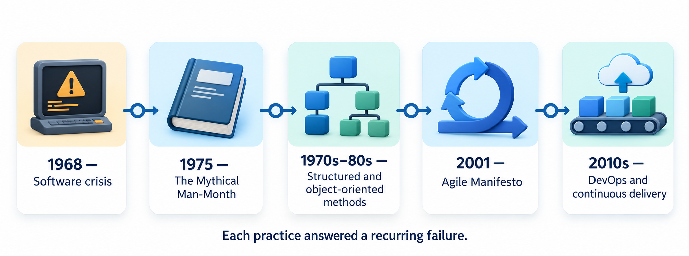
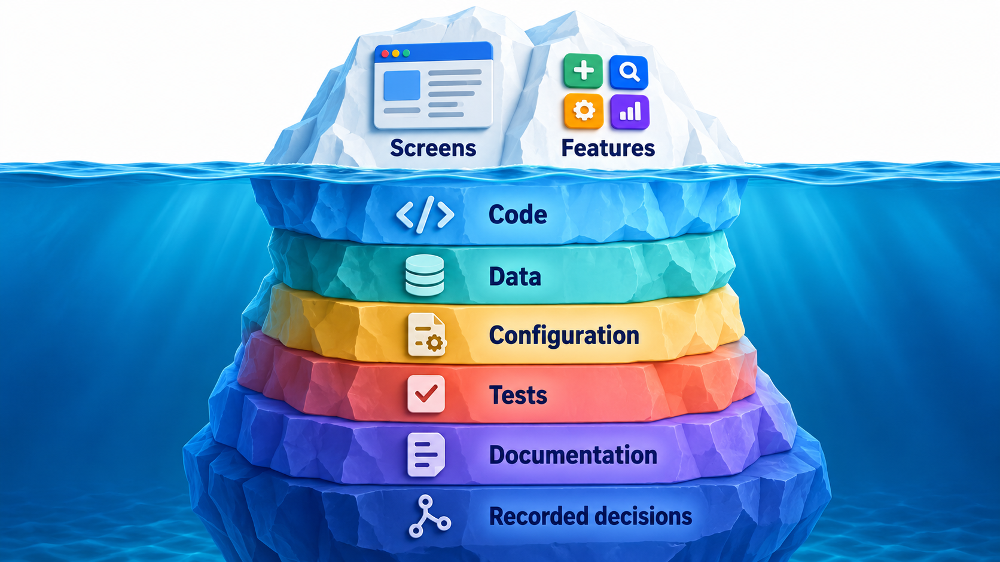
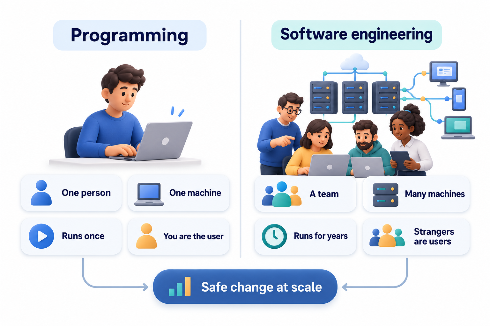
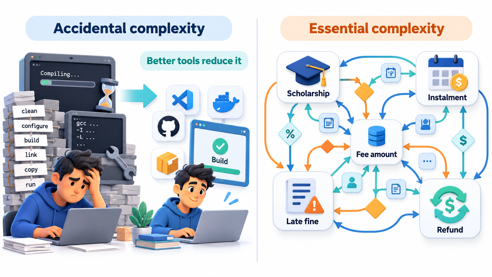
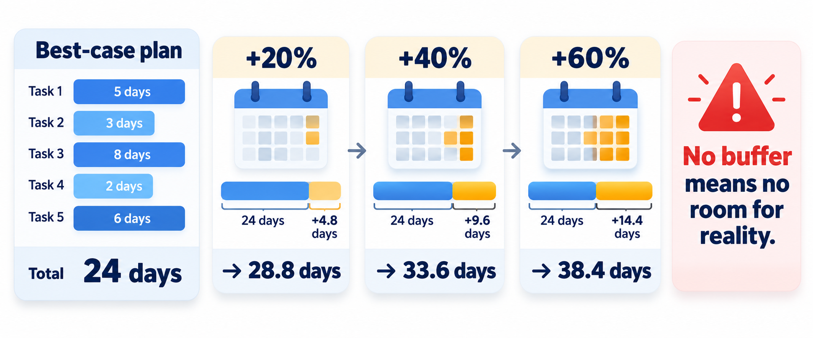
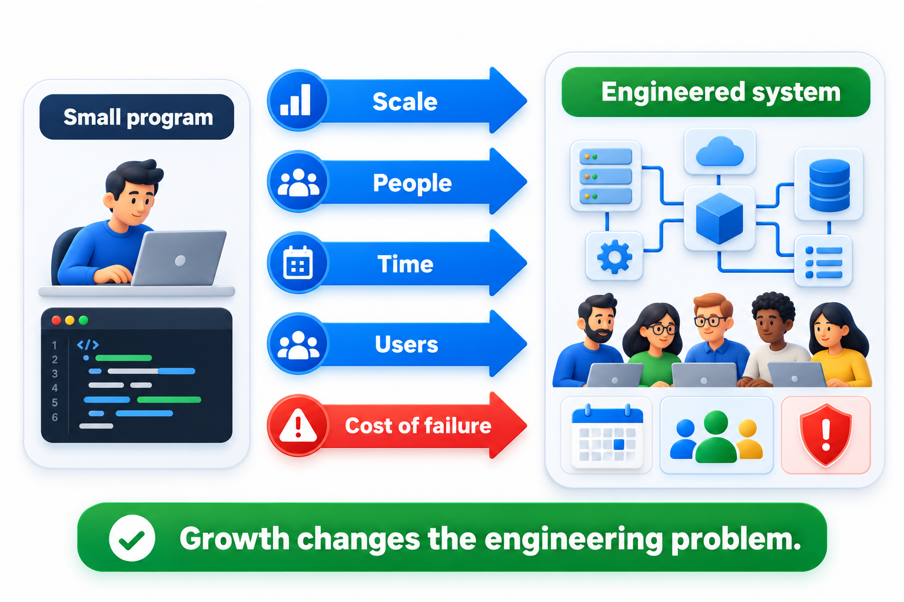
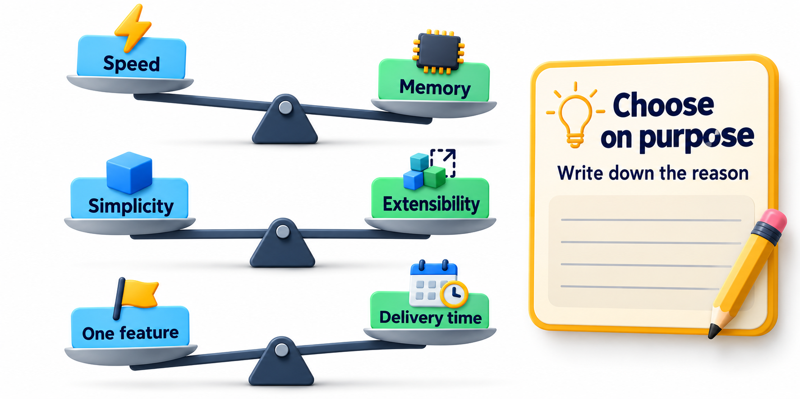

## Software You Can Neither See Nor Weigh

Open any app and there is nothing in it to touch, weigh or walk through. Yet a cancelled flight, an empty bank balance or a locked classroom door can be traced back to it. Software is invisible and still decisive, and that combination is why it has a discipline of its own. **Software engineering** is the practice of making the many decisions behind a piece of software deliberately and as a team, so that it can be built, changed and trusted over a long life.

The phrase contains two ideas that are easy to separate and important to hold together. *Software* is the thing: instructions, data and the knowledge needed to use them. *Engineering* is the manner: the application of knowledge, method and judgement to produce something that works reliably, within limits of time, money and risk, for people who depend on it. A person can write software without engineering it, in the same way that a person can build a shed without being a civil engineer. The shed may stand for years. But nobody would cross a river on a bridge built the same way.

A common definition describes software engineering as the application of a **systematic, disciplined and measurable** approach to developing, operating and maintaining software. Each of the three words rules out a particular kind of failure.

- **Systematic** means the work follows known practices and not improvisation. Two teams given the same problem should be able to describe how they went about it, and why. Without it, success depends on who happened to be in the room, and cannot be repeated.
- **Disciplined** means those practices are kept up when a deadline is close. A method that is dropped under pressure was never really a method. Discipline is what separates a team that has a testing policy from a team that tests when it has time.
- **Measurable** means a team can tell whether it is succeeding by something other than a feeling: how many defects reach users, how long a change takes, how often releases fail. What cannot be measured cannot be steadily improved, and it cannot be honestly reported to the people paying for it.

Notice that the definition covers *developing, operating and maintaining*. Building the first version is the beginning of the story. Most of the life of successful software is spent being run, repaired and changed, and engineering is concerned with all of it.

## Where the Discipline Came From

The idea that building software deserves a discipline of its own was stated openly in 1968, when a NATO conference on large software projects gave the field its name. Participants were worried by a pattern they were all seeing: software projects arrived late, cost more than planned, did not do what users needed, and broke in use. Hardware was becoming more powerful quickly, and with it the ambition of the programs people wanted, but the methods for building those programs had not kept pace. The situation was called the *software crisis*. The word *engineering* was chosen on purpose, to suggest the standards expected of bridge building or chemical plants.

The crisis was never solved once and for all. It was answered, piece by piece, over the following decades. When programs became too tangled to follow, structured programming and modularity were developed. When systems became too large for one design, object orientation and architecture grew up. When requirements kept changing, iterative and agile methods spread. When releases were slow and dangerous, continuous integration and DevOps appeared. Each practice you will meet in this course can be read as an answer to a recurring failure, and understanding the failure makes the practice easier to remember and to judge.

<!-- Visual: a timeline from the 1968 conference through structured programming, object orientation, agile and DevOps, each marked with the recurring problem it answered. -->

## Software Is More Than Code

Beginners tend to picture software as a file of instructions. A working product is a good deal more. Everything that must exist, and be kept consistent with everything else, for the software to do its job counts as part of it.

| Part of a software product | What it is | What goes wrong if it is neglected |
| --- | --- | --- |
| Program code | The instructions that run | Defects, slow performance, code nobody can change |
| Data and data structures | What the program stores and exchanges | Lost or corrupted records, formats that cannot be extended |
| Configuration | Settings that differ between machines and environments | The product works on one machine and fails on another |
| Documentation | Descriptions for users, operators and future developers | Nobody can install, use or safely modify it |
| Tests | Checks that record what the software is meant to do | Changes break old behaviour without anyone noticing |
| Knowledge in people's heads | Why things are the way they are | The team cannot explain or repair its own system when a key person leaves |

A great deal of engineering effort goes into the parts that are not the program. This is also why software is hard to judge from outside. Two products may offer the same screen to the user and differ completely in how safely they can be changed, because the difference lies in the tests, the structure and the recorded reasoning, none of which the user ever sees.

<!-- Visual: an iceberg. Above the water, the screens and features a user sees. Below the water, the code, data, configuration, tests, documentation and recorded decisions that make the product changeable. Save as images/01_software_is_more_than_code.png. -->

## Programming Is One Part of Engineering

Most people meet software by writing a program: one person, one computer, a problem that fits in a head, and a result that only has to work today. That is **programming**, and it is a genuine skill. Software engineering is what is needed when the situation changes in the following ways.

| Programming | Software engineering |
| --- | --- |
| One person writes it | A team writes it, and people join and leave |
| It runs on one machine | It runs on many machines, configurations and networks |
| You are the only user | Strangers depend on it, some of them in ways you never imagined |
| It is finished when it works once | It must keep working for years while it is changed |
| A bug costs you an evening | A bug can cost customers, money or safety |
| Quality is whether you are satisfied | Quality is agreed, measured and checked |

Notice that no row says "engineers write harder code". The difference lies in the surroundings of the code: how many people, how long, how much is at stake. A programmer who is excellent at algorithms can still fail at engineering, because failures are usually not in the algorithm. They are in a misunderstanding between two people, in a change that broke something nobody remembered, or in an assumption that stayed unwritten.

Think of the difference between cooking a meal for yourself and running a restaurant kitchen. The cook needs the same basic skill in both. The restaurant also needs a menu that customers want, ingredients that arrive on time, a way to keep the food safe, several cooks who produce the same dish the same way, and a plan for the evening when the busiest table arrives. Software engineering is the restaurant, and programming is the cooking.

<!-- Visual: one person with one program on one laptop beside a team changing a long-lived system used by many strangers on many machines. -->

## What Software Engineers Actually Do

A career in software is often imagined as typing code all day. In practice, writing code is one activity in a chain, and in many roles it takes less than half the working week. The chain below is the same for a small mobile app and a national payment system. Only the weight of each link changes.

| Activity | The question it answers | Why it is its own job |
| --- | --- | --- |
| Understand the need | What problem are we really solving, and for whom? | People rarely describe what they need in a form that can be built |
| Specify | What exactly must the system do, and how well? | Without a shared, precise description, each person builds a different system |
| Design | How will it be structured so it can be built and changed? | Structure decides how costly every later change will be |
| Build | How do we turn the design into working software? | The part most people think of as the whole job |
| Verify | Does it do what was specified, and is it right for the user? | Faults found late cost many times more than faults found early |
| Deliver | How does it reach users safely? | A release can fail even when the software is correct |
| Operate | How do we keep it running and notice when it fails? | Software that cannot be observed cannot be trusted |
| Evolve | How do we change it as the world changes? | Most of the cost of software comes after its first release |

Around this chain run activities that are less visible but just as necessary: estimating how long things will take, communicating with people who do not read code, recording decisions, managing risk and working in a team. A graduate who is surprised by how much of the job is conversation, reading and checking has usually met a real part of engineering and not a distraction from it.

## Why Software Is Hard in a Way Bricks Are Not

Fred Brooks, who managed the development of IBM's OS/360 operating system in the 1960s, wrote an essay in 1986 called "No Silver Bullet" that explains why software stays hard whatever tools arrive. He separated two kinds of difficulty.

**Accidental complexity** is difficulty that comes from our tools and methods and not from the problem. Writing in machine code instead of a high-level language, waiting an hour for a program to compile, hunting for the one machine that has the right library installed: these are accidental. Better tools remove them, and over sixty years they have removed a great many. A student today builds in an afternoon what once took a team a month.

**Essential complexity** is difficulty that is part of the problem itself. If a college fee system must handle seven kinds of scholarship, three instalment plans, a late fine that depends on the course and a refund that depends on when the student left, then somebody has to decide how all those rules interact. No programming language makes the rules go away. The rules are the problem.

Brooks argued that what remains once accidental difficulties are cleared is four properties of the essence of software.

- **Complexity.** A program has many parts that interact, and no two parts are quite alike. You cannot scale up a small program by repeating it; a system ten times larger has far more than ten times the interactions to understand.
- **Conformity.** Software must fit the existing world: other systems, laws, habits, and the whims of other people's interfaces. Physics does not change to suit a designer, but a bank's old system must be accommodated whatever its quirks.
- **Changeability.** Because software is easy to change, it is asked to change constantly, by users who would never ask a building to add a floor. Ease of change is a gift and a pressure at the same time.
- **Invisibility.** A building can be walked through. Software has no shape you can see, and diagrams of it show only one angle at a time, so a team has to work hard to keep a shared picture in everyone's head.

Compare this with a physical product. A bridge is limited by the strength of its materials, the cost of each part and the fact that it can only be built once on one site. Those limits constrain the designer and also protect them: they rule out many bad ideas early. Software has almost none. Copying costs nothing, there is no weight to carry and the structure can be rearranged at will. The result is that software projects take on problems of a size and tangle that physical engineers would never attempt, with very little to stop the tangle from growing.

The practical lesson is humility. Tools help, and engineers should use them. But no new framework will make the essential difficulty vanish. The work that remains is thinking: understanding what people need, deciding how the rules interact, and arranging the software so that it survives being changed.

<!-- Visual: a two-column picture. Left, accidental complexity (slow tools, awkward languages, manual builds) shrinking over time as tools improve. Right, essential complexity (business rules, interactions between rules, changing demands) staying the same size. -->

## Complexity That Doubles With Every Rule

Essential complexity grows in a way that no tool changes. Suppose an online ticket counter has several independent rules for the price: a student discount, a senior-citizen discount, a festival offer, a coupon code. Each rule can be on or off for a given customer, so every new rule doubles the number of situations the team must think about.

| Independent pricing rules | Combinations of rules to get right |
| --- | --- |
| 1 | 2 |
| 2 | 4 |
| 3 | 8 |
| 5 | 32 |
| 8 | 256 |
| 10 | 1,024 |

One rule can be held in mind. Five rules have 32 situations, which is a lot to check by hand. Ten rules have over a thousand, and nobody can try them all. The count comes from the business and not from the programming language, which is what *essential* means. In real systems most combinations never occur, and good design shrinks the number that need attention. That shrinking is engineering work.

Engineers have three main weapons against complexity, and the rest of this course keeps returning to them. **Abstraction** means working with a simplified view that hides detail you do not need at the moment: you use a payment service without knowing how it talks to the bank. **Decomposition** means splitting a large problem into parts small enough to understand, so that each part can be built and checked on its own. **Information hiding** means arranging the parts so that each keeps its internal decisions private, so that a change inside one part does not spread to the others. None of them removes complexity. They arrange it so that no single person, on no single day, has to face all of it at once.

## Why Plans Slip and More People Do Not Fix It

Brooks drew another lesson from OS/360: software work does not divide the way bricklaying does. A wall that is late can be finished sooner by adding bricklayers, because a wall splits cleanly. Software mostly does not. A new person has to be taught, the work has to be divided again, and every person added has more colleagues to coordinate with. The hours spent on all of that come out of the hours spent building. This is the idea behind **Brooks's law**: adding people to a late software project tends to make it later.

The cost of coordination grows quickly because the number of conversations grows faster than the number of people. Two people have one channel between them. Five have ten. Twenty have one hundred and ninety. Even if only a fraction of those channels are ever used, a team that doubles in size spends a good deal more than double the effort on keeping everyone in step.

It connects to the problem of estimation. A plan is usually made of best-case estimates for each task. Real work runs over in ordinary ways: a misunderstood requirement, a dependency that is not ready, a fault in a tool. Because every task slips a little and the slips add up, a plan with no buffer almost always finishes late. Engineering therefore treats estimates as ranges, keeps visible buffers and expects change. An honest estimate sounds like "between six and ten weeks, most likely eight", not "six weeks".

<!-- Visual: a best-case plan beside the real timeline, showing the missing buffer being consumed by coordination and uncertainty. -->

## The Five Pressures That Turn a Program Into an Engineering Problem

A short program that someone writes for themselves does not need engineering. Five pressures, which usually arrive together, change that.

1. **Scale.** The code grows from hundreds to hundreds of thousands of lines, and nobody can read it all.
2. **People.** More than one person works on it, and they must agree on how the parts fit.
3. **Time.** The software lives for years, so decisions made in a hurry are still there long after their reason is forgotten.
4. **Users.** People who are not the author use it and expect it to behave.
5. **Cost of failure.** A mistake begins to matter: it loses money, wastes hours for thousands of people, or endangers someone.

Each pressure explains a standard practice. Scale asks for modules and design. People ask for version control and code review. Time asks for tests and documentation. Users ask for requirements and usability work. Cost of failure asks for quality assurance and security practice. These practices are not arbitrary rituals; each was invented in answer to one of the five pressures.

The pressures also give a useful way to judge how much engineering a project needs. A personal script faces none of them and needs almost no process. A college fee portal faces all five at a moderate level. A hospital's medication system faces all five at a high level, and most of all the fifth. Engineering is not a single dial turned to maximum; it is a matter of matching the amount of discipline to the pressures actually present.

<!-- Visual: five arrows (scale, people, time, users, cost of failure) pushing on a small program box, which grows into a labelled engineered system. -->

## The Layers of Engineering Practice

It helps to see software engineering as layers, each resting on the one beneath.

| Layer | What it contains | The question it answers |
| --- | --- | --- |
| A focus on quality | The commitment that software must be right, not merely finished | What does "good enough" mean here, and who decides? |
| Process | The framework of activities and their order: waterfall, iterative, agile and the like | In what sequence, and with what feedback, do we do the work? |
| Methods | Techniques for each activity: how to gather requirements, model, design, test | How exactly do we carry out each step well? |
| Tools | Programs that support the methods: version control, build servers, trackers | How do we make good practice cheap and routine? |

The order matters. A team that buys tools without agreeing on methods ends up automating confusion. A team that adopts a process without a real commitment to quality produces the paperwork without the safety. The foundation is the decision that quality is a goal, and everything above it exists to deliver that goal predictably.

## Engineering Means Choosing Between Good Things

Engineers in every field live with trade-offs, and software is no exception. A faster program may use more memory. A simpler design may be harder to extend. More features take more time to deliver. A choice is not engineering unless somebody has noticed that it was a choice.

Take a college that wants a results portal ready before the exam results are published. It can build a simple version in two weeks that handles ordinary loads, or a more elaborate version in eight weeks that scales to the surge on results day. The two weeks are cheap and the risk is that the site fails on the day it matters most. The eight weeks are costly and the risk is that the results are published before the portal exists. Neither is right in general. The engineering contribution is to state the options, say what each costs and risks, choose with the decision-makers, and write down the reasoning so that it can be reviewed afterwards.

What distinguishes an engineer from an enthusiast is mostly what happens around the decision. The options are stated, the reason for the choice is recorded, and the consequences are checked later. Engineers also ask the uncomfortable question early: what happens when this goes wrong, and how much does that matter?

<!-- Visual: a balance with three pairs of competing goals (speed vs memory, simplicity vs extensibility, scope vs delivery date), and a note beside it reading "decision recorded with its reason". -->

## Responsibility Comes With the Work

Software now decides who is shown a job advertisement, whether a payment goes through, how a medical device behaves and what a driver sees on a screen. People affected by these decisions rarely see the software and cannot inspect it. They rely on the people who built it. That reliance is the reason engineering is a profession and not only a trade: practitioners are expected to put the safety and interests of the people affected ahead of convenience, to be honest about the limits of what they have built and to raise concerns when something is wrong.

This is not a separate topic added at the end. It runs through the earlier ones: honest estimates are a form of professional honesty, tests are a form of care for the user, and writing down a decision is a form of accountability. It begins with the first line of code that someone else will depend on.

## Five Misreadings of Software Engineering

**"Software engineering means writing code faster."** Typing is the cheapest part of the work. The expensive parts are understanding the need, agreeing on the design, and changing the system later without breaking it.

**"If the programmers are good enough, they do not need a process."** A brilliant team still meets the five pressures. Process is how a team keeps its brilliance from being wasted in misunderstandings, and it matters more as the team grows.

**"A better tool will make the hard part go away."** Tools remove accidental difficulty. The essential difficulty, understanding what is wanted and managing the rules, remains whichever tool is chosen.

**"More people means faster delivery."** Work can only be divided as far as the problem divides cleanly, and every extra person adds communication.

**"Engineering is bureaucracy that slows creative people down."** The aim is the opposite. Good practice takes away the avoidable disasters, such as a broken release or a forgotten requirement, so that people's energy goes into the interesting problems.
