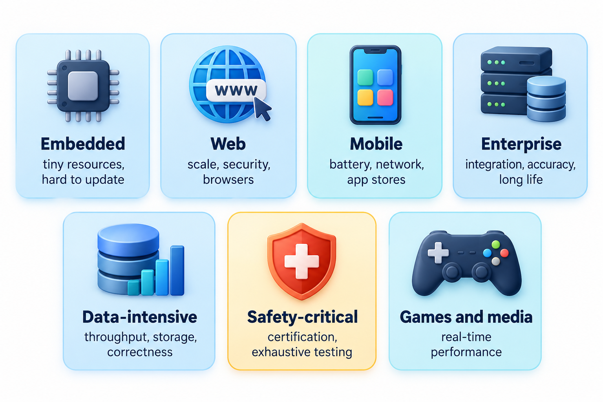
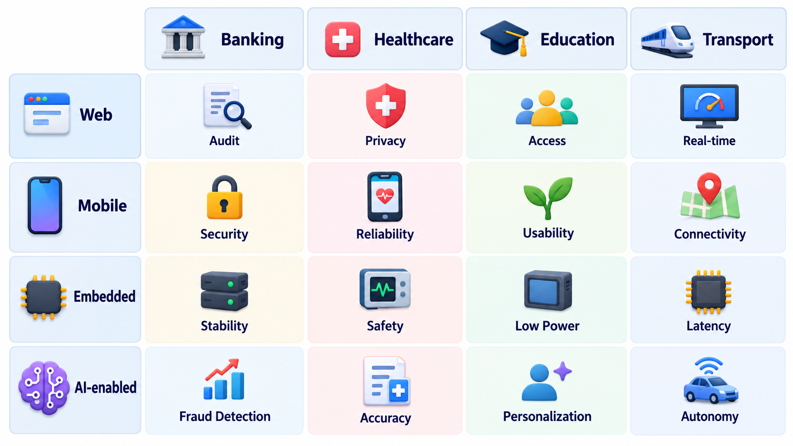
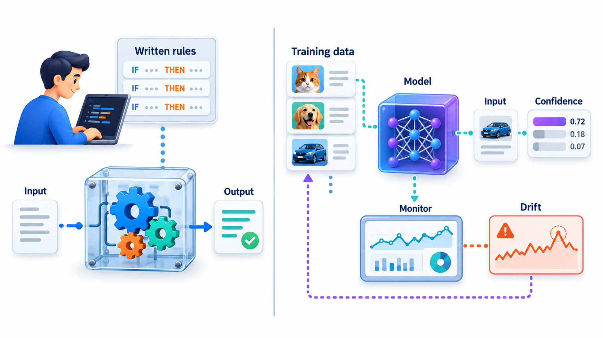
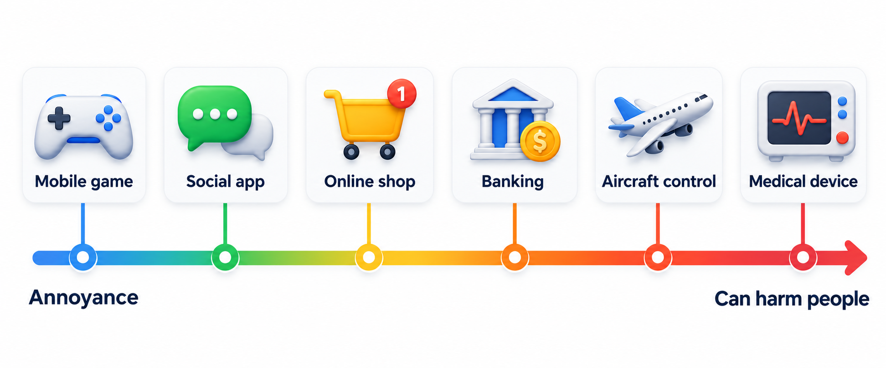
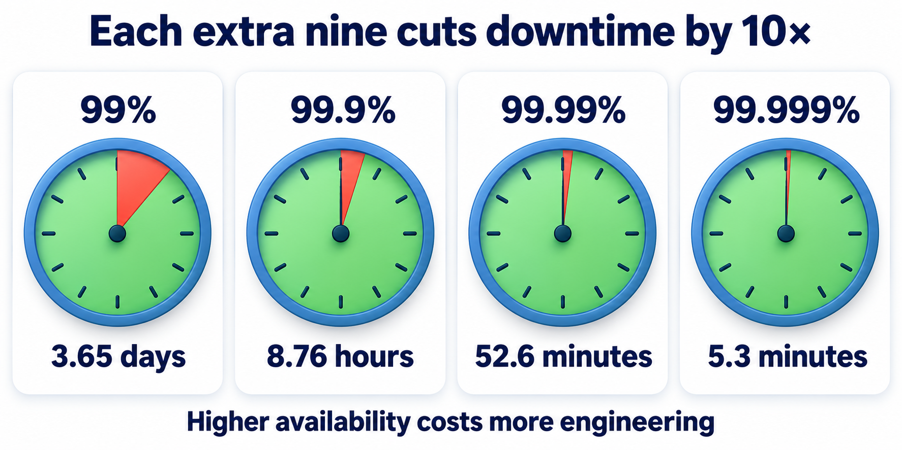
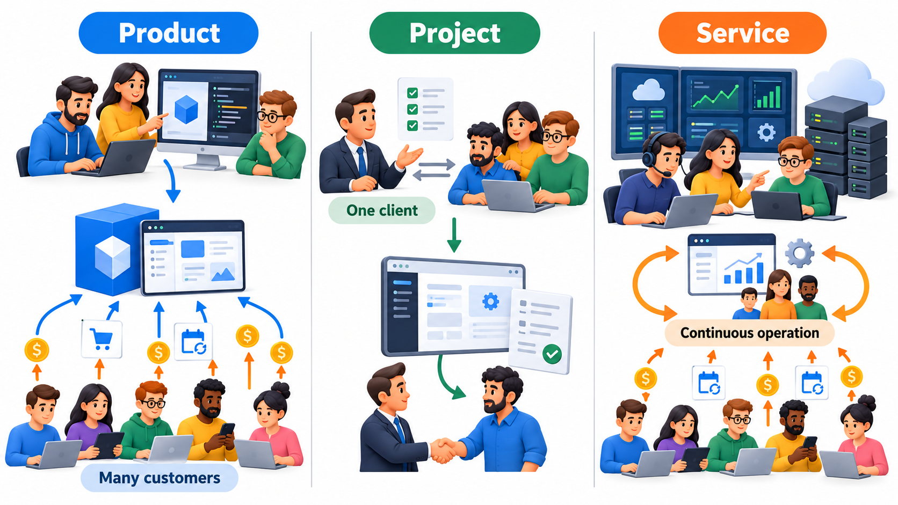
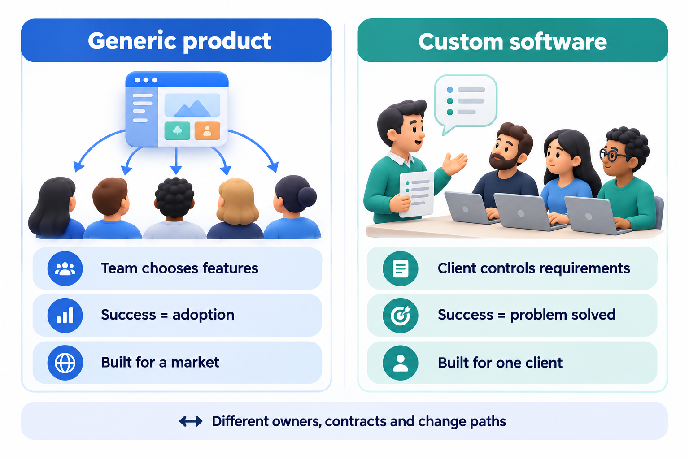

## Is a Banking App the Same Kind of Thing as a Washing-Machine Controller?

Both are software, and both are written by programmers, but almost everything else differs. One handles money for millions of people through a phone. The other sits in a few kilobytes of memory inside an appliance and can never be updated. A method of working that suits one can be wrong for the other, which is why engineers sort software into kinds before deciding how to build it. The kind tells you what failure costs, what the constraints are, who the users are, and so which practices are worth paying for.

Sorting is not an academic exercise. A new engineer who has only worked on one kind of software tends to carry its habits into another, and the habits do not always travel. A web developer used to releasing several times a day will be alarmed to learn that a car's braking software may be changed once in several years, after months of certification. An embedded engineer who treats every change with that same ceremony will find a web start-up impossibly slow. Neither is wrong; each is adapted to the pressures of its kind.

Three separate sortings are used throughout the field. The first is by *what the software does and where it runs*. The second is by *what happens when it fails*. The third is by *how the software reaches the people who pay for it*. A single piece of software has an answer to all three, and together the answers describe the engineering job better than any one alone. The sections below take each in turn, and then look at the application domains in which software is used.

## Six Kinds of Software by What They Do

The common names are *system*, *application*, *embedded*, *web*, *mobile* and *AI-enabled*. They overlap, since a banking app is both mobile and an application, but each name highlights a different set of concerns.

| Kind | What it is | Example | What dominates the engineering |
| --- | --- | --- | --- |
| **System software** | Software that runs the machine and other software | Linux kernel, a device driver, a compiler | Correctness, speed, memory, very long life |
| **Application software** | Software a person uses to do a task | A spreadsheet, a billing package, a photo editor | Usability, features, compatibility with files and data |
| **Embedded software** | Software inside a device that is not thought of as a computer | Firmware in a washing machine, a car's braking controller, an insulin pump | Tiny memory, real-time deadlines, no easy update, safety |
| **Web software** | Software that runs on servers and is used through a browser | A railway booking site, an online shop | Many simultaneous users, security, availability |
| **Mobile software** | Software that runs on a phone | A UPI payment app, a delivery tracker | Battery, patchy networks, many screen sizes, app-store rules |
| **AI-enabled software** | Software whose behaviour depends partly on a model learned from data | A spam filter, a recommendation list, a speech-to-text feature | Data quality, uncertain accuracy, fairness, monitoring after release |

Read the right-hand column as a list of worries. An embedded engineer worries about a controller with a few kilobytes of memory that cannot be patched once it ships in a million cars. A web engineer worries about a flash sale that sends a hundred times the usual traffic in one minute. A mobile engineer worries about a user on a train in a tunnel. These are different jobs, and a method that suits one can be wrong for another.

<!-- Visual: six boxes (system, application, embedded, web, mobile, AI-enabled), each with its dominant engineering concern written inside. -->

## How Each Kind Shapes the Work

**System software** sits underneath everything else, so its faults are inherited by every program above it. An operating system that mishandles memory harms every application that runs on it. For this reason system software is written conservatively, reviewed heavily, and changed slowly, and it is judged on speed and correctness more than on friendliness. Its users are mostly other programmers.

**Application software** is judged by the person using it. A spreadsheet is not praised for clean internals but for letting an accountant finish the month-end quickly, and it must open yesterday's files without complaint. The engineering concerns are usability, feature breadth and compatibility with the data people already have. Because users choose among competing applications, the pressure to add features is constant, and so is the risk that the added features make the product slow and confusing.

**Embedded software** controls a physical thing, and the physical thing sets the rules. It has a fixed amount of memory and processing power chosen to keep the device cheap. It often runs under **real-time** constraints, which means that a late answer is a wrong answer: an airbag that deploys a tenth of a second late has failed as surely as one that never deploys. It usually cannot be updated easily, so it must be right before it ships. Testing is expensive because it involves the hardware.

**Web software** runs on machines the owner controls and is used by people the owner has never met, which brings together three concerns at once. Many users arrive at the same moment, so it must scale. Anyone on the internet can try to attack it, so it must be secure. And because users expect it to be there at any hour, it must stay available. Its great advantage is that the owner can change it at any time for everyone, which makes frequent small releases possible.

**Mobile software** runs on devices the owner does not control, in the pocket of a user who is moving. The battery is limited, the connection comes and goes, screens differ in size, and each operating system and app store has its own rules. Updates depend on users choosing to install them, so old versions linger for years and must keep working against the owner's servers.

**AI-enabled software** is treated in its own section below, because it differs from the others in a more basic way: part of its behaviour is learned and not written.

## Application Domains: Where the Software Is Used

Cutting across these technical kinds is the *domain*: the field of human activity the software serves. Each domain brings its own vocabulary, its own rules and its own idea of what failure means. An engineer who understands the technology but not the domain builds the wrong thing quickly.

| Domain | Typical software | What the domain adds to the engineering |
| --- | --- | --- |
| Banking and payments | Core banking, UPI apps, card processing | Money must never be lost or created, every transaction must be traceable, and regulators audit the records |
| Healthcare | Hospital records, diagnostic tools, medical devices | Wrong data can harm patients, privacy is strictly protected, and devices need formal approval |
| Education | Learning platforms, exam systems, fee portals | Huge peaks around results and exams, large numbers of young users, and fairness in assessment |
| Government and public services | Land records, tax filing, identity systems | Millions of users with very different skills and devices, legal duties of access, and long contract lives |
| Transport and logistics | Railway booking, route planning, delivery tracking | Real-time data, sudden demand, and dependence on many partner systems |
| Telecommunications | Switching, billing, network management | Extreme reliability and very large volumes of events |
| Manufacturing and energy | Plant control, monitoring, scheduling | Safety, real-time response, and old equipment that must be supported for decades |
| Entertainment and media | Games, streaming, social platforms | Fast change, huge scale, and users who leave quickly if the experience is poor |

Notice how the same technical kind appears in several domains. A web application can be a railway booking site, an online shop or a hospital portal, and the three are not alike. The railway site must survive the minute at which advance bookings open. The shop must keep a payment and a stock count consistent. The hospital portal must protect a patient's records from everyone except the people who need them. The technology is shared; the engineering emphasis is set by the domain.

<!-- Visual: a grid with technical kinds (web, mobile, embedded, AI-enabled) down one side and domains (banking, healthcare, education, transport) across the top, with a short note in some cells showing how the same kind faces different demands in each domain. Save as images/02_kinds_by_domain.png. -->

## AI-Enabled Software Behaves Differently

Most software is written as rules: if the balance is below the amount, refuse. A person can read the rules and say what the software will do. In AI-enabled software, part of the behaviour is not written by anyone. It is learned from examples by a model, and it can be wrong in a way that no rule explains.

This changes the engineering in a few ways.

- The quality of the *data* becomes as important as the quality of the rules and instructions around it. A model trained on records that leave out a group of people will treat that group badly, however carefully the surrounding code is written.
- "Correct" becomes a percentage, such as "the filter catches 97 out of 100 spam messages". The team must decide what percentage is good enough and what to do for the remaining cases.
- The behaviour can drift after release because the world changes, so monitoring becomes part of the job. A model that was accurate in the year it was trained can decay quietly as habits, prices and fashions shift.
- A wrong answer can be unfair to a group of people in a way a plain fault seldom is.
- The same input can be hard to explain: the team may be unable to say *why* the model gave the answer it did, which matters when a person is entitled to an explanation.

The practical consequence is that testing and requirements change shape. A requirement is no longer "the system rejects an invalid card" but "the system flags at least 95 per cent of fraudulent transactions while wrongly flagging fewer than one in a thousand genuine ones". Testing becomes the measurement of those rates on data the model has not seen, and the work continues after release.

<!-- Visual: a conventional program (rules written by a developer, input to output) beside an AI-enabled program (training data feeding a model that sits inside the application), with a "monitor after release" loop on the second. -->

None of this removes the ordinary engineering. The model still sits inside an application that needs requirements, testing, security and releases. It adds a few new kinds of risk on top.

## Why the Cost of Failure Changes Everything

The sorting above is by what the software does. Engineers also sort software by what happens when it fails, because that decides how much care to buy.

A mobile game that crashes loses a player's patience. An online shop that goes down loses sales for the hour. A banking system that miscalculates loses money and trust, and may break the law. A flight controller or a medical device that misbehaves can hurt or kill someone. These are not the same engineering job, even if the amount of code looks alike.

The same small mistake shows the point. Imagine a fee total that shows the wrong currency unit. On a college website, somebody complains, a developer fixes the label and the world carries on. If the same kind of unit mismatch occurs between two programs that steer a spacecraft, the result is a lost mission. The error is the same; the system around it is not, and that difference decides how the software should be built, tested and reviewed.

Engineers describe the consequence of failure in four broad bands. *Comfort* systems cause annoyance when they fail. *Business* systems cause lost money or reputation. *Critical-mission* systems cause large loss or legal liability. *Safety-critical* systems can cause injury or death. As you move up the scale, more of the following appear: formal reviews, independent testing, written safety arguments, regulators who must approve the product, and a legal duty to keep records. These cost time and money, and a team that applied them to a student club website would never finish. A team that left them out of an insulin pump would be negligent. Matching the care to the consequence is one of the central judgements of the profession.

<!-- Visual: a scale from "annoyance" through "lost money" to "possible harm to people", with a mobile game, social app, online shop, banking system, aircraft control and medical device placed along it. -->

A useful way to put a number on this is **availability**: the share of time a system is working. A year has 525,600 minutes, so a small change in the percentage makes a very large change in the downtime the system is allowed.

| Example system | Availability target | Downtime allowed in a year |
| --- | --- | --- |
| Class project | 95% | about 18 days |
| College portal | 99% | about 3.65 days |
| Online shop | 99.9% | about 8.8 hours |
| Payments app | 99.99% | about 53 minutes |
| Hospital monitor | 99.999% | about 5 minutes |

The targets in the table are illustrative, not rules. What matters is the pattern. Each extra "nine" cuts the allowed downtime by a factor of ten. Each extra nine also costs far more engineering, because it needs backups, monitoring, redundancy and people on call. The lesson is to buy the number the system deserves and not the highest number available.

<!-- Visual: availability percentages from 95% to 99.999% against the downtime each allows per year, showing each extra nine cutting downtime tenfold. -->

## Product, Project or Service: Who Pays and When

There is another way to sort software, and it has nothing to do with the technology. It is about how the software reaches the people who pay for it.

- A **product** is built once and sold or given to many customers. A company that makes an accounting package, such as Tally, writes it for the market. The company decides what goes in, serves many customers with the same code, and earns from every copy or subscription.
- A **project** is built for one customer under an agreement. A state government asks an IT services company to build a land-records portal. The customer decides what it needs, the contract fixes scope, price and date, and the software may never be used by anyone else.
- A **service** is software that someone else runs for you and that you pay for as you use it. A company that rents out hosted customer-management software, such as Zoho, keeps the software running on its own servers, and its customers never install anything.

These differ in the questions that matter most. A product team asks "what do many customers want, and how do we keep thousands of them upgraded?". A project team asks "what exactly was promised, and how do we deliver it by the date in the contract?". A service team asks "how do we keep it running every hour of every day, and how do we change it without the customers noticing?".

They differ in money, too. A product's cost is spread over every customer, so its price can be low, but it must guess what the market wants before the market has spoken. A project's customer pays for exactly what they asked for, but the supplier carries the risk if the work takes longer than quoted, and the software usually ends with the contract. A service turns the purchase into an ongoing relationship: the customer pays continuously, and the supplier is responsible for the software working every day, not just on the day it was delivered.

<!-- Visual: three columns, product, project and service, each showing who writes the software, who owns it, who pays and when, and what the team worries about most. -->

Many companies are a mixture. The same engineers might maintain a product for the market, deliver a project to a large customer built on top of it, and run it as a hosted service too. The labels describe the arrangement around the software, not the software itself.

A closely related contrast is between **generic** software, made for a market and adapted by its users through settings, and **custom** software, made to solve one client's problem. Generic software is cheaper and ready sooner but fits everyone approximately. Custom software fits exactly but costs more and depends on the one client for its future. Choosing between them is one of the earliest decisions in any organisation that needs software.

<!-- Visual: generic packaged software made for a market beside custom software made for one client's problem. -->

## Putting the Three Sortings Together

A single piece of software has an answer in each of the three sortings, and the combination tells an engineer what to expect.

| Software | What it does | Cost of failure | How it reaches people | What follows |
| --- | --- | --- | --- | --- |
| A UPI payment app | Mobile application | Money and trust | Product, plus a service behind it | Tight security, high availability, careful release control, regulator audits |
| A railway booking site | Web application | Lost revenue and public anger | Service run for one customer | Strong scaling for peak minutes, strict consistency of seat counts |
| An insulin pump controller | Embedded | Possible harm to a patient | Product built into a device | Formal approval, very thorough testing, almost no field updates |
| A college fee portal built by a contractor | Web application | Mostly inconvenience, some money | Project for one customer | A clear contract, agreed acceptance tests, a handover plan |

Doing this analysis in the first week of a project is cheap and prevents the commonest early mistake, which is to treat the new project like the last one.

## Five Misreadings of Software Types

**"Embedded means small and simple."** The software is small in memory, but the problems are hard: deadlines measured in milliseconds, hardware that misbehaves, and no chance to patch a unit once it has shipped.

**"Web and mobile are the same job on different screens."** They share ideas but not constraints. A mobile app must work with a bad connection and a small battery, and a web service must survive many users at once.

**"AI-enabled software is just software with a clever component."** The behaviour comes partly from data and is only ever right some of the time. The team has to measure how often it is wrong, who it is wrong for, and what happens then.

**"The same practices suit every kind of software."** A flight controller and a student club's website do not deserve the same amount of review, testing or paperwork. Choosing the right amount is itself an engineering skill.

**"Product, project and service are the same thing with different names."** They differ in who owns the software, who pays and when, and what the team worries about. A method that fits a contract-driven project may fit a hosted service badly.
