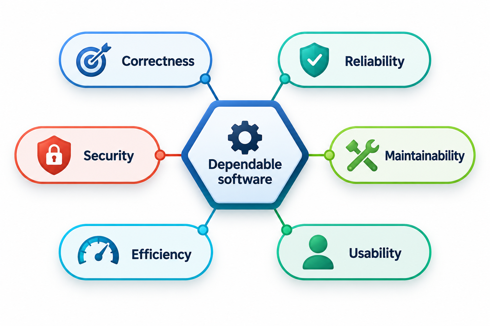
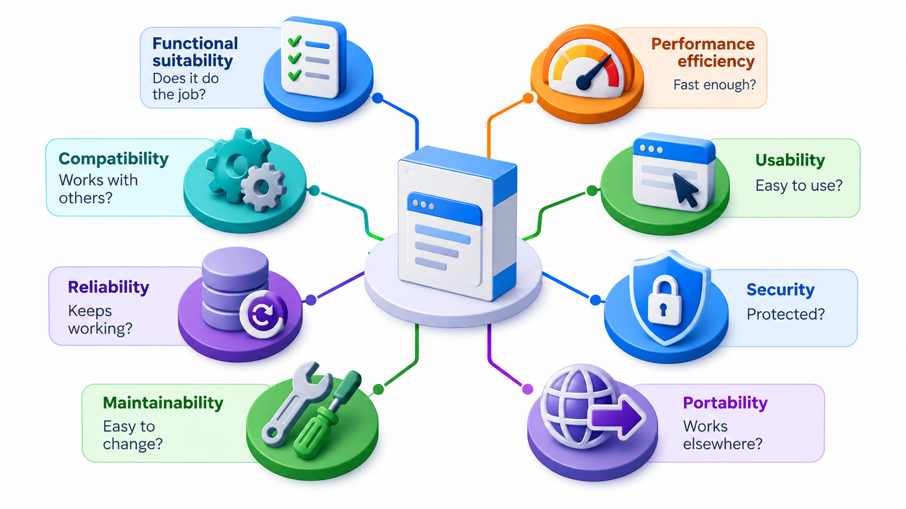
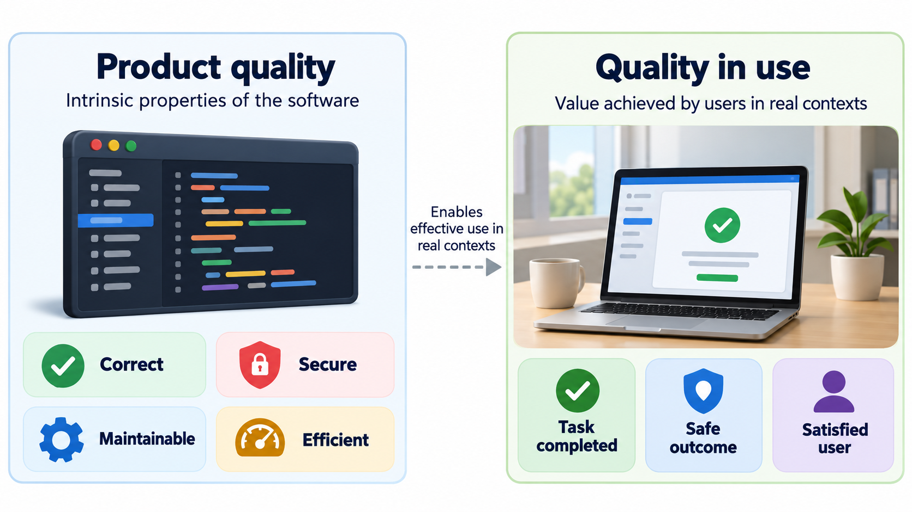
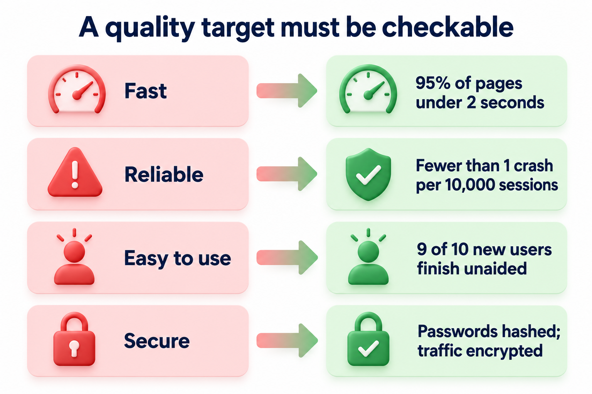
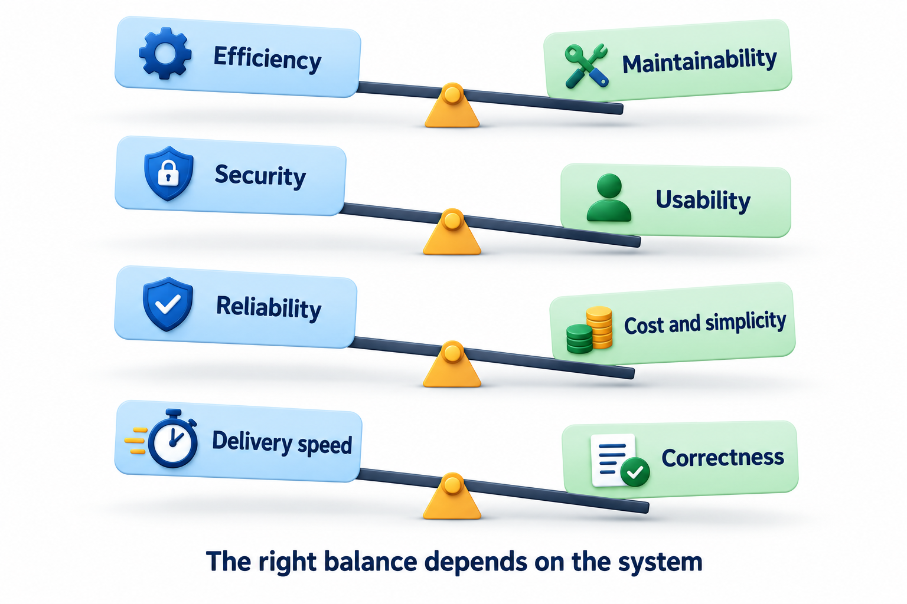
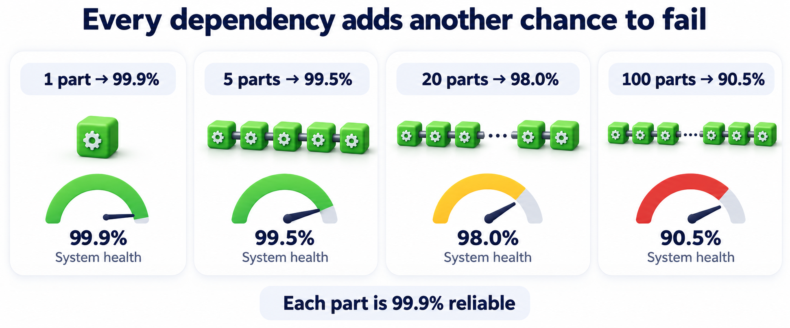

## Two Apps, Identical Features, Opposite Verdicts

Imagine two fee-payment apps with exactly the same feature list. The first opens in a second, never loses a payment, keeps every student's records private, and a first-year student can use it unaided. The second takes a minute to load on results day, occasionally records a payment twice, and shows one student's fees to another. A checklist of features cannot tell them apart, yet nobody would call them equally good.

The difference is **quality**. A system's *functional behaviour* is the list of things it does. Its quality is how well it does them and under what conditions. The properties that describe this, such as speed, safety, dependability, ease of use and ease of change, are called **quality attributes**. They are sometimes called non-functional requirements because they are not extra features: they are the qualities every feature must have. Since no feature list mentions them, they are the properties most often forgotten until something goes wrong.

There is a reason they are forgotten. Features are visible and easy to demonstrate: a button either exists or it does not. Qualities are properties of behaviour over time and under stress, and they only show when the system is tested, loaded, attacked, changed or left running for a month. A demonstration on the day before delivery shows the features at their best and the qualities not at all. Much of software engineering is the habit of asking about the qualities before the demonstration, when there is still time to build them in.

<!-- Visual: dependable software drawn as a structure resting on correctness, reliability, security, maintainability, efficiency and usability. -->

## Quality Is a Set of Questions, Not One Score

"Good software" does not mean one thing. A student who asks "is this app good?" might mean that it is quick, or never loses data, or is pleasant to use, or that a new teammate can fix it. Engineers separate these questions so they can ask each one properly. The best-known list is the product quality model in the standard **ISO/IEC 25010**, which names eight characteristics.

| Characteristic | The question it asks | A fee portal example |
| --- | --- | --- |
| **Functional suitability** | Does it do what is needed, completely and correctly? | The total includes the late fine and the scholarship |
| **Performance efficiency** | Is it fast and light enough for the resources it has? | The result page opens quickly on results day |
| **Compatibility** | Does it work with, and alongside, other systems? | It reads the bank's payment file and runs on old browsers |
| **Usability** | Can the intended people learn and use it without frustration? | A first-year student can pay without help |
| **Reliability** | Does it keep working, and recover when something fails? | A payment is never recorded twice after a timeout |
| **Security** | Does it protect data and resist misuse? | One student cannot see another student's fees |
| **Maintainability** | Can it be understood, changed and tested safely? | A new fine rule is a small, safe change |
| **Portability** | Can it move to another environment cheaply? | It can be moved to a new server without a rewrite |

A later revision of the standard, published in 2023, renames some of these and adds safety as a characteristic of its own. The idea underneath is stable, however the list is worded: quality is several independent questions.

In everyday conversation the same ideas are grouped under a handful of headings: *maintainability*, *dependability* (reliability, availability and safety taken together), *security*, *efficiency* and *usability*. They map onto the table directly. Dependability is the combination of reliability and security that decides whether people can trust the system.

<!-- Visual: a hub labelled "quality of a system" with the eight ISO 25010 characteristics around it, each with its one-line question. -->

The word "independent" is important. A system can be excellent on one characteristic and poor on another, and it can be very good on the feature list and still fail. A system that performs every function but is not safe against hostile input has passed every functional check and is still a poor system.

## Looking Inside Each Characteristic

Each of the eight is itself a bundle of narrower ideas, and the narrower ideas are where most real arguments about quality are settled.

**Functional suitability** has three parts: *completeness* (does the software cover everything the user needs?), *correctness* (does it give the right results?) and *appropriateness* (are the functions suitable for the user's task, or is the user forced through needless steps?). A system that is complete and correct can still be inappropriate if it asks for twelve fields where three would do.

**Performance efficiency** is about *time behaviour* (response and processing times), *resource use* (memory, processor, network, battery) and *capacity* (how many users or items it can handle before it degrades). A system may be fast for one user and collapse for a thousand; these are separate questions and need separate tests.

**Compatibility** covers *co-existence*, meaning that the software can share a machine with others without harming them, and *interoperability*, meaning that it can exchange information with other systems and use what it receives. Large organisations spend much of their budget on this, because their systems were built at different times and must still talk.

**Usability** covers how easily a user can *recognise* that the software suits their need, *learn* it, *operate* it and *avoid mistakes*, and how pleasant and accessible it is, including for people with disabilities. Error protection is often overlooked: a good design makes the costly mistake hard to commit, such as asking for confirmation before a payment cannot be reversed.

**Reliability** has four parts. *Maturity* is how seldom it fails in normal use. *Availability* is the share of time it is ready to be used. *Fault tolerance* is its ability to carry on when a part fails. *Recoverability* is how quickly and completely it returns to service afterwards. A system that fails often but recovers in seconds may serve users better than one that fails rarely but needs a day to repair.

**Security** is a family of properties: *confidentiality* (only the right people see the data), *integrity* (nobody can change it improperly), *non-repudiation* (actions cannot be denied afterwards), *accountability* (actions can be traced to a person) and *authenticity* (identities are genuine).

**Maintainability** covers *modularity* (parts can be changed independently), *reusability*, *analysability* (a fault can be located quickly), *modifiability* (a change can be made without introducing new faults) and *testability*. For software that will live for years, this is the characteristic that most determines lifetime cost.

**Portability** has *adaptability* (it can be moved to new hardware or platforms), *installability* and *replaceability* (it can take over from an older product without trouble).

The detail is worth knowing for one reason: when a customer says "it is not good", the engineer's first job is to find which of these narrower ideas is the complaint. "Slow", "confusing", "keeps failing" and "I cannot see my records" are four different problems with four different fixes.

## Quality of the Product and Quality in Use

The standard separates two views of quality. *Product quality* is a property of the software itself: the structure, the speed, the code. *Quality in use* is what happens when real people use it for real tasks in real conditions: did they achieve their goal (effectiveness), at what cost in time and effort (efficiency), and were they satisfied and safe? The two are linked but not identical. A product with excellent internal quality can still give a poor experience if it was built for the wrong task. A product with ordinary internal quality may serve its users well in a narrow setting.

This matters because the people who judge quality differ. Developers see the internal quality. Testers see the external behaviour. Users see only the quality in use. A project that satisfies the first two and ignores the third has not delivered quality, only correctness against its own specification. This is why user feedback and real-world monitoring remain part of quality work long after the testing is done.

## From "Fast" to a Number a Test Can Check

A quality attribute written as an adjective cannot be checked. "The portal must be fast" will be satisfied in the developer's mind and disputed in the customer's. The cure is to turn each wish into a **measurable target**: a metric, a limit and the conditions under which it applies.

<!-- Visual: vague wishes (fast, reliable, easy to use, secure) on the left, each rewritten on the right as a measurable target with a metric, a limit and a condition. -->

A complete target has four parts. The *source* says who or what triggers the situation. The *stimulus* describes the event. The *environment* describes the conditions. The *response measure* says how the outcome is judged. For example: "When 5,000 students open the results page within the first ten minutes of publication (stimulus), on the production system with normal background load (environment), 95 per cent of pages shall load in under 1.5 seconds (response measure)." Written this way, the requirement can be tested, and an argument about whether the system is fast becomes an observation of whether it meets the number.

A common measure for speed is the **95th percentile**: the response time that 95 out of 100 users do better than. An average hides the unlucky users, while a percentile shows them. Imagine twenty page loads measured during a test. Seventeen of them take between 0.4 and 0.9 seconds, and three are slow, at 1.1, 1.9 and 2.8 seconds.

| Measure | Value | What it tells you |
| --- | --- | --- |
| Average load time | about 0.8 seconds | A typical visit feels comfortable |
| 95th percentile (19th of 20, slowest first excluded) | 1.9 seconds | One visit in twenty is at least this slow |
| Target | 95% of loads within 1.5 seconds | The promise made to users |

The average looks fine and would pass any "feels fast" review. The percentile, 1.9 seconds, breaks the 1.5-second target. This is why the target is written as a percentile: the average describes a typical visit, and the percentile describes how bad the bad days are. A team that reports only the average will be surprised by complaints.

## One Page of Targets Across Several Attributes

Performance is only one attribute. A team that wants to know where it stands lists one target per attribute that matters for this system and compares each with a measurement. For the fee portal, the page might look like this.

| Attribute | What is measured | Measured | Limit | Verdict |
| --- | --- | --- | --- | --- |
| Performance | 95th percentile page load, seconds | 1.9 | at most 1.5 | Fails |
| Reliability | Crashes per 1,000 sessions | 0.8 | at most 1.0 | Passes |
| Usability | Students who finish payment unaided | 92% | at least 90% | Passes |
| Maintainability | Days for a new joiner to ship a fix | 3 | at most 2 | Fails |

Two details deserve attention. First, for some measures a smaller number is better (crashes, days to fix) and for others a bigger one is (students who finish unaided). Getting the direction wrong is a classic error in quality reports. Second, with targets written down, the release decision is no longer a matter of opinion. The team can see exactly which two attributes need work. The numbers here are invented for the example; in a real project they would come from monitoring, usability sessions and the team's own records.

Some attributes are harder to measure directly. Maintainability, for instance, cannot be read off a gauge, so teams use indirect signs: how long a new joiner takes to make a first change, how many files a typical change touches, how often a fix causes a new fault. Usability is measured through observation of real users completing tasks. Security is judged through reviews and attempts to break in. The principle is to find some observable, repeatable evidence for every attribute that matters, even if it is imperfect, because an imperfect measure that is tracked is more useful than a perfect one that is never taken.

## Attributes Pull Against Each Other

If every attribute could be maximised for free, nobody would need to choose. They cannot. Making a system more secure usually asks the user to do more, such as a second login step, which costs usability. Making it faster can mean caching, which makes it harder to keep correct. Making it extremely reliable costs money for backups and spare servers. A very flexible design is often harder to understand than a plain one.

| Improving this... | ...often costs this | Why |
| --- | --- | --- |
| Security | Usability | More checks, passwords and confirmations for the user |
| Performance | Maintainability | Clever optimisations are harder to read and change |
| Reliability | Cost and time | Spare servers, backups, extra testing |
| Flexibility | Simplicity and speed | More options mean more code paths and more to understand |
| Speed of delivery | Correctness | Less time for review and testing |

So a team decides which attributes matter most for this system and writes that down. A hospital monitor puts reliability first and will accept a plain screen. A video game puts performance and appeal first and will accept an occasional crash. Both choices are right, for their systems. What is wrong is not choosing: a team that never decides ends up with accidental priorities, usually set by whichever problem shouted loudest last.

<!-- Visual: four pairs of attributes pulling against each other (efficiency and maintainability, security and usability, reliability and cost, speed of delivery and correctness), with a dial in the middle labelled "chosen for this system". -->

## Dependability: Why Small Failures Add Up

Dependability means that people can justifiably rely on a system. One reason it is hard is that modern systems are chains. A request may pass through a login service, a database, a payment gateway and a message queue, and it succeeds only if every link works. If each of 100 links works 99.9 per cent of the time, the whole chain works only about 90.5 per cent of the time, which is nearly five weeks of failure a year. A system can be made of excellent parts and still be only moderately dependable.

| Links in the chain, each 99.9% reliable | Whole chain works |
| --- | --- |
| 1 | 99.9% |
| 5 | about 99.5% |
| 20 | about 98.0% |
| 100 | about 90.5% |

<!-- Visual: a chain of 1, 5, 20 and 100 parts each 99.9 per cent reliable, with the whole-system reliability falling underneath each chain. -->

This is why engineers talk about quality attributes of the *whole* system, and why design effort goes into limiting how many things have to work at once. The usual remedies are to reduce the number of links in the critical path, to make each link tolerate the failure of the next (by retrying, by falling back to a simpler answer, or by showing stale data rather than none), and to add redundancy where a failure would be costly. All of them are decisions about structure, and they are far cheaper to make early than to retrofit.

## When Quality Is Decided

A last point ties the topic to everything else in the course. Quality attributes are decided at specific moments. Which attributes matter is decided during requirements. How well each can be met is largely decided during design, because structure sets the limits of speed, security and changeability. Whether the code meets the design is checked during implementation and testing. Whether the whole still satisfies users is found out in operation. A quality problem discovered in the last stage often traces back to a decision in the first two, and fixing it means going back to them.

That is why the sensible time to ask "how fast, how safe, how easy to change?" is at the start, when the answers can still shape the design, and why a team that treats quality as a final inspection is always disappointed by what the inspection finds.

## Five Misreadings of Quality

**"Quality means no bugs."** A system with no known bugs can still be slow, insecure, confusing or impossible to change. Bugs are one part of one characteristic.

**"Quality is the testers' job."** Testers measure it. Quality is built in by the requirements, the design and the code, and a tester cannot add speed or security to a design that lacks it.

**"We should maximise every attribute."** The attributes compete for time, money and design choices. The skill is deciding which ones this system must excel at.

**"An average tells you how fast it is."** Averages hide the worst experiences. Percentiles and worst cases say how bad the bad days are.

**"Quality attributes can be added at the end."** Speed, security and the ability to change are shaped by the structure of the system. Adding them late usually means redesigning, which is the expensive way to get them.
