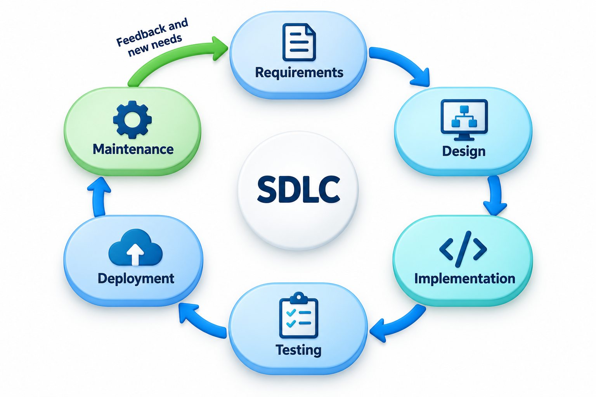
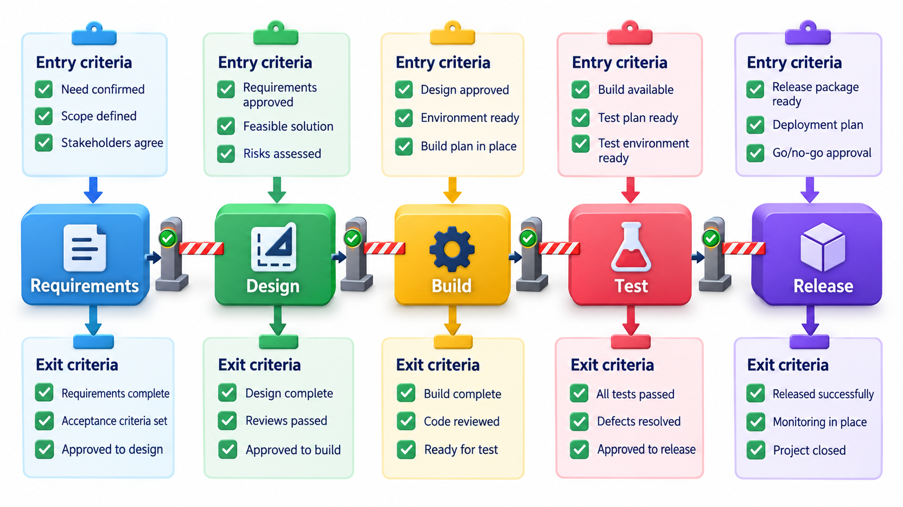
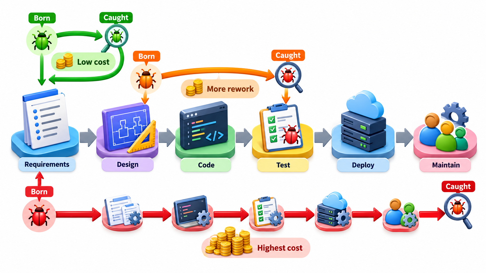
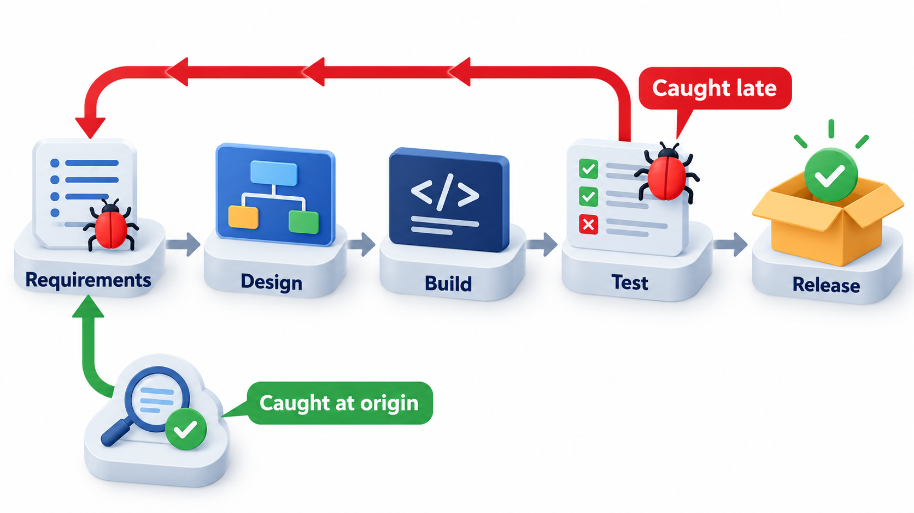
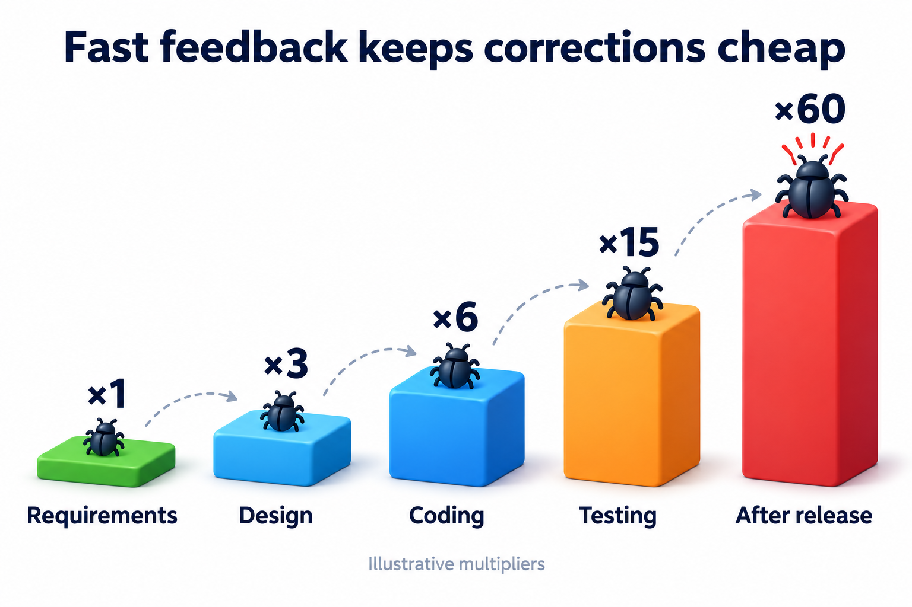
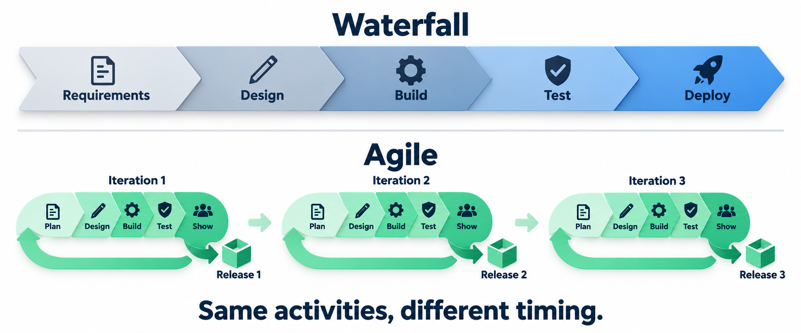
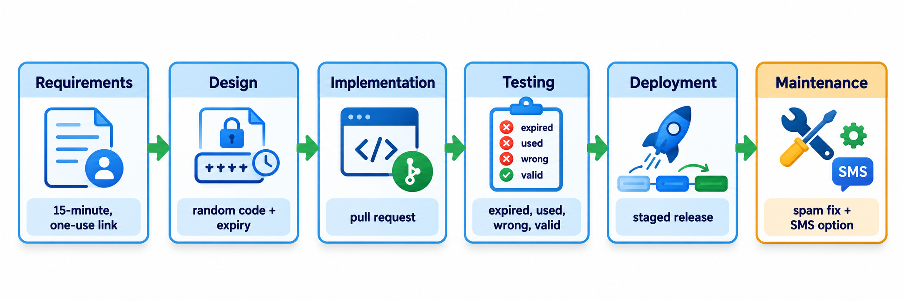

## Nobody Builds a House by Starting With the Roof

A house goes up in an order. Someone first finds out what the family needs, then a plan is drawn, then the structure is built, then it is inspected, then the family moves in, and for decades afterwards it is repaired and extended. Skip a step, or do them in the wrong order, and the cost shows up later as a wall in the wrong place.

Software follows the same logic, except that its walls are far easier to move, which tempts teams to skip the planning. The **software development life cycle**, shortened to SDLC, names the stages software passes through from the first idea to its retirement. Naming them gives a team a shared vocabulary and a series of deliberate chances to catch mistakes before they become expensive. A mistake is born in one stage and found in another, and the SDLC exists to shorten the distance between the two.

It is worth being clear about what the life cycle is and is not. It is a *description of the activities* every successful software effort goes through, whether or not the team names them. It is not a schedule, and it does not say the activities happen once, or in a strict order, or in separate months. Different process models arrange the same activities in different ways. The life cycle is the vocabulary; the process model is the plan written in that vocabulary.

## Before the First Phase: Is It Worth Doing?

Most descriptions begin at requirements, but a decision comes before. Someone must conclude that the problem is worth solving and that building software is a sensible way to solve it. This early stage, sometimes called *feasibility* or *inception*, asks a few blunt questions. Is the need real and large enough to justify the cost? Can it be built with the time, money, people and technology available? Are there legal, security or social risks that could stop the project? Could an existing product do the job at lower cost?

A feasibility study is cheap compared with the stages that follow. It is also where the largest savings occur, because the cheapest software to build is the software that is never built, and the second cheapest is the one bought ready-made. Teams that skip this stage tend to discover the answer to these questions in the middle of development.

## The Phases and What Each One Hands On

Books use slightly different names for the stages, but the activities are the same. Each stage answers a question and leaves a tangible product, called an **artefact**, which the next stage depends on.

| Phase | The question it answers | Typical artefacts |
| --- | --- | --- |
| **Requirements** | What do the people who will use it need? | Requirements list, user stories, acceptance criteria |
| **Design** | How will we build it so that it meets the need? | Architecture sketch, interface descriptions, diagrams |
| **Implementation** | Can we build it that way? | Source code, build scripts |
| **Testing** | Does it do what was asked, and nothing harmful? | Test cases, results, defect reports |
| **Deployment** | How does it reach the users? | A released version, release notes, installation steps |
| **Maintenance** | How do we keep it working and improve it? | Fixes, updates, change records |

Follow one small change through the table: a college decides that students on approved medical leave should not be charged a late fee.

| Phase | What the team does | Artefact that results |
| --- | --- | --- |
| Requirements | Asks who approves leave, whether the waiver is automatic, what happens to fees already charged | "No late fee for any day inside an approved leave period; fees already charged are refunded" |
| Design | Decides to store leave periods in a table and to check it when the fee is calculated | A short note describing the table and the changed calculation |
| Implementation | Builds the change that reads the leave table and adjusts the fee | A reviewed change to the fee module |
| Testing | Tries a day inside leave, the day before, the day after, and a refund case | A list of passing and failing checks |
| Deployment | Releases to one department first, then to all | A tagged release and a short notice to the office |
| Maintenance | Fixes the case of leave that starts mid-month, adds an export for the accounts team | New change requests |

Read the right-hand column from top to bottom. Each artefact is the input of the next phase. The test list is made of sentences from the requirement, and the design implies what the build must do. This chain is what a **hand-off** is: a point where understanding moves from one person or stage to another. Hand-offs are where meaning leaks. If the requirement says "approved leave" and nobody defines "approved", the designer guesses, the developer guesses again, and the tester checks a third version.

<!-- Visual: the six phases in a loop, with arrows going back from testing and maintenance to requirements. -->

## Each Phase in a Little More Depth

**Requirements.** The work here is not writing down what people say but discovering what they need, which is different. It involves interviewing users, watching how they work today, resolving conflicts between stakeholders, and deciding what is in and out of scope. The common failures are vague statements ("easy to use"), unstated assumptions, and requirements that contradict each other. A good requirement can be read by a developer and a tester and understood the same way by both.

**Design.** Design turns the "what" into a "how". It has two levels. *Architecture* decides the large structure: which major parts exist and how they communicate. *Detailed design* decides the inside of each part. Good design is judged by how well it will cope with change, not just how well it meets today's need, because the first change is usually on its way before the first release. The common failures are a design that works only for the examples the designer imagined, and one that makes later change expensive.

**Implementation.** Here the design is built. It is more than typing: it includes agreeing conventions so that many people write consistent work, reviewing each other's changes, and keeping the work in a shared place so that nothing is lost. The common failures are shortcuts that bypass the design, and changes that are never reviewed because there is no time.

**Testing.** Testing is the search for the gap between what the software does and what it should. It runs at several scales: small pieces on their own, pieces working together, the whole product, and the product in the hands of the customer. Testing cannot prove that no faults remain; it can only reveal the ones the tests were designed to reveal. The common failures are tests chosen from what the software happens to do instead of what it should do, and testing squeezed at the end by a deadline.

**Deployment.** Deployment is putting the software where users can use it: installing it, configuring it, migrating existing data, training people and switching over from whatever was used before. Even correct software can fail at this stage, through a wrong setting, a missing file or users who were never told what changed. Careful teams release to a few users first and widen the release only when it behaves.

**Maintenance.** Once software is in use, the work of looking after it begins and, for successful software, never ends. It includes fixing faults, adapting to new laws and devices, adding features that users request, and improving the structure so that later change stays affordable. Maintenance typically absorbs more than half of the total cost of a system over its life.

**Retirement.** The life cycle ends when the software is withdrawn. Retirement needs planning too: users must be moved to something else, data must be kept or deleted according to the rules, and other systems that depended on it must be told. Teams that ignore this stage are left running unsupported software for years because switching it off is too frightening.

## Entry and Exit: How a Team Knows a Phase Is Done

For the hand-offs to work, each phase needs a clear idea of when it is finished. Many teams define *exit criteria* for each phase and *entry criteria* for the next. Requirements might be considered done when every requirement has been reviewed by a user and has an agreed way of being tested. Design might be done when every requirement is traced to a part of the design and the main risks have been examined. Testing might be done when all planned tests have run, no serious faults remain open and the remaining minor ones have been accepted by the customer.

These checks do not need to be heavy. Their purpose is to stop the most common failure of all: moving on because the calendar says so, not because the work is ready. A phase that is declared finished while it is not simply passes its unresolved problems on, usually at a higher price.

## Born Early, Caught Late

Every defect has two dates: the phase in which it was born, and the phase in which someone finds it. The distance between the two is how far it travelled undetected, and that distance is where most of the cost lies. A wrong sentence in the requirements, found in a review, is fixed by editing a sentence. The same wrong sentence, found after release, means changing the design, rewriting the code, retesting, redeploying and apologising to the users who were affected.

A simple, illustrative rule shows the effect: suppose each phase a defect survives doubles the cost of fixing it. Take six defects from a fee-portal project.

| What went wrong | Born in | Found in | Phases survived | Relative cost |
| --- | --- | --- | --- | --- |
| Unit assumption never written down | Requirements | Operation | 5 | 32 |
| Refund rule misunderstood | Requirements | Testing | 3 | 8 |
| Two screens disagree on the late fee | Design | Testing | 2 | 4 |
| Wrong rounding of the fee | Coding | Release | 2 | 4 |
| Off-by-one in the date check | Coding | Coding | 0 | 1 |
| Missing field in the form | Design | Design | 0 | 1 |

The total is 50 units, and 40 of them come from the two defects that began in the requirements. Catching those two earlier would have saved more than fixing every other defect faster. The numbers are invented for teaching, in the spirit of a long-standing observation that later fixes cost more. The direction is real; the exact factors differ by project.

The pattern also shows what a requirements defect looks like. It is often not a typing error but an unwritten assumption: something that was true in one setting and was carried unquestioned into another. Because nobody wrote it down, no review, design check or test examined it, and it was found only when users met it.

<!-- Visual: six phases on a horizontal axis with one defect drawn as a bar from the phase where it was born to the phase where it was found, the longer bars labelled with a higher cost. -->

## Why the Cost Climbs

It is worth understanding why late fixes cost more, because the reason points to the remedy. A defect found late is expensive for four reasons.

1. **More work has been built on top of it.** Code, tests, documents and other people's work depend on the faulty decision, and all of it must be revisited.
2. **More people are involved.** Early on, the author can fix it. Later, a fix needs a report, a priority decision, a developer, a tester and a release.
3. **It is harder to find.** A fault in the requirements shows up as a strange behaviour deep in the product, far from its cause, and the investigation costs hours.
4. **Real users are affected.** After release the cost includes lost trust, support calls and sometimes lost money or safety.

Teams that practise very frequent testing, small releases and automated checks can flatten the curve, because each of the four causes is reduced. The curve is not a law of nature, but it describes what happens when the checking comes late.

## Catching Defects Where They Are Born

If the cost depends on distance, the aim is to shorten the distance. Each phase has its own way of catching its own mistakes.

- **In requirements,** read them aloud to the people who will use the system and ask "is this what you meant?". A review can catch an unwritten assumption that no test ever will.
- **In design,** walk through the design with a concrete case. Ask what happens at the largest and smallest values it must handle.
- **In implementation,** a second person reads the work, and tools check the style and common mistakes before anything runs.
- **In testing,** checks are chosen from the requirements and from the boundaries of the design, not only from what the system happens to do.
- **After release,** monitoring and user reports bring in what no earlier phase could see.

Two words describe this checking. **Verification** asks "are we building the product right?": does each phase's output match the phase before it? **Validation** asks "are we building the right product?": will it meet the real need? A product can pass verification at every step and still fail validation if the original requirement was wrong. Both questions apply in every phase, not only in testing.

The cost of a late fix is not only money. A defect that reaches users also costs their trust. The following picture shows the rising multiples for one illustrative defect.

<!-- Visual: columns rising from requirements to after release, each labelled with the relative cost to fix one defect found in that phase. -->

## The Arrows That Point Backwards

A beginner's picture of the SDLC is a straight line from requirements to maintenance. Real projects loop. Testing exposes a missing requirement, so the team goes back. A design turns out too slow, so it is revised. After release, users ask for changes, and the whole cycle begins again for the next version.

The loops are not a sign that someone failed. They are how information reaches the people who need it. What matters is how long a loop takes. A misunderstanding found in a five-minute conversation costs five minutes. The same misunderstanding found by a user a month after release costs a patch, a night of work and a lost customer.

This is also the difference between process models. A **waterfall** project goes round the loop once for the whole system, so its feedback arrives late. An **agile** project goes round it in a short cycle for one small slice, and repeats, so feedback arrives every few weeks. Both do requirements, design, implementation, testing, release and maintenance. They differ in how much they build before looking at the result.

<!-- Visual: waterfall performing every activity once across the whole project beside agile repeating the same activities in short release cycles. -->

## What the Artefacts Are For

Documents often get a bad reputation, so it is worth being clear about their job. An artefact is how one stage passes understanding to the next, and how a future reader finds out why something is the way it is. It can be short: three sentences in an issue, a sketch photographed from a whiteboard, a table of test cases. What it cannot be is absent. A team that never writes down an assumption has nothing to review and nothing to check the design against.

Artefacts serve three readers. The *next phase* needs them as input. The *reviewer* needs them to check the work. And the *future maintainer*, who may be the same person a year later, needs them to understand why a decision was taken. The third reader is the one most often forgotten and most often grateful.

<!-- Visual: a chain in which each lifecycle phase hands a reviewable artefact to the next phase. -->

