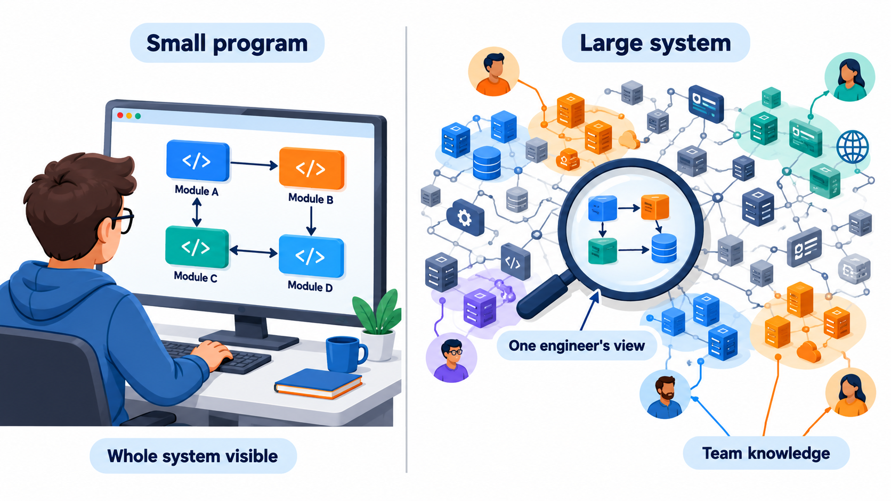
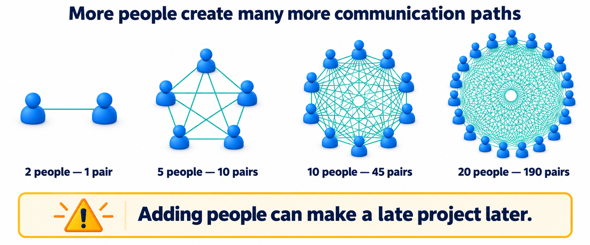
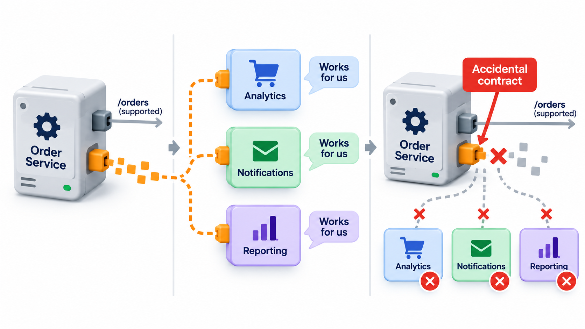
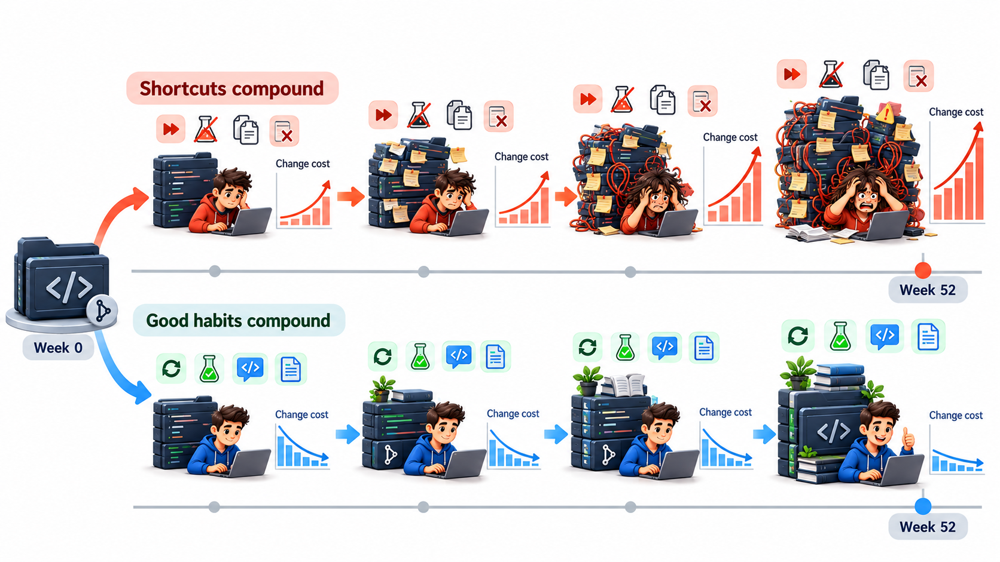
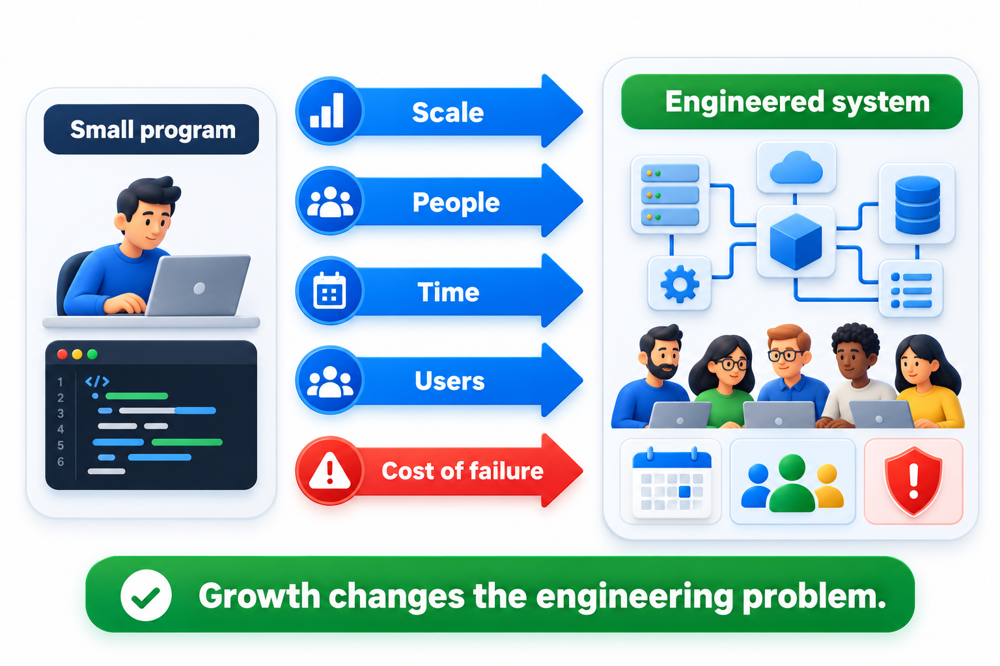

## Ten Parts, 45 Connections; a Thousand Parts, Nearly Half a Million

Software gets harder faster than it gets bigger. A system twice the size is usually more than twice as hard to understand, change and keep correct, and the reason is arithmetic before it is anything else: ten parts can be connected in 45 ways, a hundred parts in 4,950 ways, and a thousand parts in 499,500 ways.

Three forces explain most of the extra difficulty. There is the sheer amount of code that no one can hold in their head. There is the number of connections between parts and between people. And there are small habits that repeat and compound over time. This topic looks at each in turn, because together they explain why engineering practice puts so much weight on structure and discipline long before a project feels like it needs it.

Underneath all three lies one simple fact about human beings: a person can keep only a handful of things in mind at once. Complexity, in practice, is whatever makes a system hard to understand with that limited memory. A system is complex not because it has many parts but because understanding any one part requires knowing about many others. Everything an engineer does to manage complexity is a way of reducing how much needs to be known at the same time.

## How Big Software Gets

A first-year program is a few dozen lines. A final-year project may reach a few thousand. Real products are of a different order. The Linux kernel contains tens of millions of lines. Google reported in a 2016 paper that its main repository held about two billion lines of code, edited by tens of thousands of engineers. No one, at any size above a small project, holds the whole system in their head.

That has a direct consequence. A programmer making a change in a large codebase is working with a map that is incomplete. They know their corner. They guess about the rest. Most of the time the guess is right, and sometimes it is not. Engineering practice at scale is mostly a set of ways of making the guess safer: tests that report when a change breaks something far away, interfaces that restrict what a change can touch, reviews by people who know other corners, and tools that find who uses a piece of the system.

Size has other effects beyond the difficulty of understanding. A large system takes longer to build and test, so feedback arrives more slowly. It has more places where a fault can hide. It needs more people, which brings the coordination costs discussed below. And it lasts longer, so it outlives the knowledge of those who wrote it. Scale is therefore not one problem but a bundle, and a team that solves only the first (how to read the code) will still be struck by the others.

<!-- Visual: a small program of a few boxes beside a large system of hundreds of boxes with many lines between them, and a magnifying glass over one corner labelled "what one engineer sees". -->

## Parts Multiply Connections Faster Than They Multiply Themselves

The reason size is not a straight line is that the number of *relationships* grows faster than the number of *parts*. Among n parts that could each interact with every other, the number of possible pairs is n times (n minus 1), divided by two.

| Number of parts | Possible pairs |
| --- | --- |
| 10 | 45 |
| 100 | 4,950 |
| 1,000 | 499,500 |

The same arithmetic applies to people, which is why a team of twenty is not twice as hard to coordinate as a team of ten. It has 190 pairs of people who might need to talk, against 45.

<!-- Visual: communication paths between two, five, ten and twenty people drawn as dots joined by lines, with the pair counts 1, 10, 45 and 190 labelled underneath. -->

Real systems are not fully connected, and good design keeps many pairs from ever needing to interact. That is the main job of modules and interfaces. But the arithmetic explains why a system with no structure, where everything may touch everything, becomes unmanageable quickly, and why the discipline of keeping parts apart is not fussiness.

Two measures capture how connected a design is. **Coupling** describes how strongly one part depends on another: a tightly coupled part cannot be changed without touching its partner. **Cohesion** describes how closely the contents of one part belong together: a cohesive part does one job and does it completely. Good design aims for low coupling between parts and high cohesion within them. The reason is exactly the arithmetic above. Each dependency is a pair that someone must keep in mind, and every unnecessary dependency removed takes a connection out of the count.

## What Complexity Feels Like

Complexity is easier to recognise by its symptoms than by its definition. Experienced engineers describe three.

| Symptom | What it looks like | An everyday example |
| --- | --- | --- |
| **Change amplification** | A simple change needs edits in many places | Changing the late-fine rule means editing the fee screen, the receipt, the report, the export and the reminder, each with its own copy of the rule |
| **Cognitive load** | A developer must know a great deal to make a small change safely | To add a field, you must understand five modules and an unwritten rule about the order of steps |
| **Unknown unknowns** | It is not clear what must be changed, or what a change might break | A developer changes a function and does not learn until production that three other features relied on its side effect |

The third is the most dangerous. With the first two, the effort is visible. With the third, the developer cannot even tell what they do not know. Much of the discipline of software engineering, such as tests that guard behaviour, clear interfaces and written decisions, exists to turn unknown unknowns into known ones.

Not all complexity has the same source. Some of it is *structural*, caused by how many parts there are and how they connect. Some is *behavioural*, caused by systems that react to many conditions and sequences of events. Some is *organisational*, caused by many people and teams who must agree. A project in trouble usually has more than one kind, and the remedy differs: structure is helped by design, behaviour by testing and modelling, and organisation by communication practices.

## When Unpromised Behaviour Becomes a Promise

A well-known consequence of scale is called **Hyrum's law**, after the Google engineer Hyrum Wright. Paraphrased: once a system has enough users, every observable behaviour of it will be relied upon by somebody, whatever the documentation promises. The promise may say one thing. The behaviour people can see says another. Behaviour wins.

Picture a small shared function that promises to return the unique ids from a list. It does not promise any order, but its first version happens to return them sorted. Another developer, writing a different part of the system, takes the first value as "the lowest id" without reading the fine print. Months later a maintainer rewrites the function to be faster. It still returns unique ids, so the written promise is kept.

| Stage | What the shared function does | What the other developer's feature shows |
| --- | --- | --- |
| Version 1 | Returns unique ids, which happen to come out sorted | The lowest id is shown correctly |
| Version 2 | Returns unique ids, in no particular order | A different id is shown as the lowest, and no error appears anywhere |

The maintainer kept the written contract and still broke the feature. The caller depended on something that was observable, not on something that was promised. Neither person did anything unreasonable. Hyrum's law says to expect exactly this in any system that has enough callers.

The practical responses are modest. Write down what you promise, and make unpromised behaviour less predictable if you can. Test the contract and not the accident. And remember, when changing an interface used by others, that the people who depend on a behaviour you thought was incidental will not experience your change as a clean-up. They will experience it as a break.

## Small Habits Compound

The second face of scale is time. A shortcut taken once costs little. Taken as a habit across a year, it changes how the whole system behaves. Skipping a test on a change that seems trivial, copying a block instead of sharing it, leaving a confusing name because renaming takes five minutes: each is cheap on the day. But each makes the next change a little harder, and the difficulty is multiplied, not added.

Suppose a team's changes become 2 per cent more expensive each week because of accumulated shortcuts. Taking the cost of an ordinary change in a fresh system as 1.0:

| After | An ordinary change costs |
| --- | --- |
| 13 weeks (a quarter) | about 1.3 times the original |
| 26 weeks (half a year) | about 1.7 times |
| 39 weeks | about 2.2 times |
| 52 weeks (a year) | about 2.8 times |

The team did not become slower overnight. It became slower in steps too small for anyone to blame. The 2 per cent is an assumption for teaching, not a measured rate. The point is the shape: compounding looks like nothing for months and then like a wall.

The same arithmetic runs in reverse. A habit that makes each change 2 per cent easier, such as adding a check with every fix, compounds in the team's favour.

This is the heart of what engineers call **technical debt**: the extra future cost taken on by choosing a quick solution now. Like money borrowed, it is not always wrong to take on, but it carries interest, and interest left unpaid grows. What makes it dangerous in software is that nobody sees the balance. No statement arrives at the end of the month saying the codebase now costs twice as much to change. The first sign is usually a missed deadline, and by then the debt is large.

<!-- Visual: two curves over a year, one rising by 2 per cent a week and one falling by 2 per cent a week, labelled "habits that compound against you" and "habits that compound for you". -->

## The Tools Engineers Use Against Complexity

No technique removes complexity from a problem that is genuinely complex. What the techniques do is arrange the complexity so that a person can work on a part of it without having to hold all of it.

| Technique | What it does | How it reduces what you must know |
| --- | --- | --- |
| **Decomposition** | Splits the system into parts with clear responsibilities | You work on one part at a time |
| **Abstraction** | Presents a simple view that hides detail | You use a part without knowing how it works inside |
| **Information hiding** | Keeps each part's internal decisions private | A change inside one part does not spread to the others |
| **Layering** | Arranges parts so each uses only the layer below | You need to understand only your layer and its neighbour |
| **Conventions** | Agrees common names, structures and habits | Familiar patterns need no explanation |
| **Automation** | Lets tools check and repeat the routine work | People are free to think about the hard parts |

A good test of a design is how much a developer must read to make a typical change. If the answer is "the one module I am changing and its interface", the design is managing its complexity well. If the answer is "most of the system, to be safe", it is not, however tidy the diagrams look.

## The Pressures Arrive Together

Size, connections and time rarely come alone. A growing system usually brings more people, more users and a higher cost of mistakes, all at once. That combination is what turns a program into something that needs engineering.

<!-- Visual: five pressures (scale, people, time, users, cost of failure) pushing on a small program that grows into a labelled engineered system. -->

A team that understands this does not wait for the crisis. It puts structure in early, because the cost of structure is small when the system is small and enormous when it is large. It keeps habits that compound in its favour: automated checks, small reviewed changes, clear names, written contracts.

There is a sensible balance to find. Putting a heavy structure into a three-day experiment is waste. Leaving a system that will live for years without any structure is borrowing against a future that will arrive. The skill lies in judging, from the pressures that are present now and those that are coming, how much structure to put in today. A reasonable rule is to add structure when the next change would otherwise be risky, and to add it in the part of the system that is changing most.

## Five Misreadings of Complexity

**"Twice the code is twice the difficulty."** The relationships between parts grow faster than the parts. Doubling the size can much more than double the effort to understand and change it.

**"If it is not documented, nobody depends on it."** Hyrum's law says the opposite. With enough users, observable behaviour is relied on whether or not anyone promised it.

**"A bad habit is harmless if the shortcut is small."** A shortcut repeated daily is a growth rate, and growth rates compound. Small is measured per change, but the cost is paid on every later change.

**"Complexity is the sign of a clever design."** Complexity is a cost. Clever designs usually look simple in use, and the mark of a good one is that the complexity the problem really needs is all that remains.

**"We can clean it up later when we have time."** Later, the system is bigger, more things depend on the mess, and the cleaning costs more. Teams that postpone it rarely find the time.
