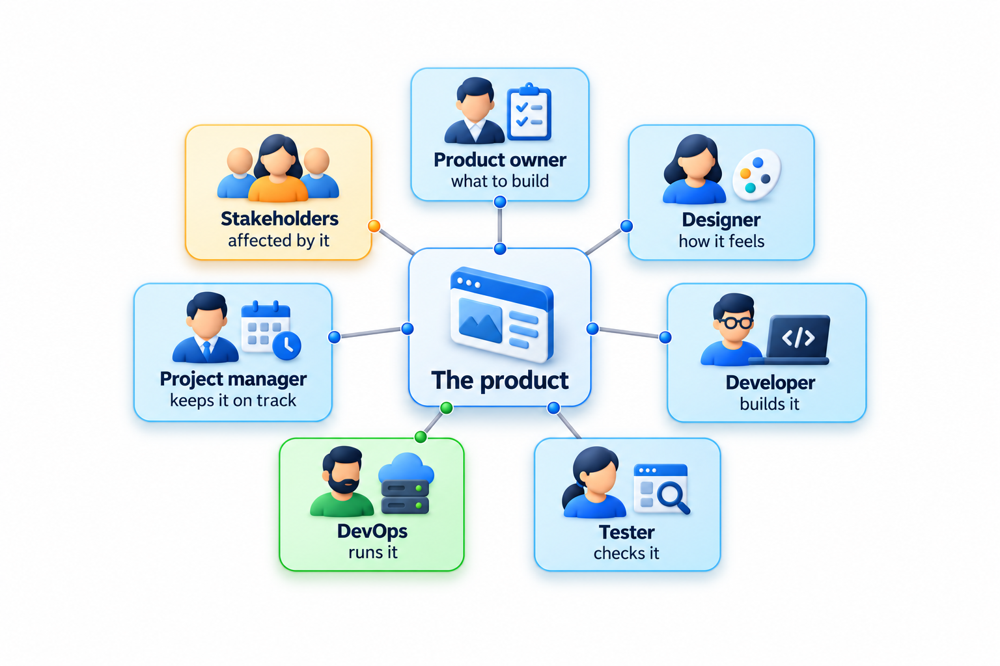
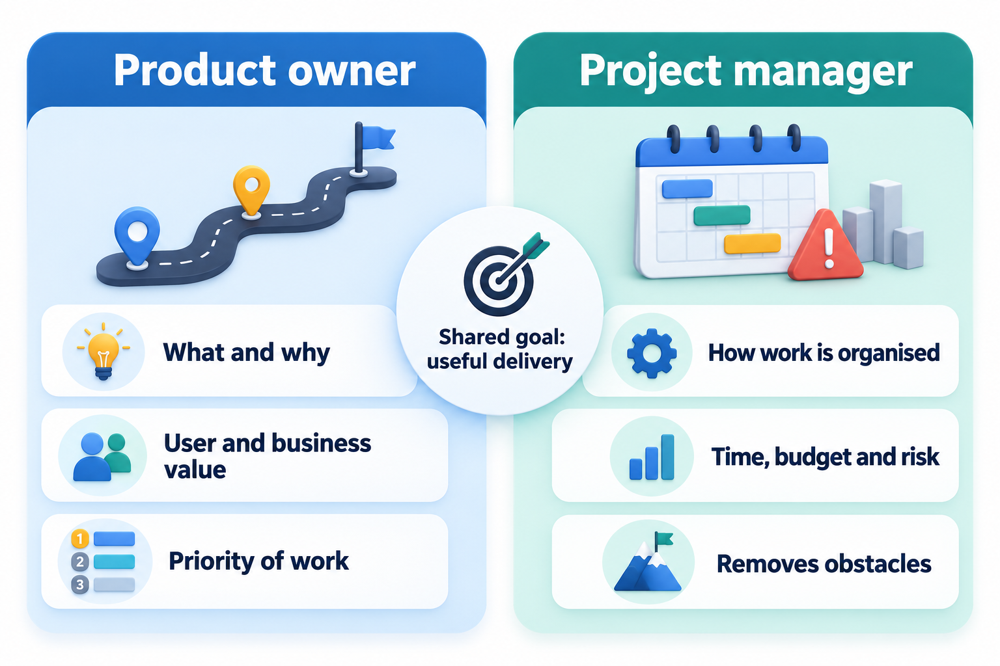
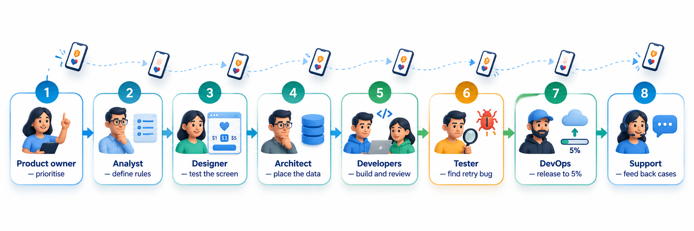
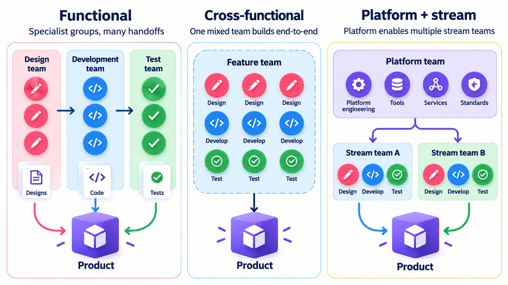
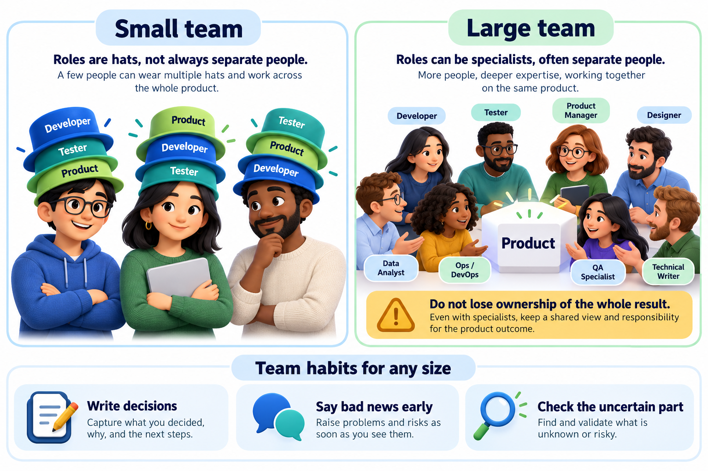
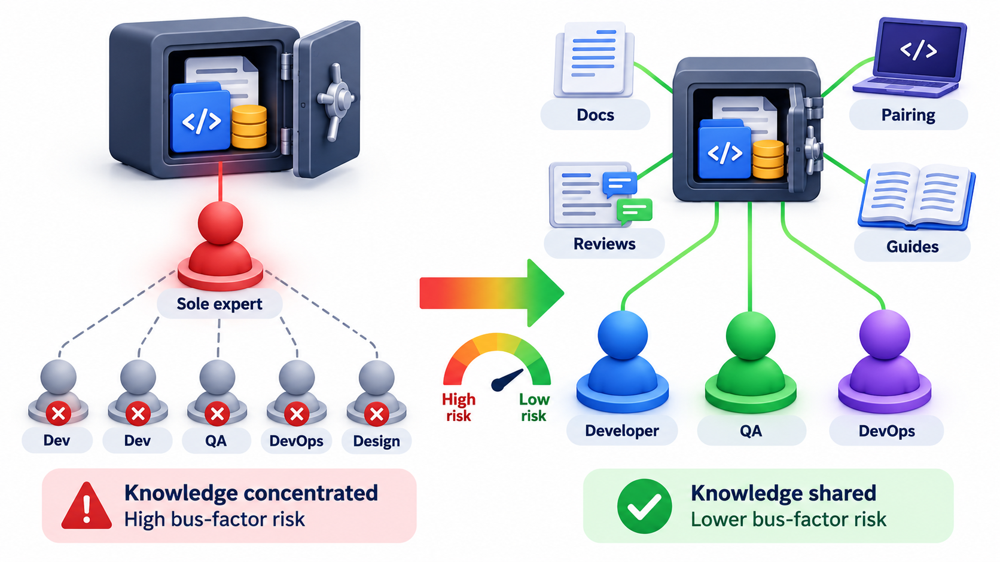

## Nobody Ships Software Alone

The app on your phone was not made by one person. Somebody decided it was worth building, somebody shaped how it looks, somebody built it, somebody tried to break it, and somebody is awake tonight in case it stops working. Once software grows beyond what one person can build and maintain, the work divides, and no single job description covers the whole life of a product.

A **role** is a bundle of responsibilities within a team. Roles are not job titles, which vary between companies, and they are not people, since one person can take on several roles. They matter because most failures in team projects are not failures of skill. They are cases where a responsibility belonged to nobody, or where two people each assumed the other had it.

For a graduate about to enter the industry, understanding roles has a practical payoff. It explains what colleagues expect from you, who to ask for what, and what the other people in the room are worried about. A developer who knows what a product manager is trying to protect can bring them the right information. A developer who thinks testers exist to criticise will resent them. Much of what looks like workplace friction is a misunderstanding of what each role is for.

## A Team Is a Set of Questions That Each Have an Owner

A useful way to think about roles is to ask what question each one owns. When no one owns a question, it goes unanswered until it hurts.

| Role | The question they own | What they typically produce |
| --- | --- | --- |
| **Software developer (SDE)** | How do we build this correctly and cleanly? | Code, tests for that code, design notes |
| **QA engineer / SDET** | How do we know it works, and keep knowing as it changes? | Test plans, automated tests, defect reports, test tooling |
| **Product manager (PM)** | What should we build, for whom, and why now? | Priorities, requirements, a roadmap |
| **Designer** | Can people use it, and will they understand it? | Wireframes, prototypes, interface specifications |
| **Tech lead** | Is the technical approach sound, and is the team able to execute it? | Design decisions, reviews, guidance for other engineers |
| **Site reliability engineer (SRE)** | Does it stay up, and what do we do when it does not? | Monitoring, on-call practice, automation, incident response |
| **Data / ML engineer** | Is the data trustworthy, and does the model behave as intended? | Data pipelines, trained models, evaluation reports |

The job titles differ from one company to another. What does not change is that these questions exist in every serious project. A small team may not have a person for each, and then the questions are shared among whoever is there. They are still asked.

<!-- Visual: the product at the centre with the product manager, designer, developer, tester, SRE, tech lead and stakeholders around it, each labelled with the question they own. -->

## Four Roles in a Little More Depth

**The developer** builds and changes the software, and in a healthy team also tests it, reviews other people's work and helps decide the design. Many companies grade developers by the size of the problem they can handle alone: a new graduate takes a well-defined task, a more experienced engineer takes a feature, and a senior engineer takes an unclear problem and returns with a plan. What grows with seniority is not speed of typing but the ability to handle ambiguity, to foresee consequences and to make the people around them more effective.

**The tester** is often misunderstood as someone who clicks around at the end. A **QA engineer** designs how quality is checked: which cases to try, which risks are the biggest, and how to find problems early. An **SDET**, a software development engineer in test, does this by building automated checks, tools to generate test data, and the systems that run checks on every change. Good testers are the people who ask "what if?" in the places where developers, who hope their work is right, are least likely to.

**The site reliability engineer** treats running the software as an engineering problem in its own right. The role was shaped at Google in the early 2000s, with the idea that people who understand both software and operations should make the running of a service as automated and predictable as possible. An SRE cares about how often the service fails, how quickly it recovers, and how the team knows before the users do.

**The data or ML engineer** matters wherever the software learns from data. Their work starts before any model exists, with collecting, cleaning and checking data, and continues after release, because a model's accuracy can decay as the world changes. In an AI-enabled product they own a quality question that a conventional developer cannot answer by reading the code.

## Other Roles You Will Meet

A real organisation has more roles than the core seven, and a graduate will meet several of them in the first year.

| Role | What they do | Where they help most |
| --- | --- | --- |
| **Business analyst** | Works with the customer to understand the business problem and turns it into requirements | Services companies and large contracts, where the customer is not in the room |
| **Architect** | Decides the large structure of a system and the rules that keep it coherent | Big systems with several teams, where parts must fit together |
| **Engineering manager** | Looks after the people: hiring, growth, workload, feedback and the health of the team | Any team where individuals need support and direction |
| **Security engineer** | Looks for ways the system could be attacked and helps build defences in | Anything that holds money, personal data or access |
| **DevOps or platform engineer** | Builds the tools and pipelines that let teams build, test and release safely | Organisations with many teams and frequent releases |
| **Technical writer** | Produces documentation that users and developers can follow | Products with external users, APIs or complex set-up |
| **Scrum master or delivery lead** | Helps the team organise its work and removes obstacles | Teams using an agile framework |
| **Support engineer** | Handles problems that reach users and feeds what they learn back to the team | Products in production with real customers |

Which of these exist depends on size. A five-person start-up will have two or three people covering all of them. A large bank will have all of them as separate departments. The questions are the same in both; only the number of people answering them differs.

## The Product Manager and the Project Manager Are Not the Same

The abbreviation PM is used for two different jobs, which causes confusion.

A **product manager** owns the *what and why*: who the users are, what they need most, and what the team should build next. They live between the users, the business and the engineers, and they say no to many good ideas.

A **project manager** owns the *how and when*: the schedule, the budget, the risks, the dependencies between teams and the removal of obstacles. Project managers are more common in contract work, where a date and a price have been promised to a customer.

In a small team one person may do both. In a large one, they are often two people, and a team without either may find that nobody has decided what comes first.

The distinction matters in disagreements. When a stakeholder asks for a new feature in the middle of a project, the product manager asks whether it is the most valuable thing to build next, and the project manager asks what it does to the date and the budget. Both questions are legitimate and they pull in different directions, so a team is healthier when both are asked by different people, openly.

<!-- Visual: two columns. Left, the product manager: what, why, priority. Right, the project manager: time, budget, risk, obstacles. -->

## One Feature, Seven Pairs of Hands

To see how the roles work together, follow a single feature. A customer-support team reports that students cannot find their results quickly on results day.

1. The **product manager** hears the pain, checks how many students are affected, and decides it is the top priority.
2. The **designer** sketches a search box on the home screen and tests it with five students.
3. The **tech lead** proposes keeping an index of students so that a search is fast, and notes the risk for peak traffic.
4. The **developers** build it, with tests, and the work is reviewed by a second developer.
5. The **QA engineer** or **SDET** adds automated checks for odd names, missing records and many users at once.
6. The **SRE** adds a dashboard for response time and a rule to alert the team if searches slow down.
7. After release, support reports and the dashboard feed a new round of priorities back to the product manager.

Each step is short, and none can be skipped without a cost. The feature is not delivered when the building is finished. It is delivered when it works for the students on the day.

Look at what would have gone wrong if one role were missing. Without the product manager, the team might have built something else that was more fun. Without the designer, the search might have worked but confused first-years. Without the tech lead, the index might not have scaled. Without the tester, a student with an apostrophe in their name might have crashed the page. Without the SRE, nobody would have known on results day that the page was failing. The roles are not overhead; each is a guard against a particular and likely failure.

<!-- Visual: a customer pain point passing from prioritisation through design, development, testing, staged release, monitoring and support feedback, with the owning role under each step. -->

## How Teams Are Organised

Roles describe what people do. Team structure describes how people are grouped, and the grouping shapes how work flows.

| Structure | How it groups people | Strength | Weakness |
| --- | --- | --- | --- |
| **Feature team** | A small team with all the skills to deliver a feature end to end | Little waiting for others, clear ownership of outcomes | Needs people comfortable across layers; code can drift apart between teams |
| **Component team** | A team owns one part of the system, such as the database or the mobile app | Deep expertise in its part | A feature needs several teams to coordinate |
| **Functional department** | People grouped by skill (all testers together, all designers together) | Skills are developed and shared | Work is handed over between departments, creating delays |
| **Platform team** | A team builds tools and services other teams use | Frees other teams from repeated work | Can lose touch with what users of the platform need |

There is no universally best structure. Many organisations use a mix: feature teams for the product, a platform team for shared tooling, and a communities of practice for skills such as testing and security. The important observation, noticed decades ago, is that the structure of the software tends to mirror the structure of the organisation that builds it. If four teams build a system, it tends to have four main parts. A company that wants a different architecture often has to change its team structure first.

## Roles Are Hats

In a team of four, nobody has just one role. The same person builds on Monday, tests a colleague's change on Tuesday, answers a support question on Wednesday and fixes a deployment on Thursday. In a big company the roles are separate jobs, but the questions still need an answer. The healthiest large teams still share ownership of the whole product: developers care about testing and operations, and testers care about design.

A clear way to keep this honest is to ask, for each important activity, who is *responsible* for doing it, who is *accountable* for the result, who must be *consulted* and who must be *informed*. Some teams write this down in a simple chart. The value is not the chart but the conversation: it reveals the activities with no owner and the ones with two.

<!-- Visual: a small team in which each person wears several role hats, beside a large team of specialists who still share ownership of the whole product. -->

## What Happens When Knowledge Sits With One Person

Roles also decide where knowledge lives. A team in which one person understands the payment module is a team with a risk. People get ill, change jobs and take holidays. The informal measure of this is called the **bus factor**: the number of people who would have to disappear, in the grim traditional phrasing "get hit by a bus", before a part of the project could no longer be maintained.

A simple way to check is to list, for each part of the system, who has worked on it in the last year.

| Module | People who have worked on it | Bus factor |
| --- | --- | --- |
| Login | Asha, Ravi, Meena | 3, comfortable |
| Payments | Ravi | 1, at risk |
| Reports | Meena, Asha | 2, acceptable |
| Notifications | Asha | 1, at risk |

Payments and notifications are flagged because only one person has touched them. Payments is the worrying one, because it is also a module where a mistake costs money. The fix is a people fix more than a technical one: pair on the module, rotate who reviews it, and write down how it works. Role boundaries that are too sharp are one cause of this problem.

## Working Well Across Roles

Most conflict between roles has the same shape: each side sees only its own pressure. The developer sees a deadline, the tester sees an unfinished build, the product manager sees a customer waiting, and the SRE sees a risky release. Habits that help include the following.

- **Explain the reason, not only the request.** "We need this by Friday because the college publishes results on Monday" lets others find a better answer than "do it by Friday".
- **Bring problems early.** A risk reported on Tuesday is a conversation; the same risk reported on Friday is a crisis.
- **Write decisions down.** A short message recording what was decided and why saves the argument three weeks later.
- **Respect the other role's expertise.** A developer should not dismiss a designer's view of usability, and a designer should not dictate how a database is organised.
- **Share the outcome.** The team succeeds when users are served, not when each role has finished its own task.
