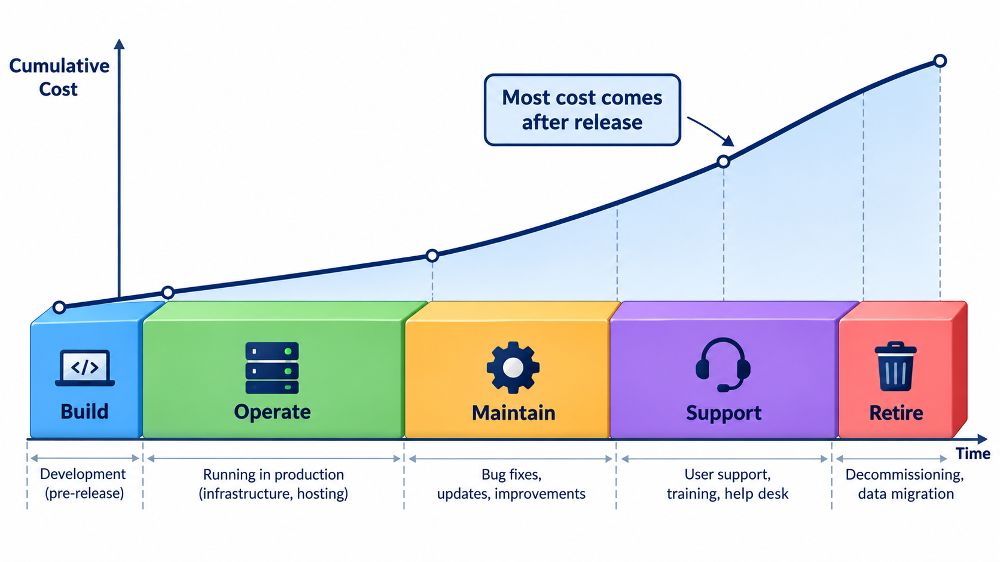
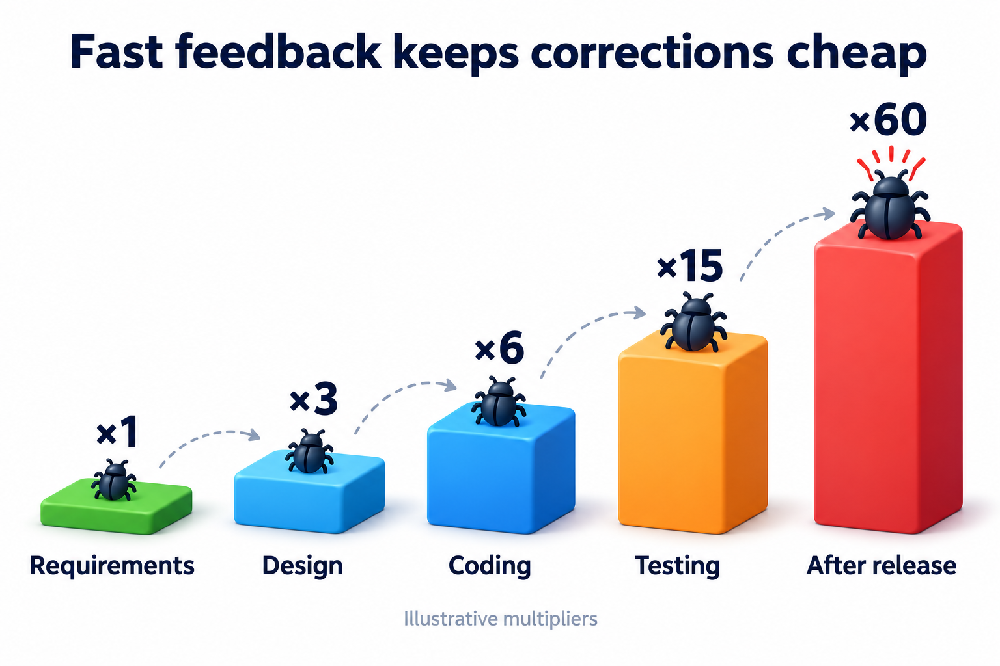
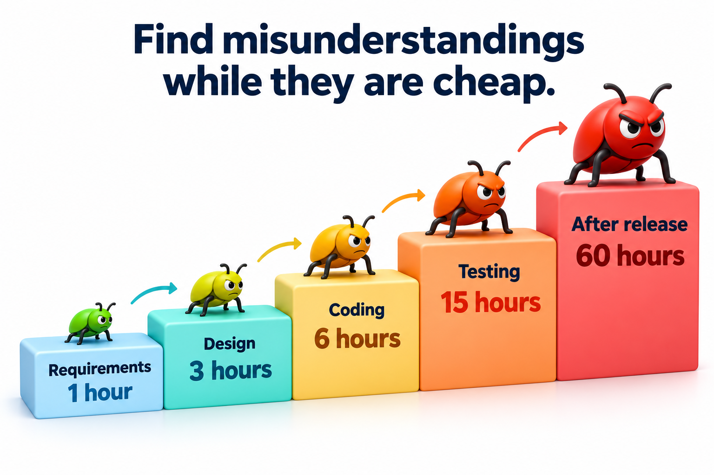
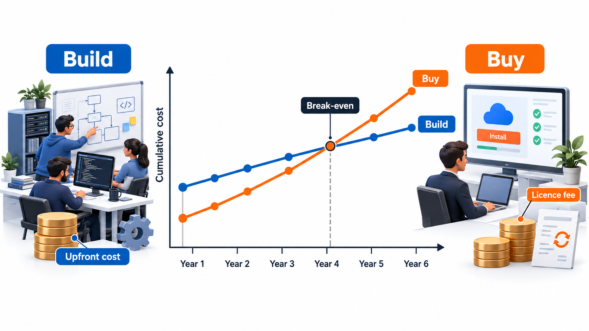
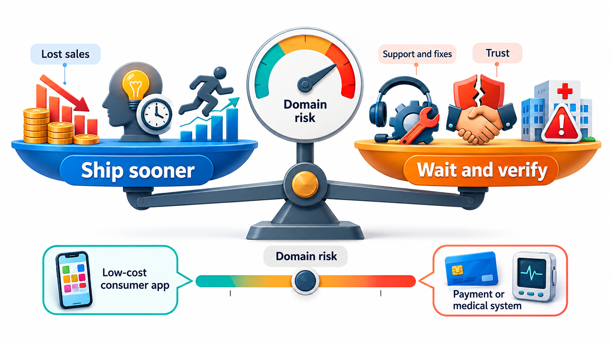
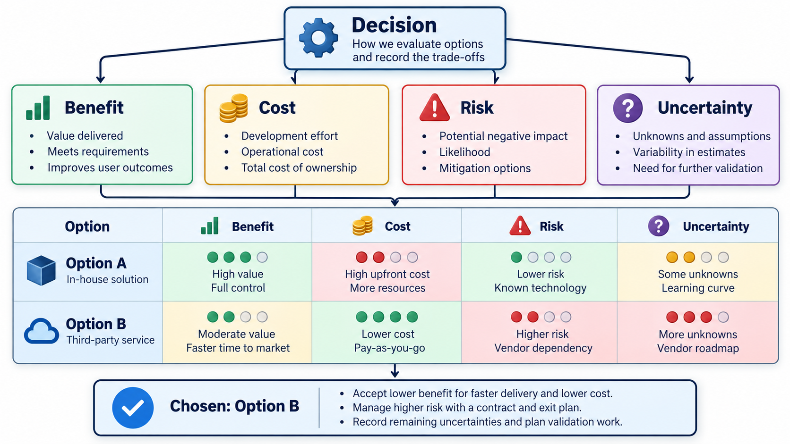

## Every Engineering Decision Is a Purchase

Choosing a design, adding a feature, skipping a test or delaying a release all spend something: money, time, attention, or the freedom to change direction later. Software engineers rarely see an invoice, but the bill arrives all the same, usually months after the decision and usually with someone else's name on it.

**Software economics** is the habit of stating the costs, benefits and risks of a decision openly so that options can be compared and defended. It does not give exact answers, because the numbers are estimates. Its value is that it makes assumptions visible, so people can argue about the assumptions instead of about opinions.

Economic thinking is not a subject only for managers. A developer who decides to copy a block of code instead of sharing it is making an economic decision: saving ten minutes now and borrowing against every later change. A tester who chooses which twenty of a thousand cases to run is allocating a scarce resource. An architect who picks a database is committing the organisation for years. In each case the quality of the decision depends on whether the person has asked what it will cost, what it will return, and what could go wrong.

## The Costs That Are Easy to Miss

The cost of software is more than the salaries of the people who write it. A fuller picture includes several kinds of cost, and the ones that are easy to miss are often the largest.

| Kind of cost | What it covers | Why it gets missed |
| --- | --- | --- |
| **Development** | Requirements, design, building, testing the first version | It is visible and budgeted |
| **Deployment and training** | Installing, migrating data, teaching users | It is treated as someone else's job |
| **Operation** | Servers, licences, monitoring, support staff, on-call time | It is spread across years and departments |
| **Maintenance** | Fixes, adapting to change, adding features | It begins after the project is "finished" |
| **Failure** | Outages, lost sales, refunds, legal costs, lost trust | It is a probability, not a certainty |
| **Opportunity** | What else the same people and money could have done | It is never written on any invoice |
| **Change of mind** | The cost of undoing a decision that turned out wrong | It depends on how reversible the choice was |

The total over the life of the software is called its **total cost of ownership**. A product with a low purchase price and a high cost of running can be far more expensive than a dearer one that is cheap to operate. The same is true of internal software: the cheapest first version is often the costliest to own.

## Software Is Mostly Paid for After the First Release

The first surprise is where the money goes. Writing the first version is usually a minority of the total cost of a system that lives for years. After release comes fixing, adapting to new laws and devices, adding what users ask for, running servers, and keeping people who understand the system. Many studies of long-lived systems put maintenance at well over half of the lifetime cost, and often much more.

This changes how decisions should be judged. A shortcut that saves a week now and costs an hour every month for five years has not saved time. A design that is slightly slower to build but easier to change may be the cheaper one, if the system will live long enough. Equally, a throw-away script for a one-off task should not be built to last. Economics asks how long the thing will live and how often it will change.

A useful habit is to ask two questions of any proposed shortcut. How many times will we pay for it, and how large is each payment? A shortcut in code that is touched once a year is cheap even if it is untidy. The same shortcut in the heart of the system, changed every week, is expensive however small it looks on the day.

## The Cost of Change

The second idea is that change is not equally expensive at all times. In the 1970s and 80s, studies of large projects, collected by Barry Boehm, suggested that a defect found in operation could cost somewhere between tens and a hundred times as much to fix as the same defect found while the requirements were still being written. The reasoning is simple. Early on, a change is an edit to a sentence. Later, it means changing the design, the build, the tests, the documents and the systems that already depend on it.

<!-- Visual: columns rising from requirements through design, coding and testing to after release, each labelled with the relative cost to fix one defect found there. -->

The exact multipliers are argued about. Teams that practise automated testing, continuous integration and small releases report that they can keep the cost of change much flatter than the older studies suggest. The curve is not a law of nature. It is a result of how a team works. What survives the argument is the direction: understanding something earlier is cheaper, and practices that make change cheap are worth investing in.

This idea has a practical consequence for how to spend money. If late change is dear, then effort put into understanding the problem early, through conversation, prototypes and careful requirements, is cheap insurance. If a team has made change cheap, through automation and small steps, it can afford to learn as it goes. Either way, the economics point at the same thing: shorten the time between making a mistake and finding out.

<!-- Visual: one misunderstanding costing one hour to fix in requirements and rising to sixty hours after release. -->

## Value: What the Money Buys

Costs only make sense next to benefits. Software creates value in a few recurring ways, and naming them helps a team decide what is worth building.

- **Earning more.** The software lets the business sell more, or sell to new customers.
- **Spending less.** It replaces manual work, reduces errors or lets fewer people do the same job.
- **Avoiding loss.** It prevents fraud, penalties or outages that would otherwise cost money.
- **Meeting a duty.** A law or contract requires it, and not having it stops the business operating.
- **Creating options.** It makes future opportunities possible that would otherwise be closed.

Two simple measures put costs and benefits side by side. The **payback period** is how long it takes for the benefits to cover the cost. The **return on investment** compares the net benefit with the amount invested. Both depend on estimates of benefit, which are usually less certain than estimates of cost, so a good analysis states the assumptions plainly and shows what happens if the benefit turns out to be half of what was hoped.

There is also a point about time. A rupee received next year is worth less than a rupee received now, because the money could have been used meanwhile and because the future is uncertain. A project that pays back in six months is a safer bet than one that pays back in six years, even if the later one returns more in total. This is why teams prefer to deliver the most valuable features first: the benefits begin sooner and the risk of a wrong guess is smaller.

## Build or Buy

Whenever a team needs a capability, whether it is sending email, taking payments or formatting text, it has three options: build it, use an open-source library, or pay for a product or service. The choice has costs on both sides, and the costs are not all in the price.

| Question | Building | Buying or borrowing |
| --- | --- | --- |
| Upfront cost | High: design, construction, tests | Lower: integration time and perhaps a fee |
| Ongoing cost | You maintain it forever | The vendor maintains it, but you pay or depend on them |
| Fit | Exactly what you need | Close to what most people need |
| Control | Full | Limited by what the vendor changes or stops supporting |
| Risk | Your own defects | The vendor's defects, price rises, licence terms, and the vendor or library disappearing |
| Time to first use | Slow | Fast |

A rule of thumb used by many teams is to build what makes the product special and buy what everyone needs. A company selling a tutoring platform builds the matching of students to tutors, which is its edge. It buys payments, email and video calls, because nobody gains by doing those better than the specialists do.

The cost comparison changes with time. Suppose building a feature costs Rs 6,00,000 upfront and Rs 1,50,000 a year to keep running, while buying costs Rs 50,000 to set up and Rs 3,00,000 a year in licence fees. The figures are illustrative. Adding them up year by year gives the cumulative cost.

| Year | Cumulative cost of building | Cumulative cost of buying | Cheaper |
| --- | --- | --- | --- |
| 1 | Rs 7,50,000 | Rs 3,50,000 | Buy |
| 2 | Rs 9,00,000 | Rs 6,50,000 | Buy |
| 3 | Rs 10,50,000 | Rs 9,50,000 | Buy |
| 4 | Rs 12,00,000 | Rs 12,50,000 | Build |
| 5 | Rs 13,50,000 | Rs 15,50,000 | Build |
| 6 | Rs 15,00,000 | Rs 18,50,000 | Build |

For the first three years buying is cheaper, because the licence beats a large upfront spend. From year four building wins, because the yearly cost of upkeep is lower. The break-even year is the real answer. If the capability will be needed for two years, buy. If it will be needed for ten, building is likely to be the better deal, as long as the team can really maintain it. The numbers leave out risks: the vendor may raise the price, the in-house version may slip its date. Cost comparisons support a decision. They do not make it.

Buying also creates a dependency, and dependencies have their own costs. A vendor can raise its prices once you are locked in, change a feature you rely on, or be bought by a competitor. A prudent team asks how hard it would be to switch away, and keeps that option alive by isolating the vendor's product behind its own interface, so that replacing it later touches one place and not the whole system.

<!-- Visual: two lines of cumulative cost over six years, one starting high and rising slowly (build), one starting low and rising faster (buy), crossing at the break-even year. -->

## Time to Market

The third idea is that time itself has a price. A product that reaches users six months sooner earns six extra months of revenue, learns what users really do, and may take the market before a competitor. In some businesses the first product on the market keeps the customers. In others, being early matters much less than being right.

Speed has a price on the other side too. Software shipped before it is ready costs more to support, and every defect that reaches users costs a fix, a patch, support time and possibly a customer. The decision is a trade, and it can be made with numbers. Compare two options: ship in month 3 with about 40 defects, or ship in month 4 with about 10 defects but lose one month of sales, say Rs 2,00,000. The right choice depends on what a single defect costs once it reaches users.

| Cost of one defect reaching users | Cost of shipping now (40 defects) | Cost of waiting (10 defects plus lost sales) | Better choice |
| --- | --- | --- | --- |
| Rs 2,000 | Rs 80,000 | Rs 2,20,000 | Ship now |
| Rs 5,000 | Rs 2,00,000 | Rs 2,50,000 | Ship now |
| Rs 10,000 | Rs 4,00,000 | Rs 3,00,000 | Wait a month |
| Rs 20,000 | Rs 8,00,000 | Rs 4,00,000 | Wait a month |
| Rs 50,000 | Rs 20,00,000 | Rs 7,00,000 | Wait a month |

When a defect is cheap to handle, shipping a month earlier is the better choice, even with four times the defects. When a defect costs Rs 10,000 or more, which happens when the software handles money or when customers leave over problems, waiting wins. The break-even is about Rs 6,667 per defect: below it, ship; above it, wait.

The right answer depends on the cost of a defect, not on a general principle that speed or quality should win. A game with a patch next week and a hospital system with no second chance sit at opposite ends. The numbers are invented; what is real is the method of writing down what each option costs and seeing where the answer flips.

<!-- Visual: a seesaw with "cost of shipping late (lost sales)" on one side and "cost of shipping defects (support, fixes, trust)" on the other, with the pivot labelled "cost of a defect in this domain". -->

## Thinking Under Uncertainty

Almost every number in an economic analysis is an estimate, and some are guesses. Three habits make decisions better despite that.

**Think in expected value and in worst case.** A risk with a 10 per cent chance of costing Rs 10,00,000 has an expected cost of Rs 1,00,000, which can be compared with the Rs 60,000 it would cost to avoid it. But the worst case matters as well: a firm that can survive a Rs 1,00,000 loss may not survive a Rs 10,00,000 one, and should pay more to avoid it than the expected value alone suggests.

**Prefer reversible decisions, and delay the irreversible ones.** A choice that can be undone cheaply, such as a library behind a clean interface, can be made quickly and corrected. A choice that cannot be undone, such as a data format that thousands of users have stored, deserves care and evidence. Keeping options open has a value, and sometimes it is worth paying a little to preserve it.

**Beware of sunk costs.** Money and effort already spent cannot be recovered, and should not decide the next step. A team that has spent eight months on an approach that is clearly failing should ask what the best course is from today, and not what would justify the eight months. The question is always about the future cost and benefit.

## Trade-offs Must Be Written Down

Every item above is a trade-off between two good things, and the best habit is to write the trade-off down: what we chose, what we gave up, and why. Months later, when someone asks why the team built its own payment screen or why it shipped with a known defect, the record answers. Without it, the decision turns into folklore and is either defended out of habit or reversed without understanding.

A good record is short. It states the situation that forced the decision, the options considered, the choice, the main reasons, and what would make the team revisit it. Some teams keep these as a numbered series of one-page notes beside the code. The cost of writing one is minutes. The benefit is that the next engineer, who was not in the room, can see the reasoning and tell whether the conditions that justified it still hold.

## Five Misreadings of Software Economics

**"Cheapest to build is cheapest overall."** Most of the cost comes after release. A cheap build that is expensive to change is not a bargain for software that will live for years.

**"Bugs cost the same whenever you find them."** The cost depends on how many other things were built on top of the mistake and how many users have met it. The exact multiplier is debated, but the direction is not.

**"Buying always beats building, or the other way round."** Neither wins in general. The answer depends on how long the capability is needed, how special it is to the product, and the risk of depending on someone else.

**"Speed to market justifies any shortcut."** Speed is worth buying only up to the point where the defects it brings cost more than the time it saves. That point is different for a game and a hospital system.

**"These numbers are what decide the matter."** The numbers are estimates. Their use is to make the assumptions visible and arguable. A decision that comes from an honest table is better than one that comes from the loudest voice, even if the table is rough.
