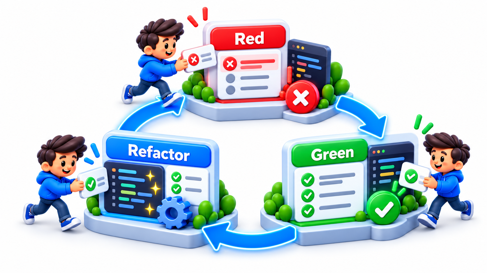
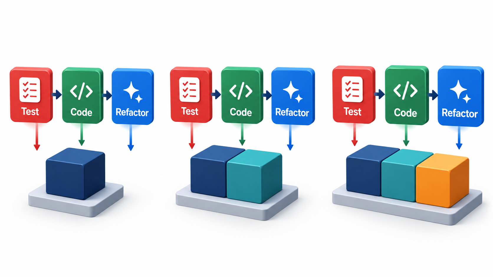
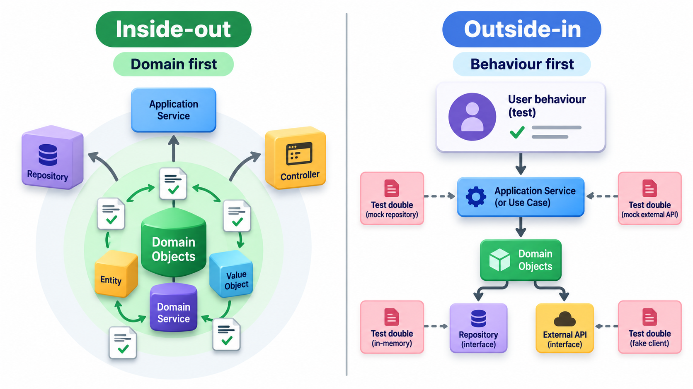
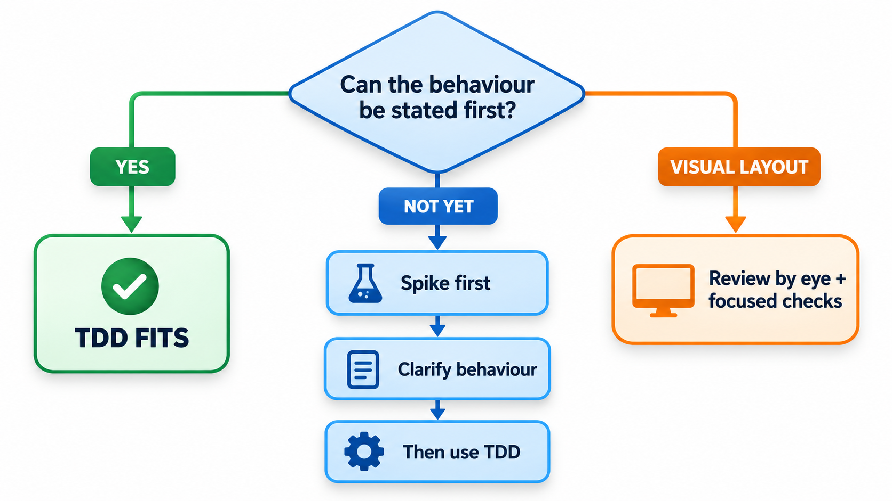

## Let a Failing Test Say What to Build Next

Most programmers write the code first and the tests afterwards, if at all. **Test-driven development**, TDD, reverses the order. Write a small test for something the code should do, watch it fail, write the least code that makes it pass, then tidy. The cycle takes minutes and repeats all day.

The test is not only a check. It is the first user of the code: writing it forces a decision about what the code should be called, what it needs and what it should return, before any of it exists. Studies of teams that adopted the practice report fewer defects, at a cost of more time up front, with the caveat that such studies are small and the results mixed. This topic describes the practice, what it does to design, and when it earns its keep.

The method was developed by Kent Beck in the late 1990s as part of Extreme Programming, and it rests on a simple observation: it is far easier to write a good test for code you are about to write than for code you wrote last month and have half forgotten.

## The Loop

**Test-driven development (TDD)** inverts the usual order. The test is written before the code it tests. The cycle, known as red-green-refactor, is short, a few minutes at most.

1. **Red.** Write a small test for a behaviour that does not exist yet. Run it and watch it fail. The failure proves that the test can fail, and that the behaviour is really missing.
2. **Green.** Write the simplest code that makes the test pass, even if it looks silly. Run the tests; all must pass.
3. **Refactor.** With the tests as a safety net, tidy the code: remove duplication, improve names, simplify. Run the tests again.

Then pick the next behaviour and begin again. A feature grows by dozens of tiny cycles, and at each moment the code works and has tests for everything it does.

<!-- Visual: test-driven development cycling through red, green and refactor. -->

## Why Watch the Test Fail?

Seeing red is not a ritual. It guards against a test that cannot fail.

| What you see | What it means |
| --- | --- |
| Test fails for the expected reason | The test works and the behaviour is genuinely missing |
| Test fails for a different reason (a typo, a missing import) | Fix the test first; it is not yet testing what you meant |
| Test passes at once | Either the behaviour already exists, or the test checks nothing. Investigate before going on |

A test that has never been seen to fail may be worthless, because nothing shows that it would notice a fault.

## Three Cycles in Practice

Take a coupon rule built in three cycles. After each cycle there is one more test and one more version of the rule, and a test counts as passing only if the version at that stage satisfies it.

| Cycle | Test added | Code written, the least that passes | Tests passing |
| --- | --- | --- | --- |
| 1 | No coupon gives no discount | Always returns 0, deliberately naive | 1 of 1 |
| 2 | Coupon SAVE10 on Rs 1,000 gives Rs 100 | Returns 10 per cent when the coupon is SAVE10, else 0 | 2 of 2 |
| 3 | SAVE10 on Rs 300 gives no discount (minimum order 500) | Returns 10 per cent only when the coupon is SAVE10 and the amount is at least 500 | 3 of 3 |

The first version is what TDD calls "the simplest thing that passes". The second test, when it arrives, forces it to change. In every cycle the number passing equals the number of tests, so each stage ends green. The sequence shows the main design effect: no behaviour was written without a test that demanded it. When a later cycle changes the code, the earlier tests keep running, so a change that breaks an earlier behaviour is noticed at once.

## What Happens in the Refactor Step

The third step is where the design improves, and it is the step most often skipped. After cycle 3 of the coupon rule, the code works but may contain a magic number (500) and a magic string ("SAVE10"). The refactor step names them and groups them, with the tests running after each small edit.

| Refactoring | Tests after |
| --- | --- |
| Replace 500 with a named minimum order | Still 3 of 3 |
| Replace the string "SAVE10" with a constant | Still 3 of 3 |
| Move coupon rules into a table of coupon, percentage and minimum | Still 3 of 3 |
| Add a second coupon by adding a table entry (and its test first) | 4 of 4 |

Because the behaviour is fixed by tests, each refactoring can be tried boldly. If a step breaks a test, the last edit is the cause.

## What TDD Does to Design

TDD is also a design technique. To write a test first, you must decide how the code will be called: its name, its inputs, its output. You are the first user of your own interface, and awkward interfaces announce themselves. A function that needs ten parameters to be set up in a test is telling you it has too many dependencies. A test that is hard to write is a sign that the design is hard to use.

The code tends to be made of small, separate pieces with few dependencies, because those are the pieces that can be tested alone. And a full set of tests accumulates as a by-product, which supports later refactoring without fear.

| Difficulty in writing the test | What it says about the design |
| --- | --- |
| Needs many objects to be created | The unit has too many dependencies |
| Needs a real database or network | Logic is mixed with input and output |
| The result is hard to check | The unit returns too little or does too much |
| The name is hard to choose | The unit has no clear purpose |
| Test set-up is longer than the test | The unit is coupled to much else |

<!-- Visual: test-first micro-cycles growing a design one behaviour at a time. -->

## Small Steps

A common beginner's mistake is to write too large a test. The discipline is to take the smallest step that moves forward: one assertion, one behaviour. Small steps keep the feedback loop tight. When a test fails after a three-line change, you know exactly where to look. The rhythm is also a pleasure, as there is a regular series of small successes. Experienced practitioners use a **test list**: a note of the behaviours still to be tested, from which they pick the next.

A test list for the coupon rule might begin like this:

| Behaviour on the list | State |
| --- | --- |
| No coupon gives no discount | Done |
| SAVE10 gives 10% | Done |
| Minimum order of 500 | Done |
| Unknown coupon code is refused | To do |
| Coupon expired | To do |
| Two coupons cannot be combined | To do |
| Discount never makes the total negative | To do |

The list is not a plan to be followed rigidly. New items appear as understanding grows, and the next one is chosen for what is most useful to learn.

<!-- Visual: tiny alternating test and code steps growing a working feature safely. -->

## Two Schools of TDD

Practitioners differ on how much to isolate the unit under test.

| Approach | Style | Strength | Risk |
| --- | --- | --- | --- |
| **Classic (state-based)** | Use real collaborators where cheap; check results | Tests survive refactoring | Failures may point beyond the unit |
| **Mockist (interaction-based)** | Replace collaborators with doubles; check calls | Drives design of collaborations | Tests tied to internals; fragile |

Neither is wrong. Beginners usually do well with the classic style and add doubles for slow or external parts.

## When TDD Helps, and When It Does Not

TDD works best where the behaviour can be described precisely before the code: business rules, calculations, parsers, algorithms, data transformations, and APIs. In these, the test is a clear statement of intent, and the cycle goes quickly.

It is a poorer fit in some situations.

- **Exploratory work.** When you do not yet know what you want, such as trying out a new library or a user interface layout, tests written first are guesses that get thrown away. A throwaway "spike" to learn, followed by TDD of the real thing, is a common pattern.
- **Visual and interaction design.** Whether a screen looks right is not easily stated as an assertion.
- **Code that is mostly glue.** A thin layer that wires together other systems gives little for unit tests to check.
- **Legacy code without seams.** Code that was not designed for testing needs some restructuring first.

Teams also differ in how strictly they apply it. Some do TDD for every line. Many do it for the core logic and write tests after for the rest. What matters more than the order is that tests exist, are fast and are trusted.

<!-- Visual: a decision aid with branches: clear behaviour that can be stated first leads to "TDD fits", unknown behaviour leads to "spike first, then TDD", and visual layout leads to "review by eye plus a few checks". Save as images/101_when_tdd_fits.png. -->

## Common Mistakes

| Mistake | Effect | Remedy |
| --- | --- | --- |
| Writing a big test first | Long red period; unclear next step | Break it into smaller behaviours |
| Skipping the refactor step | Code works but grows messy | Make refactor a fixed part of the loop |
| Writing more code than the test needs | Untested behaviour creeps in | Write only what turns the test green |
| Testing implementation details | Tests break on refactoring | Test behaviour through the public interface |
| Never running the full suite | Surprises later | Run all tests regularly |
| Treating tests as second-class code | Suite becomes unreadable | Apply the same standards as production code |

## Five Misreadings of TDD

**"TDD means writing all the tests first."** It means one small test at a time, in a loop of minutes.

**"TDD is only about testing."** It is equally about design. The tests are a by-product and the better interfaces are a main gain.

**"The tests prove the code is correct."** They prove it does what the tests say. A wrong test gives wrong confidence, so tests too need review.

**"TDD is too slow."** It adds time at the start and removes time in debugging and rework. The studies found longer initial development and far fewer defects.

**"You must follow TDD for everything or not at all."** Apply it where it pays, and make up your mind from experience.
