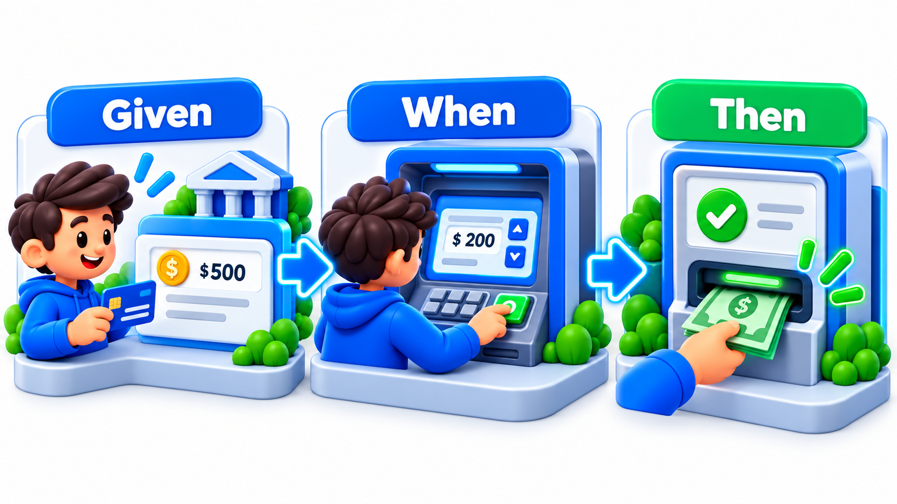
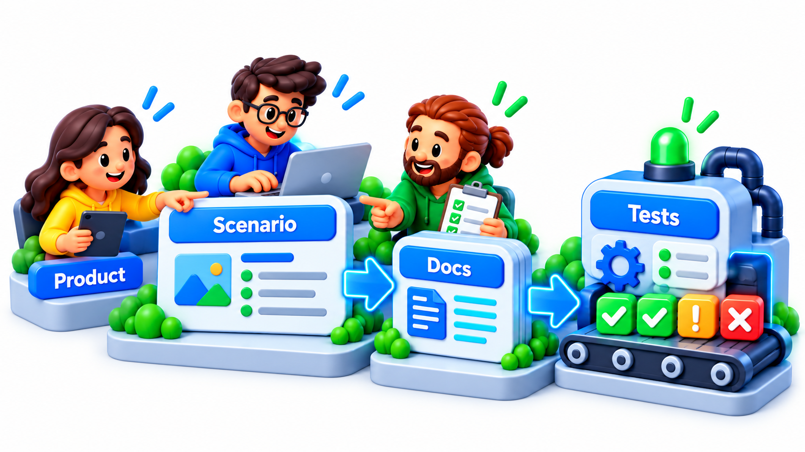
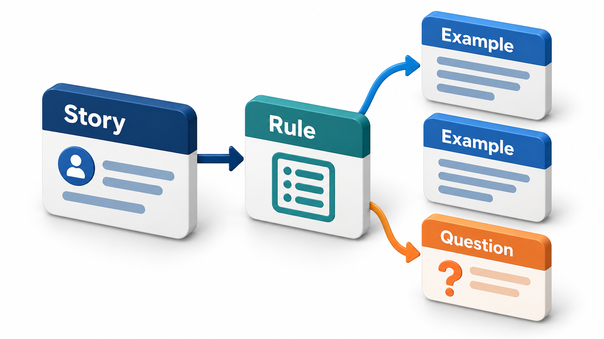
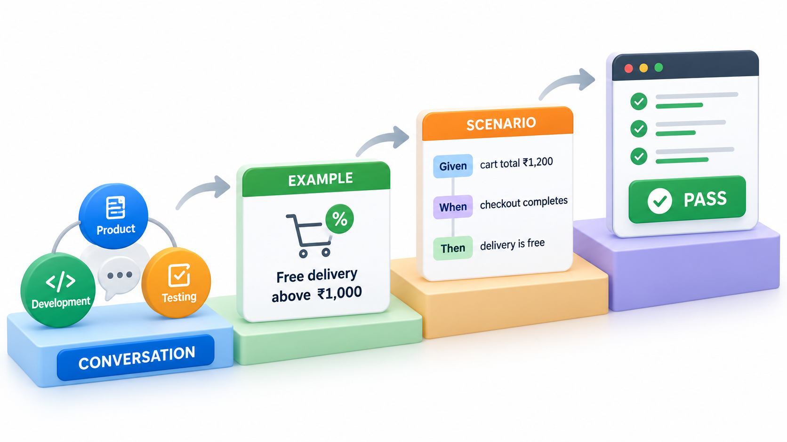
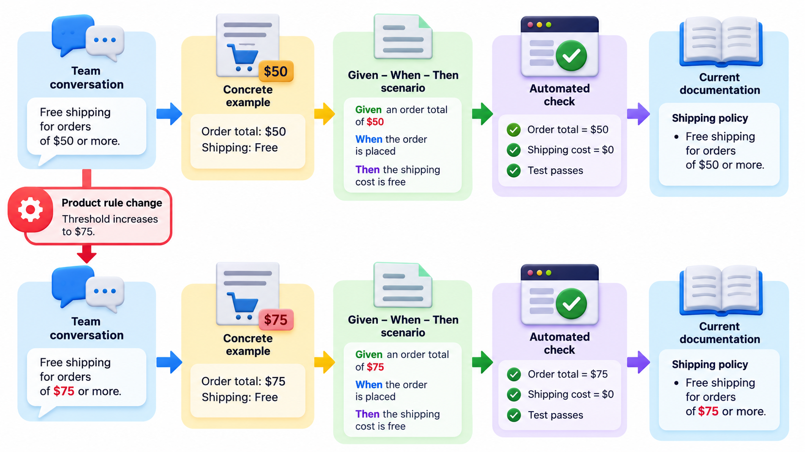

## Describing Behaviour in Words Everyone Understands

Many people treat the word *test* as meaning "check that the code I wrote does what I wrote". Then they have no idea what to write first, what to call it, or how much one test should cover. A small change of vocabulary helps. If tests are named as sentences about behaviour, such as "should reject a payment of zero", it becomes easier to decide what to write, and the names tell a reader what the system is meant to do.

**Behaviour-driven development**, BDD, extends test-driven development in this direction. The examples of behaviour are written in a plain language that anyone on the project can understand, an accountant, a product owner or a tester, using the pattern Given, When, Then. The same examples serve as specification, conversation and automated test.

The idea came from Dan North, who noticed in the mid-2000s that teams new to TDD were stuck on the word "test" and that renaming the activity around behaviour made it easier to learn. The practice grew from there into a way of working that joins business and technical people.

## The Problem BDD Addresses

The most expensive failures in software are not coding errors but misunderstandings. The business person says "reminder", the developer builds an email, and the business person meant an SMS. Each side nods in the meeting and leaves with a different picture. Specifications in prose are open to many readings. Tests in code are precise but unreadable to the people who know what the system ought to do.

BDD tries to bring the two together. The team writes down the behaviour of the system as concrete **examples** in a structured plain-English form, and those examples are both the specification and, once connected to code, the automated tests.

| Form of specification | Readable by business? | Precise? | Always up to date? |
| --- | --- | --- | --- |
| Prose requirement | Yes | No: open to interpretation | No: drifts from the code |
| Test code | No | Yes | Yes, if tests run |
| BDD scenario | Yes | Yes: concrete examples | Yes: it is run as a test |

## Given, When, Then

The form of the example is the same one used for acceptance criteria. Each scenario has three parts.

- **Given** the starting situation: the state of the world before.
- **When** an event or action occurs.
- **Then** the observable outcome that should result.

*Given* a student with a fee due of 5,000 rupees, *when* the student pays 5,000 rupees, *then* the balance is 0 and a receipt message is sent.

The language is chosen from the problem domain, so a non-programmer can read it, challenge it and say "no, that's not what happens when the payment is partial". Tools such as Cucumber, SpecFlow and Behave read these scenarios, written in a notation called **Gherkin**, and run them as tests by matching each line to a piece of code.

<!-- Visual: given, When and Then structuring one behaviour as a shared example. -->

## The Shape of a Feature File

A Gherkin file groups scenarios under a feature, using a few keywords.

| Keyword | Purpose | Example |
| --- | --- | --- |
| **Feature** | Names the capability and who benefits | "Fee payment: students can pay what they owe" |
| **Background** | Steps shared by every scenario in the file | "Given a student with a fee due of 5,000" |
| **Scenario** | One concrete example | "Paying in full clears the balance" |
| **Given / When / Then** | The three parts | As above |
| **And / But** | Continue a part without repeating the word | "And a receipt message is sent" |
| **Scenario Outline with Examples** | One scenario run with a table of values | See below |

A scenario outline avoids repeating a scenario for many data values. For example, one outline with a table of amounts:

| Amount paid | Balance after | Message sent |
| --- | --- | --- |
| 5,000 | 0 | Receipt sent |
| 3,000 | 2,000 | Partial payment received |
| 0 | 5,000 | Payment refused |
| 6,000 | 0 and a refund of 1,000 | Overpayment refunded |

Each row is run as a separate test, with the same wording. Tables like this are easy for a business person to read and check, and quickly reveal missing cases.

## How the Matching Works

A tool turns plain sentences into checks by matching the opening words of each line to a small piece of code, and treating the rest of the line as its argument. Take one scenario.

| Line of the scenario | Matched to | Outcome |
| --- | --- | --- |
| Given a fee due of 5000 | A step that sets the balance to 5,000 | OK |
| When the student pays 5000 | A step that reduces the balance by 5,000 and records "Receipt sent" | OK |
| Then the balance is 0 | A check that the balance equals 0 | OK |
| And the message is Receipt sent | A check that the message is "Receipt sent" | OK |

The "given" and "when" steps change the state of the system; the "then" steps check it. The scenario at the bottom could be read by an accountant, who could point out an error in it. A real tool does the same matching with patterns, and the scenarios stay in plain text files beside the code.

## The Three Amigos

BDD is as much a way of working as a tool. Before a story is built, three perspectives meet, a gathering called the **three amigos**: the person who knows the business need (the product owner or analyst), the person who will build it (a developer) and the person who will test it (a tester). They discuss the story and work through examples together. Each sees it differently. The business person describes what is wanted. The developer asks how it can be built. The tester asks "what if?". The conversation turns up misunderstandings, edge cases and missing rules in an hour, before any code exists.

The outcome is a small set of concrete examples that all three agree on. These become the scenarios.

<!-- Visual: product, development and testing collaborating around shared behaviour examples. -->

## A Conversation That Finds a Missing Rule

Consider the story "As a student, I can pay my fee online". Here is how the three perspectives might uncover a gap in minutes.

| Who | What they say | What it reveals |
| --- | --- | --- |
| Product owner | "The student pays what they owe and gets a receipt." | The basic rule |
| Tester | "What if they pay less than they owe?" | The partial-payment case was never specified |
| Product owner | "Then we record it and show the balance." | New rule |
| Developer | "What if they pay twice by mistake?" | Duplicate payment protection |
| Product owner | "Refund the extra within a week." | New rule, and a new story for refunds |
| Tester | "What if the payment gateway times out?" | Failure case |
| Developer | "We can check the status afterwards, but the student must see something." | A message and a retry, to be agreed |

Three questions produced three missing rules and a new story. Finding them after the code was written would have cost many times more.

## Example Mapping

A technique for running such a conversation is **example mapping**, devised by Matt Wynne. It uses four colours of card: a yellow card for the story, blue cards for the rules it must obey, green cards for examples that illustrate each rule, and red cards for questions nobody can answer yet. In twenty-five minutes a group can see whether a story is ready: many red cards mean it needs more thought, and a pile of blue ones may mean it should be split. The green cards become the scenarios.

| Card | Colour | Example for the payment story |
| --- | --- | --- |
| Story | Yellow | Student pays fee online |
| Rule | Blue | Partial payments are allowed |
| Example | Green | Fee 5,000; pays 3,000; balance 2,000 |
| Rule | Blue | Overpayments are refunded |
| Example | Green | Fee 5,000; pays 6,000; refund 1,000 |
| Question | Red | Is there a minimum payment? |

<!-- Visual: example mapping connecting a story to its rules, examples and open questions. -->

## Writing Good Scenarios

| Principle | Weak scenario | Strong scenario |
| --- | --- | --- |
| **Behaviour, not interface** | "Click the button with id pay-btn" | "When the student pays 5,000" |
| **Business language** | "POST to /api/payments" | "When the student pays by UPI" |
| **One behaviour each** | A scenario that logs in, pays, downloads and logs out | Separate scenarios per behaviour |
| **Concrete values** | "Given some fee" | "Given a fee due of 5,000" |
| **Independent** | Needs another scenario to run first | Sets up its own state |
| **Brief** | Fifteen steps | Three to seven |

## Strengths and Cautions

**What BDD gives.** A shared language between business and technical people. Early discovery of misunderstandings. Specifications that are *executable* and so cannot drift from the code. Tests that read as documentation of behaviour.

**Where it goes wrong.**

- **Treating it as a testing tool only.** If testers alone write the scenarios in isolation, the gain, the conversation, is lost, and what remains is an awkward way of writing tests.
- **Scenarios that describe the interface and not the behaviour.** "Click the button with id pay-btn" belongs in a technical test. A scenario should say what the user achieves, in business terms.
- **Too many scenarios.** Each one costs effort to maintain. They are best kept for the important rules and examples, and detail is left to unit tests.
- **Brittle step definitions.** When the matching code is tangled, a small change breaks many scenarios.

A good rule is that a scenario should be understandable by a business person and should survive a change in the screen design.

<!-- Visual: a ladder from business conversation to example to scenario to automated check, with the business person, developer and tester gathered at the first rung. Save as images/102_conversation_to_automation.png. -->

## Living Documentation

Because scenarios are run on every build, they cannot silently go out of date: if the behaviour changes, a scenario fails until someone updates it. A readable report of the passing scenarios is therefore documentation that is known to be true. New joiners can read it to learn what the system does, and business people can check it against their expectations.

## Five Misreadings of BDD

**"BDD is Cucumber."** The tool is optional. The core is the conversation and the examples. Teams get value from the practice with no tool at all.

**"BDD is a way for testers to write tests."** It is a way for the whole team to agree on behaviour. The tests follow from the agreement.

**"Scenarios replace unit tests."** They cover important business behaviour. Unit tests still cover the logic in detail, and are far faster.

**"More scenarios means a better specification."** A few well-chosen examples per rule are better than many near-duplicates.

**"BDD is the same as TDD."** TDD is a developer technique focused on design. BDD widens it to the team and puts it in the language of the business.
