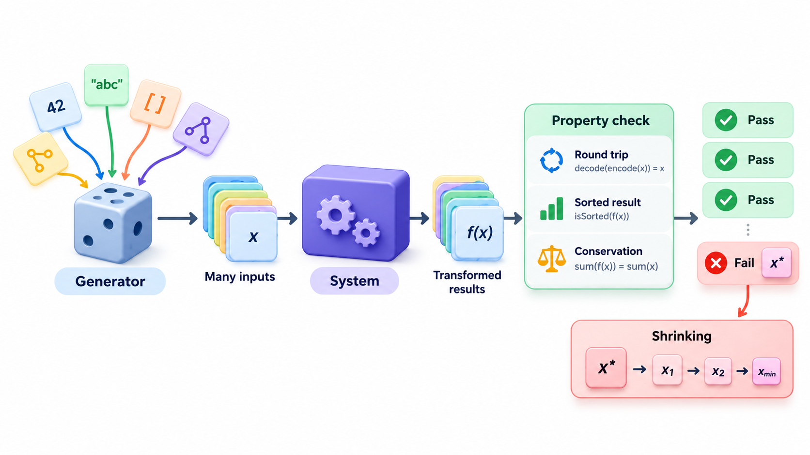
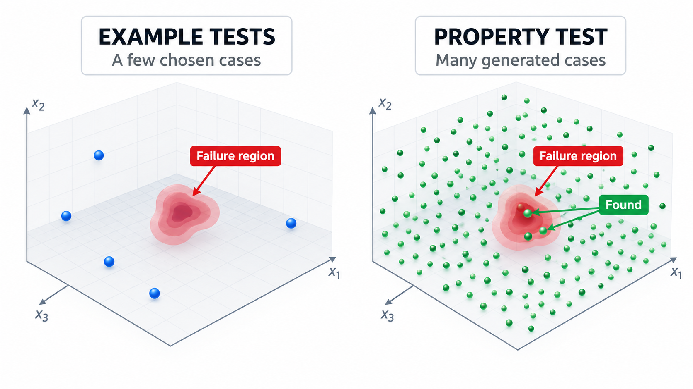
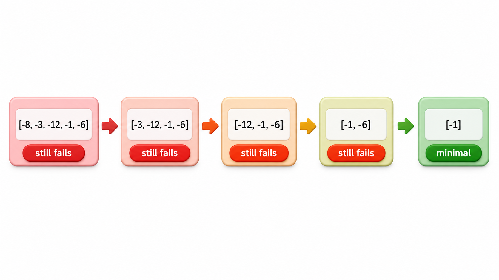
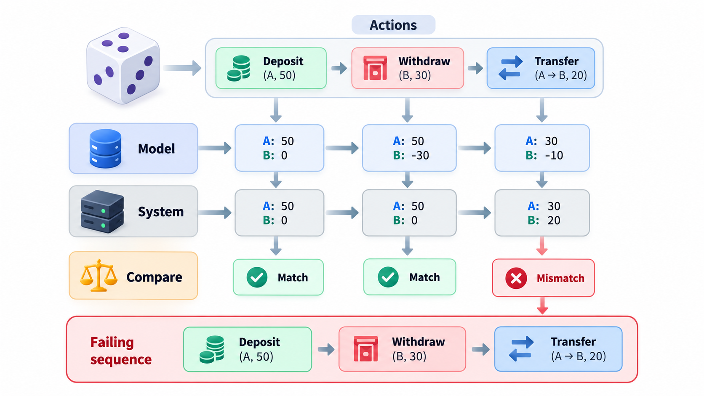
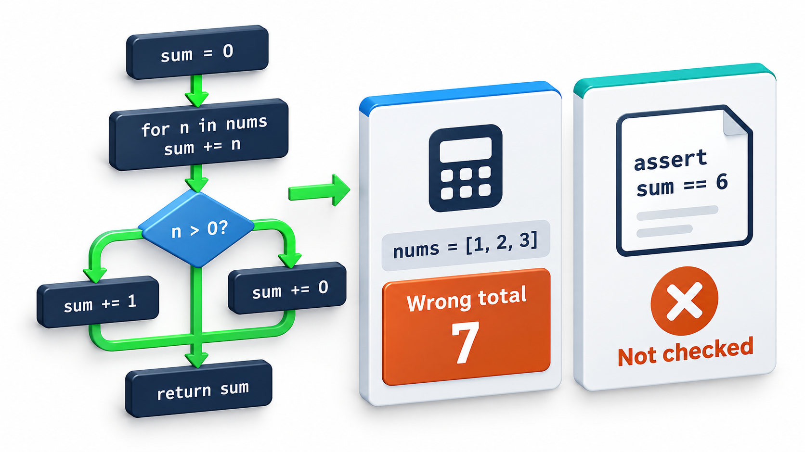

## From "For This Input" to "For Any Input"

An ordinary test says: for this input, expect this output. It checks a handful of examples chosen by a person, and the person tends to choose the examples they already thought of. A **property-based test** says something stronger: for *any* input of this kind, this statement should hold. The test tool then generates thousands of random inputs and tries to break the statement.

When it finds a failure, it also *shrinks* the failing input to the smallest one that still fails, which usually points straight at the cause. The approach has found subtle faults that conventional tests missed, including problems that appear only under rare sequences of events.

The idea was popularised by a tool called QuickCheck, written for the language Haskell around the year 2000, and has since been copied into almost every language.

## Examples Versus Properties

An **example-based test** checks one case that the author thought of: sorting the list 3, 1, 2 should give 1, 2, 3. It is clear and easy to read. It also tests only what the author imagined, and a developer who has misunderstood a rule will write the example that agrees with their misunderstanding.

A **property** is a general statement about the behaviour. For a sort function:

- The output has the same length as the input.
- The output is in non-decreasing order.
- The output contains exactly the same items as the input.
- Sorting an already sorted list changes nothing.

None of these names a specific list. Each should be true for every list. A tool then generates many lists, hundreds or thousands, including empty ones, one-element ones, lists with duplicates, huge values, negative numbers, and checks every property on each.

Properties are often easier to find than one might think. Common shapes are *round trips* (encode then decode returns the original), *invariants* (the total is unchanged by a transfer between accounts), *idempotence* (doing it twice equals doing it once), *comparison with a simpler version* (the fast code gives the same answer as slow but obviously correct code) and *oracles* (the output satisfies a check that is easy to state even if hard to compute).

| Shape of property | Statement | Example |
| --- | --- | --- |
| **Round trip** | Undo after do gives the original | Decoding an encoded record returns the same record |
| **Invariant** | Something stays true after any operation | The total money in all accounts is unchanged by a transfer |
| **Idempotence** | Doing it twice equals doing it once | Removing duplicates from an already unique list changes nothing |
| **Commutativity** | Order does not matter | Adding items A then B gives the same cart total as B then A |
| **Reference model** | Matches a slow, simple version | A fast cache gives the same answers as a plain dictionary |
| **Oracle** | The result passes an easy check | A square root squared is close to the input |
| **Metamorphic** | A change to the input gives a predictable change to the output | Doubling every price doubles the total |

<!-- Visual: two columns. Left, example tests, a few hand-picked dots in a large input space. Right, a property with a generator spraying many random points across the space, a few of which hit a failure region. Save as images/103_examples_vs_properties.png. -->

## Generators and Shrinking

Two parts make the approach work.

A **generator** produces random inputs of the right shape: integers in a range, lists of up to ten items, strings, records. Good generators favour the awkward values, such as zero, the empty list and the largest number, since faults gather there. A fixed seed makes a run repeatable, so a failure can be reproduced.

**Shrinking** deals with a practical problem. A randomly generated failing input is usually long and messy: a list of fifteen numbers, only one of which matters. The tool does not stop at the first failure. It tries simpler inputs, shorter lists, smaller numbers, and keeps whichever still fails, until it can reduce no further. The developer is then shown the *smallest* failing example, which is often obvious at a glance.

| Kind of data | What a generator might produce | Awkward values it should favour |
| --- | --- | --- |
| Integer | Any whole number in a range | 0, 1, -1, the largest and smallest values |
| Text | Random strings | Empty, one character, very long, special characters, accents |
| List | Lists of varying length | Empty, one item, duplicates, already sorted, reversed |
| Date | Any date in a range | Month ends, leap days, year boundaries |
| Record | A student with random fields | Missing optional fields, extreme values |

## A Property Test, by Hand

Take a function that is meant to return the largest number in a list, but has a bug: it starts its search at zero. The property says that the answer must be in the list and no element may be bigger. A generator with a fixed starting point makes lists, and once one fails, the failing input is shrunk.

| Stage | What happens |
| --- | --- |
| Property | The answer must be an element of the list and at least as big as every element |
| Generating | The first list the generator builds is all negative: -1, -2, -8, -5, -1 |
| Result | The function returns 0, which is not even in the list, so the property fails at once |
| Shrinking | Each element is tried for removal, and the drop is kept if the property still fails |
| Smallest failing input | A single number: -1 |

The function works for any list with a positive number. For a list of only negative numbers it returns 0. An example test written by hand might never have tried a list of only negatives. The generator tried one on its first attempt, and shrinking turned a list of five numbers into a single one that points straight at the cause.

<!-- Visual: a failing list of five negative numbers shrinking step by step, dropping one element at a time while the failure stays, until a single negative number remains. Save as images/103_shrinking_steps.png. -->

## A Round-Trip Property for a Fee Record

A second example shows a property that guards a realistic piece of code: saving a fee record to text and reading it back.

| Step | Value |
| --- | --- |
| Generate a record | Roll 1042, name "O'Brien, Aoife", amount 5000.50, note "paid, in 2 parts" |
| Save to text | A line with fields separated by commas |
| Read it back | The comma inside the name and the note is mistaken for a separator, giving too many fields |
| Property | Reading what was saved returns the original record |
| Result | Fails; shrinking reduces the record to a name that contains a single comma |

A handful of hand-written examples would probably have used plain names. The generator, which includes awkward characters, found the problem on its own, and shrinking pointed at the comma.

## Testing Sequences of Actions

Properties can also describe how a system behaves under a sequence of operations, not just one call. The tool generates random sequences, such as add, remove, add, clear, add, and checks that a model agrees with the real thing after each step.

| Sequence generated | Real shopping cart total | Simple model's total | Agree? |
| --- | --- | --- | --- |
| add A (100) | 100 | 100 | Yes |
| add B (50) | 150 | 150 | Yes |
| remove A | 50 | 50 | Yes |
| add A (100), add A (100) | 250 | 250 | Yes |
| remove A | 150 (bug: removed only one) or 50 | 50 | If the real cart disagrees, the sequence is a counterexample, and shrinking reduces it to the shortest |

Sequences like this reach states no human tester would think to build, and have found real faults in databases and distributed systems.

## Where It Pays

Property-based testing is strongest where the input space is large and the rules are general: parsers and serialisers (round trip), data structures (invariants hold after any sequence of operations), numeric code, protocols, state machines (any sequence of valid actions leaves the system consistent) and anything with a simpler reference to compare against. Libraries exist for most languages: Hypothesis for Python, jqwik for Java, fast-check for JavaScript, and QuickCheck's descendants almost everywhere.

It does not replace example tests. Examples document intended behaviour clearly and catch specific known cases. Properties find the cases nobody thought of. A healthy suite uses both: a handful of examples that tell the story, and properties that guard the rules.

The hardest part is thinking up good properties, since it requires understanding what the code is *for*. That is also a benefit. Stating the property exposes whether the specification is clear.

<!-- Visual: A coverage limit showing that passing the cases tried does not prove the rest. -->

## Practical Cautions

| Caution | Why | Remedy |
| --- | --- | --- |
| **Properties that restate the code** | A test that repeats the implementation proves nothing | State a relationship, not the computation |
| **Slow runs** | Thousands of cases per property | Cap the case count in everyday runs; run more overnight |
| **Flaky failures** | Random inputs differ between runs | Record the seed; replay a saved failure |
| **Weak generators** | Inputs never reach interesting regions | Add domain-specific generators |
| **Too-narrow assumptions** | Filtering out most generated inputs | Build valid inputs directly instead of discarding |

## Five Misreadings of Property-Based Testing

**"It is just random testing."** Randomness generates the inputs, but the properties give the tests their power, and shrinking turns noise into a clear example.

**"Properties replace examples."** Examples are clearer for documentation and for known cases. Use both.

**"A property must describe the exact output."** It usually describes a relationship. If you could state the exact output you would have written the function twice.

**"It finds only trivial bugs."** It has found faults in car software, databases and distributed systems that conventional testing missed.

**"A failure it finds might not be real."** The input is saved and replayable. If the property is right, the failure is real. If it is wrong, that is useful to learn too.
