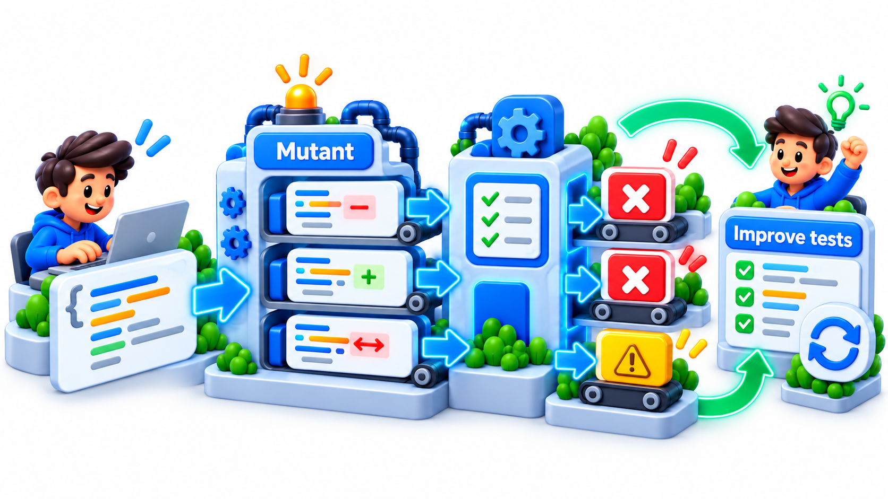
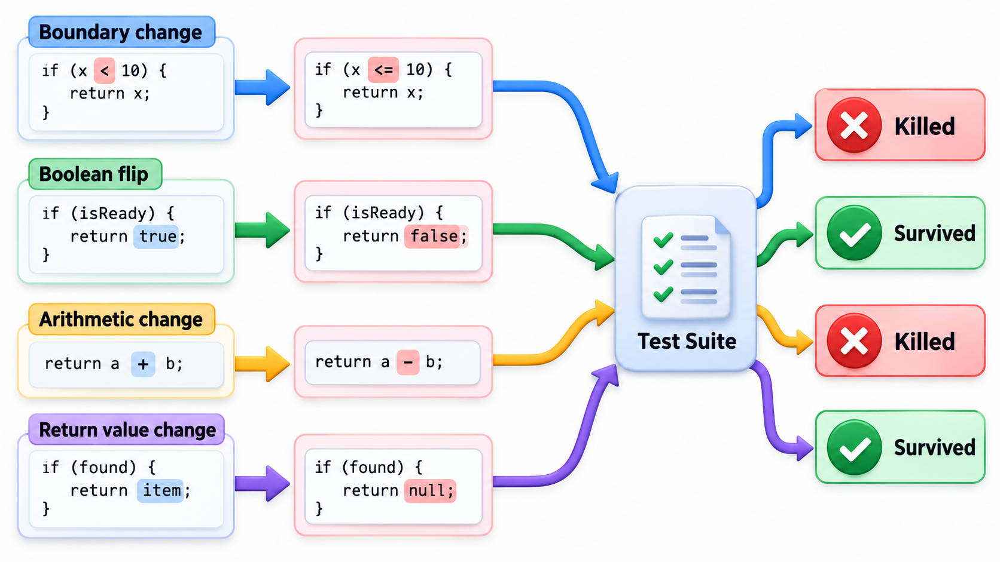
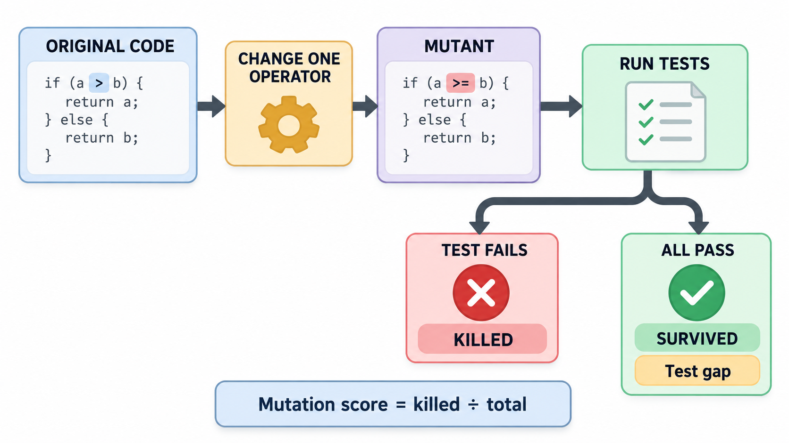
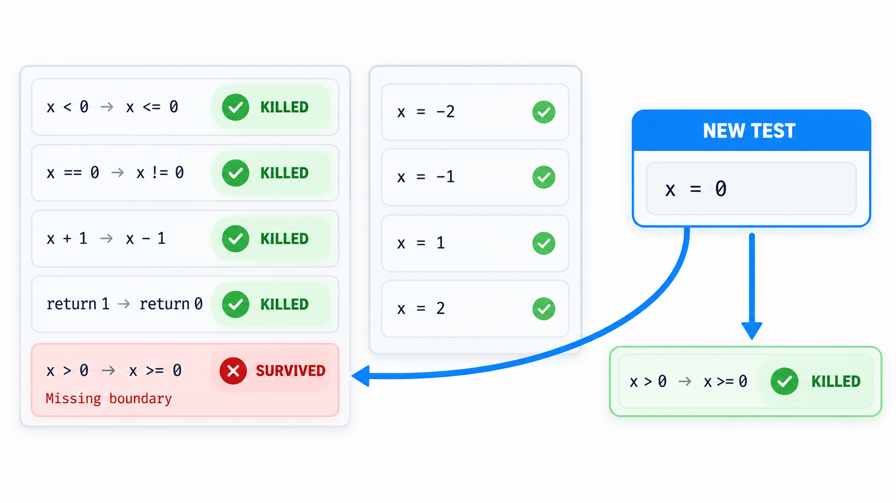
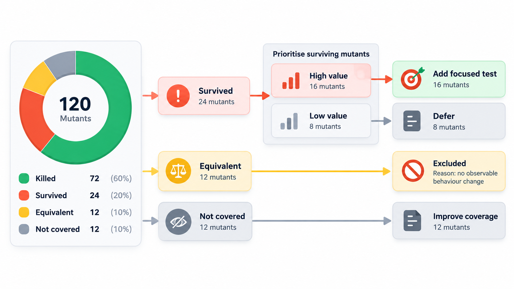

## Testing the Tests

How do you know whether your tests are any good? Counting how much of the code they run does not say whether they would notice a mistake. A more direct idea: deliberately put bugs into the program and see whether the tests notice. A test suite that passes with a bug in the code has shown that it cannot see that bug.

That is **mutation testing**. A tool makes many copies of the program, each with one small change (a "mutant"), and runs the tests against each. A mutant that makes a test fail is *killed*; one that no test notices *survives*. For decades it was too slow for large programs, since the test suite must be rerun thousands of times, but modern machines have made it practical, even as part of code review.

The idea rests on two observations. First, real faults are usually small: a wrong operator, an off-by-one, a missing condition. Second, a test suite that can detect small deliberate faults is likely to detect small accidental ones too.

## What Coverage Cannot See

A coverage report says which lines the tests ran. It does not say whether the tests would notice if those lines were wrong. A test that calls a function and checks nothing gives full coverage and no protection. Mutation testing measures what coverage cannot: whether the tests are **sensitive** to errors.

The process is simple.

1. The tool makes a copy of the code with one small change, a **mutant**. Typical changes are replacing "less than" with "less than or equal to", a plus with a minus, "and" with "or", or true with false, deleting a statement or changing a constant.
2. It runs the test suite against the mutant.
3. If at least one test fails, the mutant is **killed**: the tests detected the change. That is good.
4. If every test still passes, the mutant has **survived**. The tests cannot tell the changed code from the original. That is a gap.
5. The **mutation score** is the share of mutants killed.

A surviving mutant points to a specific missing test. It says: change this operator here, and nothing fails.

| Measure | Question | Cannot tell you |
| --- | --- | --- |
| **Line coverage** | Did the tests run this line? | Whether any test would notice a fault in it |
| **Branch coverage** | Did the tests take both ways of this decision? | Whether the outcomes were checked |
| **Mutation score** | Would the tests notice a small fault here? | Whether the tests cover every kind of fault |

<!-- Visual: mutation testing checking whether tests detect deliberate defects. -->

## The Common Mutation Operators

Tools apply a standard set of small changes, each imitating a typical programming slip.

| Operator | Change | Imitates |
| --- | --- | --- |
| **Relational** | "less than" becomes "less than or equal to"; "at least" becomes "more than" | Boundary mistakes |
| **Arithmetic** | `+` becomes `-`, `*` becomes `/` | Wrong calculation |
| **Logical** | `and` becomes `or`, `not` removed | Wrong combination of conditions |
| **Constant** | `0` becomes `1`, `100` becomes `101` | Off-by-one, wrong limit |
| **Return value** | Return `0`, `None` or the opposite boolean | Missing or wrong result |
| **Statement removal** | Delete a call or an assignment | Forgotten step |
| **Conditional removal** | Replace a condition with `true` or `false` | Checks that do nothing |

## Mutating by Hand

Take a rule that lets a member borrow a book only when they hold fewer than 3 books, and three mutants, each a copy with one small change: the comparison changed to "at most 3", the comparison reversed, and the limit raised from 3 to 4.

| Mutant | Change | Weak tests (0 books and 1 book) | Strong tests (also 2 books and 3 books) |
| --- | --- | --- | --- |
| 1 | "fewer than 3" becomes "at most 3" | Survives | Killed by the test with 3 books |
| 2 | Comparison reversed | Killed: wrong answer for 0 books | Killed |
| 3 | Limit changed to 4 | Survives | Killed by the test with 3 books |
| **Mutation score** | | 1 of 3, 33% | 3 of 3, 100% |

A failing test means the tests noticed the change. The weak suite kills only the mutant that reverses the comparison. The `at most 3` change and the limit of 4 survive, since neither shows up with such small numbers. The strong suite adds the boundary case of exactly 3, which gives a different answer in both. That is the lesson in miniature: the weak suite might have shown high coverage and still missed the boundary. The surviving mutants say exactly which test was missing. Real tools create the mutants automatically, in thousands.

## Equivalent Mutants and Cost

Mutation testing has two difficulties. The first is the **equivalent mutant**: a change that does not alter the behaviour at all, such as replacing `x * 1` with `x`. No test can kill it, and a tool cannot easily tell it from a real survivor. Surviving mutants therefore need a human to look. The second is cost. A large program yields thousands of mutants, each needing a test run. Tools reduce this by mutating only changed code, running only the tests that cover the mutated line, stopping at the first failing test, and sampling.

For these reasons teams use mutation testing selectively: on the most important code, such as payment logic, or on new changes, and not on the whole system all the time. Tools exist for most languages: PIT for Java, Stryker for JavaScript and C#, mutmut for Python.

| Cost lever | How it helps |
| --- | --- |
| Mutate only code changed in this pull request | Hundreds of mutants instead of tens of thousands |
| Run only tests that cover each mutated line | Each mutant needs a few tests, not the whole suite |
| Stop at the first failing test | Killed mutants cost almost nothing |
| Time-out mutants that cause infinite loops | They count as killed |
| Sample a fraction | A statistical estimate of the score |

## Reading a Surviving Mutant

A surviving mutant is a question to answer. There are usually three answers.

<!-- Visual: the mutation testing loop: make a mutant by changing one operator, run the tests, then either a test fails and the mutant is killed, or all pass and the mutant survives, with the score as killed divided by total. Save as images/104_mutation_loop.png. -->

- **The test is missing.** Add one that kills it. This is the common case, and the boundary tests in the example were exactly that.
- **The assertion is too weak.** A test runs the code but checks little. Strengthen what it checks.
- **The code is unnecessary.** If changing a line makes no difference to any behaviour, perhaps the line should not be there.

<!-- Visual: a list of mutants beside a test suite, with killed mutants ticked, survivors flagged, and an arrow from one survivor to a new boundary test that kills it. Save as images/104_surviving_mutant_to_new_test.png. -->

## A Survivor Report, Read Line by Line

A tool run on a late-fine function might report these survivors.

| Line | Mutant | Verdict |
| --- | --- | --- |
| "days more than 0" | Changed to "days at least 0" | Survived: a test with exactly 0 days late is missing, but the result is the same fine of 0, so this one is equivalent |
| "fine equals days times 5" | Changed to days times 6 | Survived: no test checks the rate. Add a test for 3 days = 15 |
| "the smaller of the fine and 100" | "smaller" replaced by "larger" | Killed |
| "record that the fine was computed" | Statement removed | Survived: logging; acceptable |

One of four needs a new test, one is equivalent, one is harmless, and one was caught. The work of reading is a few minutes, and the missing test for the rate is exactly the kind of gap a coverage report would have hidden.

## Using It in a Team

| Practice | Why |
| --- | --- |
| Run on critical modules first | Payments and security justify the cost |
| Set a score target for new code | For example, at least 80 per cent in changed files |
| Review survivors in code review | They are specific, actionable comments |
| Do not chase 100 per cent | Equivalent mutants and trivial code make it wasteful |
| Combine with coverage | Coverage finds unrun code; mutation finds unchecked code |

## Mutation Testing Beside Other Measures

Each measure of test quality answers a different question, and a team gets the clearest picture by reading them together.

| Situation | Coverage | Mutation score | What it tells you |
| --- | --- | --- | --- |
| Tests run all code and check results well | High | High | Strong tests |
| Tests run all code but assert little | High | Low | Tests that look good and protect little |
| Tests run little code, but check it well | Low | High in the covered part | Good tests, large untested areas |
| Tests run little and check little | Low | Low | Weak suite |

The second row is the dangerous one. A team that reports only coverage believes it is safe; the mutation score reveals that the tests would not notice most faults. Many teams adopt a simple rule: coverage finds what is never run, and mutation testing is applied to the code that matters most.

## Five Misreadings of Mutation Testing

**"A high mutation score means the code is correct."** It means the tests are sensitive to the changes tried. The code can still be wrong in ways no mutant imitates.

**"Mutation testing replaces coverage."** Coverage finds code never run. Mutation testing finds code run but not checked. They complement each other.

**"Every surviving mutant must be killed."** Some are equivalent and cannot be. Use judgement.

**"It is only for researchers."** Tools exist and companies use them in review. Applied to critical code, it is a practical check.

**"It tests the code."** It tests the *tests*. The mutants are the instrument, and the suite is the object of the measurement.
