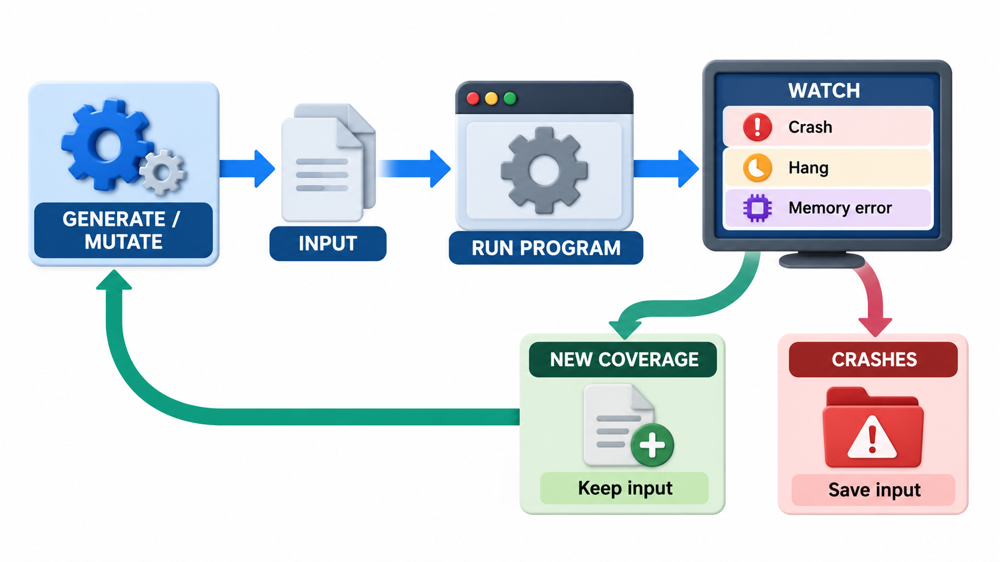
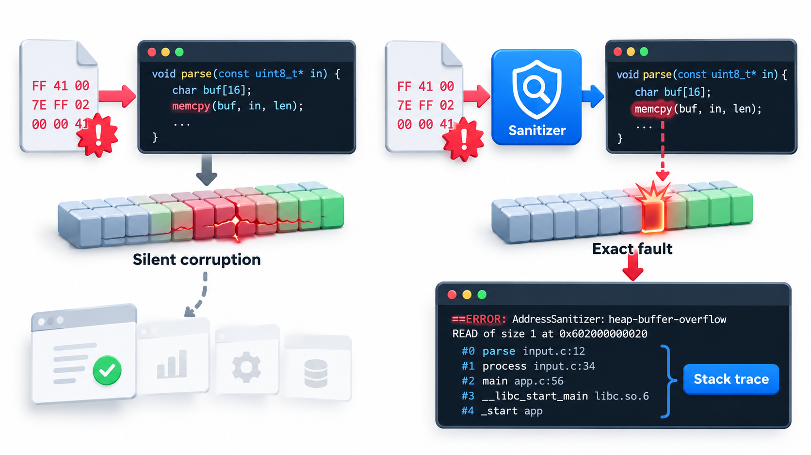
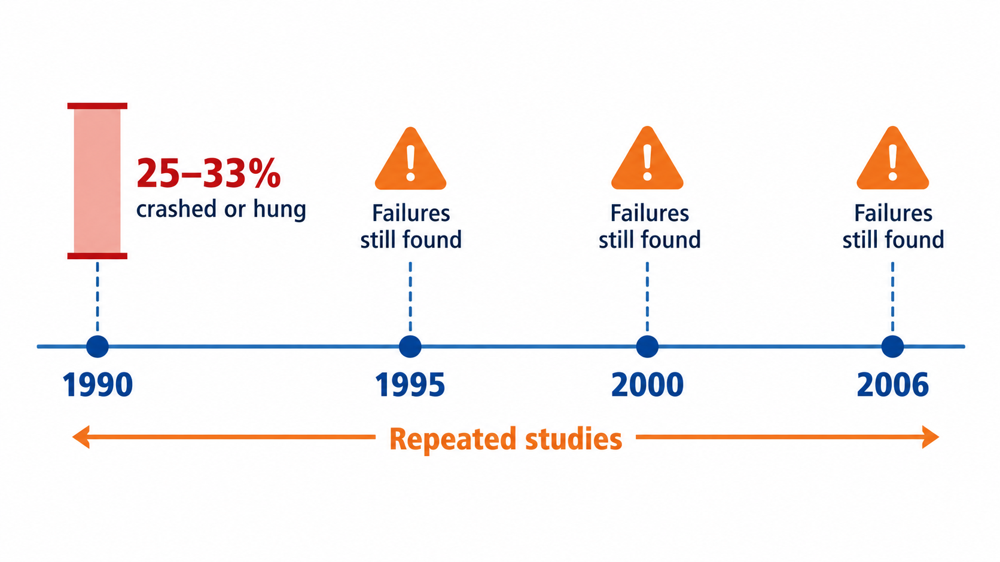
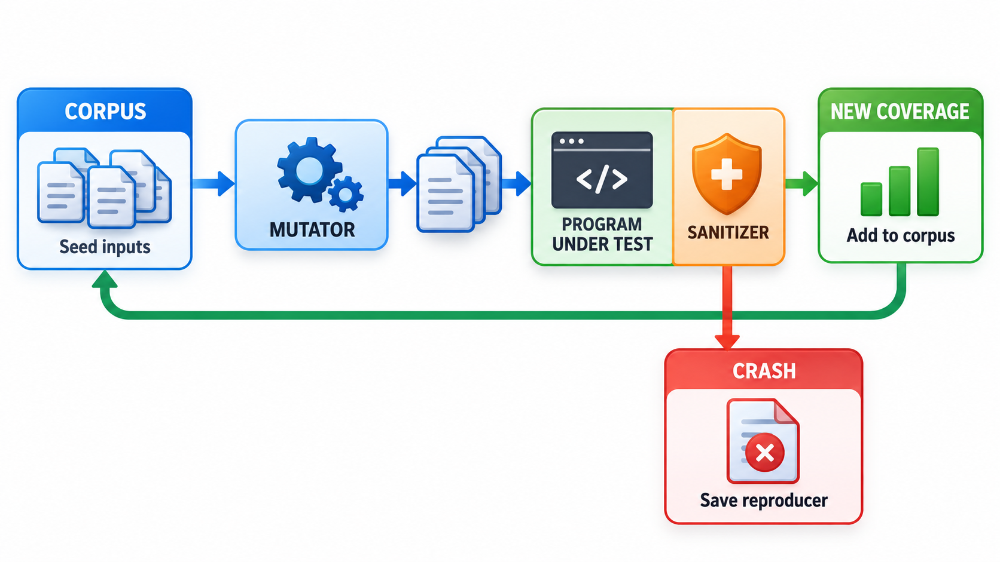
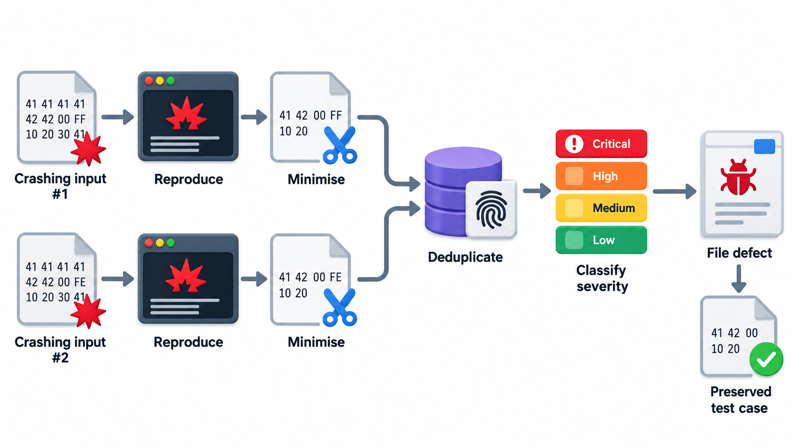

## Throwing Junk at a Program Until It Breaks

Programs that read data from outside, such as parsers, file readers, network services and image libraries, are expected to survive whatever arrives. Yet when random characters are fed to well-known, widely used programs, a surprising share crash or hang. The causes are mundane and familiar: unchecked array bounds, unchecked return values, input nobody imagined.

**Fuzzing** is the technique of generating huge numbers of random or semi-random inputs and watching for crashes. It is now a central way of finding bugs, especially security flaws. Nobody has to write a test for an empty string or an enormous number; the fuzzer tries them without being told. This topic covers how it works, how modern fuzzers steer towards new code, and how sanitizers make silent bugs loud.

The technique has a clear origin. In 1990 Barton Miller, a professor at the University of Wisconsin, and his students fed random input to the standard Unix command-line utilities and found that roughly a quarter to a third of them crashed or hung. They repeated the study in 1995 and again in 2006, and each time a substantial share of programs still failed. The word "fuzz" came from the random noise on a dial-up line that had corrupted one of Miller's own commands.

## The Idea

A fuzzer feeds a program a large number of unexpected inputs and watches for bad behaviour, mainly crashes, hangs, and memory errors. It does not check that the output is correct. It checks only that the program *survives*. That makes it cheap, since no expected results need to be written, and it makes it good at finding the kinds of fault that programmers did not imagine: inputs that are malformed, truncated, huge, empty, or full of strange characters.

Fuzzers differ in how they produce inputs.

- **Random (blind) fuzzing** generates inputs from nothing, like the earliest fuzzers. Simple and quick, it finds shallow bugs but seldom gets past the first checks of a well-guarded program.
- **Mutation-based fuzzing** starts from valid samples, such as real image files, and randomly alters bytes. Most of the input stays valid, so it reaches deeper code.
- **Generation-based fuzzing** builds inputs from a description of the format, so they are well formed but strange.
- **Coverage-guided fuzzing** watches which parts of the code each input reaches and keeps the inputs that reach something new, then mutates those. It steers towards unexplored code. The best-known tool of this kind, American Fuzzy Lop (AFL), by Michał Zalewski in 2013 and 2014, found bugs in nearly every program it was pointed at.

| Kind | Starting point | Reaches deep code? | Effort to set up |
| --- | --- | --- | --- |
| Blind random | Nothing | Rarely | Very low |
| Mutation-based | Valid sample files | Often | Low: collect samples |
| Generation-based | A grammar or format description | Yes, if the grammar is accurate | Medium to high |
| Coverage-guided | A few seeds | Yes, discovers structure itself | Low to medium |

<!-- Visual: the fuzzing loop: generate or mutate an input, run the program, watch for a crash, hang or memory error, and keep inputs that reach new code. Save as images/105_fuzzing_loop.png. -->

## Why Coverage Guidance Matters

A program that checks a signature before doing anything else is hard for a blind fuzzer. Suppose a file must begin with the four bytes "FEES" and then a valid length. A random four-byte string matches with probability one in about four billion, so a blind fuzzer almost never gets past the first check.

| Fuzzer | How it gets past "FEES" | Typical outcome |
| --- | --- | --- |
| Blind | By luck, once in billions | Stuck on the first check |
| Mutation-based with a real file as seed | The seed already starts with "FEES" | Reaches the length check and beyond |
| Coverage-guided | Notices that changing the first byte to "F" reaches new code, keeps it, then builds up the signature byte by byte | Discovers the format on its own |

The ability to learn structure by watching which code is reached is what made coverage-guided fuzzing so productive.

## Fuzzing a Small Parser

Take a function that reads marks written as a number, a percentage or a fraction. It has two hidden weaknesses: it does not check that what precedes a percent sign is a number, and it does not check a fraction's denominator. A fuzzer with a fixed starting point produces 3,000 short strings, built from digits and a few symbols, and records the first input that causes each kind of crash.

| Kind of crash | First input that caused it | Why |
| --- | --- | --- |
| Value error | An empty string | The function cannot read a number from nothing |
| Division by zero | 13/0 | A fraction with a zero below the line |

Two crashes were found within 3,000 tries. Nobody wrote a test for an empty string or a zero denominator, and a human tester might have thought of them eventually. The fuzzer found them without being told. A real fuzzer runs millions of inputs a second and reports each crash with the input that caused it.

## Sanitizers: Making Silent Bugs Loud

Some bugs do not crash. A program that reads one byte past the end of an array may carry on without complaint, or return the contents of memory next to it. That is how the Heartbleed flaw leaked secrets from servers. To catch such faults, fuzzers are run together with **sanitizers**, tools that add checks into the compiled program. The *AddressSanitizer* detects reads and writes outside the bounds of memory, use of memory after it was freed, and similar errors, and stops the program the moment they happen. Without it, many memory bugs go unnoticed. With it, the fuzzer sees a crash and can report the input that caused it.

| Sanitizer | Catches |
| --- | --- |
| **Address** | Out-of-bounds access, use after free, double free |
| **Undefined behaviour** | Integer overflow, invalid shifts, null pointer misuse |
| **Memory** | Use of uninitialised memory |
| **Thread** | Data races between threads |

## Fuzzing in Practice

Fuzzing is most valuable on code that handles **untrusted input**: anything that parses a file, a network message, a font, a video or a web request. Attackers fuzz such code to find vulnerabilities, so defenders do it first. Google runs a service called OSS-Fuzz that continuously fuzzes important open-source projects, and has reported tens of thousands of bugs found since it started in 2016. Heartbleed itself was found in 2014 by researchers using fuzzing techniques, among other methods.

A fuzz test in a project often looks like a small function that takes a block of bytes and passes it to the code being tested, called a **fuzz target** or harness. The fuzzer does the rest. When it finds a crash it saves the input. That input then becomes a regression test, so the bug cannot return unnoticed.

<!-- Visual: a bar chart of the percentage of Unix utilities that crashed in Miller's studies of 1990, 1995 and 2006, as an illustration that the problem persisted. Save as images/105_miller_fuzz_studies.png. -->

## Setting Up a Fuzz Run

A practical workflow has a handful of steps.

| Step | What is done |
| --- | --- |
| 1. Pick a target | Code that parses untrusted input: a file reader, a request parser |
| 2. Write a harness | A small function that takes bytes and calls the target |
| 3. Collect seeds | A few valid sample inputs to start from |
| 4. Build with sanitizers | So that memory errors become visible crashes |
| 5. Run for hours or days | Often on a spare machine or in the cloud |
| 6. Triage crashes | Group by cause; reduce each to a minimal input |
| 7. Fix and add a regression test | The crashing input is kept as a test |
| 8. Keep fuzzing in the build pipeline | New code is fuzzed as it arrives |

Fuzzing has limits. It finds crashes, hangs and memory errors, and is poor at finding logic errors that give a plausible wrong answer. It struggles with inputs protected by checksums or complex structure unless it is told the format. It needs a way to run the target thousands of times a second. It is a complement to other testing and not a substitute.

<!-- Visual: a coverage-guided fuzzer loop showing a corpus of inputs, a mutator, the program under test with a sanitizer, new coverage feeding good inputs back into the corpus, and crashes saved to a folder. Save as images/105_coverage_guided_fuzzer.png. -->

## What a Fuzzing Bug Report Looks Like

A fuzzer's output is a crash and the input that caused it, which is more useful than a vague complaint.

| Part of the report | Example |
| --- | --- |
| **Crashing input** | A 37-byte file, saved so it can be replayed |
| **Kind of failure** | Heap buffer overflow, reported by AddressSanitizer |
| **Location** | Line 212 of the parser, in the function that reads the length field |
| **Stack trace** | The chain of calls that led to it |
| **Reduced input** | After minimisation, a 9-byte file that still triggers it |

A developer can run the saved file against the code and see the crash within seconds. Tools can also shrink a crashing input automatically, in the same spirit as the shrinking step in property-based testing, which removes irrelevant bytes and leaves the smallest input that still fails.
