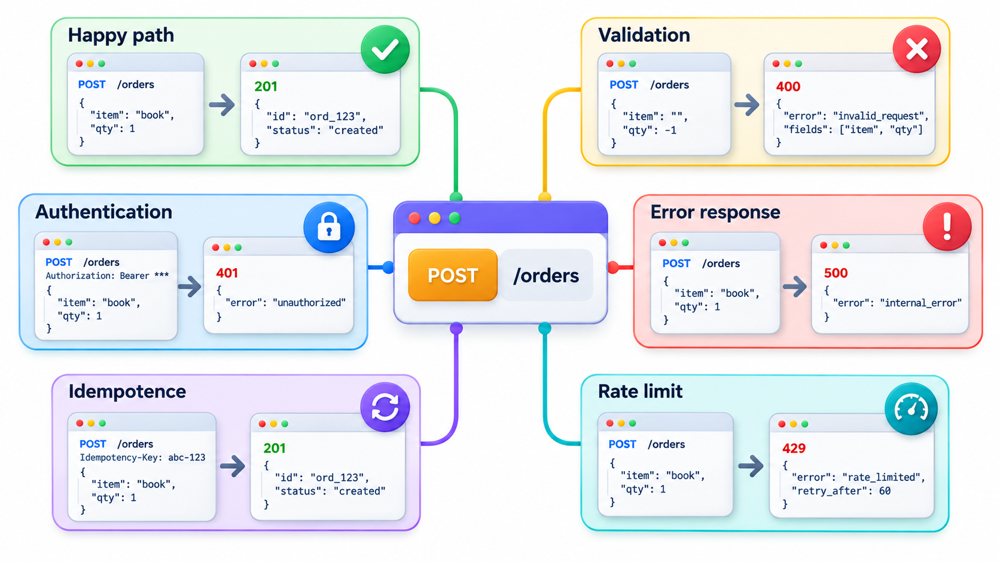
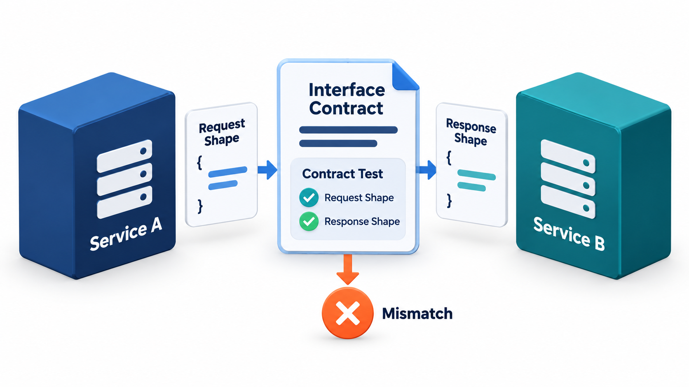
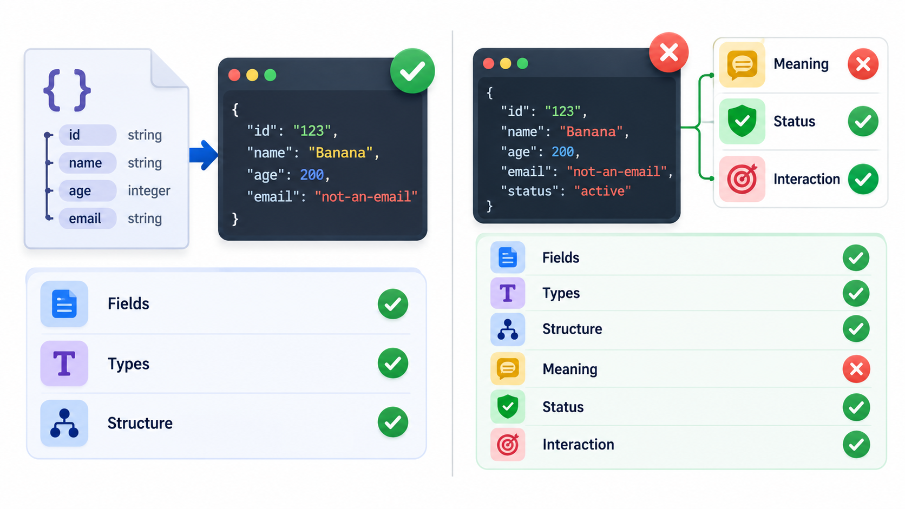
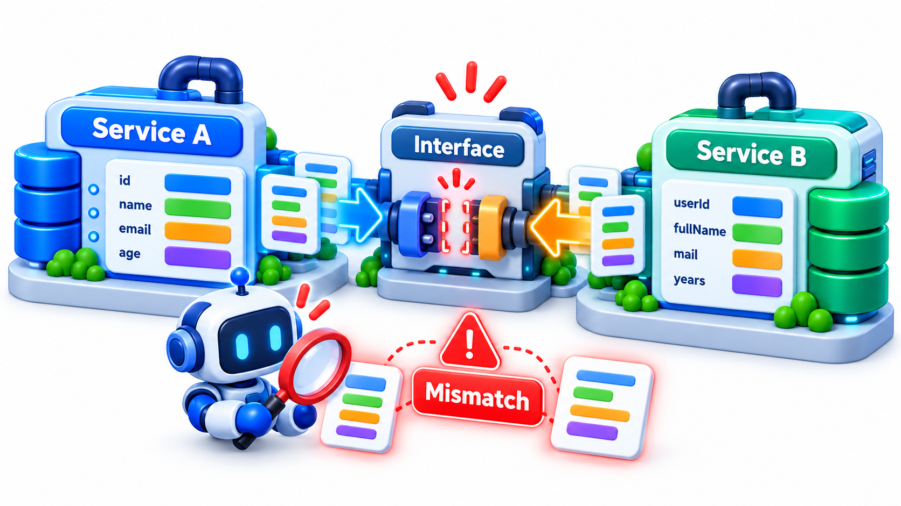
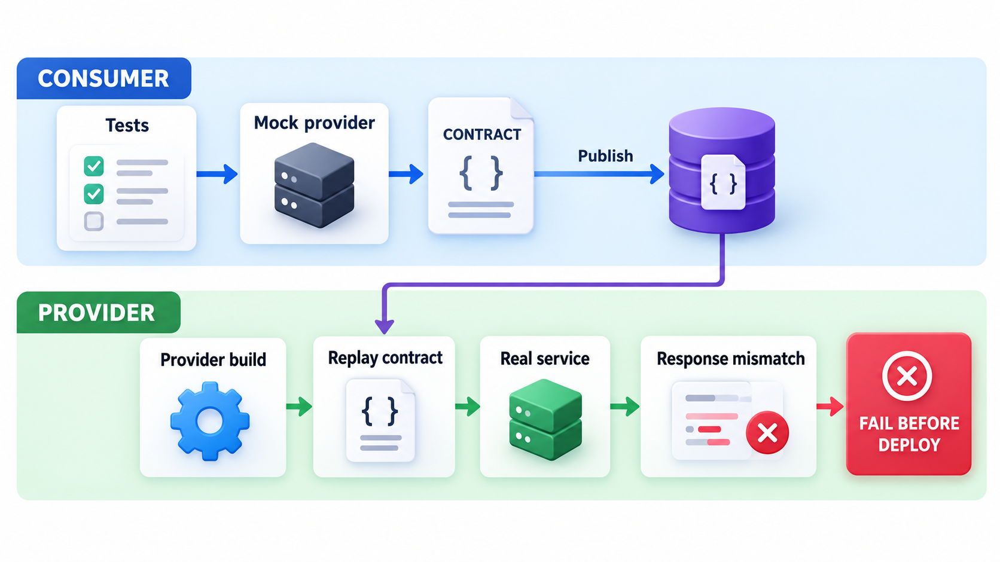

## Where Services Meet, Agreements Break

A system built from many small services that call one another has a recurring problem: a change to one service quietly breaks another, and nobody finds out until everything is assembled in a test environment, often days later. Integration tests that could catch it need everything running at once, and are slow and unreliable.

The remedy is to write the agreement down and test each side against it. In **consumer-driven contract testing**, each *consumer* of a service states exactly what it needs from the provider: "when I send this request, I expect a response with these fields of these types". The provider's own build replays those expectations, so a change that would break a consumer fails the provider's build, before anything is released. This topic covers what to test at an API, how to do it without running the whole system, and the difference between a contract and a schema.

## Why Service Boundaries Need Their Own Tests

When a system is made of services, most of its failures come from the spaces between them. A field is renamed, a type is changed, a required parameter is added, an error is reported differently. Each service may pass its own tests and the combination fail. Testing everything end to end is slow, needs every service running and fails for many reasons. Testing each service only in isolation misses the interface problems. **API testing** and **contract testing** target the boundary directly.

| Approach | Speed | Catches interface breaks? | Needs everything running? |
| --- | --- | --- | --- |
| Unit tests of each service alone | Fast | No | No |
| Full end-to-end tests | Slow | Yes, late | Yes |
| API tests of one service | Fast | Partly: provider's view only | Only that service |
| Contract tests | Fast | Yes, early | No |

## What to Test at an API

An API test sends requests to a service's interface and checks the responses, without going through a user interface. It is faster and more stable than a browser test and tests the logic where it lives. The usual checks are:

- **Correct behaviour.** The right status code and the right data for valid requests.
- **Input validation.** Bad, missing or oversized input is rejected with a clear error and not a crash.
- **Error handling.** Each documented error case returns the documented error.
- **Authentication and permissions.** A request without credentials, or from the wrong user, is refused.
- **Structure.** The response has the promised fields with the promised types.
- **Idempotence and repeats.** A request that should be safe to repeat is.
- **Performance.** Response times within the agreed limits.

<!-- Visual: A contract test catching mismatched requests and responses at an interface. -->

## A Set of API Tests for One Endpoint

Take an endpoint that returns a student's fee details. A thorough set of tests covers more than the happy path.

| Test | Request | Expected response |
| --- | --- | --- |
| Valid student | GET student 1042 with a valid token | 200 with name, fee due and hostel |
| Unknown student | GET student 99999 | 404 with a clear error body |
| Malformed identifier | GET student "abc" | 400 with a message about the identifier |
| No credentials | GET student 1042, no token | 401 |
| Wrong role | A student asking for another student's fees | 403 |
| Repeat | The same GET twice | Identical responses; no side effects |
| Boundary | Student with a zero fee due | 200 with fee due 0, not an error |
| Performance | 100 sequential requests | 95% under 300 milliseconds |

These tests run in seconds, need no browser and pinpoint the failing behaviour. They are the backbone of testing for a service-based system.

## Checking Against a Contract

Take a consumer's contract: it needs the name as text, the fee due as a whole number, and the hostel as text. Nothing more. It does not care about other fields the provider might add. Three versions of the provider's response are checked against it.

| Provider's response | Result |
| --- | --- |
| Today's response, with name, fee due and hostel | Honours the contract |
| After a rename (fee due becomes amount due) | Breaks the contract: missing field "fee due" |
| After a type change (fee due becomes the text "5000") | Breaks the contract: "fee due" should be a whole number |

The second and third cases would make an old consumer fail in production, and the check catches them in the provider's own build. Only what the consumer uses is in the contract. That keeps the provider free to change everything else, and means a breaking change is defined by who is actually affected, not by what the provider imagines.

A provider that adds a field "section" breaks nothing, because no consumer's contract mentions it. The same check therefore tells the provider which changes are safe, and which need a conversation with named teams first.

## Contract Versus Schema

Two related ideas are easy to mix up.

A **schema** is a formal description of the shape of messages, such as an OpenAPI or JSON Schema document. It says what the provider *offers*, in full. Validating responses against it catches structural drift and is a cheap, automatic check. Schemas are written by the provider and describe everything.

A **consumer-driven contract** says what a particular consumer *relies on*, which is usually a subset. It is written by the consumer. It lets the provider know which parts of its interface are in real use, and so which changes are safe. A provider can remove a field that no consumer's contract mentions with confidence.

The two are complementary. A schema guards the provider's interface in general. Contracts guard the specific dependencies of the consumers.

| Aspect | Schema | Consumer-driven contract |
| --- | --- | --- |
| Written by | Provider | Each consumer |
| Describes | Everything offered | What this consumer uses |
| Answers | "What can the provider return?" | "What would break if this changed?" |
| Catches | Drift from the documented shape | Breaks that affect real consumers |
| Number of them | One per API | One per consumer |

## Testing Without the Other Side

A contract test does not need both services running. The consumer's tests run against a **mock of the provider** that is generated from the contract: the consumer checks its own code against the promised responses. The saved contract is then given to the provider, whose tests replay the requests against the real service and verify that it replies as promised. Each side tests alone, quickly, and the contract is the shared agreement joining them. This avoids the slow, brittle environment in which everything must run together.

| Step | Who | What happens |
| --- | --- | --- |
| 1 | Consumer team | Writes a test that states the request it sends and the response it expects |
| 2 | Consumer's build | Runs the consumer code against a mock that returns that response; the test passes |
| 3 | Consumer's build | Publishes the contract to a shared place |
| 4 | Provider's build | Fetches every consumer's contract and replays each request against the real provider |
| 5 | Provider's build | Fails if any response differs from what a consumer expects |
| 6 | Both | Release when the contract checks pass |

<!-- Visual: an interface mismatch exposed at a software boundary. -->

## Keeping It Maintainable

Contract tests stay valuable when kept small and specific: only the fields and cases a consumer really uses. Overly detailed contracts, which pin down exact values or every field, turn into obstacles to change. Teams also need a way to share contracts and to see which are verified: a broker, in Pact's vocabulary. And contracts do not remove the need for a few true end-to-end tests of the most important journeys. They reduce the number of such tests required.

| Practice | Why |
| --- | --- |
| Match on type and shape, not exact values | A harmless change in sample data does not fail the build |
| Include only fields the consumer reads | Keeps the provider free to change the rest |
| Cover error responses the consumer handles | Errors are part of the contract |
| Version contracts with the consumer's code | The contract always matches what is deployed |
| Check "can I deploy" before release | Both sides confirm compatibility with what is in production |

<!-- Visual: a consumer team and a provider team with a contract file passing between them: the consumer's tests produce the contract against a mock provider, and the provider's build replays the contract against the real service, failing if a response no longer matches. Save as images/106_consumer_provider_contract_flow.png. -->

## Versioning and Contracts

Contracts also make it safe to evolve an API. Because the provider knows which fields each consumer uses, it can plan a change with evidence.

| Proposed change | Check against contracts | Decision |
| --- | --- | --- |
| Add a new optional field "section" | No contract mentions it | Safe: release |
| Rename "fee due" to "amount due" | Three consumers rely on "fee due" | Breaking: keep both names for a transition period, tell the three teams |
| Remove the unused field "legacy code" | No contract mentions it | Safe: remove |
| Change "fee due" from whole rupees to paise | Every consumer relies on rupees | Breaking: introduce a new field instead |

Without contracts, the provider would have to guess which of these are safe, or ask every team. With them, the answer is part of the build, and the conversation with consumers is limited to the changes that truly affect them.
