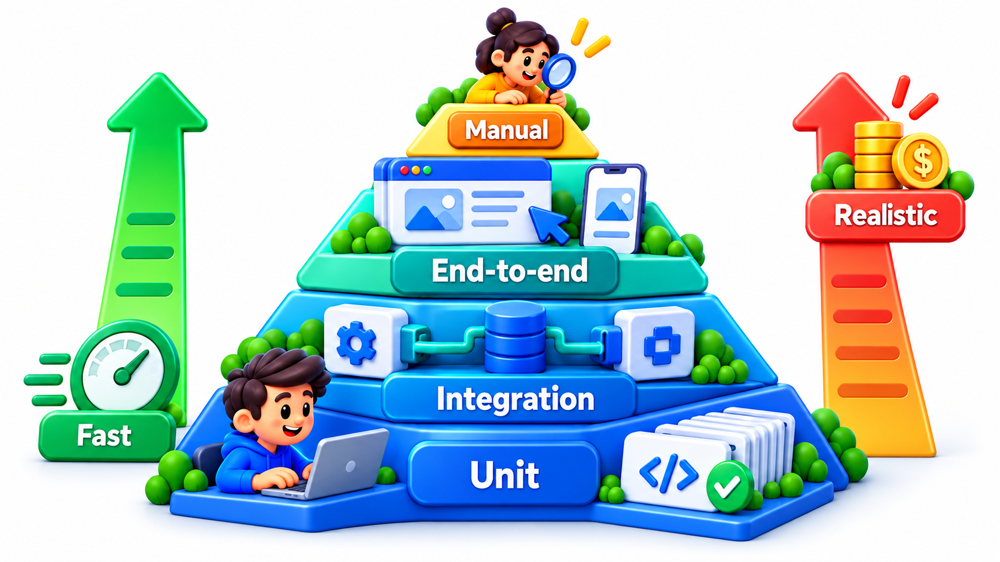
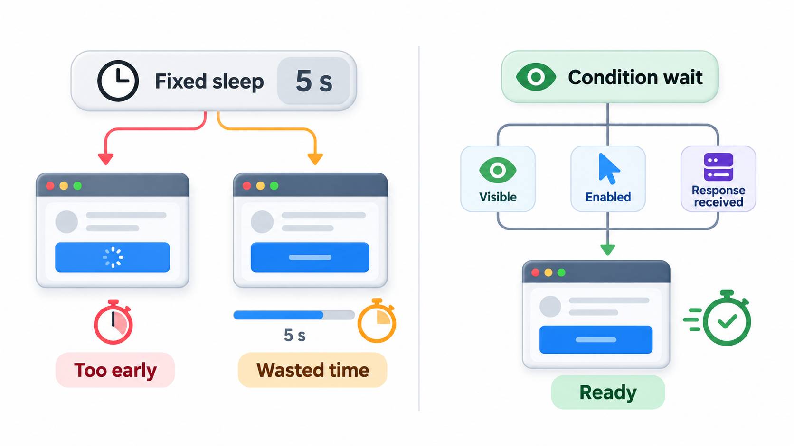
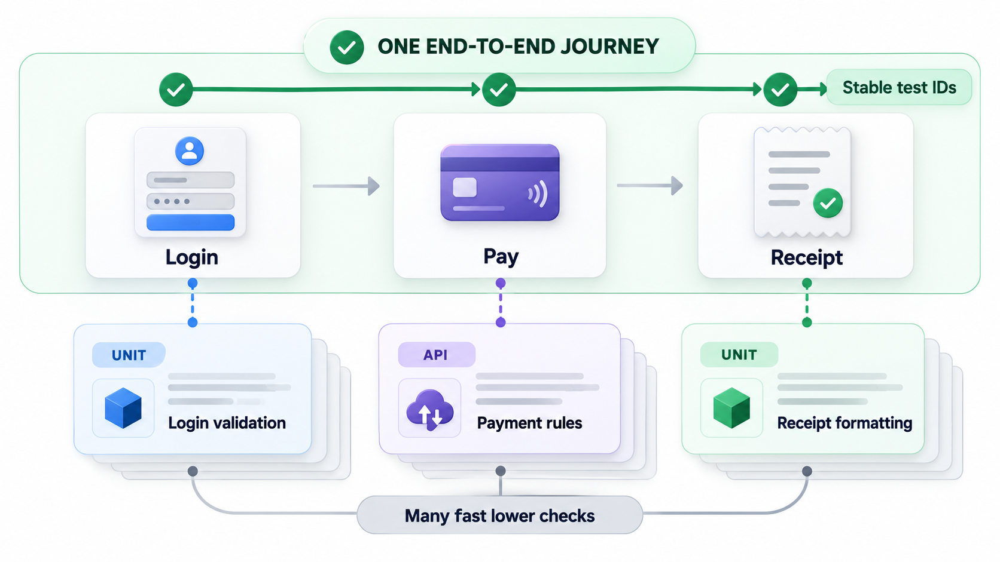
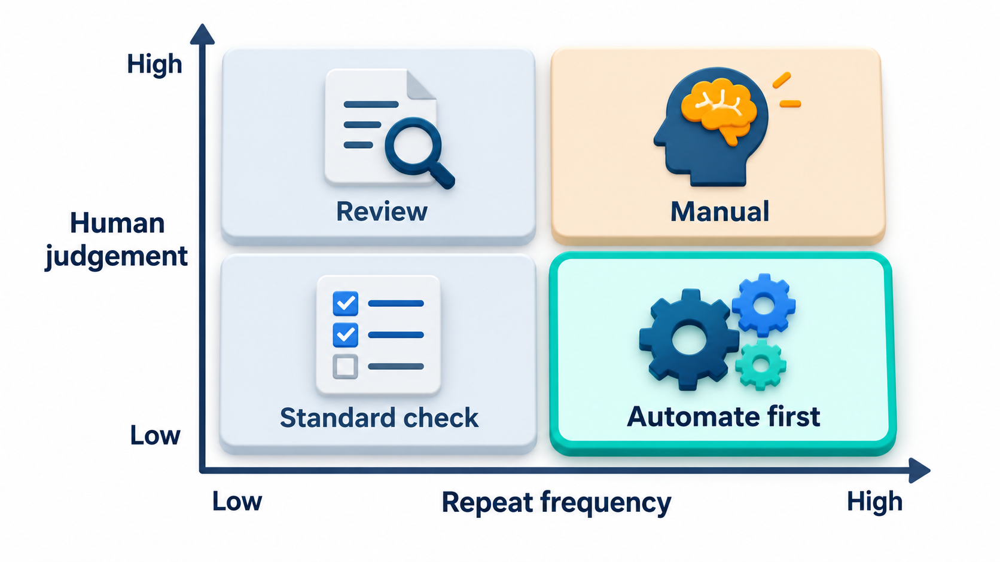
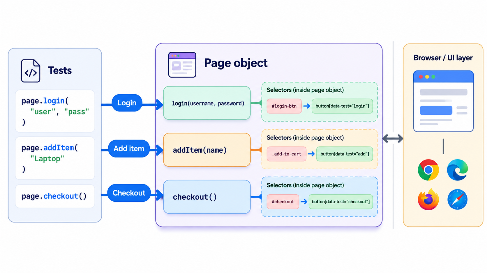

## Checking the Whole Journey Through the Real Interface

Some failures only show up when the entire system is used the way a person uses it: open a page, log in, fill in a form, press a button, and check what appears. **End-to-end (E2E) testing** exercises the whole system through its real interface, from the user's point of view, to check that complete journeys work. Tools that drive a browser make this possible.

It is also a kind of test that teams have trouble with. E2E tests are slow, depend on many moving parts, and break when the page changes in harmless ways. A well-known engineering blog post from Google carried the title "Just say no to more end-to-end tests", and the experience behind it is common. This topic covers what E2E tests are good for, why they tend to turn fragile and expensive, and how to keep them worth their cost.

## What E2E Tests Do Well

A unit test can pass, an integration test can pass, and the system can still fail for the user, because of a missing button, a broken link between the front end and the back end, a misconfigured server. Only a test that goes through the whole stack finds those. E2E tests give the most realistic answer to the question "can a user do the important thing?". Typical targets are the journeys the business cannot afford to break: sign up, log in, pay a fee, receive a receipt.

| Kind of fault | Found by unit tests? | Found by E2E tests? |
| --- | --- | --- |
| Wrong calculation | Yes | Yes, but slowly |
| Front end and back end disagree on a field name | No | Yes |
| Pay button hidden by a layout bug | No | Yes |
| Server misconfigured after deployment | No | Yes |
| Login works but session expires immediately | No | Yes |
| A third-party script breaks the page | No | Yes |

## Why They Are Costly

The same realism is the source of the trouble.

- **Slow.** Starting a browser, loading pages and waiting for responses takes seconds per step. A suite of hundreds takes hours.
- **Fragile.** The test depends on the page's structure, text, timing and data. A small redesign can break dozens of tests that have nothing wrong with the product.
- **Flaky.** Timing, network and shared test data cause failures with no change in the code. People learn to ignore them.
- **Hard to diagnose.** When a long journey fails, the cause could be in any of twenty components.
- **Expensive to maintain.** A large E2E suite needs steady attention.

For these reasons the test pyramid recommends few of them, a thin layer at the top, with the bulk of checks lower down.

| Cost | Unit test | E2E test |
| --- | --- | --- |
| Time to run | Milliseconds | 10 to 60 seconds |
| Dependencies | None | Browser, server, database, network |
| Typical failure causes | One | Dozens |
| Time to diagnose a failure | Minutes | Possibly hours |
| Maintenance per month | Low | High |

<!-- Visual: A test pyramid with a few end-to-end tests at the top of many unit tests. -->

## Locators: How a Test Finds Things

A browser test must say which element it means: "the Pay button". The way it is described is a **locator**, and the choice of locator is the biggest factor in how fragile the test is.

- A locator based on **position or structure** ("the second element", "the third div inside the form") breaks whenever the layout changes.
- A locator based on **visible text or style** ("the button labelled Pay", "the red button") breaks when wording or design changes.
- A locator based on a **stable identifier** that exists for the purpose of testing (a dedicated test identifier named pay, or a reliable id) survives redesigns.

A test must find things on a page. How it finds them decides how long it lasts. Take a page with a link home, a Pay button and a Help button. A test finds the Pay button in two ways, by position ("the second element on the page") and by an agreed identifier ("the element called pay-btn"), before and after a promotional button is added at the top.

| Page design | Finding Pay by position | Finding Pay by identifier |
| --- | --- | --- |
| Old design | Finds Pay | Finds Pay |
| New design (a promo button added at the top) | Finds the home link, which has no text: the wrong thing | Finds Pay, wherever it moved |

The page's behaviour did not change: you can still pay. Only the position-based test broke, and a real suite with hundreds of such locators would show a wall of red after a harmless redesign. Agreeing with developers on stable test identifiers, and treating them as part of the interface, is among the cheapest ways to make E2E tests last.

## Waiting: The Other Source of Flakiness

A page does not appear instantly, and a test that acts too early fails. Two ways of waiting give very different results.

| Style | What the test does | Result |
| --- | --- | --- |
| **Fixed pause** | Waits 3 seconds, then clicks | Too slow when the page is fast; fails when the page takes 4 seconds |
| **Wait for a condition** | Waits until the Pay button is visible and enabled, up to 20 seconds, then clicks | Moves on the moment the page is ready; tolerates slow days |

A suite with 200 tests that each use three fixed pauses of 3 seconds spends 30 minutes just waiting. Waiting for conditions removes most of that and most of the flakiness too.

## Making E2E Tests Worth Having

Several habits keep the cost down.

<!-- Visual: a journey of login, pay and receipt tested end to end by one test, with the stable locators highlighted, beside the same checks moved down to API and unit level. Save as images/107_one_journey_many_lower_checks.png. -->

- **Test journeys, not details.** Use E2E for the handful of critical paths. Test calculations, validation and edge cases at lower levels.
- **Keep each test independent.** A test creates its own data and does not depend on another test having run.
- **Wait for conditions, not for time.** Wait until the element appears, with a limit, instead of pausing for three seconds.
- **Use stable locators** and keep them in one place, so a change in the page is fixed in one file. A common structure is the *page object*: a small class that represents a page and knows how to find and use its parts.
- **Set up state through the back door.** To test the receipt page, create the paid fee by calling an API, not by clicking through ten screens first.
- **Run them where they belong.** A small set in the build pipeline on every change; a larger set nightly.
- **Review the value.** If a test has never caught a defect and costs a lot to maintain, question it.

Many teams find that moving checks from the browser to the API level, which tests the same logic without the screen, makes a suite much faster and steadier.

<!-- Visual: high-frequency, low-judgement tests being the best candidates for automation. -->

## Choosing the Critical Journeys

With a small budget of E2E tests, each should protect something the business cannot lose.

| Journey | Why it earns an E2E test | Lower-level coverage |
| --- | --- | --- |
| Sign in | Nothing else works without it | Unit tests of password rules |
| Pay a fee and receive a receipt | Money; the core promise | API tests of every payment case |
| Download results | The reason many users visit on results day | API test of data; performance test |
| Reset a forgotten password | Frequently needed; links email and web | Unit tests of token rules |
| Register for an exam | Deadline-driven and public | API tests of eligibility rules |

Five tests may cover most of the business risk; five hundred rarely cover much more.

## The Page Object Idea

A suite with hundreds of tests that each describe how to find the Pay button will need hundreds of edits when the page changes. A **page object** collects that knowledge in one place: a class that represents a page and offers meaningful actions such as "log in as a student" or "pay the full amount".

| Without page objects | With page objects |
| --- | --- |
| Every test lists locators and clicks | Tests read like the journey: log in, open fees, pay, check receipt |
| A changed locator is edited in 200 places | A changed locator is edited once |
| Tests are long and hard to read | Tests are short and describe intent |
| Mistakes in finding elements repeat | Mistakes are fixed once |

The tests then describe behaviour in the user's terms, and the details of the page live in a single, maintainable file. This is the same principle of hiding what is likely to change that applies to ordinary code.
