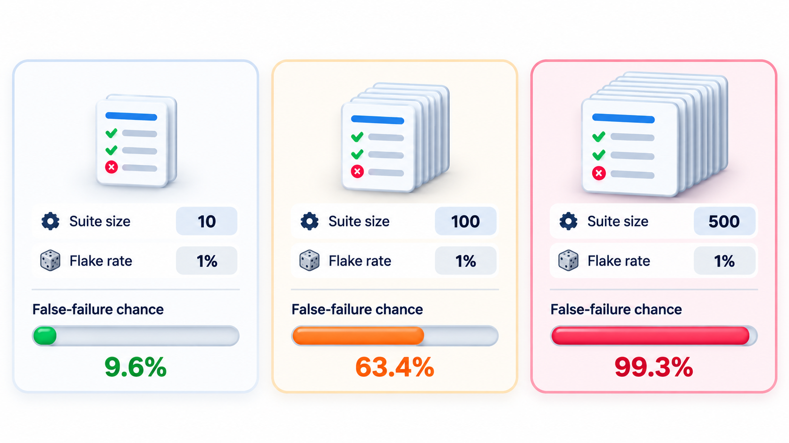
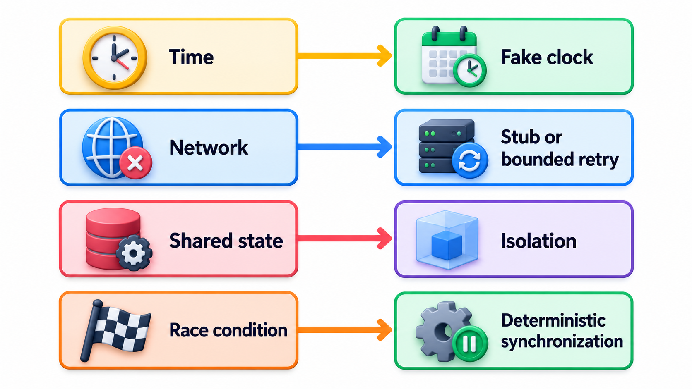
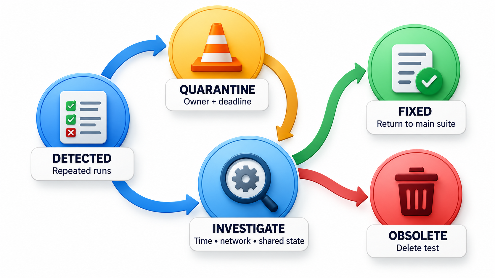
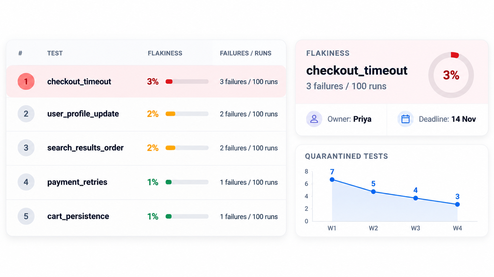

## A Test That Sometimes Fails Is Worse Than One That Always Does

A **flaky test** is a test that sometimes passes and sometimes fails with no change to the code or the test. Across a large body of automated tests, even a small percentage of flaky runs adds up to a constant background noise, costing engineers time to investigate and, worse, teaching them to shrug at red results.

It is one of the most corrosive problems in a test suite. A failing test is meant to say that something is broken. A flaky one says "maybe", and when failures can be ignored, a real failure is ignored too. This topic looks at where flakiness comes from (time, shared state, ordering, networks, randomness) and at what to do about it.

## The Arithmetic of Noise

Flakiness compounds across a suite. If each of 1,000 independent tests has a 0.1 per cent chance of failing spuriously, the chance that the whole suite passes cleanly is 0.999 to the power 1,000, which is about 37 per cent.

| Tests in the suite | Spurious failure rate per test | Chance a clean run is green |
| --- | --- | --- |
| 100 | 0.1% | 90% |
| 1,000 | 0.1% | 37% |
| 1,000 | 0.01% | 90% |
| 5,000 | 0.1% | under 1% |

A suite of five thousand tests, each flaky only one run in a thousand, almost never passes cleanly. The team learns to re-run the build, and the protective value of the suite is gone. This is why a few flaky tests are a serious problem and not a small irritation.

## What Makes a Test Non-Deterministic

A test is **deterministic** if the same inputs always give the same result. Flakiness means that something besides the code and the test affects the outcome. The causes fall into a few families.

| Cause | How it breaks the test | Example |
| --- | --- | --- |
| **Time** | The result depends on the clock | A test that expects "no reminders at night" passes in the afternoon and fails at 11 p.m. |
| **Randomness** | The code or the data uses random values | A test picks a random student and the rule fails for some |
| **Concurrency** | Threads or processes run in different orders | Two operations race, and one test run loses |
| **Shared state** | Tests affect each other through files, a database or global variables | Test A leaves a record that makes test B fail, but only if A runs first |
| **External systems** | The network, a third-party service or a slow database | A call to a payment sandbox times out now and then |
| **Environment** | Differences in machine speed, memory, locale or time zone | A test passes on a laptop and fails on a busy build server |
| **Test order** | The suite runs in a different order or in parallel | A test passes alone and fails in the suite |

Many flaky tests involve **waiting**: a test starts an action and checks the result after a fixed pause, which is long enough on a fast machine and too short on a slow one.

<!-- Visual: flaky tests changing outcome because of time, network or shared state. -->

## Two Flaky Tests, Made Reliable

Two causes can be made reliable. First, a rule says reminders are allowed only between 8 a.m. and 9 p.m. A test that asked the real clock would depend on when it ran. The fix is to give the rule the hour as an input, so a test can supply any hour it likes.

| Hour supplied | Reminder allowed? | Expected |
| --- | --- | --- |
| 7 | No | No, too early |
| 8 | Yes | Yes, the first allowed hour |
| 14 | Yes | Yes |
| 21 | No | No, too late |

The answers are the same at any time of day, because the time is part of the test and not part of the world. This is the standard remedy for time-based flakiness: **inject** the clock. Production passes the real hour, and tests pass fixed ones. The same applies to random numbers, which can be seeded.

Second, two tests share a list. One puts an item in and expects the list to have one item; the other expects exactly one item.

| Order the tests run | First test | Second test |
| --- | --- | --- |
| Adder first, then checker | Passes | Passes |
| Checker first, then adder | Fails (the list is empty) | Fails or passes depending on what remains |

The code did not change, only the order. The remedy is isolation: each test creates its own data and cleans up after itself, so no test relies on another having run. Test frameworks can also shuffle the order on purpose, to expose hidden dependencies.

## Remedies by Family

| Family | Remedy |
| --- | --- |
| **Time** | Inject the clock; never read the system time inside logic |
| **Randomness** | Seed the generator; log the seed on failure |
| **Concurrency** | Wait for a signal or a condition; avoid sleeping; test the thread-safe part separately |
| **Shared state** | Fresh data per test; clean up in teardown; no global variables |
| **External systems** | Replace with a test double; keep a few separate tests for the real thing |
| **Environment** | Fix versions, time zone and locale in the test set-up; use the same containers locally and in the pipeline |
| **Order** | Shuffle test order regularly; run in parallel to expose dependencies |
| **Waiting** | Wait for a condition with a generous limit |

## Finding and Fixing Flakiness

When a test turns flaky, a methodical approach works better than hoping.

1. **Reproduce it.** Run the test many times in a loop, on its own and in the full suite, and in random order. A test that fails one time in fifty will show itself in a few hundred runs.
2. **Find the family.** Ask whether it depends on time, randomness, order, shared data, the network or timing between threads.
3. **Remove the source.** Inject the clock. Seed the random generator. Give each test its own data. Replace the real external system with a test double. Wait for a condition and not for a fixed time.
4. **Keep the evidence.** Log enough detail on a failure, such as timestamps, data and the order of events, to diagnose a problem that shows up once a week.

How many repeat runs are needed to be confident? For a test that fails with probability p per run, the chance of seeing at least one failure in n runs is 1 minus (1 - p) to the power n.

| True failure rate | Runs to be 95% sure of seeing it |
| --- | --- |
| 1 in 10 | About 29 |
| 1 in 50 | About 149 |
| 1 in 200 | About 598 |

A test suspected to fail one run in two hundred needs several hundred repeats before it can be declared fixed.

## Quarantine: Containing the Damage

Fixing takes time, and meanwhile a flaky test harms everyone. A widely used practice is **quarantine**: move the test out of the set that blocks merges, into a separate group that is still run and reported but does not fail the build. It is a holding area, not a grave. The test is given an owner and a deadline. If it is fixed, it returns. If it cannot be fixed and is not valuable, it is deleted. Teams track the number of quarantined tests, because a growing quarantine means rising debt.

One tempting response is to **retry** failing tests automatically until they pass. It hides the noise and keeps the build moving, and it also hides real intermittent bugs, which are often the most important ones. If used at all, retries should be visible: a test that passed only on retry should be recorded and treated as flaky.

<!-- Visual: a flaky-test lifecycle: detected by repeated runs, moved to quarantine with an owner and a deadline, then either fixed and returned to the main suite or deleted. Save as images/108_flaky_lifecycle.png. -->

## Real Bugs Can Look Like Flaky Tests

Before blaming the test, consider that a race in the *product* will make a test flaky because the product is flaky. An intermittent failure may be the first visible sign of a genuine concurrency bug. In 2003 a software race condition in an alarm system at a power utility in the United States went unnoticed during a grid disturbance and contributed to a blackout across the north-east of the country and parts of Canada; the fault was rare enough to have escaped years of ordinary use. It is worth asking, before quarantining, whether the test is exposing something real.

| Question | If yes |
| --- | --- |
| Does the failure involve two parts of the product running at once? | Suspect a race in the product |
| Does the failure appear more often under load? | Suspect a real timing problem |
| Does the failing assertion concern data that could be partly updated? | Suspect missing atomicity |
| Does a user ever see the same symptom? | Treat it as a defect, not a test problem |

<!-- Visual: a test results dashboard with a flakiness rate per test, one test highlighted that fails 3 times in 100 runs, an owner and deadline attached, and a count of quarantined tests over time. Save as images/108_flaky_test_dashboard.png. -->

## Five Misreadings of Flaky Tests

**"A flaky test is a test problem, not a product problem."** Sometimes the product has a race or an ordering bug that the test is correctly revealing.

**"Re-run it and it will pass."** That teaches the team to ignore red. Every unexplained failure should be recorded.

**"Flakiness is rare."** At scale, it is constant. A study at Google found that about one in six of its tests showed some flakiness.

**"Add a longer wait."** Fixed waits are slow and still fail on a bad day. Wait for the condition you need.

**"Delete flaky tests."** Only after deciding they are not valuable. A flaky test of an important behaviour should be fixed, not removed.
