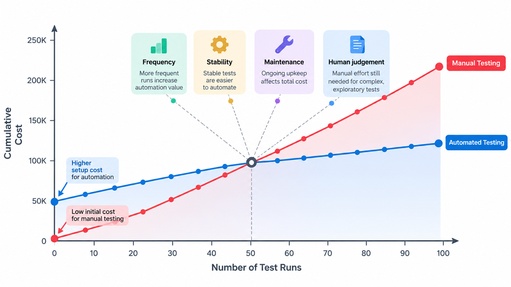
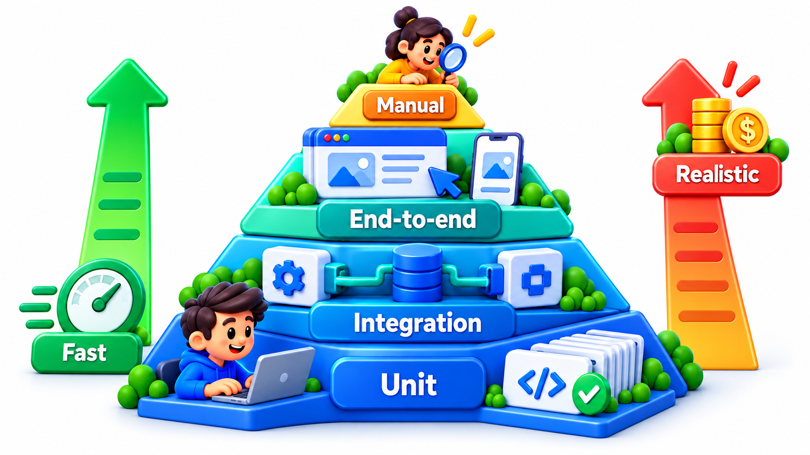
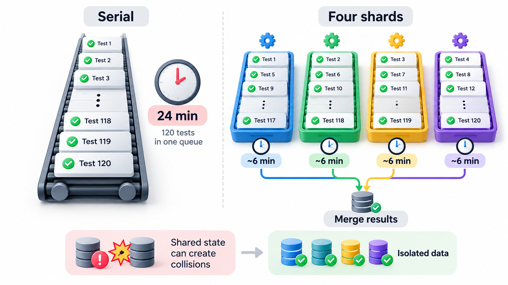
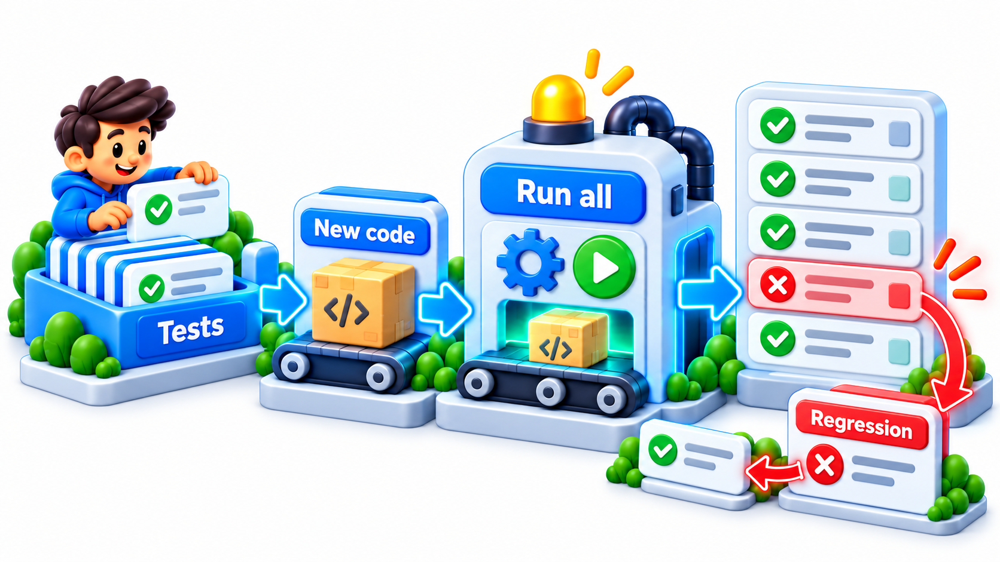
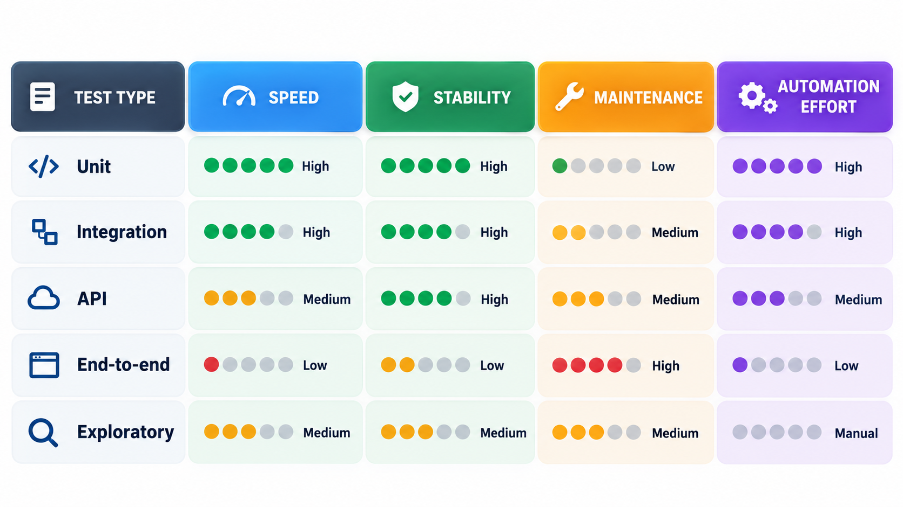

## Why Nobody Should Automate Everything

A team that chases confidence by automating every possible check through the slowest, most fragile route ends up with a suite that takes hours to run, fails often, and needs a person to dig through logs to find out whether the product or the test is at fault. Adding more tests of the same sort makes it worse.

That is not an argument against automation. Test automation is the only way to check a growing product quickly and repeatedly. The point is that automation is an investment, with a cost to build and a cost to keep, and like any investment it should be made where the return is highest. A **test automation strategy** is the set of decisions about what to automate, at which level, with what data and tools, so that the suite stays fast, trustworthy and affordable as it grows.

## What to Automate

Good candidates for automation share some traits.

- **Run often.** A check that runs on every change or every night pays back quickly. Regression tests are the classic case.
- **Stable.** The behaviour being checked does not change every week. A test for a feature still being redesigned will be rewritten many times.
- **Deterministic and clear.** The expected result can be stated exactly, with no need for human judgement.
- **Tedious or error-prone by hand.** Checking a thousand combinations, or the same ten screens in five browsers.
- **Valuable if it fails.** It protects something important.

Poor candidates are the opposite: a check run once, behaviour still in flux, results needing judgement ("does this look right?"), and anything whose automation would cost far more than doing it by hand. These are better done manually, or by exploratory testing.

| Check | Frequency | Stable? | Judgement? | Verdict |
| --- | --- | --- | --- | --- |
| Fee and fine rules | Every build | Yes | No | Automate at unit level |
| Payment API responses | Every build | Yes | No | Automate at API level |
| Login and pay journey | Every release | Yes | No | Automate, a few E2E tests |
| New dashboard layout | Once | No | Yes | Manual and exploratory |
| Compatibility on 12 devices | Every release | Yes | Partly | Automate on a device cloud, plus a manual look |
| One-off data migration check | Once | Yes | No | Script it, but do not maintain it |

## Counting the Return

Automation has a cost to build and a cost to maintain, and it saves the manual cost of every run. Find when it pays back for a check that takes 30 minutes by hand, 6 hours (360 minutes) to automate, and 2 minutes of upkeep each time it runs. The saving per run is 30 - 2 = 28 minutes.

| Runs | Net time saved |
| --- | --- |
| 5 | -220 minutes |
| 10 | -80 minutes |
| 13 | +4 minutes |
| 20 | +200 minutes |
| 50 | +1,040 minutes |

After 5 runs the team is 220 minutes behind, and after 10 it is still 80 behind. Break-even comes after about 12.9 runs (360 divided by 28), and from then on every run is a gain. That number is the one to compare with the plan. A check that will run twice before the feature changes is not worth automating. A check that runs on every build is. The upkeep figure is the one most often underestimated: if it were 20 minutes a run, the saving per run would be 10 and break-even would take three times as long. Brittle tests destroy the return.

## The Layers of Automation

Different levels of test pay back differently, which is why the pyramid is a strategy as well as a picture.

| Level | Cost to write | Cost to maintain | Speed | Share of effort |
| --- | --- | --- | --- | --- |
| Unit | Low | Low | Milliseconds | Largest |
| Integration and API | Medium | Medium | Seconds | Substantial |
| Contract | Medium | Low | Seconds | For service-based systems |
| End-to-end | High | High | Tens of seconds | Small, for critical journeys |
| Visual and exploratory | Varies | Mostly manual | Slow | Targeted |

## Test Data

Tests need data, and managing it is among the hardest parts of automation. Three problems recur: tests that share data and interfere with each other, tests that rely on a particular database state that drifts, and tests that use real customer data, which is a privacy risk. Good habits are for each test to **create its own data** and remove it afterwards, to use **builders or factories** that produce valid objects with sensible defaults, to keep a small, known set of **fixtures** for stable reference data, and to use **generated or anonymised data** and never real personal records.

| Approach | Strength | Weakness |
| --- | --- | --- |
| Each test creates its own data | Independence; parallel-safe | Takes set-up code |
| Shared fixtures loaded once | Fast, simple | Tests can interfere; hidden coupling |
| A snapshot of production, anonymised | Realistic volume and shape | Privacy risk if done carelessly; size |
| Generated data | Flexible, safe | May miss real-world oddities |

## Building a Suite That Lasts

A suite lives for years. A few design rules keep it from rotting.

- **Keep tests independent.** Any test can run alone, in any order.
- **Keep tests readable.** A test is documentation. Name it for the behaviour, and keep the steps short.
- **Remove duplication.** Put common setup in helpers, and the details of finding things on a screen in one place, so a change is made once.
- **Test behaviour, not implementation.** A test tied to internal details breaks when the code is improved.
- **Treat test code as production code.** It gets reviews, refactoring and standards.
- **Prune.** Delete tests that no longer matter, and quarantine and fix the flaky ones.

<!-- Visual: many fast checks and few slow ones in a balanced test pyramid. -->

## Running Tests Fast: Parallelism

As a suite grows, the time to run it grows with it. A common remedy is to run tests in **parallel** on several machines or processes. The ideal is to split the tests so that all workers finish together. Take twelve tests of different lengths (60, 50, 45, 40, 30, 30, 20, 20, 15, 10, 10 and 5 seconds) and three workers, always handing the longest remaining test to the least busy worker.

| Arrangement | Time |
| --- | --- |
| One after another | 335 seconds, over five minutes |
| Three workers, balanced as described | The workers finish at 115, 110 and 110 seconds, so 115 seconds in all |

That is less than a third of the sequential time, and close to the ideal of 335 divided by 3, about 112. Parallel running works only if tests are independent. Tests that share a database, a file or global state will interfere with each other, which is another reason for isolation. Teams also use this idea to run the most informative tests first, so that a failure appears in the first minute and not the last.

<!-- Visual: A regression suite re-running accumulated checks after every change. -->

## Where Tests Run in the Pipeline

A strategy also says when each group runs, trading speed against thoroughness.

| Stage | Tests | Target time | Purpose |
| --- | --- | --- | --- |
| On every commit | Unit tests, linters, a few API tests | Under 5 minutes | Fast feedback to the author |
| On every merge request | Unit, integration, contract, smoke E2E | Under 15 minutes | Gate for merging |
| After merging to main | Full regression, selected E2E | Under an hour | Confidence in the shared branch |
| Nightly | Complete E2E, load, security scans, compatibility | Hours | Deep checks that are too slow for each change |
| Before release | Release checklist, staged rollout monitoring | As needed | Final confidence |

## Choosing Tools and Measuring the Strategy

Pick tools to fit the team: the language it already uses, the kinds of system it tests and the skills it has. Prefer widely used tools with active communities. Avoid choosing a tool first and bending the process to it.

Judge the strategy by outcomes, not by the count of tests. Useful measures are the time from a change to a test result, the share of failures that are real defects (against flaky or broken tests), the number of defects that escape to production, the time spent maintaining tests, and how often people trust and consult the results. If the suite takes an hour, fails randomly and is ignored, adding tests will not help.

| Measure | Healthy sign | Warning sign |
| --- | --- | --- |
| Time to feedback | Minutes | Hours |
| Failures that are real defects | Most of them | Most are flaky or broken tests |
| Escaped defects | Falling | Rising |
| Maintenance share of testing time | Under a third | Over half |
| People consult the results | Yes | "Just re-run it" |

<!-- Visual: a table of test types (unit, integration, API, end-to-end, exploratory) against speed, stability and cost, with a suggested share of automation effort for each. Save as images/109_effort_by_test_type.png. -->

## Five Misreadings of Test Automation Strategy

**"Automate everything."** Automate what runs often, is stable and is clear. The rest is cheaper by hand.

**"Automation replaces manual testing."** It replaces repetition. Exploration, judgement and the first look at a new feature are still done by people.

**"More tests means better quality."** A fast, trusted, well-chosen suite beats a large slow one.

**"Test code is second-class."** It lives as long as the product and needs the same care.

**"Automation is free once written."** Maintenance is often the larger part of the cost.
