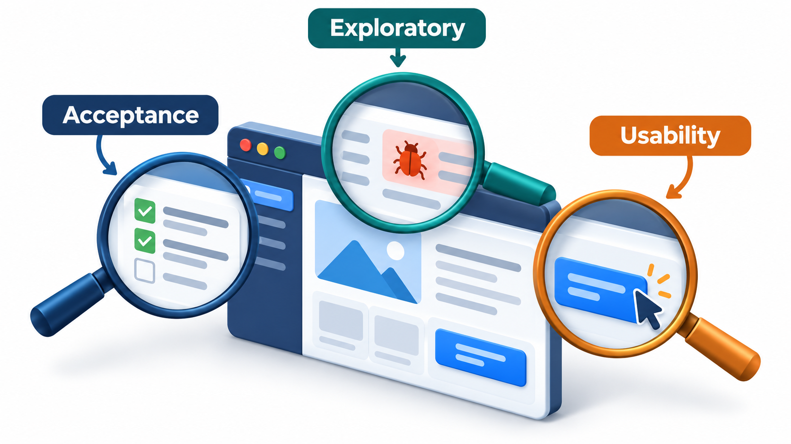
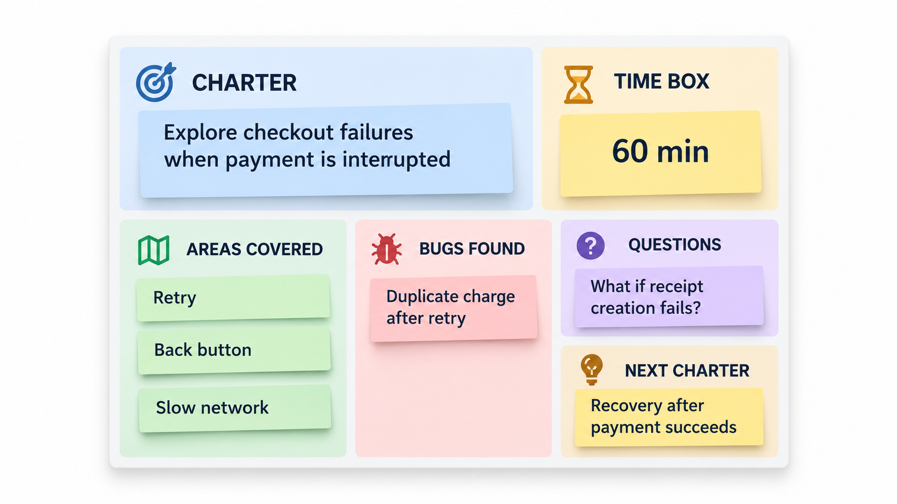
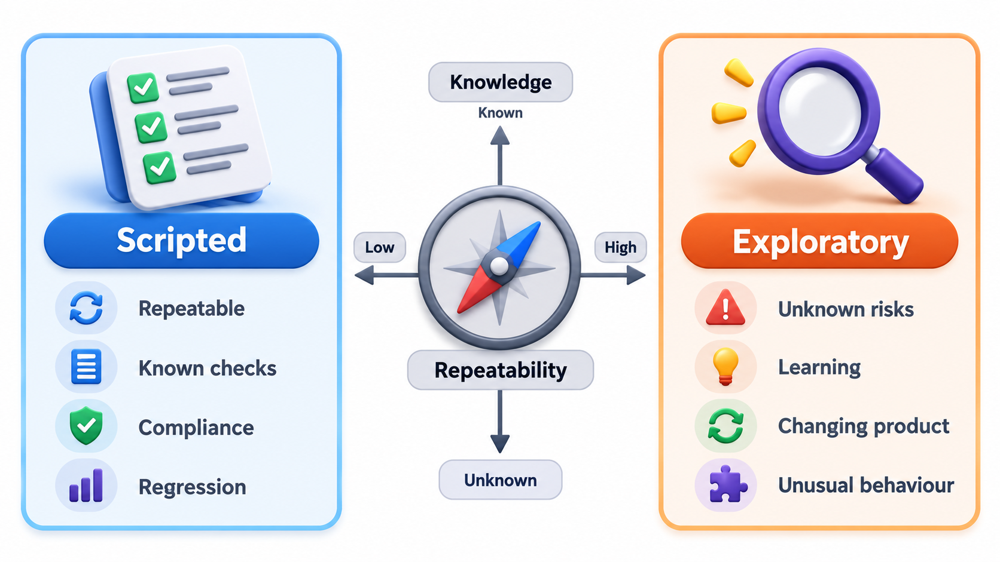

## Learning, Designing and Running at the Same Time

Textbooks describe testing as phases: write a plan, design test cases from the specification, then run them. But experienced testers often work differently. They begin to use the software, notice something odd, form a guess about what might be wrong, design a new test on the spot to check it, and follow whatever they learn.

That style is called **exploratory testing**: simultaneous learning, test design and test execution. The tester does not follow a script. They explore the product, and each result shapes the next test. It is the way a person finds a way around a new town: they look, they try a street, they learn something, they choose where to go next. A script is a map drawn in advance, and an exploration is the act of walking.

## Why Scripts Are Not Enough

Scripted tests, whether run by a person or a machine, check the things the author thought of. They are good for confirming known behaviour and repeating it. But a script does not look around. It cannot notice that the button is oddly placed, that the error message is rude, that a number is wrong in a place it was not asked about, or that a combination nobody listed produces a crash. People find these through curiosity and variety.

The two approaches find different bugs. Studies of testers found that exploratory sessions often turn up serious defects that scripted suites do not, for the simple reason that nobody had written a script for them. The best strategy combines both: automated scripts for the stable, repeated checks, and human exploration where judgement and imagination are most useful.

| Aspect | Scripted testing | Exploratory testing |
| --- | --- | --- |
| **Design** | Done beforehand | Done during the session |
| **Steps** | Fixed in advance | Chosen as the tester learns |
| **Strength** | Repeatable; good for regression | Finds the unexpected; adapts to what is seen |
| **Weakness** | Checks only what the author imagined | Depends on the tester's skill; less repeatable |
| **Best for** | Stable behaviour, repeated often | New features, risky areas, odd interactions |
| **Output** | Pass or fail per case | Bugs, questions, risks and new test ideas |

## Not the Same as Random Poking

Exploratory testing is sometimes confused with undisciplined clicking. Done properly, it is structured by three things.

**Charters.** A session starts with a short mission statement, a **charter**: "Explore the fee payment page with unusual inputs, to find ways it can show a wrong total." A charter gives direction without prescribing steps. It is specific enough to focus and open enough to allow discovery. Elisabeth Hendrickson's template is popular: *Explore* a target, *with* some resources, *to discover* some information.

**Time-boxed sessions.** Work is done in sessions of, say, 60 to 90 minutes, uninterrupted. James and Jonathan Bach's method of **session-based test management** adds notes, a record of what was covered, bugs found and issues, and a short debrief with a colleague afterwards. This makes the work visible and accountable without scripting it.

**Heuristics.** A tester uses rules of thumb for where bugs tend to be. Examples are *boundaries* (the smallest, largest, empty, zero), *interruptions* (cancelling halfway, going back, losing the connection), *variety of data* (long names, accents, quotes, other languages), *sequences* (doing steps in an unusual order), *configuration* (other browsers, devices, settings) and *comparison* (does it do what a similar product does?). Mnemonics such as SFDIPOT (structure, function, data, interfaces, platform, operations, time) help people remember them.

<!-- Visual: an exploratory charter turning investigation into risks, notes and learning. -->

## Example Charters

| Charter | What it focuses on |
| --- | --- |
| Explore the fee payment page with interrupted connections, to discover whether a payment can be lost or taken twice | Failure and recovery |
| Explore the student registration form with unusual names and dates, to discover validation gaps | Data variety |
| Explore the results page on small phones and slow networks, to discover layout or timeout problems | Configuration |
| Explore the order of steps in exam registration, to discover whether skipping or repeating a step breaks it | Sequences |
| Explore the admin reports with large date ranges, to discover performance and accuracy problems | Volume and boundaries |

## A Tour of Awkward Inputs

One of the simplest heuristics is to try awkward data. Take a function that makes the label printed on a student's ID card: it trims spaces, capitalises each word and cuts the name to ten characters. A tour of awkward inputs is tried and the results reviewed.

| Input | Label produced | Review |
| --- | --- | --- |
| Asha | Asha | OK |
| (empty) | (empty) | Empty label: a blank where a name should be |
| (only spaces) | (empty) | Empty label |
| Ravi Kumar Subramaniam | Ravi Kumar | Name cut off, surname lost |
| O'Brien | O'Brien | OK |
| ñandú | Ñandú | OK |
| A non-Latin name (two characters) | Unchanged | OK |
| A thousand letters | Aaaaaaaaaa | Name cut off |
| Meena, line break, Rao | Unchanged, with the line break | Would print across two lines |

An empty or blank name produces an empty label. "Ravi Kumar Subramaniam" is cut to "Ravi Kumar", losing the surname, and in a real product the question is whether the surname should be lost silently. The name with a line break passes through unchanged and would print across two lines on a card. A scripted test that tried "Asha" and "Ravi" would have found none of these. The tour found them in a moment, and each one is a question for the product owner.

## Following a Thread

The skill of exploration is in following a clue. A session might unfold like this.

| Minute | What the tester does | What they notice | Next move |
| --- | --- | --- | --- |
| 0 to 10 | Pays a fee normally | Works; receipt appears | Try something unusual |
| 10 to 20 | Pays and presses Back | The receipt page shows again | Wonder what a second click does |
| 20 to 30 | Presses Pay twice quickly | Two receipts with the same number | A possible duplicate payment |
| 30 to 40 | Checks the balance | Shows a negative fee due | Confirmed: a serious bug |
| 40 to 50 | Tries the same on a slower connection | More likely to happen | Records the pattern and timing |
| 50 to 60 | Writes up the bug with steps; notes a new charter on double-submission across the system | | |

No script contained "press Pay twice quickly". The bug came from noticing, wondering and trying.

## Developer Ownership and Shifting Left

Exploratory testing is not only for specialist testers. Developers who explore their own work for a few minutes before handing it over catch many problems early, when they are cheapest to fix. Many teams hold short **bug bashes**, where everyone, including designers, product owners and support staff, spends an hour trying to break a new feature. Each person brings a different perspective and habits. The idea of **shifting left** is to do such testing as early as possible, on early builds and prototypes, and not to wait for the end.

<!-- Visual: acceptance, exploratory and usability testing revealing different truths. -->

Quality is the whole team's responsibility. The tester's special skill is to bring structure, heuristics and a questioning mind. The developer's is to build things that can be tested and to explore their own work with fresh eyes.

<!-- Visual: Exploratory testing alongside acceptance and usability testing, each answering a different question. -->

## Recording What You Find

Exploration produces information as well as bugs. A good session record includes the charter, the time spent, what was covered, bugs found (with steps to reproduce), questions raised and ideas for follow-up charters. A short debrief turns the notes into decisions: file the bugs, automate the checks that proved valuable, and plan the next sessions. Often the best result of a session is a new automated test for something that was found by hand.

| Part of the session record | Example |
| --- | --- |
| **Charter** | Explore fee payment with interrupted connections |
| **Time and tester** | 60 minutes, Meena |
| **Coverage** | Card and UPI; Back button; double click; slow network |
| **Bugs** | Double click creates two receipts (ticket 482) |
| **Questions** | Should an overpaid fee be refunded automatically? |
| **Risks noted** | Payment status after a timeout is unclear to the user |
| **Next charters** | Duplicate submission across other forms |

<!-- Visual: a one-page session sheet with a charter at the top, a time box, a list of areas covered, bugs found, questions, and a note "ideas for the next charter". Save as images/110_session_sheet.png. -->

## When to Explore and When to Script

The choice is a practical one, guided by the stage of the feature and the risk.

| Situation | Better approach | Reason |
| --- | --- | --- |
| A brand-new feature | Exploratory first | Nothing is stable enough to script |
| A stable, high-use rule | Automated scripts | Repeated cheaply and reliably |
| A change in a risky area | Both | Scripts guard what is known; exploration looks for what is not |
| After a serious production bug | Exploratory around the area | Related faults tend to cluster |
| Before a major release | A bug bash plus scripts | Many perspectives, plus repeatable checks |

The two work as a cycle. Exploration finds new problems and ideas, and the valuable ones are turned into scripts, so that the next session can move on to unexplored ground.

## Five Misreadings of Exploratory Testing

**"Exploratory testing is unplanned."** It is planned by charter, time box and heuristics. What is not planned is each step.

**"It finds only trivial bugs."** It often finds the most serious ones, those no script anticipated.

**"It is a replacement for automation."** It complements it. Scripts repeat, and exploration discovers.

**"Only testers can do it."** Developers, designers and support staff are all good at it, from their own points of view.

**"It cannot be measured."** Sessions can be counted, coverage can be recorded and the bugs found can be tracked. It is accountable without being scripted.
