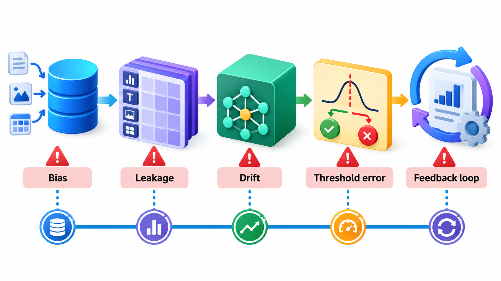
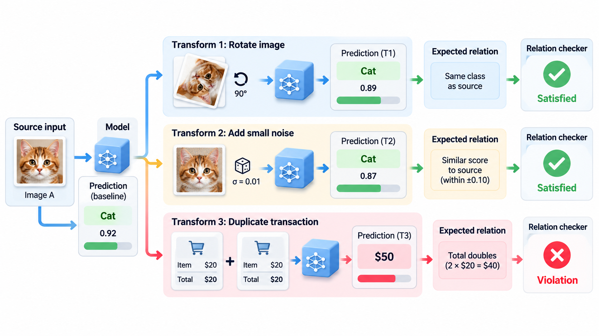
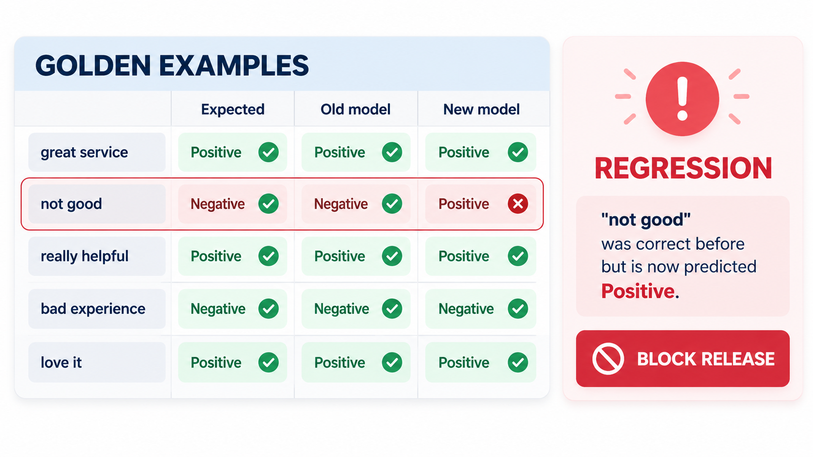
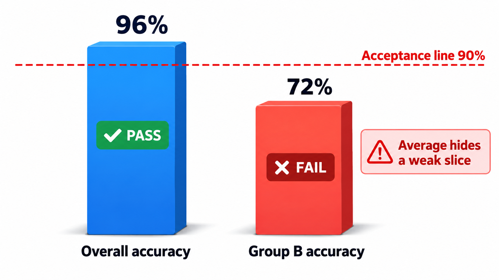
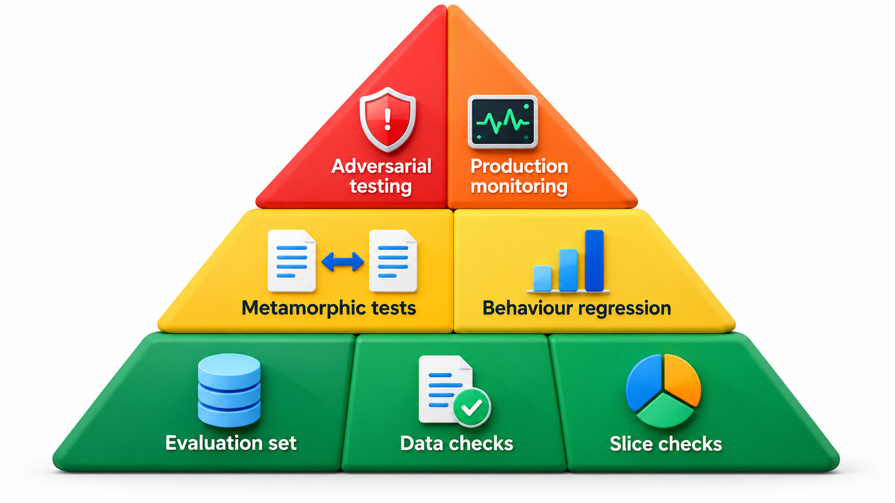

## Behaviour That Emerged, Not Behaviour That Was Written

A conventional program does what its code says. A system with a learned component does something else: its behaviour comes from its training data and from what it learns in use. No line of code says "repeat insults"; the behaviour *emerges*, and the only way to find out what it will do is to try it in conditions as hostile as the ones it will meet. A system tested only among friendly users meets an unfriendly world.

That is why machine-learning systems need testing methods of their own. This topic is about the particular problems of testing software with a learned component, and the techniques that have grown up for them: evaluation sets, metamorphic tests, slice testing and watching for drift.

## Why Ordinary Testing Is Not Enough

A model is not a function with a specification. Several features make it different.

- **There is no exact expected output.** For a spam filter, "the right answer" for a borderline message is a matter of opinion and probability. A single wrong answer is not a bug in the usual sense, since every model makes some.
- **Correctness is statistical.** The question is "how often is it right?", and the answer is a percentage over a sample.
- **Behaviour depends on data.** Change the training data slightly, and behaviour changes in ways no one can read from the code. A bug may be in the data.
- **The input space is vast and unstructured.** Images, text and speech cannot be partitioned neatly into equivalence classes.
- **It can fail silently and drift.** The world changes, and a model that was accurate last year degrades without any change to the code.
- **Failures can be unfair.** A model may do well on average and badly for a group of people. That is a defect, though no test of the average would reveal it.

None of this makes testing impossible. It changes what a test looks like.

| Aspect | Conventional software | Learned component |
| --- | --- | --- |
| Specification | Exact rules | Examples and statistics |
| Expected output | One right answer | Often a range or a probability |
| Pass or fail | Per test | Rate over a sample |
| Where a bug lives | Code | Code, data, labels or training |
| Changing behaviour | Edit code | Retrain; effects are broad |
| Ageing | Stable until changed | Drifts as the world changes |

## A Real Case: The Chatbot That Learned from Strangers

In March 2016 Microsoft released Tay, a chatbot on Twitter that was meant to sound like a friendly American teenager and to get better at conversation by learning from the people who talked to it. It had been tested inside the company, and the tests went well. Within sixteen hours of the public launch it was taken offline. A coordinated group of users had discovered that Tay would repeat and absorb what it was told, and they fed it abusive and offensive messages until it began producing its own. Microsoft apologised and withdrew it.

The interesting question for an engineer is which test would have caught this. Nothing in the code was broken. Every function did what it was written to do, and a conventional test suite would have passed. The fault lived in the relationship between the model and its data: the system learned from whoever turned up, and the people who turned up on launch day were not the people who had tested it.

| What the team tested | What actually happened |
| --- | --- |
| Conversations with colleagues and friendly testers | Conversations with strangers who set out to cause harm |
| Whether the bot replied sensibly | Whether the bot could be steered into replying harmfully |
| The program's correctness | The behaviour that the training data produced |

This is the central point of testing machine learning systems. The behaviour is learned, so the tests must examine behaviour: how the system responds to hostile, unusual and badly distributed inputs, and what limits stop it learning from them. A system that updates itself in public also needs monitoring and a way to switch it off quickly, which is exactly what Microsoft had to do. Later in this topic, the sections on data quality, behavioural tests and monitoring are all answers to the question Tay posed.

## Where Defects Come From in ML Systems

The causes of failure are different from those of ordinary code.

| Source | Example |
| --- | --- |
| **Wrong or noisy labels** | Photos labelled "cat" that are dogs; the model learns the mistake |
| **Unrepresentative data** | Training photos taken in daylight only; the model fails at night |
| **Leakage** | The test set contains examples that were in training, so scores look better than they are |
| **Spurious cues** | A model learns that a ruler in a photo means "skin cancer", because training images with cancer included rulers |
| **Skew between training and use** | Trained on clean text, used on messages with spelling mistakes and slang |
| **Feedback loops** | The model's output changes what data it later sees |
| **Plain code bugs** | Pre-processing differs between training and serving |

The last one is common and easy to miss: if the code that prepares data for the model during training differs, even slightly, from the code used in production, the model sees inputs it was never trained on.

## Evaluation Sets and Probabilistic Acceptance

The foundation is the **evaluation set**: a collection of examples with known correct labels, kept separate from the data used for training, on which the model is scored. The scores are accuracy, or measures that treat different mistakes differently (how many of the real spam messages it caught, and how many good messages it wrongly blocked). The acceptance criterion is **probabilistic**: "at least 95 per cent accuracy on the evaluation set, with no group below 90 per cent", and not "every answer is correct".

The evaluation set must represent the real world. A set that is too clean, too small or too like the training data gives false comfort. It should include the hard and rare cases, and should be sliced by groups and conditions to reveal uneven performance. It should also be refreshed from real use, since what users actually send drifts.

A spam filter's results on 1,000 messages show why a single number is not enough.

| | Predicted spam | Predicted not spam |
| --- | --- | --- |
| **Actually spam (100)** | 90 caught | 10 missed |
| **Actually not spam (900)** | 45 wrongly blocked | 855 correct |

Accuracy is (90 + 855) / 1,000, or 94.5 per cent, which sounds good. But 45 genuine messages were blocked, and 10 per cent of spam got through. Precision (of those marked spam, how many really were) is 90 / 135, or 67 per cent. Recall (of the real spam, how many were caught) is 90 per cent. Which measure matters depends on the cost: blocking a genuine job offer may be far worse than letting one spam message through.

## Metamorphic Testing

When there is no known correct answer for an input, there may still be a known *relationship* between answers. **Metamorphic testing**, proposed by T. Y. Chen and colleagues in 1998, checks such relationships. If you rotate a photo of a cat by a few degrees, it should still be labelled a cat. If you add a harmless, neutral word to a movie review, its sentiment should not flip. If you change a person's name in a loan application, the decision should not change. You do not need to know the right answer, only that two related inputs should give consistent ones. A violation shows a real weakness.

| Relation | Change to the input | Expected change to the output |
| --- | --- | --- |
| Invariance | Rotate the image slightly | Same label |
| Invariance | Swap a person's name | Same decision |
| Invariance | Add a neutral word to a review | Same sentiment |
| Directional | Increase the applicant's income | Approval chance does not fall |
| Monotonic | Add another strongly negative word | Sentiment does not become more positive |

## A Model Tested Three Ways

Use a deliberately simple "model" that counts positive and negative words in a sentence, to stand in for a trained one, and test it with three approaches in turn.

| Approach | What is done | Result |
| --- | --- | --- |
| 1. Evaluation set | Six labelled sentences, with an acceptance threshold of 80% | 5 of 6 right, 83%: accepted on this evidence |
| 2. Metamorphic test | Adding a neutral word ("course") to "great and clear" should not change the label | The label does not change: passes |
| 3. Looking at what failed | The one wrong case, "not good" | Predicted positive, expected negative |

The model gets five right, which meets the threshold. The third check shows what the accuracy figure hid. "Not good" contains the positive word "good" and the model calls it positive. The one sentence that failed in the evaluation set is a systematic weakness: it does not understand negation. The lesson is that a passing score is not the end. Looking at which cases fail, and why, finds patterns that a percentage hides.

## Slice Testing: Averages Hide Groups

A model's score should be broken down by the groups and conditions that matter.

| Slice | Share of data | Accuracy |
| --- | --- | --- |
| All users | 100% | 94% |
| Users in cities | 80% | 97% |
| Users in rural areas | 20% | 82% |
| Daytime photos | 75% | 96% |
| Night photos | 25% | 88% |

The overall 94 per cent hides a rural figure of 82 per cent. If the acceptance criterion says no group may fall below 90 per cent, this model fails, though its average looks excellent. Slice testing turns fairness from a worry into a measurable requirement.

## Regression of Model Behaviour

Each time a model is retrained, its behaviour changes, and improving the average can break specific cases that used to work. A **model regression test** keeps a set of important cases, "golden" examples, and checks that a new version still handles them. It compares the new model with the previous one, on the same data, slice by slice. A new model that is better overall but much worse for one group, or that breaks a case customers noticed, should not ship without a decision. Teams also keep tests for known past failures.

<!-- Visual: a model regression check: the old and new model answering the same set of golden examples side by side, with one case that used to be right and is now wrong circled. Save as images/111_model_regression_check.png. -->

## Testing the Whole System, and After Release

The model sits inside a larger system, and the interactions need testing: what the application does when the model is unsure, when it is unavailable, or when it returns something unexpected. A system should have a fallback, such as a person reviewing low-confidence cases, and that path needs testing too. Then comes **monitoring in production**: tracking the model's inputs and outputs for drift, watching the share of low-confidence answers, and sampling real predictions for human review. For Tay, a monitor that noticed the content of its tweets, and a limit on how fast it could learn from strangers, would have caught the problem within minutes.

| What to monitor | Signal of trouble |
| --- | --- |
| Input distribution | The kinds of input shift from what the model was trained on |
| Output distribution | Sudden change in the share of each prediction |
| Confidence | More low-confidence answers than before |
| Human feedback | More corrections or complaints |
| Business outcomes | Conversions, complaints or errors worsen |
| Accuracy on fresh labelled samples | Falls below the acceptance threshold |

<!-- Visual: two bars for a model's accuracy overall and for a smaller group, showing a good average hiding a poor result for the group, with the acceptance line drawn across. Save as images/111_average_hides_group.png. -->

Adversarial testing, sometimes called red-teaming, deliberately tries to make the system misbehave, the way hostile users will. It is the test Tay did not get.

<!-- Visual: a model test pyramid: evaluation-set scores and slice checks at the base, metamorphic and behaviour regression tests in the middle, and adversarial and production monitoring at the top. Save as images/111_ml_test_layers.png. -->

