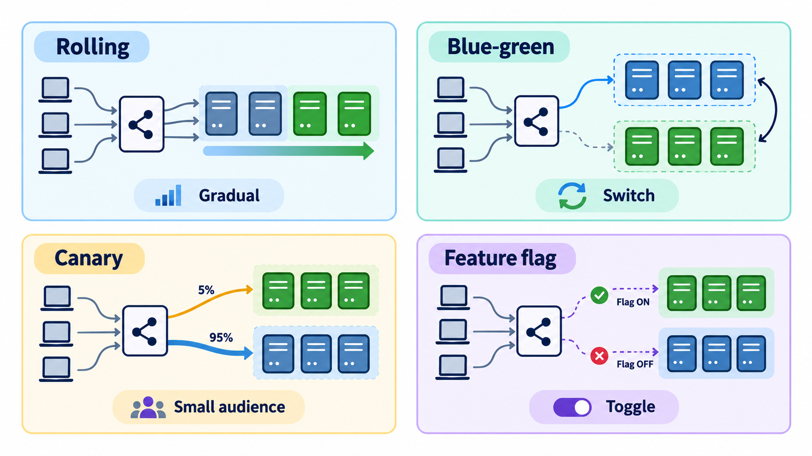
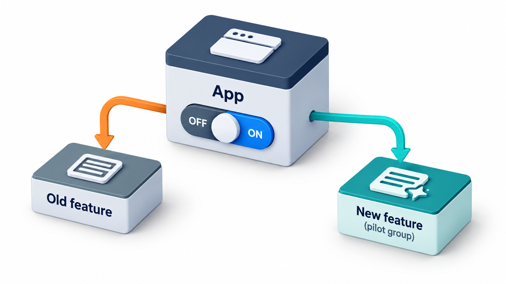
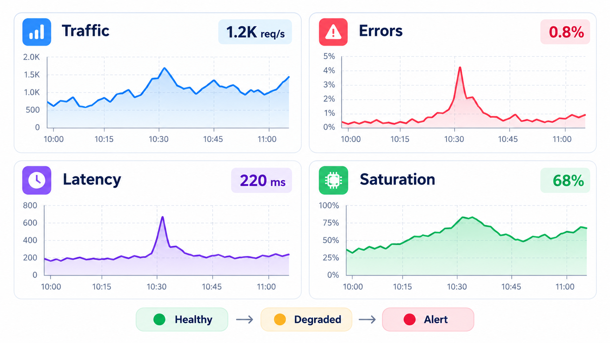
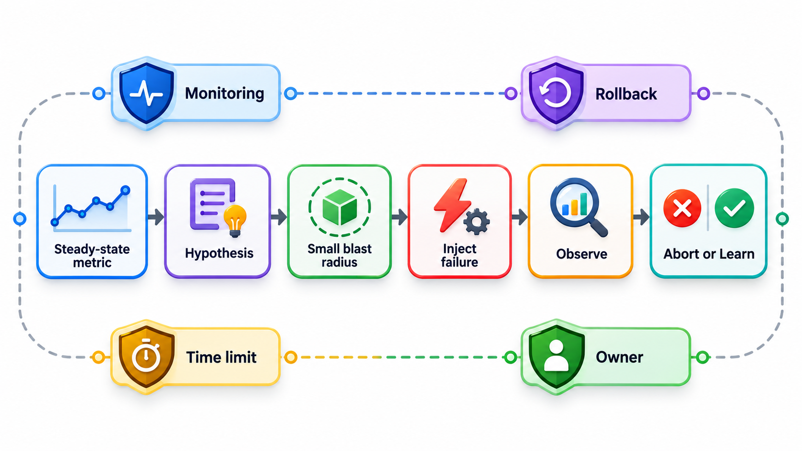
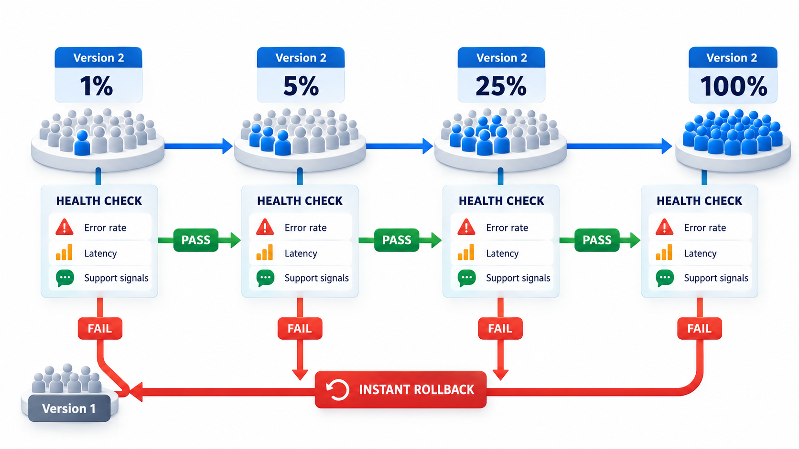

## Some of the Best Testing Happens After Release

It is easy to believe that testing happens before release and stops there. But no test environment is a perfect copy of production. It has less traffic, different data, a different mix of users and none of the strange real-world events. The only place where you can be completely sure of how the system behaves under real conditions is the real system.

**Testing in production** is the careful use of that fact, with controls that keep the risk small. Examples include releasing a new version to a small share of users first, switching features on gradually, watching for problems with monitoring, and deliberately switching off parts of the live system during working hours to be sure the rest survives, a practice known as chaos engineering. The effect is to change how people build things: an engineer who knows a server may be killed at any moment builds a service that copes.

## Why Pre-Release Testing Is Not Enough

However good the test suite, certain things only appear in production. The real volume and variety of data. Combinations of devices, browsers and settings that no lab has. The behaviour of the real third-party services. The interaction of many users at once. The effects of a gradual build-up, like slowly filling disks. A team that relies only on pre-release tests will release with a certain level of uncertainty, and if it releases rarely, in big batches, the risk of each release is large.

The modern answer is to make releases small, frequent, observable and reversible, so that the uncertainty is handled in production safely. The techniques below all share that aim.

| What differs in production | Example of a surprise |
| --- | --- |
| **Data** | A customer record with a field in an unexpected format |
| **Scale** | A query that is fast on 10,000 rows and slow on 10 million |
| **Users** | A browser or device nobody tested |
| **Timing** | Peak traffic at the moment a batch job runs |
| **Dependencies** | A third-party service slower than its sandbox |
| **Configuration** | A setting that differs from staging |
| **Gradual effects** | A memory leak that takes two weeks to matter |

## Canary Releases

Miners once took canaries into coal mines because the birds were more sensitive than humans to poisonous gas. If the canary stopped singing, the miners knew to leave. A **canary release** sends the new version to a small share of real traffic, say 1 to 5 per cent, while the rest of the users stay on the old version. The team watches the canary closely. If its metrics are as good as the old version's, the share is increased in stages. If not, traffic is switched back and only a few users were affected.

A canary release sends a small share of traffic to the new version and compares it with the old one. Take a canary receiving 5 per cent of traffic, with an agreed tolerance: the new version may be at most half a point worse.

| Version | Requests | Errors | Error rate |
| --- | --- | --- | --- |
| Old | 9,500 | 19 | 0.2% |
| Canary (new) | 500 | 9 | 1.8% |

The canary has nine times as many errors per request, and is 1.6 points worse, beyond the half-point tolerance. The decision is to roll back. Only 500 requests were affected. Had the new version been released to everyone at once, ten times as many users would have met the problem before anyone noticed. That is the point of the canary: the damage is limited by design. Real systems apply the same logic to several measures together, such as errors, response time and business measures like payments completed, and use statistical tests to avoid reacting to noise.

<!-- Visual: release strategies such as canary and blue-green that limit exposure to a new version. -->

## Other Ways to Release Safely

| Strategy | How it works | Strength | Cost |
| --- | --- | --- | --- |
| **Canary** | A small share of traffic goes to the new version | Limits exposure; real data | Needs good monitoring |
| **Blue-green** | Two full environments; switch all traffic at once | Instant rollback by switching back | Double the infrastructure during the switch |
| **Rolling update** | Replace servers a few at a time | No extra environment | Old and new run together for a while |
| **Dark launch** | Run new code on real traffic but hide its results | Tests performance without user impact | Extra load |
| **Shadow traffic** | Copy real requests to the new version and compare answers | Finds differences without risk | Complex to set up |
| **Staged rollout by region or user group** | Release to one region or group first | Natural boundaries | Slower overall |

## Feature Flags and Gradual Rollouts

A **feature flag** is a switch in the code that turns a feature on or off without redeploying. With flags, deploying code and releasing a feature become separate acts. The code can be shipped, switched off, for days. It can then be turned on for staff, then for 1 per cent of users, then for 10, then for everyone, and turned off in seconds if something goes wrong. This gives a precise control over who sees what, and it allows **A/B testing**: showing two versions to different groups and measuring which does better.

Flags need discipline. Old flags should be removed once a feature is fully released, or the code fills with branches and combinations that no one tests.

| Kind of flag | Lifetime | Purpose |
| --- | --- | --- |
| **Release flag** | Days to weeks | Hide an unfinished or new feature until ready |
| **Experiment flag** | Weeks | Compare versions with real users |
| **Operational flag (kill switch)** | Long-lived | Turn off a risky part during an incident |
| **Permission flag** | Long-lived | Give a feature to certain customers |

<!-- Visual: A feature flag separating deployed code from released functionality. -->

## Monitoring as a Test

In production, the monitoring system is the test. Instead of asserting that a function returns 100, the team watches the live system for signs that something is wrong: error rates, response times, queue lengths, failed payments, signups per minute. **Synthetic monitoring** adds artificial users: a script that logs in and pays a test fee every minute and raises an alarm if it fails. Alerts are tuned to indicate real problems, with a clear action attached, so that people trust them.

Good observability, the ability to understand what a system is doing from the data it emits, in the form of logs, metrics and traces, is what makes production experiments safe. Without it a team cannot tell whether the canary is healthy.

| Signal | Kind | What it answers |
| --- | --- | --- |
| **Metrics** | Numbers over time | Is the error rate rising? |
| **Logs** | Records of events | What happened at 10:03? |
| **Traces** | The path of one request through services | Which service made it slow? |
| **Synthetic checks** | Scripted user journeys | Can a user pay right now? |
| **Real-user monitoring** | Measurements from actual users' devices | How slow is the page on a phone in a village? |

<!-- Visual: A dashboard of the signals that show how a live system is behaving. -->

## Chaos Engineering

Chaos engineering goes further. The team forms a hypothesis about the system's steady behaviour ("if one server dies, users notice nothing"), injects a failure in a controlled way (kills a server, slows a network link, makes a dependency return errors), and watches whether the hypothesis holds. The experiments start small, in a limited part of production, with a clear way to stop. They find weaknesses on the team's schedule and not the customers'.

| Step | Example |
| --- | --- |
| 1. Define steady state | Payments succeed at 99.9%; pages load in under 2 seconds |
| 2. Hypothesis | If one of three payment servers is stopped, the steady state holds |
| 3. Limit the blast radius | Only 1% of traffic; a person watching; an abort button |
| 4. Inject the failure | Stop one payment server |
| 5. Observe | Success rate dips to 97% for 30 seconds, then recovers |
| 6. Learn and fix | The load balancer was slow to notice the server was gone; shorten the health-check interval |

## The Conditions for Doing It Safely

Testing in production is a discipline and not a licence for recklessness. It needs the ability to roll back quickly, small increments that limit the damage, good monitoring that detects trouble fast, careful treatment of user data and a culture in which people are not afraid to report problems. It complements pre-release testing and does not replace it. Basic checks still come first, so that obvious defects are not offered to real users.

<!-- Visual: a staged rollout timeline from 1 per cent to 5, 25 and 100 per cent of users, with a health check between each stage and an arrow to instant rollback if the check fails. Save as images/112_staged_rollout.png. -->

## Five Misreadings of Testing in Production

**"Testing in production means not testing before."** Pre-release testing still comes first. Production adds what no lab can show.

**"It is reckless."** Done with canaries, flags, monitoring and quick rollback, it limits the risk to a small share of users, and is less risky than a rare big release.

**"A staging environment shows everything production will."** It has less traffic, different data and different timing. Differences are where surprises live.

**"Monitoring is operations' job, not testing's."** In production, monitoring is the test. The team that builds the feature should define what healthy looks like.

**"Chaos engineering is about breaking things."** It is about learning how the system behaves under failure, in a controlled way, so that it can be made stronger.
