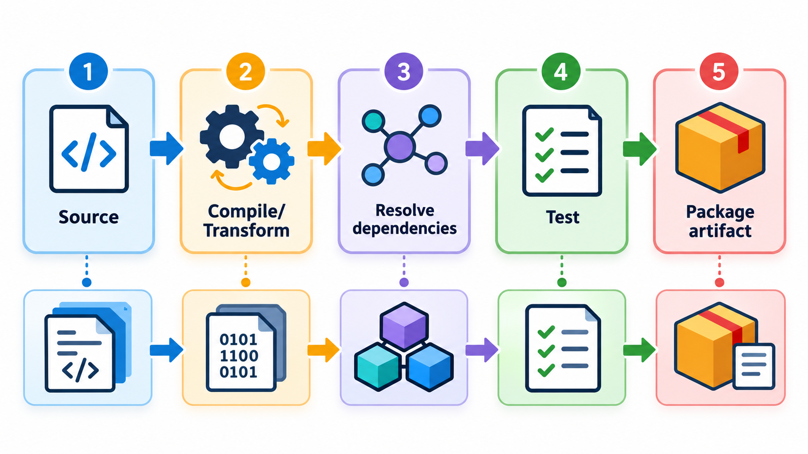
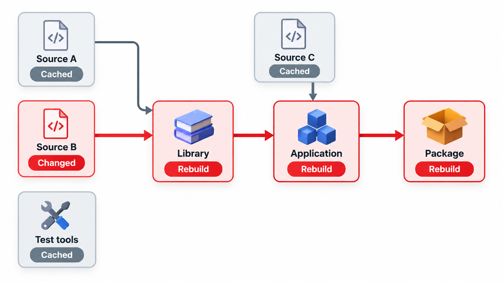
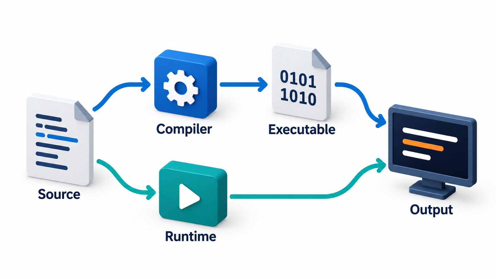
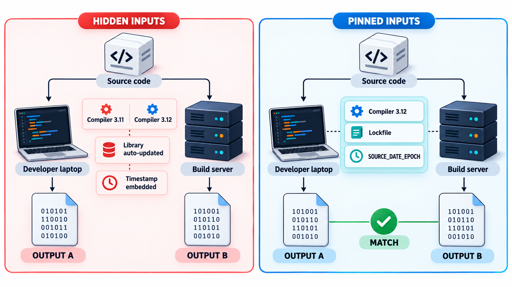
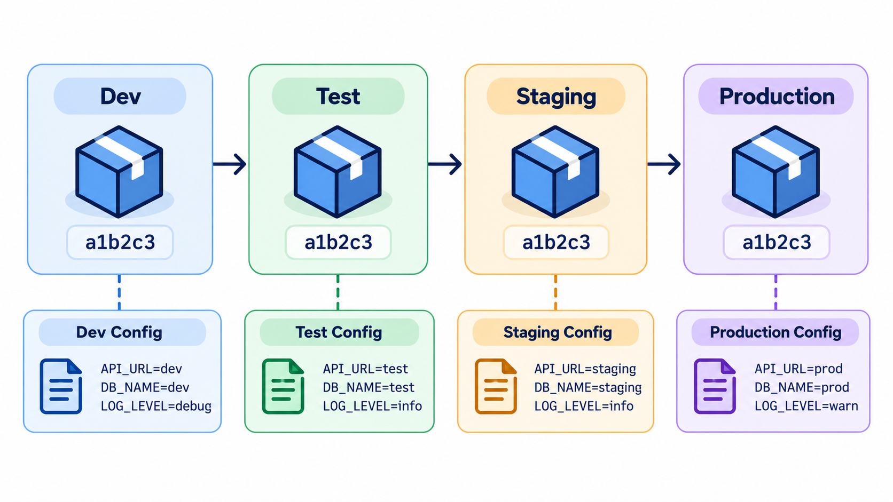

## Rebuild What Changed, and Nothing Else

Software is not usually compiled in one piece. Source files are turned into intermediate files, which are combined into the finished program. If a source file changes and its intermediate file is not rebuilt, the program that runs is a confusing mixture of old and new, and the error messages come from code that no longer exists. Rebuilding everything every time avoids that, but wastes minutes or hours.

A **build tool** solves this by recording what each product is built from and rebuilding only what is out of date. Its central idea, a graph of dependencies and a rule for deciding what is stale, sits inside nearly every build tool that has followed the first ones. This topic explains what a **build** is, why it needs a tool, and what makes a build trustworthy.

## What a Build Does

Source code is not what runs. Between the files a developer edits and the program a user runs, a series of steps take place. They are called the **build**.

| Step | What happens |
| --- | --- |
| **Fetch** | Download the libraries the project depends on |
| **Compile** | Translate source code into machine code or bytecode |
| **Link** | Join the compiled pieces and libraries into one program |
| **Test** | Run the automated checks |
| **Package** | Bundle the result into something that can be installed or deployed, such as an executable, a web bundle or a container image |

Interpreted languages such as Python and JavaScript skip compilation, but still have a build: install dependencies, check the code, bundle files, create a package. The final product of a build is an **artefact**, a file or set of files that can be deployed.

<!-- Visual: A build pipeline turning source code into a deployable artefact. -->

## Kinds of Build

Builds happen at different moments, and each has a different aim.

| Kind | Where | Aim | Typical speed |
| --- | --- | --- | --- |
| **Local (developer) build** | A developer's machine | Quick feedback while coding | Seconds, using incremental builds |
| **CI build** | A build server, on every change | Prove the change builds and passes tests on a clean machine | Minutes |
| **Release build** | A controlled server | Produce the artefact that will be shipped, with optimisations and signing | Minutes to hours |
| **Nightly build** | A scheduled job | Run the longest checks and catch slow-burning breakage | Hours |

A good build system makes these as similar as possible, so that what passes locally also passes on the server.

## Why a Tool Is Needed

A project of any size has hundreds or thousands of files, and building by hand is slow and error-prone. A person forgets a step, uses a different compiler version, or recompiles everything when only one file changed. A **build system** automates the whole sequence. It is told the *what*, not the *how many times*: it works out from the dependency graph which steps are needed.

The saving is in the **incremental build**. When one file changes, only that file and the things that depend on it are rebuilt. For a large program, this turns a rebuild of an hour into one of seconds.

## Rebuilding Only What Is Stale

Imitate what such a tool does with a tiny project: a program built from two compiled files, each built from its own source file and a shared header. The build runs three times.

| Situation | What the tool rebuilds | Why |
| --- | --- | --- |
| Nothing changed | Nothing | Every output is newer than its inputs |
| The reports source file is edited | The compiled reports file and the program | Only the outputs that depend on the edited file are stale; the fees file is left alone |
| The shared header is edited | Both compiled files and the program | Everything depends on the header |

Each product records what it depends on, and each file has a time it was last changed. The tool first brings every input up to date, then compares: if any input is newer than the output built from it, the output is stale and is rebuilt. That is the whole logic. Real tools add parallelism, caching across machines and many languages, but they all answer the same question: what is out of date, and what must be rebuilt because of it?

## The Dependency Graph

The relationships form a graph, and the order of building follows it.

| Target | Built from | Built after |
| --- | --- | --- |
| `fees.o` | `fees.c`, `common.h` | Nothing else |
| `reports.o` | `reports.c`, `common.h` | Nothing else |
| `program` | `fees.o`, `reports.o` | Both object files |
| `tests` | `program`, `tests.c` | The program |
| `package` | `program`, `tests` passing | The tests |

Two targets with no link between them, `fees.o` and `reports.o`, can be built at the same time on different processor cores. This is why a well-described graph lets a build use all the machine's cores: independent work is found automatically.

A graph must not contain a cycle. If `a` needs `b` and `b` needs `a`, there is no first step, and the tool reports an error. Spotting cycles is also a useful check on a design: modules that cannot be built independently are probably too tightly coupled.

## Build Tools Across Ecosystems

Each language community has its favourites, and the ideas are the same.

| Ecosystem | Common tools | Notes |
| --- | --- | --- |
| **C and C++** | Make, CMake, Ninja | CMake generates the files that Make or Ninja then run |
| **Java and JVM** | Maven, Gradle | Maven is declarative and conventional; Gradle is flexible and fast |
| **JavaScript** | npm or Yarn scripts, Webpack, Vite | Bundling many files into a few for browsers |
| **Python** | pip with pyproject files, setuptools | Packaging for distribution |
| **.NET** | MSBuild, `dotnet` | Built into the platform |
| **Large monorepos** | Bazel, Buck | Strict, cached, distributed builds for huge codebases |

Choose the tool the ecosystem uses. A project that ignores the norm makes it harder for newcomers.

## Caching: Never Do the Same Work Twice

Modern build systems go beyond timestamps. They compute a fingerprint (a hash) of every input to a step: the source, the compiler version, the flags. If the fingerprint has been seen before, the stored result is reused instead of redoing the work, even if the result was made on a different machine.

| Cache type | What it stores | Benefit |
| --- | --- | --- |
| **Local cache** | Results on this machine | Fast repeat builds |
| **Remote (shared) cache** | Results on a server, shared by the team | A colleague's build saves your time |
| **Dependency cache** | Downloaded libraries | No repeated downloads |
| **Layer cache (containers)** | Unchanged steps of an image | Rebuild only what changed |

The condition is that the build is deterministic: if hidden inputs change the output, a cache returns the wrong answer. That is why the next section matters.

## Deterministic Builds

A good build is **deterministic**: the same inputs always produce the same output. That sounds obvious, and it is surprisingly hard. Builds are spoiled by hidden inputs: the compiler version on a particular machine, a library that updates itself, the current time embedded in the output, the order in which files are read, the user's name in a file path. A build that works on one laptop and fails on another is the source of the phrase "it works on my machine".

<!-- Visual: compiled and interpreted languages meeting at a single deployable artefact. -->

The remedy is to make every input explicit. Pin the versions of compilers and libraries. Record them in a file. Build in a clean, controlled environment, often a container, and not on a developer's own machine. The most demanding goal is a **reproducible build**, in which independent builders produce a bit-for-bit identical artefact from the same source. Reproducibility matters for security, since it lets anyone check that a published program really was made from the published source. Projects such as Debian have worked for years to make their packages reproducible.

| Hidden input | How it spoils a build | Fix |
| --- | --- | --- |
| Compiler version | Different optimisations or behaviour | Pin the version; build in a container |
| Unpinned library | A new release changes the result | Lockfile |
| Timestamp in the output | Two builds differ by the time | Use a fixed build date |
| File order | Files combined in a different order | Sort inputs |
| Absolute paths | The user's folder name appears in the output | Use relative paths |
| Environment variables | A local setting alters behaviour | Declare every setting in the build |
| Network access | A download changes between builds | Fetch from a pinned, cached source |

<!-- Visual: a developer laptop and a build server both producing outputs that differ, marked "hidden inputs: compiler version, library update, timestamp", beside a controlled environment where every input is pinned and the two outputs match. Save as images/113_hidden_inputs.png. -->

## One Artefact, Many Environments

A principle that follows is to **build once and deploy the same artefact everywhere**. The file that was tested should be the file that goes to production, and not a new build made later that might differ. Differences between environments, such as database addresses, are supplied as configuration at deployment time, not baked into the build. The same package runs in testing and in production, which removes a source of "it passed the tests but broke in production".

<!-- Visual: one build artefact deployed unchanged to several environments. -->

## Build Health

A build is a product with its own quality measures.

| Measure | Healthy sign | Problem sign |
| --- | --- | --- |
| **Time for a clean build** | Minutes | Over half an hour |
| **Time for an incremental build** | Seconds | Rebuilds everything for small changes |
| **Failure rate not caused by code** | Near zero | Frequent random failures |
| **Works on a fresh machine** | One documented command | A page of manual steps |
| **Warnings** | None, or tracked | Hundreds ignored |
