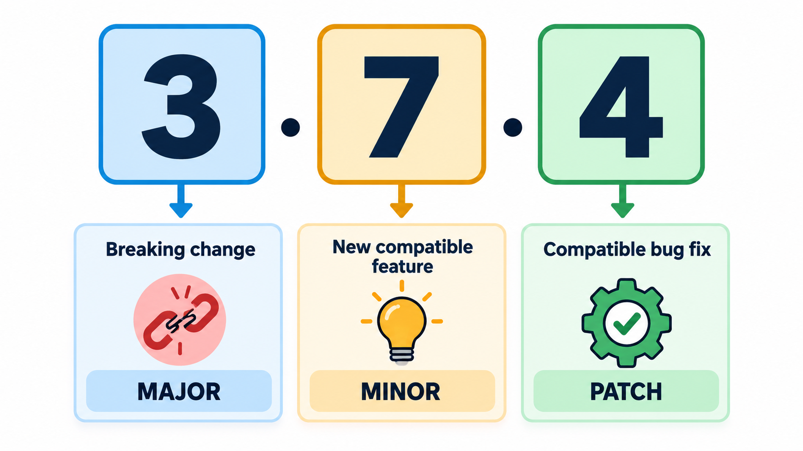
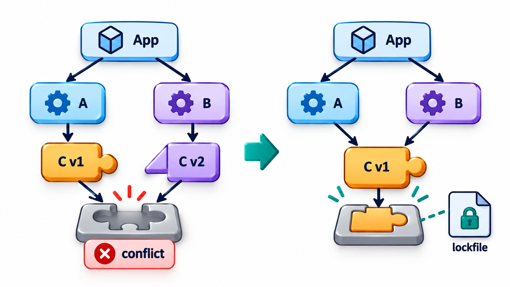
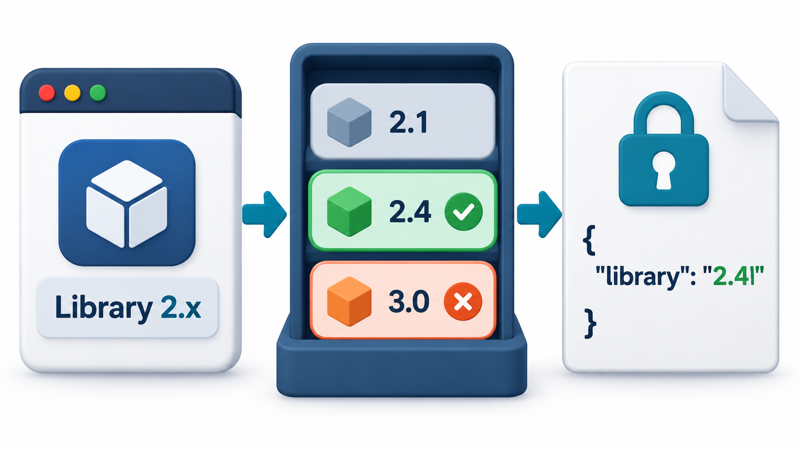
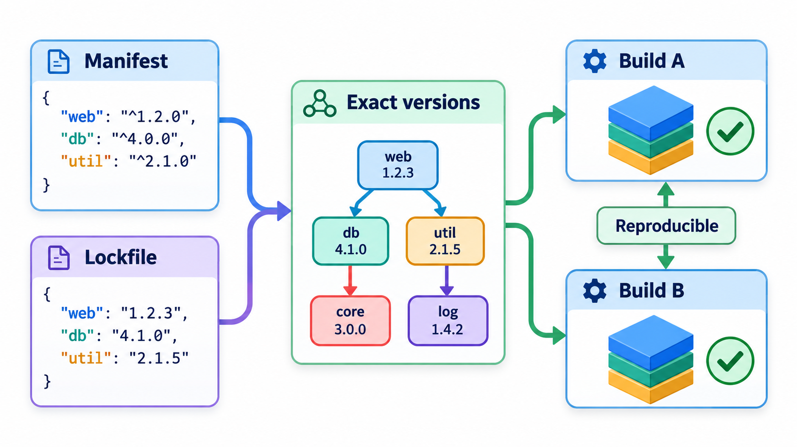
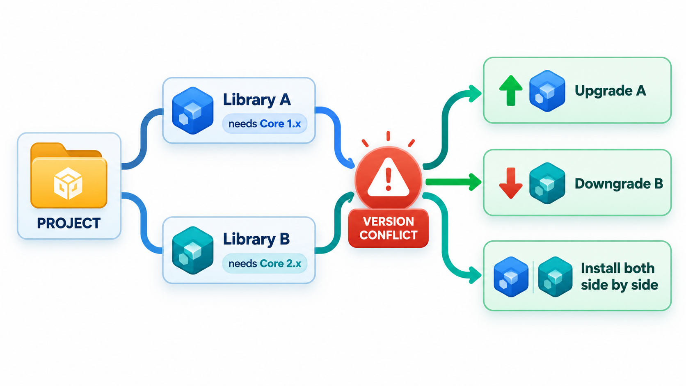

## Dependency Hell and a Three-Part Number

A project uses libraries. The libraries use other libraries. Each library has versions, and each version number is chosen by its author in whatever way the author likes. Upgrading one library might silently break another, or might demand a version of a third library that conflicts with the one something else needs. If a project's dependencies are too tightly locked, it cannot take security fixes. If they are too loose, any update might break it. This tangle is called **dependency hell**.

**Semantic versioning**, or SemVer, gives version numbers a meaning that tools and people can rely on. A version has three numbers, MAJOR.MINOR.PATCH, and each change to a number is a promise about compatibility. Combined with files that record the exact versions in use, it makes the problem manageable. This topic explains both, and how they combine.

## What the Three Numbers Promise

| Part | Increase it when... | Example | What a user can assume |
| --- | --- | --- | --- |
| **MAJOR** | You make a change that breaks existing users | 1.9.2 to 2.0.0 | Read the changelog. Code may need to change |
| **MINOR** | You add functionality in a backward-compatible way | 1.4.0 to 1.5.0 | Safe to upgrade. New features are available |
| **PATCH** | You fix bugs without changing the interface | 1.4.1 to 1.4.2 | Safe to upgrade. Nothing should differ except the bug |

The convention is a promise by the author, and its worth depends on the author keeping it. A major version of zero (0.x.y) means "anything may change". Pre-release versions such as 2.0.0-beta.1 are marked with a suffix.

| Version | Reading |
| --- | --- |
| 0.3.2 | Early; the interface may change at any time |
| 1.0.0 | First stable release; the interface is now a promise |
| 1.4.2 | Stable; the fourth feature release, with two bug-fix releases after it |
| 2.0.0-beta.1 | A preview of a breaking version; not for production |
| 2.0.0 | The breaking version is released |

<!-- Visual: A semantic-version change communicating whether an upgrade is safe. -->

## Version Ranges

Projects do not usually list a single exact version for each dependency. They list a **range** of acceptable ones. A common form is the caret: `^1.4.0` means "any version from 1.4.0 up to, but not including, 2.0.0". The project accepts bug fixes and new features and rejects breaking changes. A tilde, `~1.4.0`, is stricter and accepts only patch changes within 1.4.

A caret range such as ^1.4.0 accepts any version with the same major number that is at least 1.4.0. Applying the rule:

| Available version | Accepted by ^1.4.0? | Why |
| --- | --- | --- |
| 1.3.9 | No | Too old |
| 1.4.0 | Yes | The wanted version itself |
| 1.4.7 | Yes | Same major, newer |
| 1.9.2 | Yes | Same major, newer |
| 2.0.0 | No | A new major version, which might break things |

Comparing the numbers as numbers, and not as text, matters: as text, "1.10.0" would sort before "1.9.0". Now consider two libraries that depend on the same package. Library A needs ^1.4.0 and library B needs ^2.1.0. No version is both in the 1.x series and in the 2.x series, so the list of versions that satisfy both is empty. That is a **version conflict**, the heart of dependency hell. It is resolved by upgrading A, downgrading B, or, in some ecosystems, by installing both versions side by side.

| Range style | Written | Accepts | Use when |
| --- | --- | --- | --- |
| **Exact** | `1.4.2` | Only 1.4.2 | You need total control |
| **Caret** | `^1.4.2` | 1.4.2 up to below 2.0.0 | Trust the author to follow SemVer |
| **Tilde** | `~1.4.2` | 1.4.2 up to below 1.5.0 | Accept only bug fixes |
| **Wildcard** | `1.x` | Any 1.something | Rarely wise |
| **Open-ended** | "1.4.2 or anything newer" | Anything newer, including breaking releases | Avoid in applications |

## Transitive Dependencies and Conflicts

Your project depends on libraries, and they depend on others. The libraries you never chose are **transitive dependencies**, and they are usually the majority. A project with ten direct dependencies might have two hundred in all. A conflict can arise deep in the tree, where two of your libraries need incompatible versions of a third. The tool that installs packages, the *resolver*, tries to find a set of versions that satisfies everyone. Some can do it; others report failure.

<!-- Visual: A dependency diamond where two libraries need different versions of a third. -->

## Lockfiles

A range allows variation, and variation threatens repeatability. If your build today installs library X at 1.4.7 and next week's build gets 1.5.0, the two builds are different, even though your code did not change. A **lockfile** records the exact version of every dependency, direct and transitive, that was installed. With a lockfile, every developer, the test server and production all get the same set. Names vary by ecosystem: `package-lock.json`, `yarn.lock`, `Pipfile.lock`, `poetry.lock`, `Cargo.lock`, `go.sum`.

<!-- Visual: A resolver choosing one version that satisfies several libraries. -->

The workflow is: the manifest says what is acceptable, the lockfile says what was chosen, and the lockfile is committed to version control. To upgrade, you deliberately run an update, which changes the lockfile, and you test the result and commit it. Updates are then a visible, reviewable change and not something that creeps in.

| File | Written by | Says | Committed? |
| --- | --- | --- | --- |
| **Manifest** (`package.json`, `pyproject.toml`) | The developer | Which dependencies, and which versions are acceptable | Yes |
| **Lockfile** | The tool | The exact versions chosen, with checksums | Yes, for applications |

Lockfiles often record a checksum of each package. If a package at the same version is later altered, perhaps maliciously, the checksum no longer matches and the install fails.

<!-- Visual: A lockfile pinning exact dependency versions to make builds repeatable. -->

## An Upgrade, Step by Step

A routine upgrade shows how the pieces fit.

| Step | Action | Evidence |
| --- | --- | --- |
| 1 | An automated tool notices library X has a new minor version, 1.5.0 | A pull request is opened |
| 2 | The pipeline installs it and runs all tests | Tests pass or fail |
| 3 | A developer reads the changelog | Notes a deprecation to follow up |
| 4 | The lockfile change is reviewed | Only X and one transitive dependency changed |
| 5 | Merge | Next build uses 1.5.0 everywhere |
| 6 | Watch | If a problem appears, revert the single commit |

Because the lockfile is in version control, the upgrade is one commit and the rollback is one commit.

## Resolving a Conflict in Practice

When the resolver reports a conflict, a calm sequence of steps usually finds the way out.

| Step | Question | Action |
| --- | --- | --- |
| 1 | Which two libraries disagree, and about what? | Read the resolver's message; it names them |
| 2 | Is a newer version of either library compatible with the other? | Upgrade the one that is behind |
| 3 | Is the disagreement real, or only a loose range? | Check whether the stricter range is needed; sometimes an update to a library relaxes it |
| 4 | Can the ecosystem install both versions side by side? | Some can (a separate copy for each); others cannot |
| 5 | Is one of the libraries replaceable? | Switch to an alternative |
| 6 | Last resort | Fork or patch one library; record why |

The same attention applies to the opposite problem: a vulnerability found in a transitive dependency that none of your libraries has yet updated. Tools can sometimes force a safer version of the buried package, but the safest long-term fix is for the direct library to be upgraded.

## Choosing and Dropping Dependencies

Versioning is easier when there are fewer dependencies. Before adding a library, a team can ask a few questions, and ask them again from time to time about libraries already in use.

| Question | If the answer is no |
| --- | --- |
| Is it actively maintained? | Plan an exit |
| Does it follow SemVer, with a changelog? | Expect surprises in minor updates |
| Do we use more than a small part of it? | Consider writing the small part ourselves |
| Is its licence acceptable? | Do not adopt |
| Does it pull in many other packages? | Count them as your own risk |

## Living With It

Several habits make dependency management smoother:

- **Commit the lockfile** for applications. (Libraries meant to be used by others usually do not pin tightly, so as not to cause conflicts for their users.)
- **Update often and in small steps.** A weekly or monthly update is cheaper than a yearly leap across several major versions. Automated tools can open a pull request for each new version so that the tests decide.
- **Read the changelog** before taking a major version.
- **Keep the tree small.** Fewer dependencies mean fewer conflicts.
- **Watch for vulnerabilities.** Tools scan the lockfile for known security problems and say which version fixes them.

<!-- Visual: a project with two direct libraries each pointing to a different required version of a third library, with a red cross at the conflict and three exits labelled upgrade one, downgrade the other, install both side by side. Save as images/114_version_conflict_exits.png. -->

## Five Misreadings of Versioning

**"A version number is just a label."** In SemVer it is a promise about compatibility, and tools rely on it.

**"Minor and patch updates are always safe."** They are meant to be. Authors sometimes break the promise, so the tests are the real guard.

**"Pinning everything exactly is the safest."** It prevents surprises and also blocks security fixes. Use ranges with a lockfile, and update on purpose.

**"A lockfile is clutter."** It makes builds repeatable. Commit it.

**"A conflict means someone made a mistake."** It is a natural result of independent authors. The resolver, or you, picks a way out.
