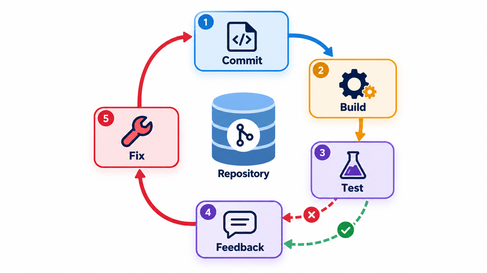
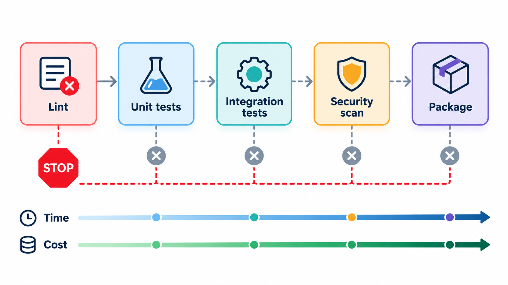
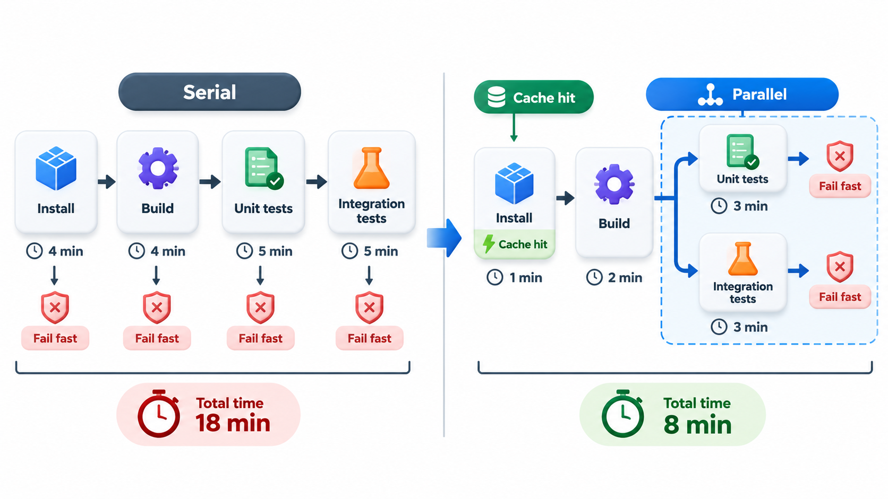
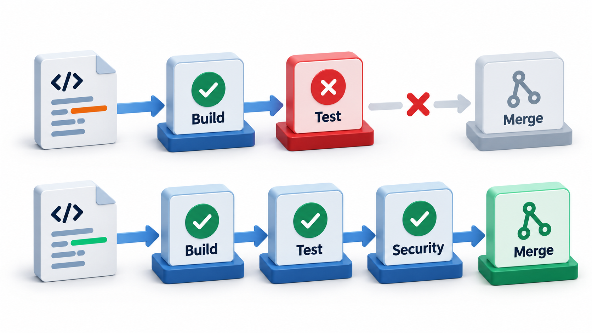
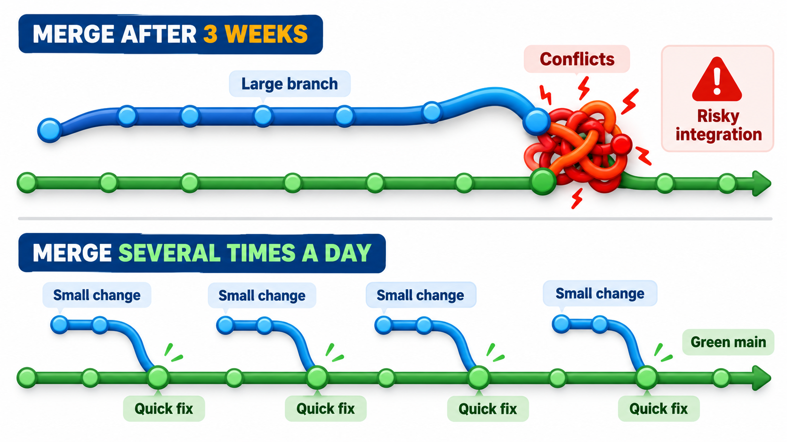

## Integrate Often, Because Waiting Hurts

When developers work separately for weeks and then combine their work, the combination fails in dozens of ways at once. Changes overlap, assumptions clash, and untangling it takes days. This is known as "integration hell". The opposite approach is to integrate every few hours, so that each integration is small, the problems are small, and the cause is obvious because only a little has changed.

**Continuous integration**, CI, is that practice. Every developer merges their work into the shared main line frequently, at least daily, and each merge triggers an automatic build and test run. If it fails, the team stops and fixes it. In a few years the idea went from a radical suggestion to an assumed baseline of professional practice.

The name was popularised by Kent Beck's Extreme Programming and by Martin Fowler's essay on the subject in the early 2000s. The underlying observation is that the cost of integrating grows faster than the size of what is integrated, so doing it in small pieces is cheaper in total.

## Why Small Merges Are Cheaper

The cost of a merge grows with the number of changes and the chance they overlap. Compare two teams of five developers over a month.

| Practice | Merges | Size of each | Conflicts per merge | Time to fix |
| --- | --- | --- | --- | --- |
| Merge once, at the end of the month | 1 per developer | Very large | Many, tangled | Days |
| Merge daily | About 20 per developer | Small | Rarely more than one | Minutes |

Overlap between changes behaves much like the pairs of connections in any system: when two people each change twenty files over a month, the number of places where they may collide is far larger than when each changes two files in a day. Frequent integration keeps the pile of unmerged changes small, so conflicts are few and the cause of a break is easy to see.

## The Practice

Several habits make up CI.

- **One shared main line.** Everyone works against the same branch, and keeps their own branches short.
- **Merge small and often.** At least once a day, in small steps.
- **Automate the build.** Anyone can build the whole system with one command.
- **Make the build self-testing.** The build includes a suite of automated tests that gives confidence.
- **Build every change on a clean machine.** A server, not a laptop, runs the build, so "works on my machine" does not count.
- **Keep it fast.** Developers should hear within about ten minutes.
- **Fix a broken build at once.** A red build is the team's top priority. Nobody piles new changes on top of a broken main line.
- **Everyone can see the result.** Status is visible to the whole team.

The effect is cultural as much as technical. The main line is always in a state that works, and the team trusts it.

<!-- Visual: A continuous integration loop running on every change. -->

## A Day with CI

What the practice looks like for one developer:

| Time | Action | Result |
| --- | --- | --- |
| 09:30 | Pulls the latest main line; starts a small change | Local tests pass |
| 11:00 | Runs the local build and tests; pushes the branch | The server begins a build |
| 11:08 | Pipeline reports green | Opens a pull request |
| 11:40 | A colleague reviews and approves | Merges into main |
| 11:42 | Pipeline runs on main | Green; the change is in the shared line |
| 14:00 | Starts the next small change | Repeats |

Two merges in a day is normal. If the 11:42 build had failed, the developer would drop everything and fix or revert it before starting anything else.

## A Pipeline

A CI system, such as Jenkins, GitHub Actions, GitLab CI or CircleCI, runs a **pipeline**: a sequence of stages defined in a file kept with the code ("pipeline as code"). Typical stages are checking out the code, running a linter, compiling, running unit tests, running integration tests, building the package, scanning for security problems and publishing the artefact. Each stage is a **gate**: if it fails, the pipeline stops and reports.

The order matters. Cheap, fast checks come first, so that a simple mistake is reported in a minute and not after the slow tests. The idea is called **fail fast**. Take a pipeline of five stages in which the integration tests fail.

| Stage | Minutes | Result | Waited so far |
| --- | --- | --- | --- |
| Lint | 1 | Passed | 1 minute |
| Unit tests | 3 | Passed | 4 minutes |
| Build | 4 | Passed | 8 minutes |
| Integration tests | 8 | Failed | 16 minutes: the developer is told now |
| End-to-end tests | 20 | Never run | n/a |

The pipeline stops at the failure and tells the developer at once. If every stage had been run regardless, the run would have taken 36 minutes. Failing fast cuts the wait for bad news to 16, and saves the cost of running the last stage on code already known to be broken. Putting the cheap, likely-to-fail checks early is the point of the order. A mistake caught by the 1-minute lint costs one minute of waiting, and not twenty.

<!-- Visual: A fail-fast pipeline stopping at the first failing stage. -->

## Speeding Up the Pipeline

A slow pipeline changes behaviour, so teams work to shorten it.

| Technique | How it helps | Typical saving |
| --- | --- | --- |
| **Run stages in parallel** | Lint, unit tests and security scan at the same time | The longest stage sets the time, not the sum |
| **Cache dependencies and build outputs** | Skip downloads and unchanged work | Minutes per run |
| **Split tests across machines** | Each runs a share | Roughly divided by the number of machines |
| **Run only affected tests** | Skip tests unrelated to the change | Large, with careful mapping |
| **Fast pipeline on every change; slower one afterwards** | Blocking checks stay short | Keeps merges quick |

For example, if lint (1 minute), unit tests (3), and a security scan (4) run in parallel, the stage takes 4 minutes instead of 8.

## Quality Gates

A **quality gate** is a condition that a change must meet to move on: all tests pass, code coverage on new code is at least a set level, no new serious security warnings, no linter errors. With gates enforced by the CI system, a change that fails them cannot be merged. This turns a team's standards from a hope into a rule. It must be used with judgement: a gate nobody can pass without cheating, or one that blocks on flaky tests, teaches people to resent or bypass the system.

| Gate | Blocks when | Risk if badly set |
| --- | --- | --- |
| Tests | Any test fails | Flaky tests block everyone |
| Coverage on new code | Below, say, 80% | People write empty tests to reach the number |
| Static analysis | New serious findings | False positives cause resentment |
| Security scan | A known serious vulnerability | Unfixable findings stall work; need an exceptions process |
| Review | No approval | Rubber-stamp approvals |

<!-- Visual: A CI gate blocking a change until required checks pass. -->

## What Makes CI Work

The practice depends on a few conditions.

**Good automated tests.** CI without tests only proves the code compiles. The value comes from a suite that catches real problems quickly. Slow or flaky suites undermine it.

**Short-lived branches.** If a branch lives for three weeks, its merge is a big integration, whatever the build server does. The practice requires small changes.

**A culture that fixes red builds.** If people ignore failures, CI becomes noise. The rule that a broken build is fixed first is the practice's heart.

**Fast feedback.** A pipeline that takes an hour changes behaviour: people batch their changes and wait, and the benefit is lost. Teams invest in speeding it up, with parallel tests, caching and splitting the pipeline into a fast part that blocks merges and a slower part that runs afterwards.

<!-- Visual: two timelines side by side, one with developers merging after three weeks into a large pile of conflicts, and one with developers merging several times a day into small, quickly resolved differences. Save as images/115_big_merge_vs_small_merges.png. -->

## Warning Signs

| Sign | Meaning | Remedy |
| --- | --- | --- |
| The build has been red for days | Nobody owns it | Make fixing it the first priority; consider reverting |
| "Just re-run it" | Flaky tests | Quarantine and fix them |
| Pipeline over 30 minutes | Developers batch changes | Parallelise, cache, split |
| Branches live for weeks | Integration is deferred | Break work into small slices; use feature flags |
| Tests added only to hit coverage | Gate being gamed | Review test quality |
| Only one person can change the pipeline | Knowledge risk | Document it; share ownership |

## Five Misreadings of Continuous Integration

**"CI is a tool you install."** The tool runs the build. CI is the habit of integrating often, which no tool can do for you.

**"If the build is green, the software is good."** Only as good as the tests behind it. Green means the checks passed.

**"CI means running the tests nightly."** A nightly build is better than none, but the feedback is a day late. CI runs on every change.

**"Long-lived feature branches are fine with CI."** They defer the integration that CI exists to make frequent.

**"A failing build can wait until tomorrow."** Every change merged on top of a broken main line makes the cause harder to find. Fix it first.
