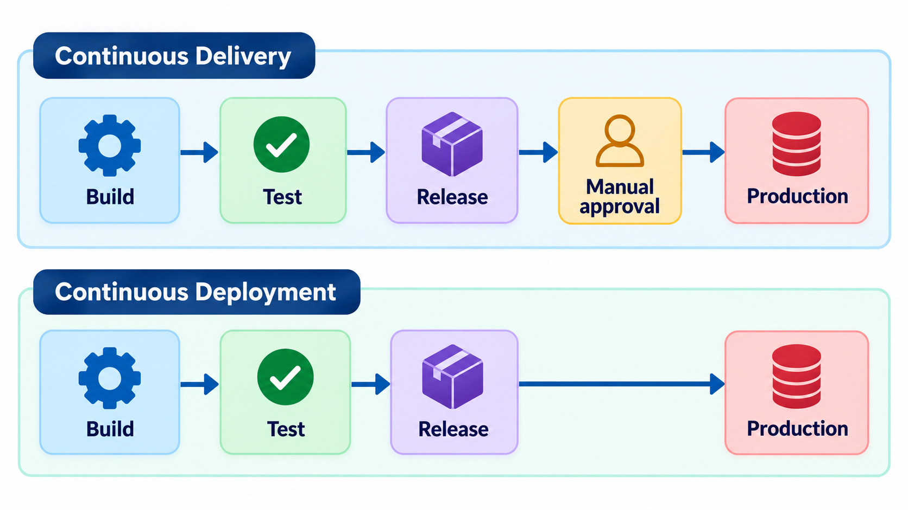
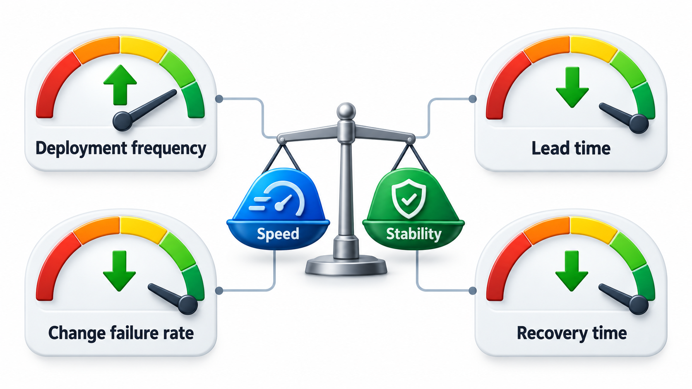
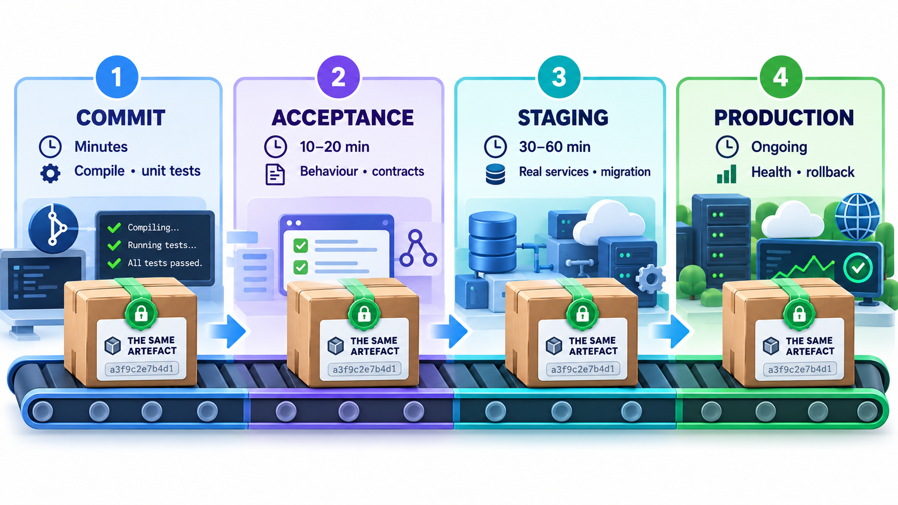
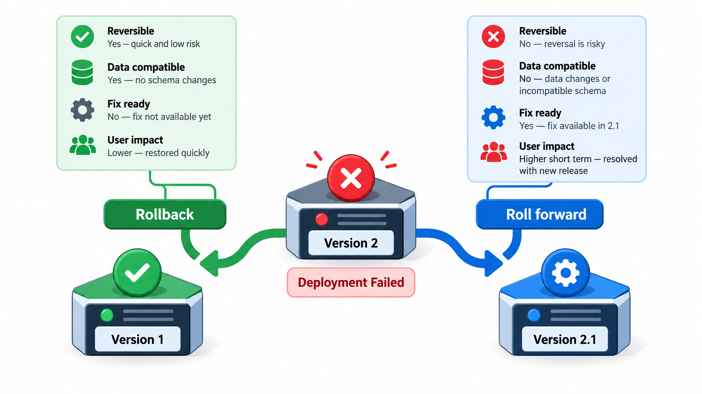
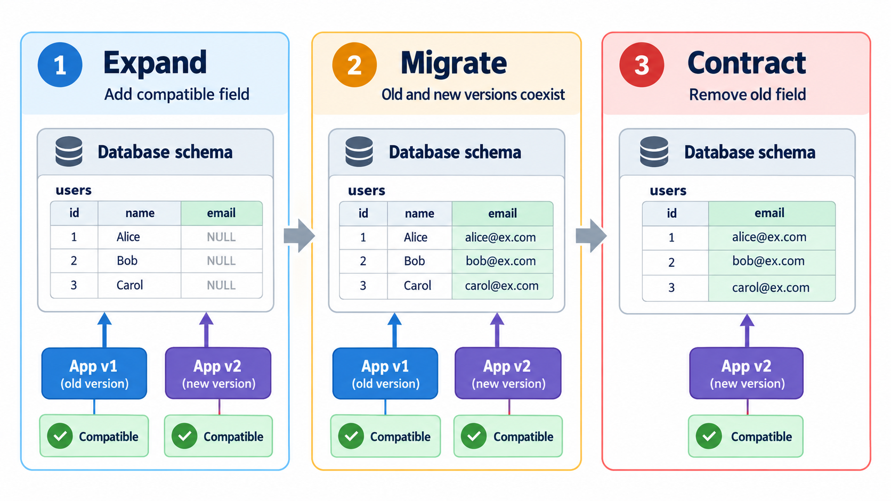

## Release as Routine, Not as Event

In many organisations a release is an event: a weekend, a team of nervous people, a long checklist and a hope that nothing breaks. Rare releases are large, so they are risky, and because they are risky they are made even more rarely. Some of the largest websites in the world found the way out is the opposite: release constantly, in tiny pieces, with the machinery to do it automatically.

**Continuous delivery** argues that the process of getting software from a developer's computer into the hands of users should be as automated, repeatable and low-drama as possible. A release should be as routine as saving a file. This topic explains how that is achieved, and the difference between continuous delivery, where a person approves the last step, and continuous deployment, where nothing waits.

The approach was set out in detail by Jez Humble and David Farley in their 2010 book on the subject. Their central claim is that releasing software is a problem of engineering, solved by automation and small steps, and not a problem of courage or heroics.

## Delivery and Deployment

Two terms are often mixed up.

**Continuous delivery** means that every change that passes the pipeline is *ready to be released* at any time. The software is always in a deployable state, and a release is a business decision carried out by pressing a button. There may be a manual approval before it reaches production.

**Continuous deployment** goes one step further: every change that passes all the automated checks is *deployed to production automatically*, with no human approval. A developer merges, and some minutes later real users are running the new code.

Which to use is a question of risk and culture. Continuous deployment needs excellent automated tests, monitoring and a quick way to roll back. Many organisations practise continuous delivery, with a final manual gate, and some move to deployment as their confidence grows. In regulated areas, a human approval is often required.

| | Continuous integration | Continuous delivery | Continuous deployment |
| --- | --- | --- | --- |
| Every change is built and tested | Yes | Yes | Yes |
| Every change is kept deployable | Not necessarily | Yes | Yes |
| Release to production | Not covered | By a human decision | Automatic |
| Needs | Tests, CI server | Plus automated deployment | Plus strong monitoring and rollback |

<!-- Visual: continuous delivery stopping at a manual release decision and continuous deployment going straight to production. -->

## The Deployment Pipeline

At the centre is the **deployment pipeline**, which takes a change through stages that increase confidence at each step, using the same artefact all the way.

1. **Commit stage.** Build, run fast unit tests and static checks. Takes minutes. A failure here is the cheapest.
2. **Automated acceptance and integration tests.** Deploy to a test environment and run slower tests against the running system.
3. **Staging or pre-production.** A copy of production. Run performance, security and smoke tests; sometimes a manual exploration.
4. **Production.** Deploy, with a check that it is healthy.

A change moves along only if it passes each gate. The earlier stages are faster and catch more; the later ones are slower and catch fewer, more subtle problems. A failure anywhere stops the change and tells the developer.

Walk one build through the gates. Each environment has a check that guards it, and the same build is promoted upward only if the check passes. There is a manual approval at the last gate, as in continuous delivery.

| Environment | Gate | Build 482 |
| --- | --- | --- |
| Test environment | Automated tests are green | Promoted |
| Staging | Smoke test and load test pass | Promoted |
| Production | Manual approval from the release owner | Waits: the approval has not yet been given |

At production, the approval is missing, so the build waits. Pressing the approval would let it through at once, as the rest is already done. In continuous deployment, the same line of gates would have no approval step, and the build would go straight to production. The difference is a single gate.

## Measuring Delivery

How well a team delivers can be measured with a few figures. Researchers who studied thousands of teams (the DORA programme, published in the book *Accelerate*) found four measures that together predict good performance.

| Measure | Question | Strong teams |
| --- | --- | --- |
| **Deployment frequency** | How often do you release to production? | Many times a day to once a week |
| **Lead time for changes** | How long from commit to running in production? | Under a day |
| **Change failure rate** | What share of releases cause a problem? | A small percentage |
| **Time to restore** | How quickly can you recover from a failure? | Under an hour |

The surprise in the research was that speed and stability go together: teams that released more often also failed less and recovered faster. A team releasing 35 times a week deploys about every 4.8 hours of the week, which is only possible when each change is small. Small changes are easier to test, to understand and to undo.

## Why Frequent Releases Are Safer

It seems backwards that releasing more often should be less risky. But risk grows with the *size* of a release. A release with three months of changes has thousands of changes, interacting in ways no one can predict. If something breaks, the cause could be anywhere. A release with one change has one suspect. It is simple to test, simple to understand and simple to undo.

Frequent releases also shorten feedback. A feature goes out, real users react, and the team learns in days and not quarters. And because the process is practised constantly, it becomes reliable. A team that deploys once a year has a deployment procedure that nobody remembers how to follow.

| Release | Changes inside | Where a fault might be | Time to find it | Rollback |
| --- | --- | --- | --- | --- |
| Quarterly | About 1,500 | Any of them | Days | Undoes everything, including good changes |
| Weekly | About 100 | Any of them | Hours | Large |
| Several times a day | 1 to 5 | One of a few | Minutes | Small and routine |

## The Ingredients

Continuous delivery depends on a set of practices working together:

<!-- Visual: a pipeline with the stages commit, acceptance, staging and production, each labelled with its typical duration and the kinds of failure it catches, with the same artefact moving through all of them. Save as images/116_one_artefact_through_the_pipeline.png. -->

- **Everything in version control**: code, configuration, infrastructure definitions, database changes.
- **A deterministic build**, producing one artefact promoted through all stages.
- **Comprehensive automated testing** at several levels.
- **Environments that are alike**, created from code so that staging genuinely resembles production.
- **Automated deployment**, a script and not a document of manual steps.
- **Safe release techniques**, such as feature flags, canary releases and blue-green deployments, so that deploying and releasing are separate.
- **Fast rollback**, a quick return to the previous version.
- **Monitoring**, so that problems are noticed within minutes.

## Rollback and Roll Forward

When a release goes wrong, there are two ways to recover, and a team should decide in advance which it will use.

| Approach | What it means | Good when | Caution |
| --- | --- | --- | --- |
| **Rollback** | Return to the previous version | The problem is clearly in the new code and data has not changed | Database changes may make the old code incompatible |
| **Roll forward** | Ship a quick fix on top | The fix is small and obvious | Needs a fast pipeline and confidence |
| **Switch off with a flag** | Disable the feature without redeploying | The risky code sits behind a flag | The flag must exist beforehand |
| **Failover** | Direct traffic to a healthy copy | Blue-green or multi-region setups | Costs spare capacity |

The ability to undo quickly is what lets teams release boldly. If recovery takes an hour, every release feels dangerous. If it takes a minute, releases become routine.

## Databases and Other Tricky Parts

The hardest part to deliver continuously is the database. Code can be swapped in seconds, but data cannot be rolled back so easily. The safe approach is to make database changes in small, **backward-compatible** steps: first add a new column that old code ignores, then deploy code that writes both, then move the data, then deploy code that reads the new one, and finally remove the old column. Each step is safe with the code that is running at the time. This is sometimes called the *expand and contract* pattern. It takes more steps and avoids a release that depends on a risky, all-at-once change.

| Step | Database | Code running | Safe if rolled back? |
| --- | --- | --- | --- |
| 1. Expand | Add the new column `full_name` | Old code ignores it | Yes |
| 2. Dual write | Both columns exist | New code writes both | Yes |
| 3. Backfill | Copy old data into the new column | Both versions work | Yes |
| 4. Switch reads | Both columns exist | Code reads `full_name` | Yes, old column still has the data |
| 5. Contract | Drop the old column | Only new code runs | Not reversible: do it last, after a safe period |

<!-- Visual: A safe database change made in small compatible steps. -->

