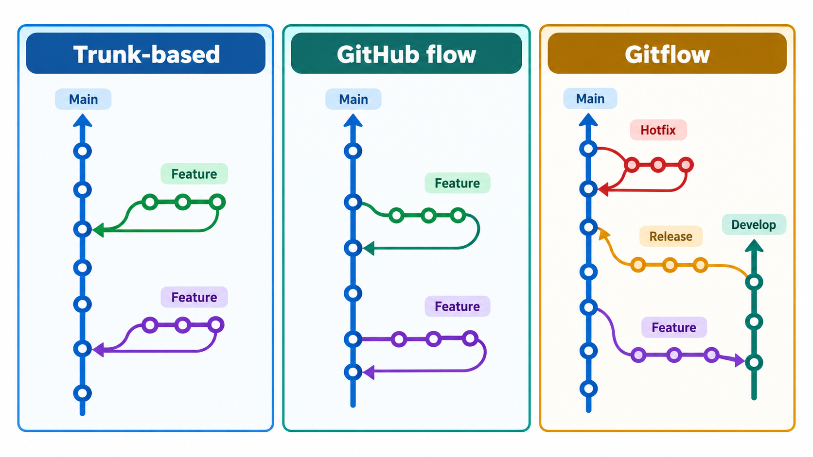
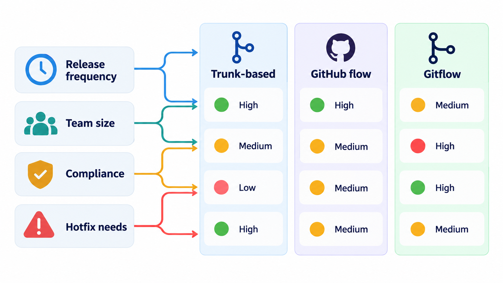
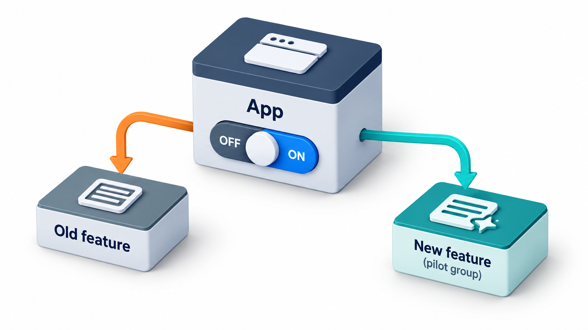
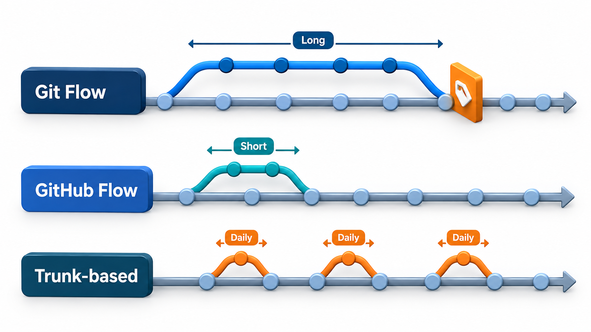
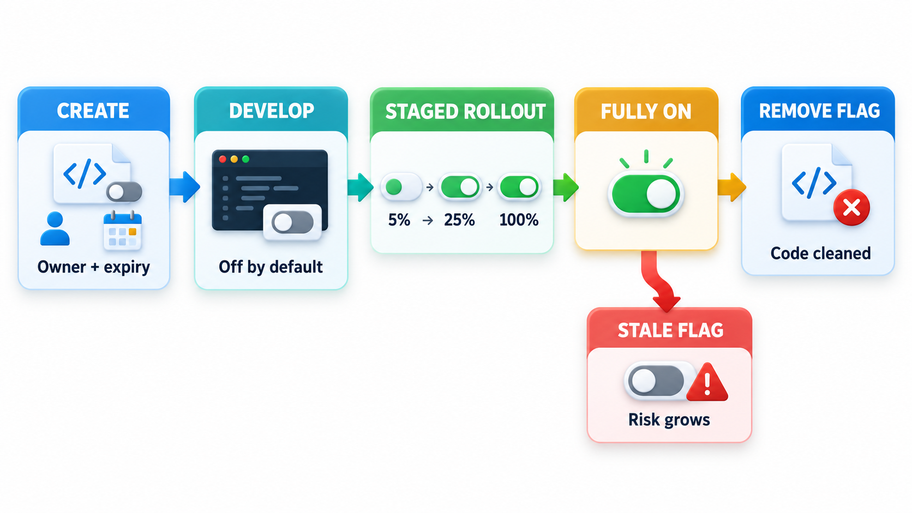

## Deploying Code Is Not the Same as Releasing a Feature

How a team organises its branches shapes how quickly changes reach users, how painful merging is and how safely work can be released. A branching model designed for software shipped in explicit versions, such as boxed products and downloads, is a poor match for a web application deployed continuously, and even the model's own author has said as much.

Alongside branching comes a technique, the **feature flag**, that changes the question by separating the act of *deploying* code from the act of *releasing* a feature. Code can reach production switched off, and be turned on later for a few users, then more, without a new deployment. This topic covers the main branching strategies and how flags make them safer.

## What a Branch Is For

A branch is a separate line of work. It lets a developer make changes without disturbing others, and it carries a cost: the longer it lives, the further it drifts from the main line, and the harder it is to merge back.

| Branch purpose | Typical life | Risk |
| --- | --- | --- |
| A small fix or tweak | Hours | Low |
| A feature in progress | Days | Moderate; merge conflicts grow with time |
| A release being stabilised | Days to weeks | Fixes must be copied to the main line |
| An experiment | Unknown | May never merge; wasted effort |
| A long-lived "next version" | Months | Severe; the merge is a project in itself |

## Two Families of Workflow

**Long-lived branches (Git Flow and its relatives).** Work happens on feature branches that may live for days or weeks. A `develop` branch collects finished features. Release branches are cut for stabilisation, and `main` holds released versions. The structure is clear, and it suits products that ship versions, support several versions at once, or have a long hardening period before release. Its cost is integration: branches that live for weeks drift apart, and merging them is a big, risky event.

**Trunk-based development.** Everyone works on one shared branch, the *trunk* (often called `main`), or on branches that live for no more than a day or two. Changes are small and merged several times a day. The trunk is always in a releasable state. This is the style that continuous integration was designed for, and that the very large engineering organisations such as Google use. The cost is discipline: you need good automated tests, so that the trunk stays healthy, and a way to ship unfinished work without exposing it, which is what feature flags provide.

| | Long-lived branches (Git Flow) | Trunk-based |
| --- | --- | --- |
| **Branch life** | Days to weeks | Hours to a day or two |
| **Merge pain** | High, merges are big | Low, merges are small |
| **Releases** | Cut from a release branch | Cut from the trunk, often continuously |
| **Best for** | Versioned products, several supported releases | Web services and continuously delivered software |
| **Needs** | Clear process for release and hotfix branches | Strong tests, fast CI and feature flags |

There are middle paths, such as **GitHub Flow**: a single `main`, short feature branches reviewed by pull request, and deployment from main after each merge. For most web teams, that is plenty.

<!-- Visual: three branching strategies organising work with different levels of structure. -->

## Choosing a Workflow

| Your situation | Likely fit |
| --- | --- |
| A web service deployed many times a week | Trunk-based or GitHub Flow |
| A mobile app released through app stores every two weeks | GitHub Flow with a release branch for stabilisation |
| A product with several customer versions supported at once | Release branches, with fixes carried between them |
| A library with semantic versions | Main plus tags for releases; release branches for old majors |
| A small team starting out | GitHub Flow: simple and sufficient |
| A regulated system needing formal release records | Release branches with strict review, plus audit trails |

## The Problem of Unfinished Work

A rule of "merge small and often" collides with a fact of life: some features take weeks to build. If you merge half a feature to the trunk, users might see it. If you keep it on a branch for weeks, you are back to painful merges. Feature flags dissolve the dilemma.

<!-- Visual: choosing a branching strategy by release style and team practice. -->

## Feature Flags

A **feature flag** (or toggle) is a condition in the code that decides whether a feature is active:

In words: if the new fee page flag is on for this user, show the new page; otherwise show the old one.

The code for the new page is merged and deployed, but dormant. The flag, stored outside the code in a configuration service, decides who sees it. Turning it on needs no new deployment, and turning it off is instant. This **decouples deployment from release**: engineers deploy whenever the code is ready, and the business releases whenever the feature is ready.

Flags make possible several practices: merging unfinished work safely; releasing to staff first, then 1 per cent of users, then everyone (a *gradual rollout*); switching off a misbehaving feature in seconds (a *kill switch*); testing two versions against each other (A/B tests); and giving a feature only to certain customers.

A percentage rollout turns a feature on for a share of users. Each user's identifier is turned into a fixed number from 0 to 99, so that the same user always gets the same answer, and the flag is on for users whose number is below the chosen percentage. Take ten users.

| Flag set to | Users who see the feature |
| --- | --- |
| 0% | None of the ten |
| 50% | Three of the ten: Asha, Kiran and Leela |
| 100% | All ten |

A sample of ten is small, so the share does not match exactly at 50 per cent. With thousands of users it comes very close to the percentage. Each user's number never changes: Asha's is always the same. If the rollout is raised from 50 to 70 per cent, everyone who had the feature keeps it, and more users are added. That stability is why the user's identifier is turned into a fixed number and a random choice on each request is not used. A real flag service adds rules by country, customer group or plan, and a dashboard to change the percentage without code.

<!-- Visual: A feature flag separating deployed code from released functionality. -->

## A Feature Through Its Flag

Follow a new fee page from first commit to full release.

| Week | Flag state | Who sees the feature | What the team does |
| --- | --- | --- | --- |
| 1 | Off | Nobody | Merges the first pieces to main daily; code is dormant |
| 2 | On for developers | The team | Tests it in the real environment |
| 3 | On for staff | Accounts office | Collects feedback and fixes problems |
| 4 | 5% of students | A small sample | Watches errors and payment completion |
| 4 | 25%, then 50% | A growing share | Compares measures with the old page |
| 5 | 100% | Everyone | Keeps the old page for a few days as a fallback |
| 6 | Flag removed | Everyone | Deletes the flag and the old page code |

The final row is the one teams forget. A feature is not finished until its flag is gone.

## Flags Have a Cost

Flags are powerful and, left alone, they become clutter. Each flag doubles the number of possible behaviours, and a codebase with fifty flags has more combinations than anyone can test. Stale flags, for features that have been fully released for months, add dead branches and confuse readers. Good practice treats a flag as having a **life cycle**: it is created with an owner and a purpose, rolled out, and then *removed* from the code once the feature is permanent. Many teams track flags in a list with an expiry date, and treat an overdue flag as a defect.

<!-- Visual: A release path from branch to production showing where flags and reviews fit. -->

There are different kinds of flag, and they live for different times. *Release flags* hide unfinished features and should be short-lived. *Experiment flags* run for the length of an A/B test. *Operational flags* (kill switches) may stay for good. *Permission flags* give certain customers certain features and live as long as the business rule does.

| Kind | Typical life | Owner | End of life |
| --- | --- | --- | --- |
| Release | Weeks | The feature team | Remove when fully on |
| Experiment | Weeks | Product and analytics | Remove when a winner is chosen |
| Operational | Long | Operations | Review yearly |
| Permission | Long | Product | As long as the business rule exists |

The combinations problem is easy to count. With n independent flags there are 2 to the power n possible states: 10 flags give 1,024, and 20 flags give over a million. No team tests them all, which is why flags should be few, short-lived and independent of one another.

<!-- Visual: a flag's life cycle from created with an owner, to development behind the flag, to staged rollout, to fully on, to removed from the code, with a warning on the flags left stuck at the fully-on stage. Save as images/117_flag_lifecycle.png. -->

## Five Misreadings of Branching and Flags

**"Git Flow is the standard way to use Git."** It is one workflow, designed for versioned releases. Its own author suggests simpler ones for continuous delivery.

**"Trunk-based means no branches."** It means short-lived ones. A branch of a day is still a branch.

**"Feature flags are for A/B tests."** They are also for safe merging, gradual rollout and kill switches.

**"A flag is free."** Each one adds paths to test and code to read. Remove flags once a feature is permanent.

**"A branch is the same as a release."** A branch is a line of work. A release is a decision to expose a version to users. Flags let the two move separately.
