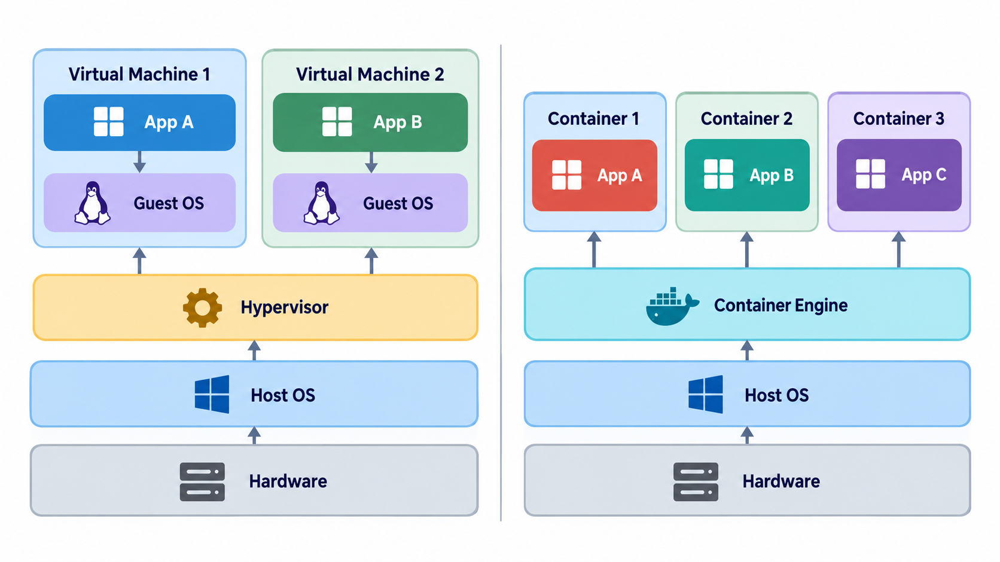
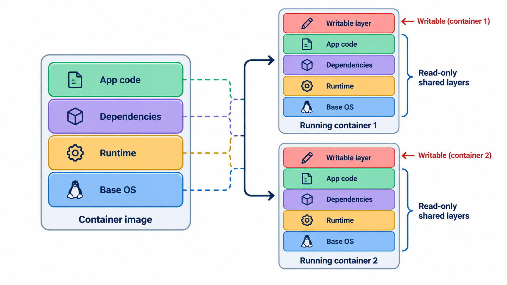
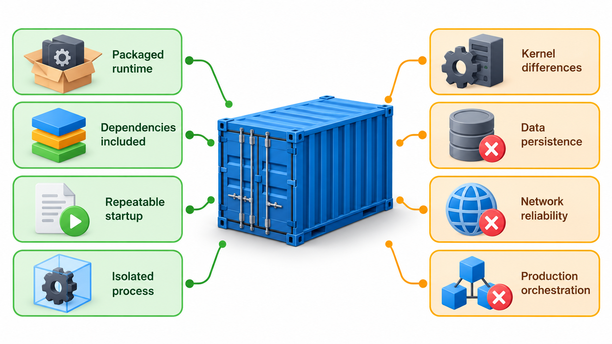
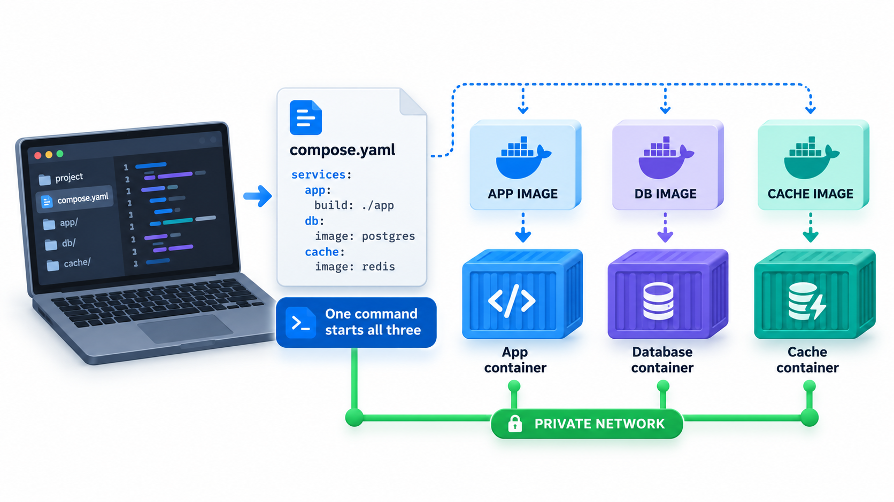
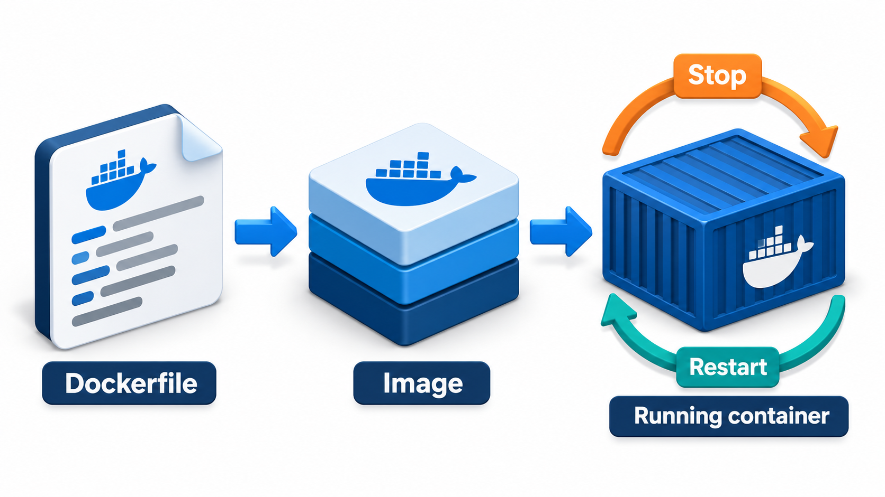

## One Package That Behaves the Same Everywhere

To run a project you need a particular version of the language, certain libraries, a database, a message queue, some environment settings, and the right operating system packages. Each developer sets these up by hand from a long document, and no two laptops come out the same. A new team member loses days getting it to work. A bug appears for one developer and not for another. And the application that worked in testing behaves differently in production, because the machines differ in a hundred small ways.

A container is a way to package the application together with everything it needs to run, so that it behaves the same wherever it is started. Within a few years of becoming easy to use, containers changed how software is built and run, and reading a container recipe became an expected skill.

## The Problem: "It Works on My Machine"

Anyone who has set up a development environment knows the pain. The differences between machines are many, and each is a place for a bug to hide.

| Difference | Example | Effect |
| --- | --- | --- |
| Language version | Python 3.9 on one laptop, 3.12 on another | A feature exists on one and not the other |
| Library versions | A newer library on one machine | Different behaviour |
| Operating system | Windows, macOS, Linux | File paths, line endings and tools differ |
| System packages | A missing image library | A crash only on one machine |
| Settings | An environment variable set on one laptop | Works for one developer only |
| Services | A different database version | Queries behave differently |

Containers remove most of these differences by putting the environment in the package.

## What a Container Is

A **container** is an isolated process on a host machine, with its own view of the file system, its own network settings and limits on the resources it can use, but sharing the host's operating system kernel. A container looks to the application like a small private computer, though it is only a normal process in a fenced area. Because it does not boot a whole operating system, it starts in a fraction of a second and uses little memory.

This is the difference from a **virtual machine** (VM), which emulates a whole computer, including its own operating system, on top of the host. A VM is heavier: gigabytes in size, and taking tens of seconds to minutes to start. It also gives stronger isolation. A container is lighter: megabytes, and ready in a moment. Many containers can run on the machine that would hold a handful of VMs.

| Aspect | Virtual machine | Container |
| --- | --- | --- |
| Contains | Full operating system plus the application | The application and its libraries; shares the host kernel |
| Typical size | Gigabytes | Tens to hundreds of megabytes |
| Start-up | Tens of seconds to minutes | Under a second to a few seconds |
| Isolation | Stronger | Weaker, since the kernel is shared |
| Density per host | A handful | Dozens or hundreds |

<!-- Visual: virtual machines each carrying a full operating system compared with containers sharing one kernel. -->

## Images and Dockerfiles

Two terms are essential. An **image** is a read-only template: the application, its libraries and settings, packaged. A **container** is a running instance of an image. You can start many containers from one image, as many processes from one program.

An image is described by a text file, a **Dockerfile**, listing the steps to build it. A simple one has five.

| Step | What it says |
| --- | --- |
| 1 | Start from an image that already has Python 3.12 |
| 2 | Copy the list of required libraries into the image |
| 3 | Install those libraries |
| 4 | Copy in the application code |
| 5 | Say which command to run when a container starts |

Anyone with this recipe, and the application, can build an identical image on any machine that has the tool installed.

## Layers and the Build Cache

Each step of the recipe produces a **layer**: a snapshot of the changes it made. Layers are stacked, and the tool caches them. When you rebuild, it reuses the cached layers up to the first step that changed, and rebuilds from there. That means the order of steps matters a great deal for speed. Take the five-step recipe above and two different edits.

| Edit | Steps reused from the cache | Steps rebuilt |
| --- | --- | --- |
| Only the application code changed | The first three, including the slow library install | 2: copy of the code, and the start command |
| The list of libraries changed | Only the first | 4: the copy of the list, the library install, the copy of the code, and the start command |

In the first edit, the slow library install stays cached. In the second, the change comes early, so the install and everything after it are rebuilt. That is why such recipes put the rarely changing steps first, such as installing libraries, and the often changing step, copying the code, last. Code changes many times a day. The libraries change seldom. Ordering the recipe to match saves minutes on every build. A change is felt by all the steps after it, which is the property that makes layers a good model of dependency.

<!-- Visual: an image built from stacked layers that can be cached and shared. -->

## Writing a Good Image

A few habits make images smaller, faster and safer.

| Habit | Why |
| --- | --- |
| Start from a small, official base image | Less to download and less to attack |
| Pin the base image version | Builds do not change under you |
| Order steps from least to most changing | Better caching |
| Install only what is needed | Smaller size and fewer vulnerabilities |
| Run as a non-root user | Limits damage if the application is compromised |
| Keep secrets out of the image | An image can be inspected by anyone who has it |
| Use a multi-stage build | Compile in one stage, copy only the result into a small final image |
| Rebuild regularly | Pick up security fixes in base images |

## Containers for the Developer

Containers make several things easier for development.

- **Reproducible environments.** A new developer runs one command and has the language, libraries and tools set up exactly as everyone else's. Onboarding falls from days to minutes.
- **Dependencies that you can run locally.** A database, a cache or a message queue can be started as a container on a laptop. A tool called Docker Compose describes a whole group of containers in one file and starts them together.
- **Parity with production.** The image tested in CI is the image deployed. The "it works on my machine" gap shrinks.
- **Isolation.** Two projects needing different versions of the same tool run in separate containers and do not interfere.
- **Cheap experiments.** Try a new database in a container, and throw it away afterwards.

The container for the application is often combined with a **development container** setup in an editor, which runs the editor's tools inside the container, so that even the compiler and the linter match the project's.

| Without containers | With containers |
| --- | --- |
| Follow a two-page setup guide; fix problems for a day | Clone, run one command, begin |
| Install a database on your laptop | Start a database container; delete it when done |
| Two projects need different Python versions: juggle them | Each project runs in its own container |
| CI uses a different setup from your laptop | CI uses the same image |

## What Containers Do Not Solve

Containers are not magic, and some of the claims made for them need correcting.

<!-- Visual: a laptop running three containers started from three images, an application, a database and a cache, joined by a network, with a single "compose" file driving all three. Save as images/118_compose_three_containers.png. -->

- **They do not make code correct or portable across processor types.** An image built for one kind of processor may not run on another without a rebuild.
- **They share the host's kernel.** That makes them less isolated than VMs, so a flaw in the kernel can affect them all. Security needs attention: run as a non-root user, keep images small and updated, scan them for known vulnerabilities, and do not put secrets in them.
- **They do not remove the need to understand the application.** A badly written application in a container is still badly written.
- **Data needs care.** The files inside a container vanish when it is removed. Databases and uploads need storage that lives outside, called a volume.
- **Images can grow large and stale.** Without discipline, they accumulate unused tools and outdated libraries. Small base images and regular rebuilds help.
- **Running many containers needs an orchestrator.** Tools like Kubernetes manage starting, stopping, scaling and networking containers across machines. That is a large topic with its own complexity, and many teams do not need it.

<!-- Visual: the life cycle of a container from image to running, stopped and removed. -->

## Orchestration in Brief

When an application runs as dozens of containers across many machines, something must decide where each runs, restart those that fail, spread traffic and roll out new versions. That job is **orchestration**.

| Task | What the orchestrator does |
| --- | --- |
| Scheduling | Places containers on machines with free capacity |
| Self-healing | Restarts a container that crashes |
| Scaling | Adds or removes copies as load changes |
| Service discovery | Lets containers find one another by name |
| Rolling updates | Replaces old containers with new ones gradually |
| Configuration and secrets | Supplies settings to containers at start-up |

Kubernetes is the most widely used orchestrator. It is powerful and complex, so a small team with a few services is often better served by a simpler hosting option.

## Five Misreadings of Containers

**"A container is a lightweight virtual machine."** It is an isolated process sharing the host kernel. The difference affects start-up time, size and isolation.

**"Containers make applications secure."** They add some isolation, and a poorly configured container is a risk. Security still needs work.

**"Containers fix works-on-my-machine."** They fix a large part: the environment. Differences in data, configuration and load remain.

**"Everything must be containerised."** Many programs run well without them. Use them where the reproducibility pays.

**"The order of lines in a Dockerfile is a matter of style."** It decides how much is cached, and so how long every build takes.
