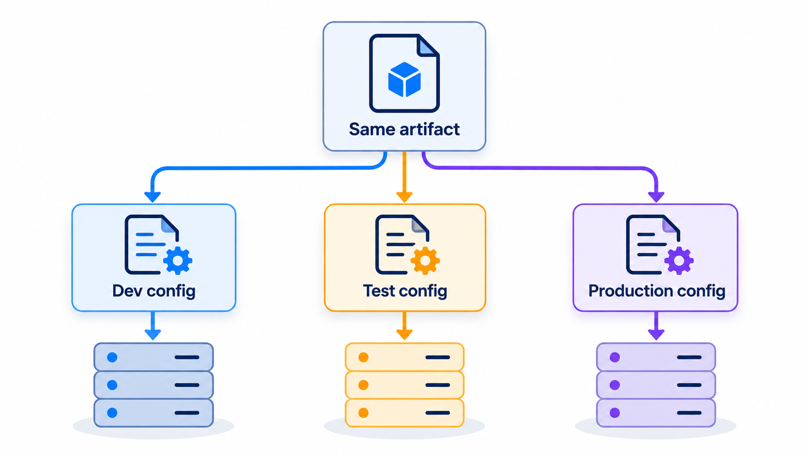
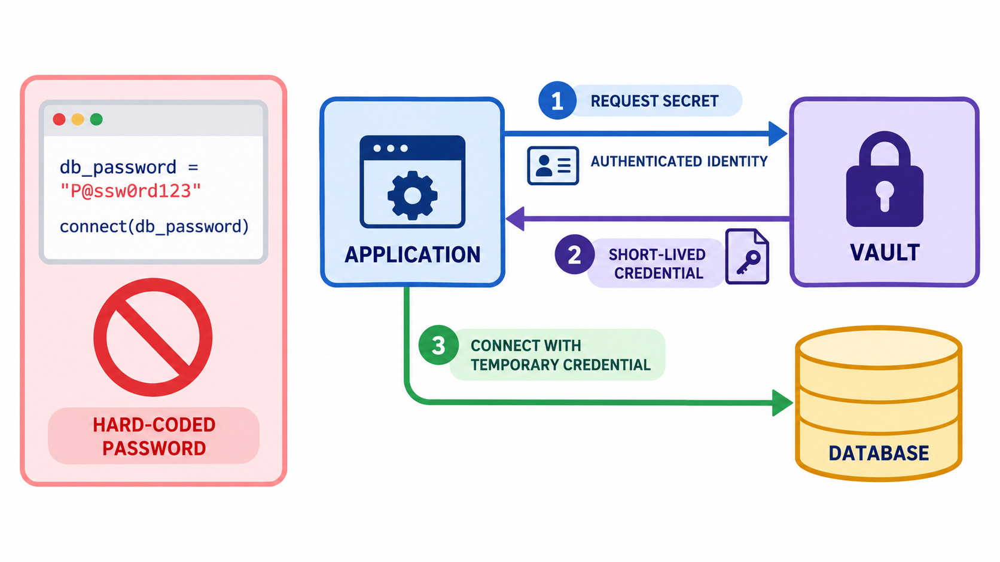
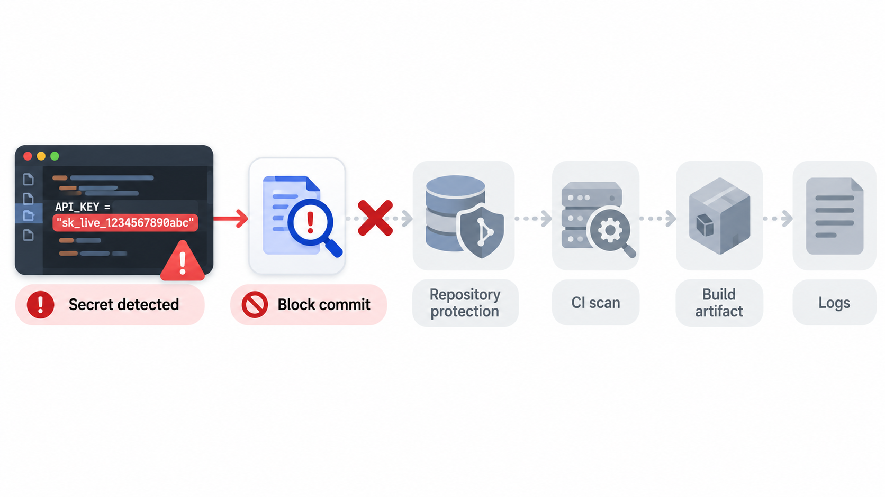
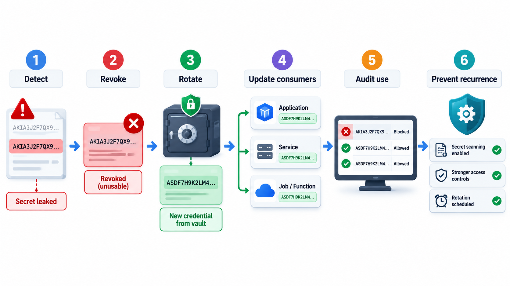
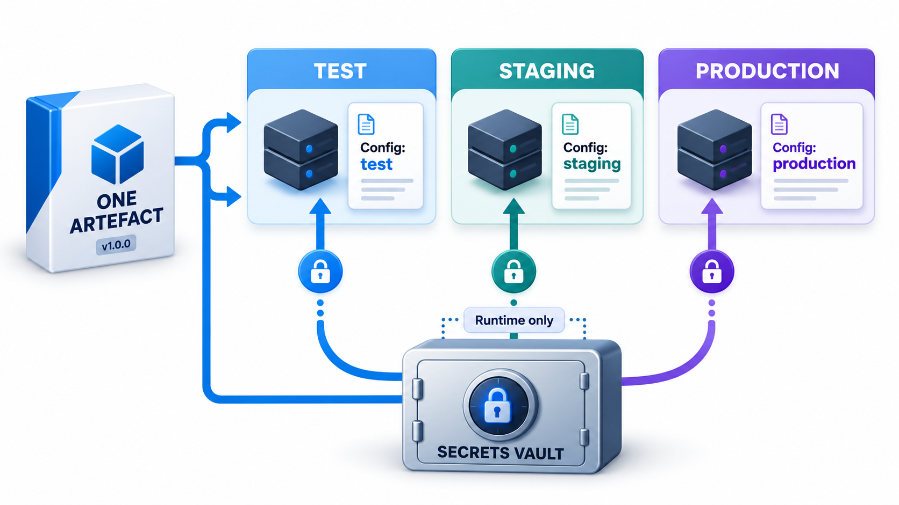

## What Must Never Be in the Repository

A credential that is committed to a repository can be read by everyone who can read the repository, today and for ever, because version control keeps the history. A private repository is not a safe: access can be gained by a reused password, a leaked laptop or a departing colleague, and keys found there can open cloud storage holding the records of millions of people. The technical lesson is simple, and the consequences of ignoring it are severe.

This topic is about how to keep two kinds of thing out of code: the **settings** that differ between environments, and the **secrets** that must stay secret. It covers where each should live, how programs read them, and what to do when one leaks.

## Configuration Is Not Code

Any application has values that change depending on where it runs: the address of the database, the number of worker processes, the URL of a payment service, whether debug output is on, the email address to send alerts to. In the testing environment they point to test systems, and in production to real ones. If these values are written into the code, then the code must be changed and rebuilt for each environment, and the artefact that was tested is not the one that is deployed.

The widely cited advice comes from **The Twelve-Factor App**, a set of principles written by Adam Wiggins and colleagues at Heroku in 2011 for building applications that deploy cleanly in the cloud. Its third factor is: store config in the environment. Keep configuration strictly separate from code. The same build then runs in every environment, and a deployment supplies the values for where it is going. A test for it is whether the codebase could be made open source at any moment without leaking anything.

Typical ways to supply configuration are environment variables, configuration files kept outside the repository or generated at deployment, and a configuration service that applications query at start-up. Each environment, development, test, staging and production, has its own set of values.

| Method | How it works | Good for | Caution |
| --- | --- | --- | --- |
| **Environment variables** | The platform sets values before the program starts | Simple settings; works everywhere | Visible to anyone who can inspect the process; not for large values |
| **Config files outside the repository** | A file placed on the server at deployment | Many related settings | Must not be committed; permissions matter |
| **Configuration service** | The application asks a central service | Changing values without redeploying | A dependency that must be available |
| **Secrets manager** | Encrypted store with access control | Credentials and keys | Needs set-up; application needs an identity to ask |
| **Command-line arguments** | Values passed when starting | One-off options | Visible in process lists; poor for secrets |

<!-- Visual: an artefact separated from environment-specific configuration. -->

## A Real Case: Keys in a Private Repository

In 2016 attackers broke into the private code repository of the ride-hailing company Uber. The repository was hosted on a public service and protected only by the login details of engineers, which the attackers had obtained. They were not after the code. Inside it they found access keys for the company's cloud storage, left there so that programs could reach the data. With those keys they downloaded records belonging to about 57 million riders and drivers. The company paid the attackers 100,000 dollars to delete the data and kept quiet for about a year, a decision that later led to legal action and the conviction of its former head of security.

Nobody had to defeat the cloud provider's security, and nobody had to find a flaw in Uber's software. The keys worked because they were valid, and anyone who held them was, as far as the system could tell, entitled to the data. The repository was private, which felt safe, but a private repository is read by every developer, every tool connected to it and every attacker who gets one set of credentials.

Three habits would have limited the harm, and each is a theme of this topic:

| Habit | How it would have helped |
| --- | --- |
| Keep secrets out of source code and history | The repository would have contained nothing worth stealing |
| Store secrets in a managed vault and issue them when needed | Access can be logged, limited and withdrawn in one place |
| Give each key the least access it needs, and rotate it | A leaked key opens a small door for a short time |

The lesson is that where a secret is stored matters as much as how strong it is. A strong key in the wrong place is an unlocked door with a good lock on it.

## What Counts as a Secret

| Item | Secret? | Notes |
| --- | --- | --- |
| Database password | Yes | Never in code |
| API key for a payment service | Yes | Live keys especially |
| Private key for signing or encryption | Yes | Highest care; rotate rarely but carefully |
| Session or token signing secret | Yes | A leak lets attackers forge logins |
| Database host name | Usually not | Configuration, but not for publication |
| Number of worker threads | No | Plain configuration |
| Public key | No | Meant to be shared |
| Feature-flag defaults | No | Plain configuration |

## Secrets Are Special Configuration

A **secret** is a configuration value whose exposure would cause harm: passwords, API keys, tokens, private encryption keys, database credentials, signing certificates. They need stricter handling than ordinary settings.

The rules are few and strong.

- **Never commit secrets to version control.** Not in code, not in config files in the repository, not in a "temporary" commit. Once committed, treat the secret as exposed, even if you delete it later, because the history keeps it and copies may exist.
- **Never put secrets in container images, logs, error messages or screenshots.**
- **Give each environment its own secrets.** A leak from a test system should not give access to production.
- **Use the least privilege.** A key should allow only what its service needs.
- **Rotate them.** Change secrets regularly and whenever a person who knew them leaves. A secret that can be rotated is a much smaller risk.
- **Store them in a secrets manager.** Tools such as HashiCorp Vault, AWS Secrets Manager, Azure Key Vault and Google Secret Manager store secrets encrypted, control who can read them, record every access and can issue short-lived credentials on demand.

<!-- Visual: A secrets vault supplying credentials to an application at run time. -->

## How an Application Gets Its Secret

A secrets manager changes the question from "where do we store the password?" to "how does the application prove who it is?".

| Step | What happens |
| --- | --- |
| 1 | The application starts with an identity given by the platform (a role, not a password) |
| 2 | It asks the secrets manager for the database credential, presenting that identity |
| 3 | The manager checks the policy: is this application allowed this secret? |
| 4 | It returns the secret, possibly a short-lived one created for this request |
| 5 | The access is logged |
| 6 | When the secret expires or is rotated, the application asks again |

Short-lived credentials are especially valuable. A password that is valid for an hour is of little use to an attacker who finds it a day later.

## Catching Mistakes Before They Spread

People make mistakes, so teams add automatic guards. **Secret scanning** tools look through code and history for things that look like credentials: strings in known formats, such as the beginning of an AWS access key, and assignments like a password written into a file. They run in the editor, as a pre-commit check and in the CI pipeline, and some hosting services scan public repositories for known key formats and tell the provider, who may revoke the key at once. A tiny version of such a scanner, run on three files, reports:

| File | Line | Finding |
| --- | --- | --- |
| settings file | 2 | Looks like a secret: a database password is written into the file |
| deploy script | 1 | Looks like a secret: an AWS access key is exported in plain text |
| application file | 2 | Not flagged: the password is read from the environment, which is the pattern to follow |

Two possible secrets are found, and the report shows only the start of each line so that the scanner's own output does not leak the secret. If this ran in CI, the build would fail until they were removed. And because anything already committed must be treated as exposed, the next step would be to revoke and replace those credentials, not just to delete the lines.

## What to Do When a Secret Leaks

Speed matters. First, **revoke or rotate** the secret so it no longer works. This is the main step, and deleting the commit is not a substitute. Then find out what it gave access to and whether it was used, from the logs. Remove it from the code and the history if possible, and fix the process that let it in. Finally, tell the people who need to know. In Uber's case, the company paid the attackers to delete the data and did not disclose the breach for a year; when it came out, the concealment turned a serious incident into a scandal, with large fines and criminal charges against a senior executive.

| Order | Action | Why |
| --- | --- | --- |
| 1 | Revoke or rotate the secret | Stops further use immediately |
| 2 | Check logs for use of the secret | Learn whether anyone used it, and what they reached |
| 3 | Remove it from code and history | Prevents re-use by anyone who finds it later |
| 4 | Find and fix the cause | A missing scanner, a habit, a shared file |
| 5 | Notify as the law and policy require | Customers and regulators may need to be told |
| 6 | Record a short post-incident review | So the lesson is kept |

## Configuration Across Environments

A few habits keep configuration manageable:

- **Validate at start-up.** The application checks that every required setting is present and sensible, and refuses to start with a clear message if not. A missing value found at start-up is a minor event. Found at the moment of the first payment, it is a failure.
- **Provide safe defaults for development, and no defaults for secrets.** A missing password should be an error and not a silent blank.
- **Keep the list of settings documented**, with example values that are not real.
- **Make differences between environments few and explicit.** Every difference is a place where a bug can hide.
- **Treat configuration changes like code changes**: reviewed, versioned and able to be rolled back.

<!-- Visual: one build artefact deployed to test, staging and production, each receiving its own configuration values and its own secrets from a vault, with a locked padlock on the secrets path. Save as images/119_one_artefact_three_configs.png. -->

## Local Development Without Real Secrets

Developers need to run the application on their laptops without handling production credentials.

| Practice | Effect |
| --- | --- |
| A sample file listing the setting names with dummy values, committed | New developers know what to set |
| The real local file listed in the ignore file, never committed | Prevents accidents |
| Local services (database, queue) in containers with throwaway passwords | No real data or credentials on laptops |
| Separate low-privilege accounts for development | A leaked key opens little |
| Test keys for third-party services | Payment sandbox keys, not live ones |
