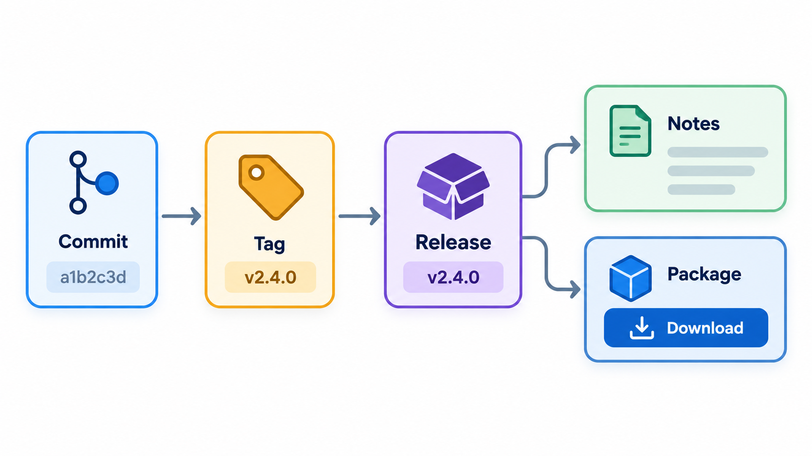
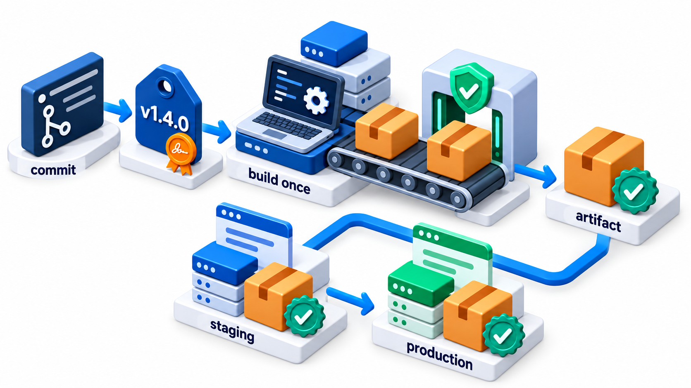
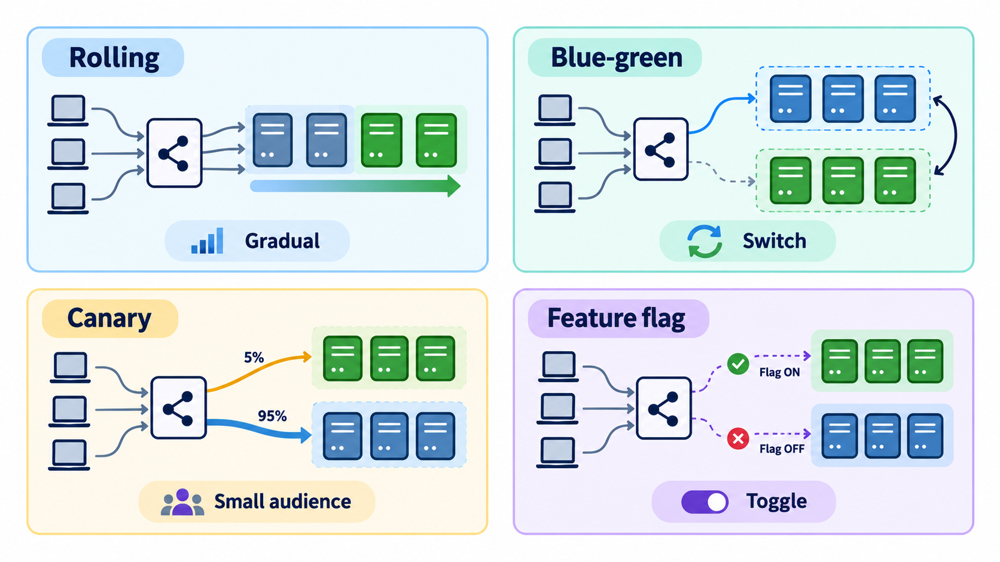
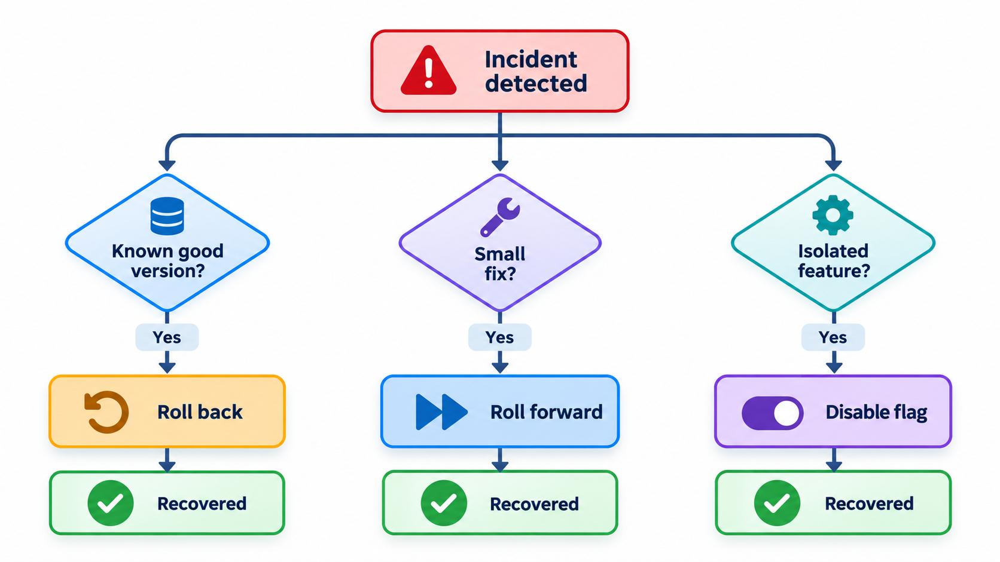
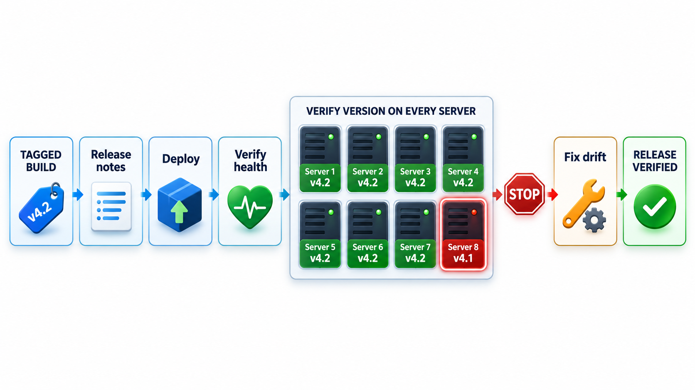

## A Release You Cannot Undo Is a Gamble

A release is an ordinary task, and it can destroy a company when there is no reliable way to deploy, check and undo. A new version installed on some machines and missed on others, an old setting reused with a new meaning, alerts that nobody acts on, no clear procedure for turning off a faulty machine: each is a small gap in release practice, and together they can cost more than the firm is worth within an hour.

**Release management** is the discipline of making sure that new versions reach users in a controlled, repeatable and reversible way. This topic covers the pieces: what a release is, how it is communicated, how emergencies are handled, and how a release can be taken back.

## A Release Is a Named, Reproducible Thing

A **release** is a specific version of the software that is made available to users. To be useful, it has to be identifiable: you must be able to say exactly what is in "version 3.2.0", rebuild it, and know what changed since 3.1.0.

The standard mechanisms are tools of version control and builds. A **tag** marks the exact commit that became the release. The build produces one **artefact**, stamped with the version number, which is stored and promoted unchanged through the environments. A **version number** follows a scheme, usually semantic versioning, where the numbers tell users how risky the change is. Together they make a release a fixed point to which everyone can refer.

| Element | Purpose | Example |
| --- | --- | --- |
| **Tag** | Marks the exact commit | `v3.2.0` points to commit a1b2c3 |
| **Artefact** | The deployable file | `portal-3.2.0.zip`, with a checksum |
| **Version number** | Tells users the scale of change | 3.2.0 after 3.1.4: new features, no breaks |
| **Changelog entry** | Lists the changes | Added SMS reminders; fixed late fine |
| **Release record** | Who deployed what, when | Deployed to production 14 June, 10:05 |

<!-- Visual: tags identifying exact commits that become documented releases. -->

## A Real Case: Seven Servers Out of Eight

On the morning of 1 August 2012, the American trading firm Knight Capital switched on new software for a retail trading programme. The release was done by hand: a technician copied the new code to the firm's eight servers, and one of them was missed. That server still ran an old trading routine, long retired, which responded to a setting that the new software had given a new meaning. When the market opened, the missed server began sending orders that nobody had intended, at high speed, buying and selling the same shares again and again.

It took about forty-five minutes to stop. In that time the firm had sent millions of unintended orders and lost about 440 million dollars, more than the company was worth. It survived only because outside investors rescued it within days. Automated warnings had gone out before the market opened, but they were not treated as urgent, and the team had no rehearsed way to turn the faulty server off. Engineers reached for fixes in the middle of the crisis and, by some accounts, made things worse by removing the new code from the servers that were working correctly.

| What failed | The release practice that addresses it |
| --- | --- |
| One server out of eight was missed | A scripted, repeatable deployment, checked after it finishes |
| Old, unused code stayed in the system | Removing dead code before it can be woken |
| Warnings were ignored | Alerts that have an owner and a clear response |
| No way to stop the harm quickly | A tested rollback and a kill switch |

Release management is the discipline of making the last step of the work as safe as the earlier ones. The topic that follows covers the plans, checks and rollbacks that stand between a change and a company's balance sheet.

## Release Notes and Changelogs

Users and colleagues need to know what changed. A **changelog** is a record, version by version, of the notable changes: new features, fixes, changes in behaviour, removals. **Release notes** are the user-facing version: shorter, in plain language, saying what matters to the reader and what, if anything, they need to do. Both are best organised by kind of change (added, changed, fixed, removed, security) and begin with anything that breaks compatibility.

<!-- Visual: A chain from commit to tag to artefact to deployed release. -->

Writing release notes by hand at the last minute is tedious and error-prone. Many teams generate them from commit messages written in a fixed style, such as the Conventional Commits convention, in which each message begins with a type: "feat" for a feature, "fix" for a bug fix, and an exclamation mark for a breaking change. The type also determines the next version number: a breaking change raises the major number, a feature the minor, and a fix the patch. Take five commits and a current version of 2.4.1.

| Commit | Type | Goes into |
| --- | --- | --- |
| Late fine no longer negative | fix | Fixes |
| SMS reminders for fee due | feat | Features |
| Receipt shows correct date | fix | Fixes |
| Update README | docs | Left out: changes nothing for users |
| Fee API now returns amounts in paise | breaking feature | Breaking changes |

A breaking change anywhere means the next major version, so 2.4.1 becomes 3.0.0, and the minor and patch numbers reset to zero. Had there been no breaking change, the feature would have given 2.5.0, and a fix alone would have given 2.4.2. The release note lists the breaking change first: "fee API now returns amounts in paise". A reader who depends on that API sees at once that this release needs their attention. Real tools do this on every release and add links to the commits and issues, so the notes are a by-product of work already done.

| Kind of release note reader | What they need |
| --- | --- |
| End user | What is new or different, in plain words |
| Administrator | Anything to configure, migrate or restart |
| Developer using the API | Breaking changes, deprecations, new endpoints |
| Support team | Known issues and workarounds |
| Security team | Fixed vulnerabilities and their severity |

## Hotfixes: Releasing in a Hurry

Sometimes a serious defect is found in production, and it cannot wait for the next regular release. A **hotfix** is a small, urgent change that is made, tested and released ahead of schedule. The principles are to keep it as small as possible, to fix only the one problem, to test it as carefully as time allows, to follow the normal path (pipeline, review, deployment) with the shortest safe route, and then to bring the fix back into the main line so it is not lost in the next release.

The danger in an emergency is that people skip the process, and the hotfix itself breaks something. A rehearsed procedure, with a short checklist, is safer than improvising. At Knight Capital, the engineers who tried to fix the problem by rolling back the new code on the seven good servers made matters worse, because it spread the faulty behaviour to those machines too.

| Step | Hotfix practice |
| --- | --- |
| 1. Confirm | Reproduce or at least understand the failure |
| 2. Decide | Is rollback faster than a fix? |
| 3. Branch | From the production tag, not from the main line |
| 4. Fix | Smallest change; one problem only |
| 5. Test | Automated tests plus a targeted manual check |
| 6. Review | A second pair of eyes, even if fast |
| 7. Deploy | By the normal script, with monitoring |
| 8. Merge back | The fix must reach the main line |
| 9. Review afterwards | What allowed the defect to escape? |

## Rollback: The Way Back

Every release should come with an answer to the question "how do we undo it?". **Rollback** means returning to the previous version. The simple case is code: redeploy the earlier artefact, which is why old artefacts are kept. Several things make it harder.

- **Database changes.** If the new version changed the data's structure, the old code may not work with it. The safe approach is to make database changes backward compatible, in small steps, so that rollback of the code is always possible.
- **Data written by the new version.** Records created in the new format may confuse the old code.
- **External effects.** Emails sent, payments made and messages published cannot be recalled.

Where rollback is difficult, the alternative is **roll forward**: quickly fix the problem and release again. Many teams prefer it for small, frequent releases. Either way, the choice should be made *before* the release, with the steps written and, ideally, rehearsed.

Techniques that reduce the damage of a bad release include **canary releases**, which expose a small share of users first; **blue-green deployments**, where the new version is installed beside the old and traffic is switched over, so that switching back is instant; and **feature flags**, which turn the new behaviour off without a redeployment. Knight had none of these on the day.

<!-- Visual: release strategies that expose few users first and allow quick rollback. -->

## Planning a Release

Larger releases need a plan, even when most of the work is automated.

| Item | Question | Example |
| --- | --- | --- |
| **Scope** | What is in this release? | Five features, eight fixes |
| **Timing** | When is the least harmful moment? | Not during exam registration week |
| **Dependencies** | Does another team need to release first? | Payment gateway change goes first |
| **Communication** | Who must be told, and when? | Support team a day before; users on the day |
| **Risk assessment** | What is the worst that could happen? | Double charges; rollback plan ready |
| **Go / no-go criteria** | What must be true to proceed? | All tests green; no open critical defects |
| **Ownership** | Who decides and who executes? | Release manager decides; engineer on call deploys |
| **Verification** | How will we know it worked? | Smoke tests and dashboards watched for an hour |

## Deprecation and Communicating Change

Releases also remove things. A **deprecation policy** says how long an old feature will keep working after it is announced as going away, and how users are told. A good one gives clear dates, warnings in the product and the documentation, and a migration path. Breaking changes should be rare, announced well in advance and tied to the major version number. Users plan their own work around the provider's schedule, and a surprise removal is a breach of trust.

<!-- Visual: choosing to roll back or to roll forward after a failed release. -->

## A Release Checklist

For a release to be routine, the steps are written down and, as far as possible, automated.

1. The release candidate is built once, from a tagged commit, by the pipeline.
2. All automated checks have passed on that artefact.
3. Release notes and changelog are ready and reviewed.
4. Database changes are compatible with both the old and the new version.
5. The rollback or roll-forward plan is written down.
6. Monitoring and alerts for the new version are in place and someone is watching.
7. The deployment is done by an automated script, to *all* intended machines, with a check that every one has the same version.
8. Afterwards, health is checked, and the release is announced.

Step 7 is the one that is easy to skip: a check that every server is running the same code.

<!-- Visual: a release checklist as a vertical flow from tagged build to deployed and verified, with a highlighted step "verify every server runs the same version" and a note referring to the missed eighth server. Save as images/120_release_checklist.png. -->

## After the Release: Reviews

A release is not over when the deployment ends. Teams look back to learn.

| Question | Why |
| --- | --- |
| Did the release meet its goals? | Close the loop with the business |
| What went wrong or nearly did? | Near misses are free lessons |
| Which steps were manual and risky? | Candidates for automation |
| How long did it take, and where was the delay? | Targets for speed |
| What would we change in the checklist? | Keep it alive |

A blameless review, which asks how the system allowed a mistake and not who made it, produces more honest answers and better fixes.
