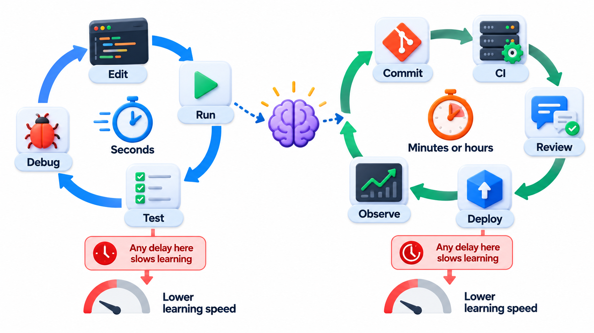
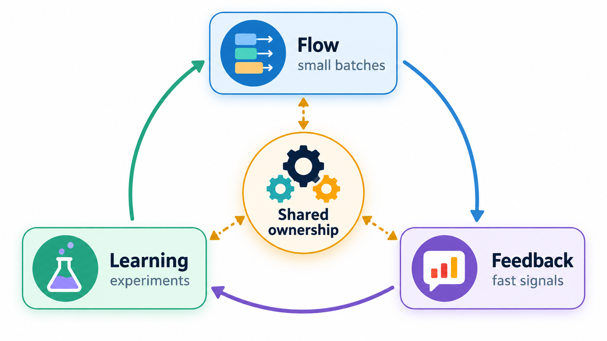
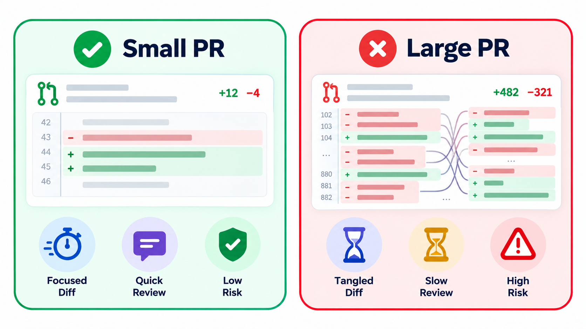
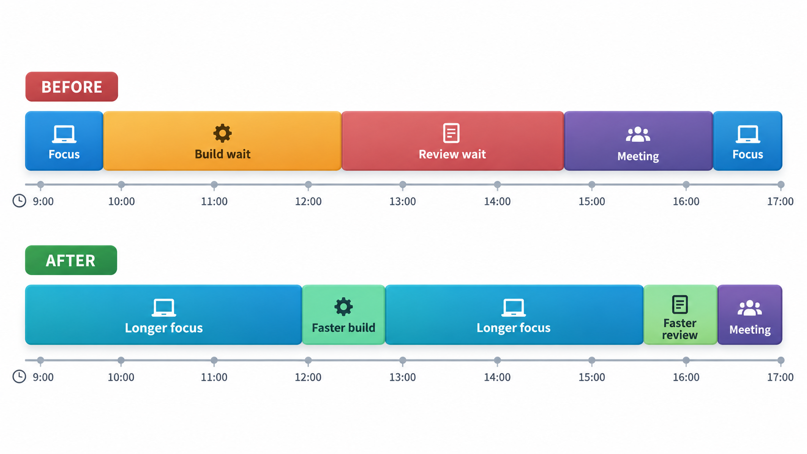
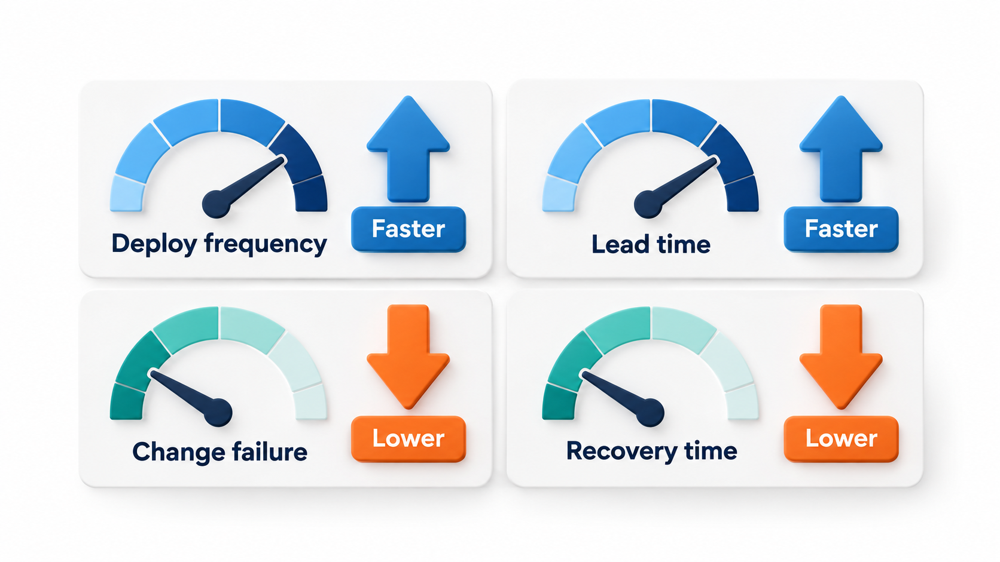

## The Time Between a Change and Knowing If It Works

Engineers spend much of their working life waiting: for a build, for tests, for a review, for a deployment, for a command to finish. Each wait is small, and the cost is easy to overlook because it is spread over many small moments. Yet the speed of an engineer's own tools can be one of the largest hidden costs in an organisation.

**Developer productivity** is the study of what slows engineers down and what lets them do their best work. It sits at the end of the build and release topics for a reason. Build systems, continuous integration, containers and delivery pipelines all exist to shorten one thing: the time between making a change and knowing whether it works.

## The Inner Loop and the Outer Loop

Engineers work in two loops.

The **inner loop** is the small cycle on a developer's own machine: edit code, build, run the tests, see the result, repeat. It happens dozens of times an hour. A good inner loop gives an answer in seconds. If it takes a minute, people lose focus. If it takes ten, they start something else and lose the thread.

The **outer loop** is the cycle through the shared system: push the change, wait for continuous integration, get a review, merge, deploy. It happens a few times a day. A good outer loop takes minutes to hours, not days.

The speed of both is a big part of productivity, because they set how many times a day an engineer can learn whether an idea works. An engineer with a one-minute loop can try thirty ideas an hour. One with a thirty-minute loop can try two.

| Loop | What happens | Target | If it is too slow |
| --- | --- | --- | --- |
| **Inner** | Edit, build, test, see | Seconds | People lose focus; fewer experiments |
| **Outer** | Push, CI, review, merge, deploy | Minutes to hours | Work queues up; bigger, riskier changes |

## The Hidden Cost of Waiting

Slow feedback is expensive, and the cost is easy to overlook because it is spread over many small moments. Estimate it for a team of 40 engineers who each run the continuous integration pipeline six times a day, over 220 working days, at an assumed cost of Rs 800 an hour.

| Wait for each run | Engineer-hours lost a year | Cost |
| --- | --- | --- |
| 2 minutes | about 1,760 | about Rs 14 lakh |
| 10 minutes | about 8,800 | about Rs 70 lakh |
| 30 minutes | about 26,400 | about Rs 211 lakh, more than two crore |

At 10 minutes the figure is five times that of 2 minutes. The calculation counts only the waiting. It leaves out the larger cost of broken concentration: an engineer who must wait ten minutes does not sit still, but starts something else, and then pays to switch back. Waiting also makes people batch their changes into bigger, riskier ones. A faster pipeline is therefore an investment with a real return. Two engineers working for a month to cut the wait from 30 minutes to 10 would pay back many times over.

Check the payback. Cutting the wait from 30 to 10 minutes saves about 17,600 engineer-hours a year (26,400 minus 8,800). Two engineers for a month cost roughly 2 x 176 = 352 hours. The saving is about fifty times the cost in the first year alone.

## What Slows Engineers Down

Studies and surveys of developers point to the same few culprits.

- **Slow builds and tests.** The most common complaint, and the easiest to quantify.
- **Slow or flaky continuous integration.** Waiting for a pipeline that sometimes fails for no reason.
- **Slow code review.** A change that waits two days for a first look blocks everything that depends on it.
- **Painful environments.** Hours or days to set up a new machine, or a test environment that is shared and often broken.
- **Poor documentation and unclear code.** Time spent finding out how things work.
- **Interruptions and meetings.** Fragmented days with no long stretch for focused work.
- **Unclear requirements and shifting priorities.** Work done and thrown away.
- **Tool friction.** Scripts that fail, permissions to request, tickets to raise for simple things.

Most of these are not about talent or effort. They are about the system the engineers work in.

<!-- Visual: A flow of feedback and learning, where each wait slows the next improvement. -->

## Finding the Bottleneck

Improvement starts with finding where the time goes. A simple method is to follow one change from the idea to production and record each wait.

| Stage | Active work | Waiting | Where the delay is |
| --- | --- | --- | --- |
| Write the change | 3 hours | 0 | |
| Local build and test | 10 minutes | 0 | |
| Push; CI pipeline | 0 | 35 minutes | Slow pipeline |
| Wait for review | 20 minutes of review | 20 hours | Review queue |
| Fix review comments | 30 minutes | 0 | |
| CI again | 0 | 35 minutes | Slow pipeline |
| Merge and deploy | 5 minutes | 2 hours | Manual approval step |
| **Total** | About 4.5 hours | About 23.3 hours | Waiting is five times the work |

For this change, the working time was four and a half hours, and the waiting was nearly a full day. The largest delay was not the pipeline but the review queue. Without this kind of trace, a team might spend months speeding up the pipeline and leave the biggest delay untouched. This view, sometimes called a value stream map, comes from lean manufacturing.

## Making the Loops Faster

Teams that take productivity seriously work on it as engineering.

**Speed up the inner loop.** Incremental builds that compile only what changed, fast unit tests that run on save, hot reload that updates a running application, and local environments that start in seconds.

**Speed up the pipeline.** Run tests in parallel across machines. Cache dependencies and build outputs. Run only the tests affected by a change. Put the fastest checks first and fail fast. Split a long pipeline into a quick one that blocks merges and a slower one that runs afterwards. Treat flaky tests as defects.

**Speed up review.** Keep changes small. Agree a target, such as a first response within a working day. Automate what a machine can check, so reviewers focus on design and logic.

**Make environments easy.** A one-command set-up script, development containers, and disposable test environments created on demand. Onboarding should be a measured process: how long does it take a new engineer to ship their first change? That figure is a good health check for the whole system.

**Build internal tools.** Larger companies have *platform* or *developer experience* teams whose customers are other engineers. They provide shared tooling, templates, paved paths for creating a new service, and self-service access to what people need. The aim is to remove the friction that each team would otherwise have to deal with separately.

**Protect focus.** Fewer meetings, blocks of uninterrupted time, and fewer context switches between projects.

<!-- Visual: small pull requests being reviewed and merged quickly. -->

## Quick Wins and Big Projects

| Improvement | Effort | Typical effect |
| --- | --- | --- |
| Cache dependencies in CI | Hours | Minutes off every run |
| Run test groups in parallel | Days | Pipeline time divided by the number of groups |
| Set a review response target and a daily rota | A meeting | Days off lead time |
| One-command set-up script | Days | Onboarding from days to hours |
| Quarantine flaky tests | Days | Fewer reruns and less distrust |
| Replace a slow test database with an in-memory one | Weeks | Test suite several times faster |
| Migrate to a faster build system | Months | Large, for big codebases |

Starting with the cheap items builds credibility, and the savings pay for the larger projects.

## Measuring Without Doing Harm

What gets measured gets managed, and also gamed. Counting lines of code or commits per person is notoriously misleading and harmful. Better measures look at the *system* and not at individuals: build and test times, the time a change takes from commit to production (lead time), how often deployments are made, how often they fail and how quickly service is restored. These four are the delivery measures from the DORA research, and they have been found to go with better outcomes for both the company and its people. Some teams add regular surveys of how developers feel about their tools, since satisfaction, difficulty of tasks and time lost to friction are things only the engineers can report.

<!-- Visual: a developer's day drawn as a strip, with blocks of focused work, waits for builds, waits for review and meetings, and a second strip after improvements in which the waits have shrunk and the focused blocks have grown. Save as images/121_day_before_and_after.png. -->

The rule is to use measures to find and fix bottlenecks, never to rank people.

<!-- Visual: DORA delivery measures describing speed and stability of a delivery system. -->

