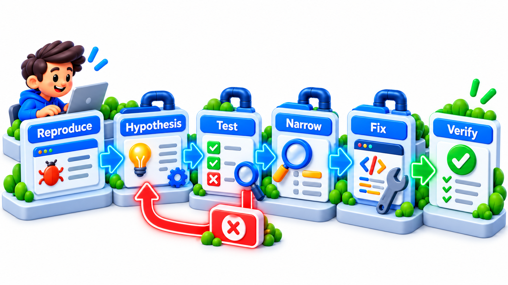
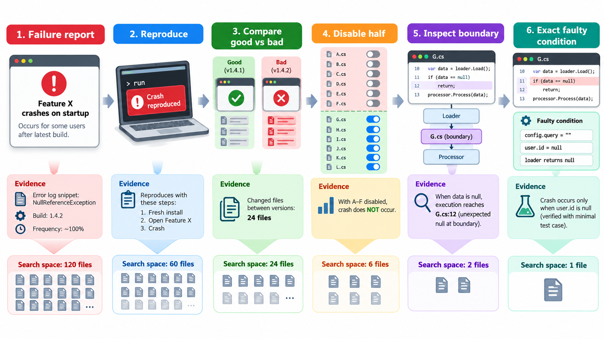
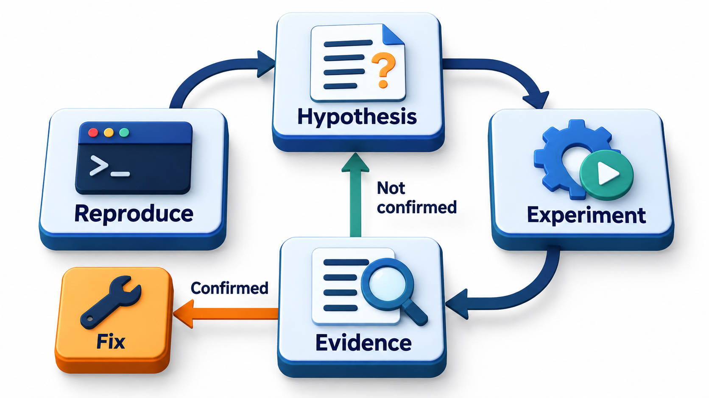
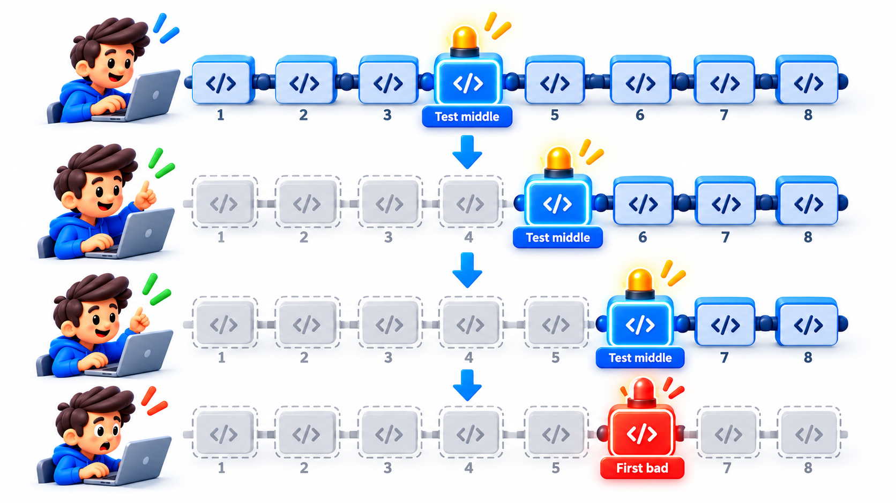
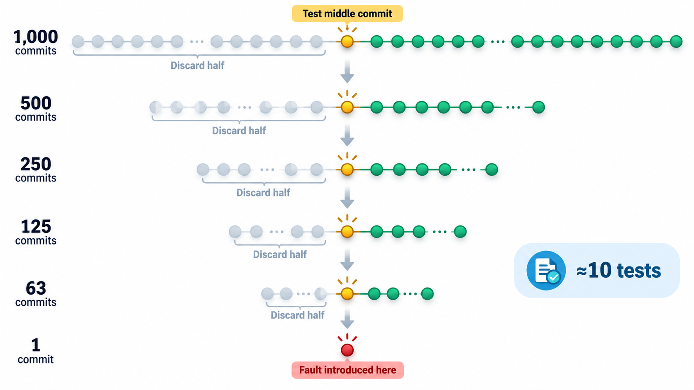

## Debugging Is Science, Not Guesswork

Finding a fault is harder than creating it, and the programmer is at their least capable at the moment they most need to be capable. Most beginners debug by guesswork: change something, run the program, see whether the symptom has gone, try something else. Occasionally this works. More often it ends in an hour of random edits, a program with new bugs and no idea what was wrong.

The professional approach is the scientific method applied to a program: observe, guess, test the guess, learn, and repeat. This topic describes that method, a powerful trick for finding the change that introduced a bug, and a few habits that make the work calmer.

The difference between the two approaches shows up in time. Studies of developers often find that a large share of their working time goes on understanding and fixing faults, and that the spread is wide: experienced debuggers find the cause in minutes where others take hours, not because they type faster but because each step they take rules something out.

## The Method: Reproduce, Isolate, Hypothesise, Verify

**1. Reproduce.** You cannot fix what you cannot see. Find the exact steps and input that make the fault appear, every time. A bug report that says "sometimes it fails" must become "it fails when the fee list is empty". If the fault is intermittent, collect evidence until you find what makes the difference: the data, the timing, the order of events. Until you can reproduce it on demand, you cannot know whether you have fixed it.

**2. Isolate.** Make the problem as small as you can. Remove parts of the input, switch off features, cut the program down to the shortest version that still fails. This is called a *minimal reproduction*. It does two things: it narrows where the fault can be, and it often reveals the cause on its own, because irrelevant detail has been stripped away.

**3. Hypothesise.** Form a specific guess about the cause, a statement that could be wrong: "the division fails because `instalments` can be zero". A hypothesis can be tested. "Something is wrong with the fee code" cannot.

**4. Test the hypothesis.** Design an experiment whose result would tell you whether the guess is right: print the value, set a breakpoint, write a failing test. The answer should *surprise* you only if you were wrong. If the experiment does not distinguish the possibilities, it was the wrong experiment.

**5. Fix and verify.** Change the code to remove the cause, and show that the failure is gone. Then run the other tests to check you have not broken something else. Add a test for this fault so that it cannot return unnoticed.

The discipline is to change only one thing at a time, and to resist the urge to try a fix before you understand. A fix made without understanding may hide the symptom while the cause stays, and returns later in a worse form.

<!-- Visual: A debugging cycle from reproduction through hypothesis to a verified repair. -->

## The Method on a Real Report

Take a bug report: "The fee report shows the wrong total for some students." Following the steps:

| Step | What the debugger does | Result |
| --- | --- | --- |
| Reproduce | Asks which students; finds that roll 1042 shows 4,500 where the rows add to 5,000 | The failure is now exact |
| Isolate | Cuts the report to just roll 1042, then to just its fee rows | Three rows, one of which is a Rs 500 late fine |
| Hypothesise | "The total ignores late fines" | A specific, testable claim |
| Test | Checks a student with a late fine and a student without; compares totals | Only students with fines are wrong: the hypothesis holds |
| Look closer | Reads the total function; finds it sums only rows of type "fee" | The cause: fines are a different row type |
| Fix | Includes fines in the sum | The report is right for roll 1042 |
| Verify | Adds a test for a student with fines; runs all tests | Passes; nothing else broke |

Each step reduces the possibilities. At no point was a change made without a reason.

## Where to Look

A few principles help to find the fault faster.

- **Work backwards from the symptom.** Start at the wrong output and ask what produced it, then what produced that. The cause lies on the path from the data to the failure.
- **Divide and conquer.** If the program does ten things in sequence and the final result is wrong, check the data half-way. Is it right at step five? Then the fault is in steps six to ten. Repeat.
- **Question your assumptions.** The fault is almost always in something you were sure was fine. Check what a variable really contains, what a function really returns, and which version of the code is really running.
- **Trust the evidence over the theory.** If the program does something your understanding says is impossible, your understanding is wrong.
- **Look for what changed.** If it worked yesterday, the cause is in a recent change. This leads to the best technique of all.

## Common Kinds of Fault

Knowing the usual suspects shortens the search.

<!-- Visual: debugging as a series of hypotheses tested against evidence. -->

| Kind | Typical sign | First check |
| --- | --- | --- |
| **Off-by-one** | First or last item missing or repeated | Loop bounds and comparisons ("less than" versus "less than or equal") |
| **Wrong assumption about data** | Crash on empty, missing or odd input | Print the actual value |
| **State left over** | Works the first time, fails the second | Variables or files not reset between runs |
| **Wrong version running** | Your fix has no effect | Confirm what code is actually deployed |
| **Timing and order** | Fails sometimes, differently each time | Shared data, threads, network delays |
| **Environment difference** | Works here, fails there | Versions, settings, locale, permissions |
| **Silent error swallowed** | Nothing visible fails but the result is wrong | Empty exception handlers, ignored return values |
| **Type or unit confusion** | Results off by a factor | Rupees vs paise, strings vs numbers |

## Bisection: Finding the Commit That Broke It

If a bug did not exist in an older version and exists now, then somewhere in the history there is a first commit that introduced it. With a thousand commits between, reading them all would take days. But you do not need to. Take the commit in the middle and test it. If it is good, the bug was introduced in the later half. If it is bad, in the earlier half. Either way, half the history has been eliminated with one test. Repeat, and a thousand commits take about ten tests.

Version-control tools have this built in as a bisect command. You tell it a good version and a bad one, it checks out the middle for you to test, you report good or bad, and it halves the range again until it names the first bad version. If you have an automated test that detects the bug, the tool can run the whole search itself. Each test halves the remaining range, so the number needed grows very slowly.

| Versions in the history | Tests needed to find the first bad one | Tests if tried one by one |
| --- | --- | --- |
| 100 | 7 | up to 100 |
| 1,000 | 10 | up to 1,000 |
| 100,000 | 17 | up to 100,000 |

Each tenfold increase in history costs only about three more tests. A bug introduced somewhere in a hundred thousand versions can be pinned down in an afternoon. The method needs a test that gives a clear good or bad answer, which is a reason to have an automated test for the failure before starting.

<!-- Visual: bisection halving the commit history to find the first bad change. -->

## Thinking Out Loud: Rubber-Duck Debugging

A technique with a charming name comes from *The Pragmatic Programmer*, published in 1999: keep a rubber duck on your desk, and when you are stuck, explain the problem to it, line by line. The act of putting your understanding into words forces you to examine each assumption, and very often you find the error in the middle of your own sentence. The duck says nothing and the duck is not needed. A colleague works equally well, and so does writing the problem down as a question. If, while writing it, you find the answer, you have just practised the same technique.

## When You Are Stuck

Every debugger reaches a point where nothing makes sense. A short list of moves helps.

| Move | Why it works |
| --- | --- |
| Re-read the error message and the report from the beginning | You may have skipped a detail |
| List what you are sure of, then check each item | One "certainty" is usually false |
| Draw the data flow | Shows where two ideas of the program disagree |
| Explain it to someone | Rubber-duck effect |
| Simplify the case further | A smaller failure has fewer causes |
| Walk away for a while | Fatigue narrows thinking |
| Ask, with a minimal example | Others see what you cannot |

## Habits for a Calm Mind

- **Keep a log.** Write down what you tried and what happened. After an hour, notes stop you repeating tests.
- **Take a break.** Fatigue is a large cause of hours-long bugs that take ten minutes the next morning.
- **Change one thing at a time**, and undo changes that did not help.
- **Read the error message.** All of it. It often says what is wrong.
- **Make the fault appear in a test.** A failing test is the best proof that you have understood and then fixed it.

<!-- Visual: a timeline of 1,000 commits with the middle one tested, the half without the bug discarded, and the process repeated, narrowing to a single commit in ten steps. Save as images/122_bisect_halving.png. -->

