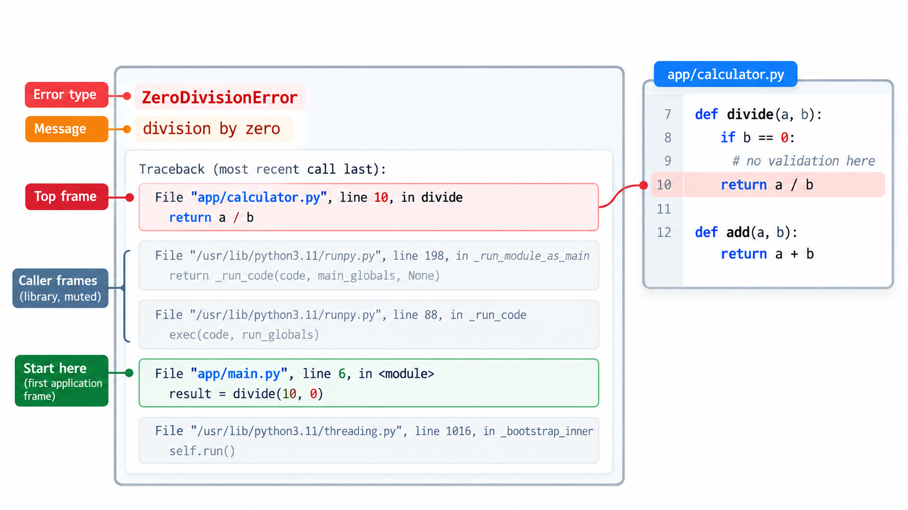
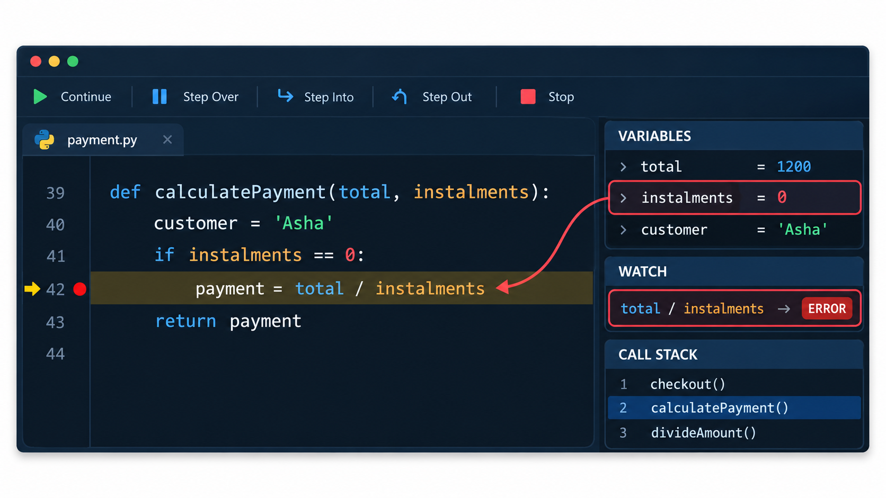
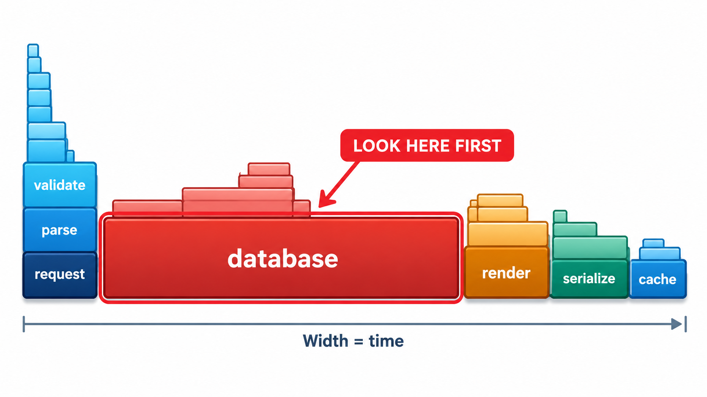
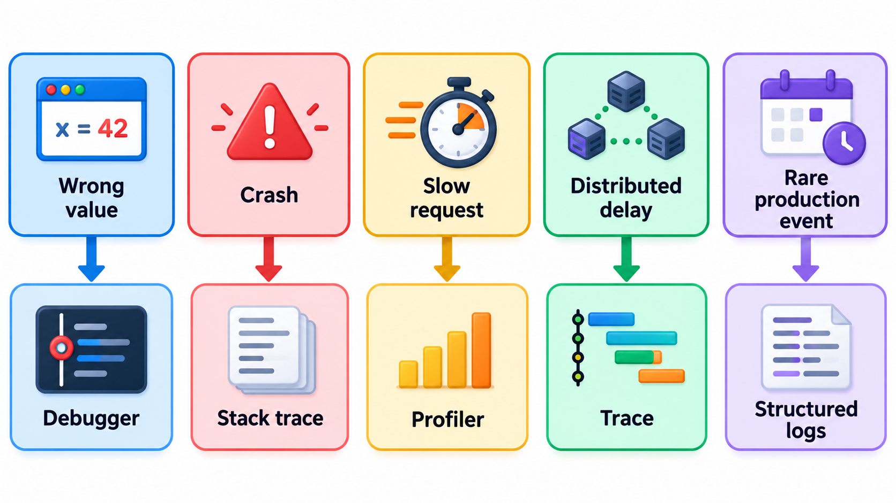
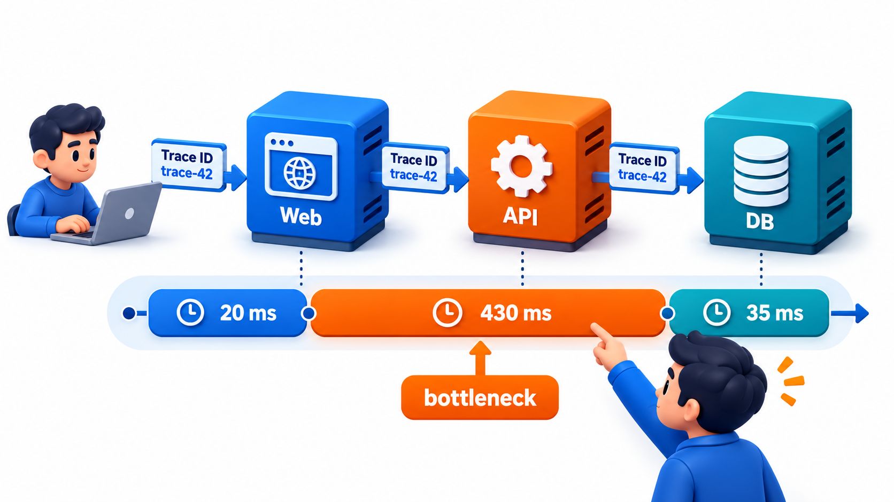

## You Cannot Fix What You Cannot See Inside

Debugging means finding out what a running program is actually doing, which is often not what you think. You need to be able to *observe* the inside of a program: what it is doing, what values it holds, where it is. Even the most remote or constrained systems are debugged the same way: ask the system to report its state, compare it with what you expected, find where they diverge, and test a fix.

The tools in this topic are different ways of looking in: stack traces, breakpoints and debuggers, logging, and profilers.

## The Debugger

A **debugger** is a program that runs another program under your control. It lets you stop it at any point, examine its state and move forward step by step. The basic facilities are:

- **Breakpoints.** A marker on a line where execution stops. You choose where to look.
- **Stepping.** Run one line at a time. *Step over* runs a function call as a whole, *step into* goes inside the function, and *step out* runs to the end of the current function.
- **Inspecting variables.** At a stop, see the value of every variable in scope.
- **Watch expressions.** A value or formula that you ask the debugger to show at every stop, such as the total, or the number of students.
- **Conditional breakpoints.** Stop only when a condition holds: "when `roll_number` is 1042". This is invaluable when the fault happens on the thousandth pass of a loop.
- **The call stack.** The chain of functions that led to this point, with the variables of each. You can move up and down it.

Every serious editor and language has one: the debugger built into Visual Studio Code and IntelliJ, `pdb` in Python, `gdb` and `lldb` for C and C++, and the developer tools in a web browser for JavaScript. The ideas are the same everywhere.

A debugger answers the question "what is the state right now?". It is slower than a print statement for a quick look, and far better when you need to explore: look at many variables, follow a call, or change a value and see what happens.

| Feature | Question it answers | Example |
| --- | --- | --- |
| Breakpoint | What is the state at this line? | Stop where the fee is computed |
| Step over | What does the next line produce? | Skip into a trusted library call |
| Step into | What happens inside this call? | Enter the suspect function |
| Watch | How does this value change over time? | Watch `balance` across a loop |
| Conditional breakpoint | What is happening on the failing case? | Stop only for roll 1042 |
| Call stack | How did we get here? | See who called with the bad value |
| Set a value | What if this were different? | Change `instalments` to 1 and continue |

## A Real Case: Repairing a Spacecraft from Billions of Kilometres

In November 2023 the Voyager 1 spacecraft, launched in 1977 and more than twenty billion kilometres from Earth, began sending its controllers a stream of meaningless data in place of its normal readings. It was still receiving commands and still working, but it could no longer report on itself. A signal takes about a day to reach it, and another day for the reply to come back, so every question costs two days, and there is no way to examine the machine in person.

The engineers did what any programmer does with a program that will not behave. They first reproduced the symptom and narrowed down where it came from. They asked the spacecraft to send back the contents of its memory, a request that is the equivalent of a memory dump, and compared the readout with what they expected to find. The comparison showed that one small region of memory, about three per cent of it, had been corrupted, probably by a failed chip. Rather than repair hardware that nobody could touch, they split the affected program into pieces and wrote a patch that stored them in different places. They tested the idea on a copy of the system on Earth. In April 2024 they sent the change, waited the two days, and the spacecraft resumed sending usable readings.

| Step in the Voyager repair | The same step on any program |
| --- | --- |
| Observe the failing symptom | Reproduce the bug |
| Request a memory readout | Use a debugger or dump to inspect state |
| Compare with the expected contents | Find where actual and expected values diverge |
| Test the patch on a replica | Test a fix before it reaches users |

The tools in this topic, from breakpoints to memory inspection, are ways of seeing inside a running program. On Voyager they had to be used with extreme patience, but the method is the one used for an ordinary bug.

## A Debugging Session, Step by Step

A session on the zero-instalments failure might run like this.

| Step | Action | What is seen |
| --- | --- | --- |
| 1 | Run the report; see the division-by-zero error and the stack trace | The failing line is in the fee routine |
| 2 | Place a breakpoint on that line | Execution stops on the first record |
| 3 | Inspect `instalments` | 3: fine; continue |
| 4 | Make the breakpoint conditional: stop when the number of instalments is zero | It stops on the second record |
| 5 | Open the call stack; move up to the report loop | The record is roll 1042, imported from a spreadsheet |
| 6 | Hypothesis: the import left the field blank, read as zero | Check the import: blank cells become 0 |
| 7 | Fix the import to reject blanks, and the routine to handle zero | Rerun: the report completes |

The debugger did not find the bug; it supplied the evidence for each step of the reasoning.

## Reading a Stack Trace

When a program fails with an unhandled error, it usually prints a **stack trace**: the list of functions that were active at the moment of failure, with the file and line of each. It is the most useful single piece of evidence in debugging, and many beginners ignore it. A trace is read from the **bottom up** in some languages, such as Python, where the last line gives the error and the line above it shows where it happened, and top-down in others. In either case it shows the path the program took to reach the failure.

A stack trace lists the chain of calls that led to a failure. Take a monthly report that calls a routine to divide each record's fee by its number of instalments, where the second record has zero instalments. The division fails.

| Reading the trace from the bottom up | What it tells you |
| --- | --- |
| The error: a division-by-zero error | What went wrong, already |
| Innermost frame: the fee routine, at the line that divides the fee by the instalments | Where it broke |
| Next frame: the monthly report, in the loop that goes through the records | Who called it |
| Outermost frame: the top-level call that started the report | The path from the start of the program to the failure |

The trace points to the line, but the *cause* is the data: a record with no instalments. The trace says where, and you still need to ask why that record is there, which is the next step of the method.

## Profilers: Where Does the Time Go?

Some faults are not wrong answers but slowness or too much memory. A **profiler** measures a running program and reports where the time or memory goes: how much time was spent in each function, how many times each was called. The result is often a table or a *flame graph*, a picture in which wide blocks are where the time goes. A profiler replaces guessing, which is usually wrong, with data. The advice for performance problems, to measure first, is the same here.

<!-- Visual: a debugger window with a breakpoint on a line, a variables panel showing the value of instalments as 0, a watch expression, and a call stack panel listing the three active functions. Save as images/123_debugger_panels.png. -->

| Kind of profiler | Measures | Finds |
| --- | --- | --- |
| **CPU (time)** | Time in each function | The slow function |
| **Memory** | Allocations and what holds them | Leaks and wasteful structures |
| **Call count** | How often each function runs | A cheap function called millions of times |
| **I/O and network** | Waiting on disk or services | A slow query or a chatty service |

<!-- Visual: a flame graph of one request with wide blocks for the functions where most of the time is spent, a tall narrow stack of calls on the left, and the widest block circled as the place to look first. Save as images/123_flame_graph.png. -->

## Logging and Printing

The simplest tool is to make the program tell you what it is doing. A `print` statement shows a value at a point. It needs no setup and works anywhere, including places where a debugger cannot attach, such as a program running on a server. **Logging** is the disciplined form: messages with a severity and a timestamp, which can be switched on and off and kept. In production, logs are often the only evidence you have.

| Print statement | Logging |
| --- | --- |
| Quick, temporary | Planned and permanent |
| No levels | Levels (debug to critical) |
| Must be removed afterwards | Can be switched on and off |
| Output mixed with normal output | Goes to a separate destination |
| Fine for a quick look | Needed for production |

## Other Tools

- **Memory tools** such as Valgrind and sanitizers find invalid memory access in languages like C.
- **Network tools** show what is sent and received: the browser's network tab, `curl`, Wireshark.
- **Test frameworks** with a failing test let you reproduce the fault in seconds, and are themselves a debugging tool.
- **Version control tools** such as `git blame`, which shows who last changed each line, and `git bisect`.
- **Remote and time-travel debuggers** record a run and let you step backwards, so that you can ask "how did this value get here?".

## Choosing a Tool

| Situation | Reach for |
| --- | --- |
| A crash with an error message | The stack trace |
| A wrong value and you can run the code | A debugger with a breakpoint |
| A loop that goes wrong on the 500th pass | A conditional breakpoint |
| A program that is slow | A profiler |
| A problem only in production | Logs, metrics and traces |
| A bug that appeared recently | `git bisect` |
| A fault in a distant, hard-to-reach system | Whatever telemetry you can get, as with a distant spacecraft |

<!-- Visual: A trace of a request through several services, showing where time is spent. -->

