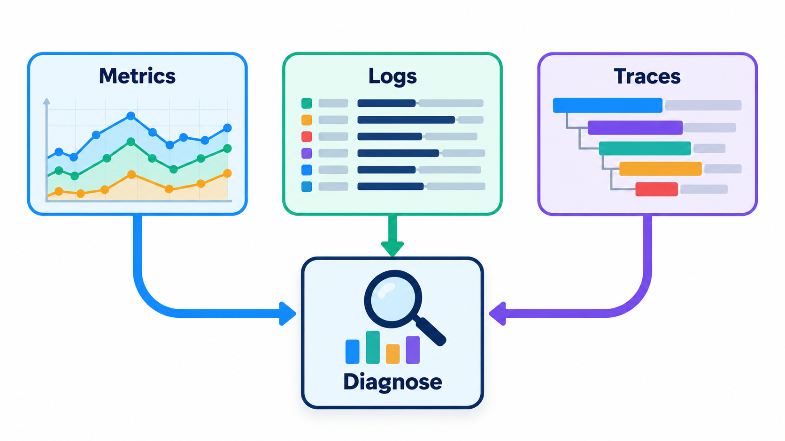
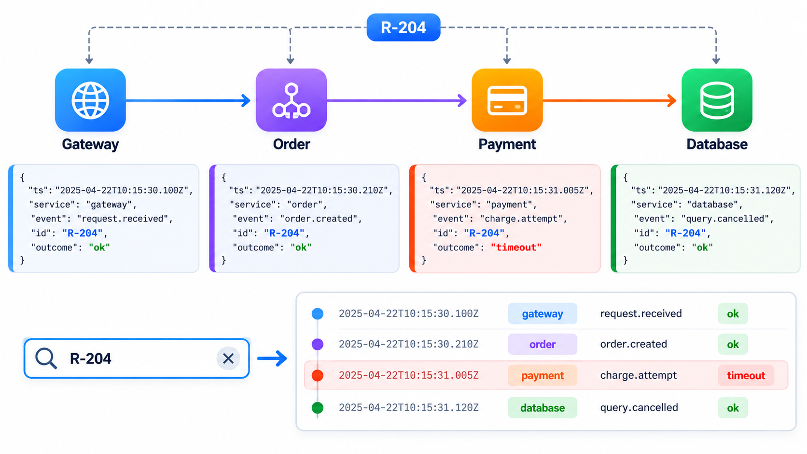
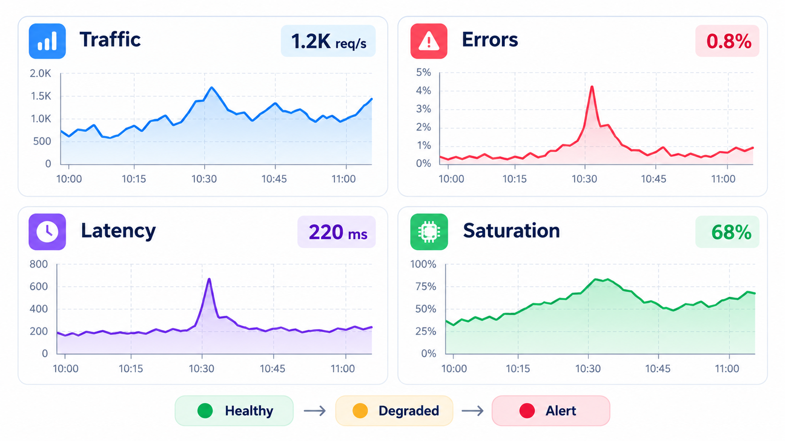
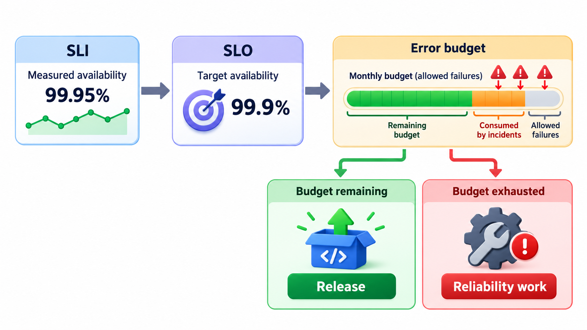
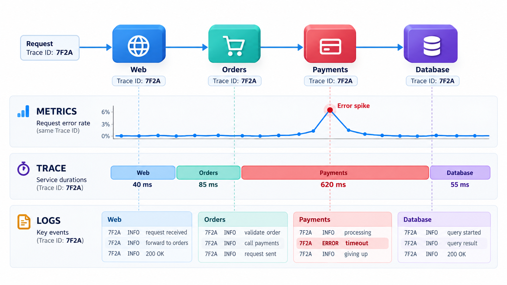

## A System You Cannot Observe Is a System You Cannot Defend

A system that cannot be seen from the outside cannot be defended, debugged or run. Tools that watch a system are themselves part of it, and they can fail silently: a monitor that stops working produces no alert for its own silence, and the absence of alarms is mistaken for health.

**Observability** is the ability to tell what a system is doing from the outside. Its main tools are logs, which record events; metrics, which count and measure; and traces, which follow one request across many services. This topic covers how to use them well, and what should never be logged.

## Monitoring and Observability

The two words overlap, and the difference is useful. **Monitoring** watches for known problems: you decide in advance what to measure and when to alarm. **Observability** is the broader property that lets you ask new questions about a system you did not foresee, using the data it emits.

| Aspect | Monitoring | Observability |
| --- | --- | --- |
| Question style | "Is the error rate above 2%?" | "Why are payments slow for users in one region?" |
| Problems | Known in advance | Unknown, discovered by exploring |
| Data | Chosen metrics | Rich logs, traces and metrics that can be sliced |
| Use | Alerts | Investigation |

## A Real Case: The Monitor That Went Quiet

In 2017 the credit-reporting company Equifax suffered one of the largest data breaches on record, in which information about 147 million people was taken. Among its many failures was a small and revealing one. The company ran a tool that watched network traffic for signs of data being taken out, which was exactly the tool that could have seen the attack. To read encrypted traffic, the tool relied on a digital certificate, and the certificate had expired about nineteen months earlier. When it expired, the tool did not complain. It simply stopped inspecting, and since it still looked as if it was running, nobody noticed. The attackers moved data out for roughly seventy-six days, until the certificate was finally renewed in July 2017 and the tool began to show what had been happening.

A monitor that has failed in silence is worse than no monitor, because everyone assumes that no news means no problem. Observability work has to include the question that Equifax never asked: how would we know if the thing that tells us about problems had itself stopped working?

| Question | Why it matters |
| --- | --- |
| Is the monitor itself being monitored? | A silent failure looks identical to a quiet system |
| Do expiry dates raise an alert well before they arrive? | Certificates and keys expire on a known schedule |
| Does a lack of data raise an alarm? | An absence of events can be the signal |
| Who owns each alert? | A warning with no owner is read by no one |

This topic explains logs, metrics and traces as the three ways a running system reports on itself. The Equifax case adds a fourth requirement: those reports must themselves be trusted, tested and kept alive.

## Three Kinds of Signal

Modern practice talks about three pillars of observability. They answer different questions.

| Signal | What it is | Answers | Example |
| --- | --- | --- | --- |
| **Logs** | Timestamped records of events | What happened, in detail? | "10:02:11 ERROR payment gateway timeout for roll 1042" |
| **Metrics** | Numbers measured over time | How is the system doing overall? | Requests per second, error rate, response time |
| **Traces** | The path of one request through many services | Where did this request spend its time? | A trace showing 4 seconds of a 5-second request in the payment service |

Metrics tell you *that* something is wrong, and are cheap and good for alerts. Logs help to find *what* is wrong, with detail. Traces show *where* in a chain of services. Teams usually start from a metric (the error rate has risen), look at traces to find the service, and read logs to see the cause.

<!-- Visual: logs, metrics and traces as three complementary signals. -->

## An Investigation Using All Three

A support team reports that fee payments are slow. A walk through the signals:

| Step | Signal | What is seen | Conclusion |
| --- | --- | --- | --- |
| 1 | Metric: response time dashboard | Payment latency rose from 300 ms to 5 s at 10:00 | The problem is real and started at 10:00 |
| 2 | Metric: error rate | Errors up from 0.1% to 6% | Failures as well as slowness |
| 3 | Trace of a slow request | 4.8 of 5 seconds spent in the call to the payment gateway | The gateway call is the slow part |
| 4 | Logs of the payment service around 10:00 | "gateway timeout after 5000 ms", repeated | Confirms timeouts |
| 5 | Deployment log | Nothing deployed near 10:00; the gateway's status page reports an incident | The cause is outside the system |
| 6 | Action | Switch on the fallback and tell users | Impact reduced while the provider recovers |

Six steps, three kinds of evidence, and no guessing.

## Logs That Can Be Searched

A traditional log line is a sentence, such as "Payment failed for Asha, gateway timeout after 5 seconds". It is easy for a person to read and hard for a program to analyse, since every message has its own wording. A **structured log** records each event as data, with named fields: the time, the service, the level, the message and the relevant values. A program can then count, filter and group the lines. Take five entries.

| Time | Service | Level | Message | Milliseconds |
| --- | --- | --- | --- | --- |
| 10:00:01 | payments | INFO | charge ok | 120 |
| 10:00:02 | payments | ERROR | gateway timeout | 5000 |
| 10:00:03 | receipts | INFO | receipt sent | 40 |
| 10:00:04 | payments | ERROR | gateway timeout | 5000 |
| 10:00:05 | login | INFO | login ok | 85 |

Counting errors by cause gives "payments: gateway timeout" twice, which already tells an engineer where to look. The slowest request is the payment timeout at 5,000 milliseconds, at 10:00:02. With sentences, answering "how many gateway timeouts occurred and which request was slowest?" would need careful text parsing. With fields it is a few lines, and log systems do this over billions of lines. The design lesson is to log *facts as fields*, not facts buried in prose, so that the data can be searched later by someone who did not write the message.

## What and How to Log

Logging is a design choice and not an afterthought.

- **Use levels.** DEBUG for fine detail, INFO for normal milestones, WARNING for odd but survivable situations, ERROR for failures, CRITICAL for emergencies. In production, usually only INFO and above are kept.
- **Include context.** A request or correlation identifier that follows a request through every service lets you gather all its logs. Include the user (by an ID, not their personal data), the operation and the relevant values.
- **Log at boundaries.** Requests received, calls to other systems, and decisions that matter.
- **Say what happened and what it means.** "Order 482 rejected: card declined by bank (code 51)" is more useful than "error".
- **Do not log too much.** A flood hides the signal, costs money to store and slows the system.
- **Never log secrets or personal data.** No passwords, tokens, full card numbers or sensitive personal details. Logs are widely read and stored for a long time.

| Level | Use for | Example | Kept in production? |
| --- | --- | --- | --- |
| DEBUG | Developer detail | "fee computed: base 5000, fine 100" | Usually off |
| INFO | Normal milestones | "payment 482 completed" | Yes |
| WARNING | Odd but survivable | "retrying gateway, attempt 2" | Yes |
| ERROR | An operation failed | "payment 482 failed: card declined" | Yes, and counted |
| CRITICAL | The service is in trouble | "database unreachable" | Yes, and alerts |

## Metrics and Alerts

Metrics are numbers sampled over time and drawn as graphs. The most useful set for a service are the **four golden signals**, named in Google's book on site reliability: **latency** (how long requests take), **traffic** (how many there are), **errors** (what share fail) and **saturation** (how full the system is: CPU, memory, queue length). A dashboard of those four tells most of the story at a glance.

An **alert** tells a person when something needs action. Good alerts are few, are tied to what the user feels (errors, slowness) and not to every internal quirk, and say what to do. Alerts that fire constantly or need no action teach people to ignore them, which is how a security tool at Equifax could stay broken: the failure of a monitoring component was itself unmonitored.

| Alert rule | Good or poor? | Why |
| --- | --- | --- |
| Error rate above 2% for 5 minutes | Good | Reflects user pain; sustained, so not noise |
| CPU above 70% for one second | Poor | Normal fluctuation; no action needed |
| Disk will be full within 4 hours | Good | Warns early, with time to act |
| Any single error logged | Poor | Floods the team |
| No payments received in 10 minutes on a weekday | Good | Catches silent failure |

<!-- Visual: A dashboard of the signals that show how a live system is behaving. -->

## Service Levels

To judge whether a system is healthy enough, teams state targets. A **service level indicator** (SLI) is a measured quantity, such as the share of requests that succeed. A **service level objective** (SLO) is the target for it, such as 99.9 per cent over a month. The gap between the target and perfection is the **error budget**: the amount of failure the team is allowed.

| SLO | Allowed downtime in a 30-day month | Error budget as requests (of 10 million) |
| --- | --- | --- |
| 99% | About 7 hours 12 minutes | 100,000 failures |
| 99.9% | About 43 minutes | 10,000 failures |
| 99.99% | About 4 minutes | 1,000 failures |

A budget makes trade-offs explicit. If the budget is nearly spent, the team slows risky releases and works on reliability. If plenty is left, it can take more risk and ship faster.

## Monitor the Monitors

Monitoring tools themselves need watching. Monitoring is a system, and it can fail silently. Certificates expire, disks fill, agents crash. A *dead man's switch* alert, which fires if the expected stream of data stops, would have noticed. Teams check that their alerts really work, test them on purpose and track certificate expiry dates in the same way as any other deadline.

<!-- Visual: a request passing through four services with a trace bar showing the time spent in each, a metric graph above showing an error spike, and log lines below tied to the same request identifier. Save as images/124_three_signals_one_request.png. -->

