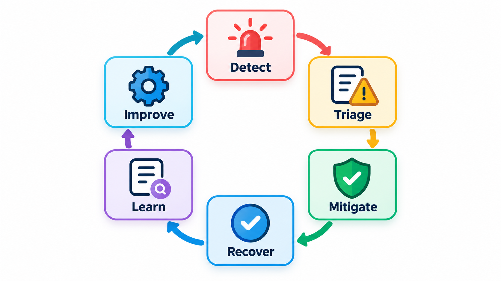
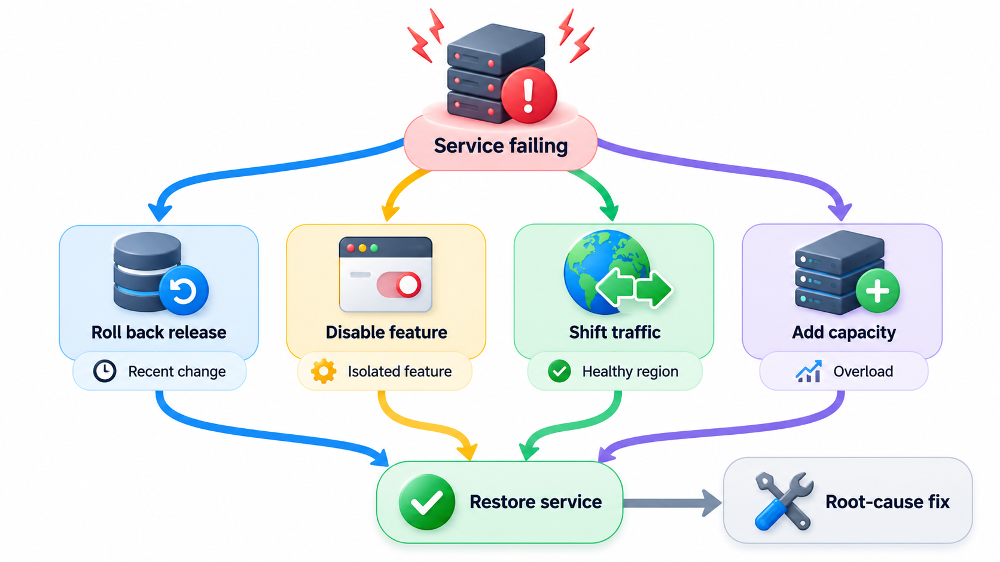
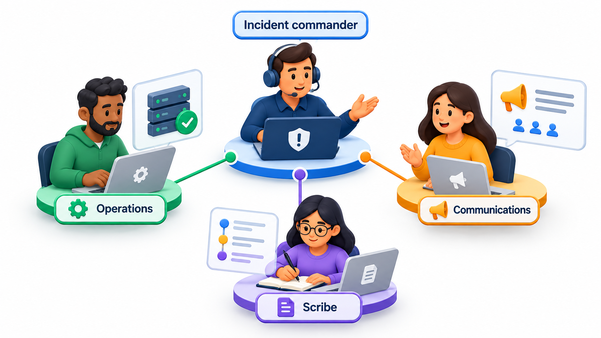
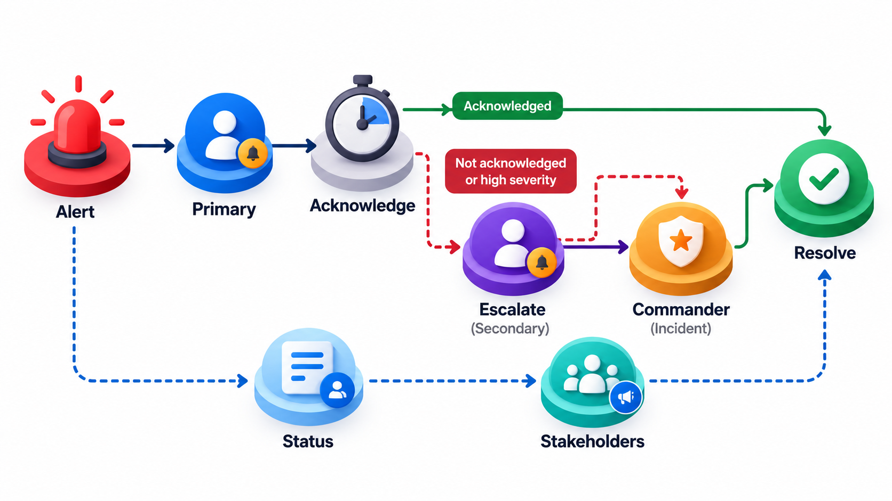
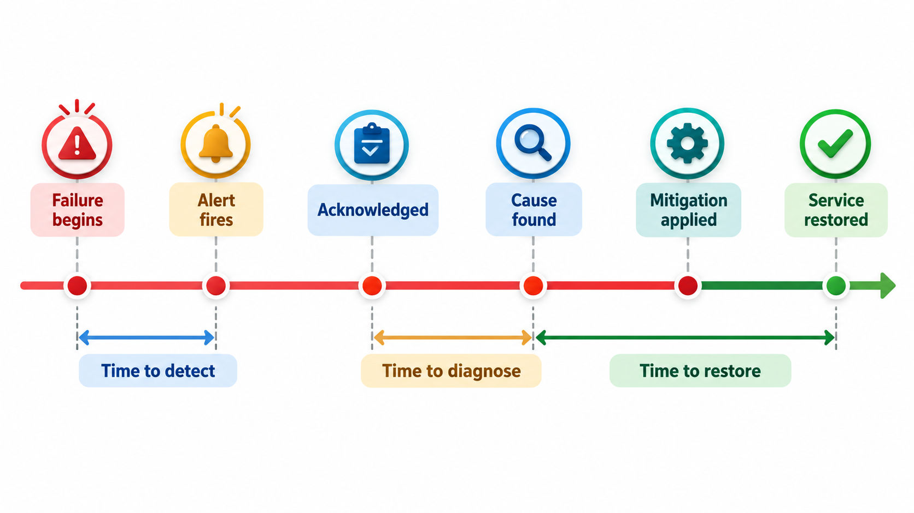

## Who Does What When Something Breaks at Night?

An incident is an unplanned event that disrupts or threatens a service. The failure is often ordinary: a tired person, a typo-sized mistake, a backup that quietly stopped working. What separates a bad outcome from a recoverable one is the response: whether someone notices quickly, whether roles are clear, whether communication is calm and honest, and whether the team has practised the recovery.

**Incident management** is the practice of detecting, responding to and recovering from incidents in an organised way. This topic covers the stages of an incident, the roles in a response, communication, and how to measure the response so it can improve.

## What Counts as an Incident

Not every problem is an incident. The word is used when something affects, or threatens to affect, users or the business and needs a coordinated response.

| Event | Incident? | Why |
| --- | --- | --- |
| A single user cannot reset a password | Usually a support ticket | Narrow impact |
| Payments fail for 5% of students | Yes | Money and many users |
| A server's disk is 85% full, with days to spare | An alert for follow-up | No harm yet |
| The results site is down on results day | Yes, severe | Large, visible, time-critical |
| A security researcher reports a vulnerability | Yes, handled by security process | Risk of exposure |
| A backup job has failed three nights in a row | Yes, quietly | The protection is gone |

## A Real Case: Deleting the Wrong Database

On the evening of 31 January 2017 an engineer at the code-hosting company GitLab was working late to fix a problem with the database that stored the site's data. A copy of the database had fallen behind, and after hours of attempts the engineer decided to clear the copy and start it afresh. The deletion command was typed on the wrong server. It ran on the live database, and by the time it was stopped about 300 gigabytes had shrunk to a few gigabytes. Around six hours of user changes were gone.

The company then discovered that its safety nets had holes. It had five different backup or replication methods, and none was usable as it stood: one failed silently, one had not been set up properly, one produced empty files, and the others were too old or in the wrong place. GitLab recovered from a copy that an engineer had happened to take for a different reason six hours earlier. What the company did next became part of the case. It streamed its recovery live, and published an honest, detailed account of what had happened and what it would change. That openness is still taught.

| Phase of the incident | What it shows |
| --- | --- |
| A tired engineer under pressure typed a destructive command | Systems should make destructive mistakes hard, not rely on care |
| Backups existed on paper but had never been tested by a restore | An untested backup is a hope |
| Recovery was slow because no one had practised it | Incident response needs rehearsal |
| The company communicated openly and wrote it up | Trust is rebuilt by honesty, not silence |

Incident management is the practice of preparing for exactly this evening: roles, procedures, communication and learning. The topic that follows describes how a team handles the hours of an incident, so that a single mistaken command does not become a crisis.

## The Stages of an Incident

Every incident passes through the same stages, and a team that knows them can act faster.

1. **Detection.** Someone or something notices. The best is an automatic alert before any user complains. Often it is a user report.
2. **Triage.** Decide how serious it is and who should respond. How many users are affected? Is data at risk? This sets the **severity**.
3. **Mitigation.** Stop the harm *first*, and understand later. Roll back the release, switch off the feature, add capacity, fail over to a backup. The aim is to restore service, not to find the root cause.
4. **Resolution.** Fix the underlying problem, and confirm that service is normal.
5. **Review.** Learn from it, afterwards, in a calm and blameless way.

A frequent mistake is to dive into diagnosis while users are still suffering, when a quick rollback would end the pain in minutes.

<!-- Visual: the incident loop from detection through mitigation and resolution to learning. -->

## Mitigation Options

The choice of first action depends on the cause.

| Suspected cause | Quick mitigation | Trade-off |
| --- | --- | --- |
| A recent release | Roll back or switch off the feature flag | Loses the new features for a while |
| Overload | Add capacity, shed load, turn off a heavy feature | Some users see reduced service |
| A failing dependency | Use a fallback or cache; fail over to a backup | Data may be slightly stale |
| A bad configuration change | Revert the change | Simple if it was recorded |
| Corrupted data | Restore from backup; stop writes | Possible data loss since the backup |
| A security compromise | Isolate affected systems, rotate credentials | Service interruption |

## Measuring the Response

Teams measure how fast they move through the stages. The timeline of an incident is the data. Take one timeline, in minutes after the first symptom.

| Event | Minute | Interval measured |
| --- | --- | --- |
| Failure begins | 0 | |
| First alert fires | 12 | Time to detect: 12 minutes |
| Engineer acknowledges | 15 | Time to acknowledge: 3 minutes |
| Cause identified | 55 | Time to diagnose: 40 minutes |
| Mitigation applied (a rollback) | 70 | Time to mitigate: 70 minutes from the start |
| Service fully restored | 85 | Time to restore: 85 minutes in total |

Time to detect is the gap in which users suffered without the team knowing; better alerting shrinks it. The longest gap between events is 40 minutes, between acknowledging and identifying the cause. That is where improvement will pay most, perhaps with better dashboards, a runbook or a recent-changes list. Teams track the averages of these intervals over many incidents, often called MTTD, MTTA and MTTR (mean time to detect, acknowledge and restore). A falling trend shows the response getting better.

## Roles in a Response

In a big incident, everyone trying to help at once creates chaos. Mature teams assign clear roles, borrowed from emergency services.

- **Incident commander.** Runs the response, makes decisions, keeps people on task. Does not do the technical work.
- **Operations or technical lead.** Directs the investigation and fixes.
- **Communications lead.** Keeps stakeholders, support staff and customers informed, with regular, honest updates, even if the update is "we are still working on it".
- **Scribe.** Writes a running timeline of what is tried and when. This record is gold for the review.

For a small incident one person may hold all roles. The principle is that a person should always know who is in charge.

<!-- Visual: roles in an incident response, with a commander, technical lead, communicator and scribe. -->

## Severity and On-Call

A shared scale of **severity** tells everyone how to react. A typical one: severity 1 is a major outage or data loss affecting many users, with an immediate all-hands response; severity 2 a serious degradation; severity 3 a minor problem handled in working hours. Definitions based on the impact on users, written down in advance, avoid arguments in the heat of the moment.

| Severity | Impact | Response | Updates |
| --- | --- | --- | --- |
| **1** | Major outage, data loss or security breach | Page everyone needed at once; commander appointed | Every 30 minutes |
| **2** | Serious degradation or a key feature down | Page on-call engineer; escalate if not improving in an hour | Every hour |
| **3** | Minor problem, workaround exists | Handle in working hours | Daily |
| **4** | Cosmetic or very low impact | Ticket for the backlog | As needed |

Someone must be reachable at any time, and so teams run an **on-call rotation**: engineers take turns being the person who is alerted. It needs fairness and care: limits on night calls, time off after a bad night, a secondary person for backup, and a **runbook** for each alert, a short document that says what the alert means and what to do first. Alerts that wake people for no reason are a cost to the team and a risk to the service.

| Runbook section | Content |
| --- | --- |
| What the alert means | "Payment error rate above 5% for 5 minutes" |
| First checks | Is the gateway status page reporting an incident? Was there a recent deployment? |
| Mitigation steps | Switch to the fallback gateway; roll back the last release |
| Who to escalate to | Payments team lead; the gateway's support line |
| How to confirm recovery | Error rate below 1% for 10 minutes |

## Communication

During an incident, silence is damaging. Customers and colleagues forgive outages; they find lack of information much harder to forgive. A good practice is a **status page** with regular updates, a first acknowledgement within minutes, an honest account of what is known and not known, and a note when the next update will come. GitLab's handling of its 2017 incident shows the value: the company published live notes and streamed its recovery, and the openness won it more trust than the incident cost.

| Update | What to include |
| --- | --- |
| First (within 15 minutes) | "We are aware that payments are failing for some users. We are investigating." |
| Regular | What is known; what is being done; what users can do meanwhile; time of next update |
| Resolution | "Payments have recovered since 11:40. Some payments may show as pending for an hour." |
| Follow-up | A summary of cause and the changes being made |

<!-- Visual: a timeline of an incident with the markers failure begins, alert fires, acknowledged, cause found, mitigation applied and service restored, and brackets labelled time to detect, time to diagnose and time to restore. Save as images/125_incident_timeline_intervals.png. -->

## Preparing Before Anything Breaks

The quality of a response is mostly decided in advance.

| Preparation | Why |
| --- | --- |
| **Runbooks for common alerts** | Fewer decisions at 3 a.m. |
| **Practice drills (game days)** | The team knows the roles and tools |
| **Backups that are restored on a schedule** | Proof that recovery works |
| **A communication template and a status page** | No time wasted on wording |
| **Contact lists and escalation paths** | The right person is found fast |
| **Access ready for responders** | No waiting for permissions |
| **A habit of blameless review** | People report problems early |

The last row matters more than it looks. If engineers fear punishment, they hide near misses, and the organisation loses its best source of learning.

## Hotfixes and Root Causes

Two ideas link the response to what comes after. A **hotfix** is a small, urgent change made to production outside the normal release schedule, to stop an incident that rollback or a switch cannot end. Because it is made under pressure, it is kept as small as possible, reviewed by a second person even if briefly, and merged back into the main line afterwards so it is not lost.

A **root-cause analysis** is the later work of finding why the incident was possible. It looks past the trigger, such as a wrong command, to the conditions that let the trigger have this effect: a missing check, an untested backup, an alert that never fired. It is done after service is restored, not during, and its output is a short list of changes that make the same failure harder to repeat.

| | Hotfix | Root-cause analysis |
| --- | --- | --- |
| **When** | During the incident | After recovery |
| **Aim** | Stop the harm quickly | Understand why it could happen |
| **Scope** | The smallest change that works | The whole chain of contributing factors |
| **Output** | A patched system | A list of lasting improvements |
