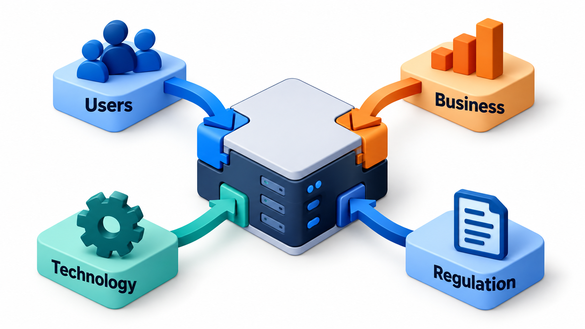
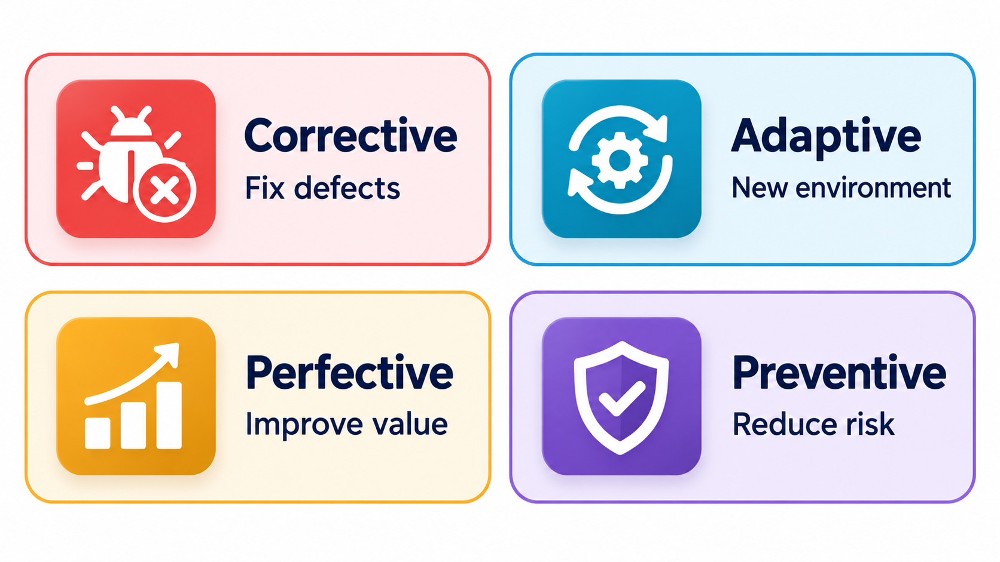
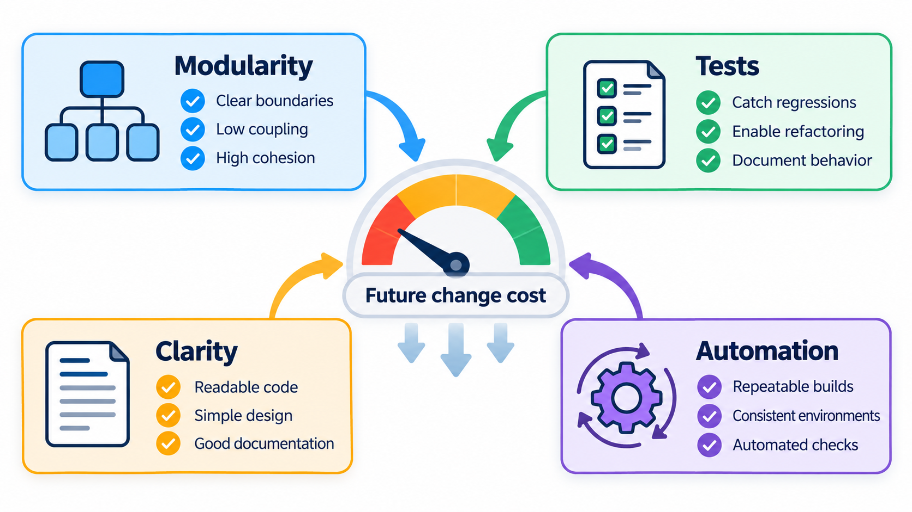
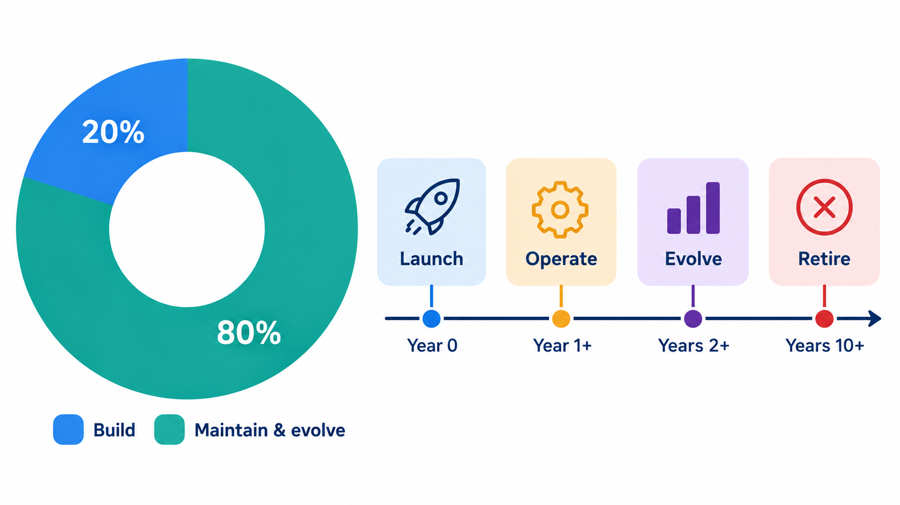
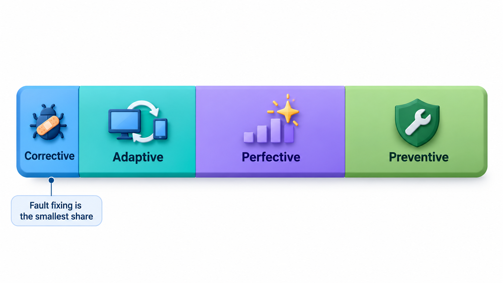

## Most Software Spends Most of Its Life Being Maintained

Much of the software that matters is old. It was built years or decades ago, it has been running ever since, and the work of looking after it, **software maintenance**, is the largest part of the profession. Study after study has found that maintenance takes the greater part of the money spent on a system over its life, with figures from 60 to 80 per cent often quoted. Governments and banks still run essential systems written in languages from the 1950s, and look for people who can read them.

It is the part of software work that courses rarely teach, and that new graduates find themselves doing from the first week. This topic covers the four types of maintenance, why it costs so much, and how to do it well.

## What Maintenance Is

Maintenance is the modification of a software product after it has been delivered. It is not simply bug fixing. Classic work by Swanson in 1976 divided it into types, and the four-way split that is used today is:

| Type | Purpose | Example |
| --- | --- | --- |
| **Corrective** | Fix faults found in use | A crash when the fee list is empty |
| **Adaptive** | Keep the software working as the environment changes | Support a new version of the operating system, a changed tax law or a new payment app |
| **Perfective** | Improve the software, with new features or better performance | Add a fee export; make a report faster |
| **Preventive** | Make future maintenance easier and avoid problems | Upgrade a library about to lose support; clean up duplicated code |

The proportions surprise people. Fixing faults, the first thing one thinks of, is usually the smallest part. Most maintenance effort goes into adaptive and perfective work: changing the software because the world changed or because users asked for more. In other words, software is not "finished and then repaired". It is continually reshaped.

<!-- Visual: the sources of change that drive maintenance work. -->

## Where Maintenance Requests Come From

Changes arrive from many directions, and each source has its own pace and priority.

| Source | Example | Type of work |
| --- | --- | --- |
| **Users** | "The export is too slow" | Perfective or corrective |
| **The business** | A new fee structure from next term | Adaptive or perfective |
| **The law** | A change in how tax is shown on receipts | Adaptive, with a fixed deadline |
| **Technology** | A library or operating system loses support | Adaptive or preventive |
| **Security** | A vulnerability in a component | Corrective, urgent |
| **The team itself** | Duplicated code slows every change | Preventive |

Deadlines differ: legal changes cannot move, security fixes are urgent, and preventive work can always be postponed, which is exactly why it is postponed too often.

## Seeing Where the Effort Goes

A team that does not measure its maintenance work cannot tell where its effort is going. Sort a year's change requests into the four types and total the days.

| Change request | Type | Days |
| --- | --- | --- |
| Fix crash on empty fee list | Corrective | 3 |
| Fix wrong rounding | Corrective | 2 |
| Support new UPI app version | Adaptive | 6 |
| Comply with new tax rule | Adaptive | 7 |
| Faster report loading | Perfective | 5 |
| Add fee export | Perfective | 8 |
| Upgrade old library before it loses support | Preventive | 4 |
| Clean up duplicated fine code | Preventive | 3 |

| Type | Days | Share of maintenance effort |
| --- | --- | --- |
| Corrective | 5 | 13% |
| Adaptive | 13 | 34% |
| Perfective | 13 | 34% |
| Preventive | 7 | 18% |

Corrective work, fixing faults, takes only 5 of 38 days. A team that believed maintenance meant bug fixing would plan for a small effort. The data show that two thirds of the work is the system keeping pace with a changing world and with users' wishes. Over time, a healthy balance includes some preventive work. A team with none is borrowing against the future, and will see the corrective and adaptive shares grow as the code becomes harder to change.

<!-- Visual: the four types of maintenance and their purposes. -->

## The Maintenance Process

Maintenance follows a recognisable path, and each step has its own risk.

| Step | What happens | Main risk |
| --- | --- | --- |
| 1. Receive and log the request | Record who asked and why | Lost or duplicated requests |
| 2. Classify and prioritise | Corrective, adaptive, perfective or preventive; urgency | Urgent items crowd out preventive work |
| 3. Understand the code | Find the relevant parts and what depends on them | Misreading; hidden dependencies |
| 4. Assess the impact | What else might this change affect? | Unexpected breakage |
| 5. Make the change | The smallest change that does the job | Scope creep |
| 6. Test | New tests plus regression tests | Thin test coverage |
| 7. Release | By the normal pipeline | Rushed hotfixes |
| 8. Update documentation | Notes, diagrams, release notes | Docs drifting from code |

Steps 3 and 4 take the most time, which is why they are the focus of the topics that follow.

## Why Maintenance Is Hard

Several features make maintenance harder than new development.

- **You must understand code you did not write.** Reading takes up most of the time. The original authors may be gone, the documentation out of date and the reasons for decisions forgotten.
- **Every change risks breaking something.** The existing system works, in ways that users rely on, some of them undocumented. A change must preserve what works while altering what does not.
- **The structure decays.** Each change made under pressure leaves the design a little worse. Over years, the code becomes brittle and each change costs more.
- **The tests may be thin.** Without a safety net, it is hard to tell what a change has affected.
- **It is undervalued.** New features get celebrated and maintenance gets overlooked, so skilled people drift away from it.

The consequence is that maintainability, the ease with which software can be understood, changed and tested, should be treated as a quality to build in from the start. Factors that determine it include clear structure, good naming, tests, documentation and low coupling.

<!-- Visual: factors that make software easier or harder to maintain. -->

## The Lifetime Cost

If maintenance is the larger part of the cost, then decisions that save a little in development and add to maintenance are false economies. A shortcut that saves a week and costs an hour in every later change is a bad bargain if there will be a thousand later changes. This is the argument for care at the start, and for treating the first release as the beginning of a long life and not the end of a project.

| Choice at the start | Saves in development | Costs in maintenance | Over 500 later changes |
| --- | --- | --- | --- |
| Skip tests | 2 weeks | 30 minutes extra per change | About 250 hours, or six weeks |
| Skip documentation of design decisions | 3 days | 20 minutes extra per change | About 170 hours |
| Copy code instead of sharing | 1 day | 15 minutes extra per change | About 125 hours |

Each shortcut saves days and costs weeks. The arithmetic is why experienced engineers argue for a little more care at the beginning.

<!-- Visual: maintenance forming most of a system's lifetime cost. -->

## Looking After a System Well

Practical habits make maintenance sustainable.

- **Keep tests.** They are what allows changes with confidence.
- **Refactor continuously.** Small improvements made alongside each change stop the decay.
- **Document the why.** Decision records and comments about reasons save the next maintainer days.
- **Manage dependencies.** Update libraries regularly, so that no upgrade becomes a crisis.
- **Track the work.** Label the types of change, and watch the balance.
- **Keep knowledge alive.** Pair, rotate and write things down, so that the system does not depend on one person.
- **Plan the end.** Every system should have an idea of how it will be replaced or retired.

<!-- Visual: a bar split into four coloured sections for corrective, adaptive, perfective and preventive maintenance, drawn for a typical project, with a note that the fault-fixing section is the smallest. Save as images/126_maintenance_share.png. -->

