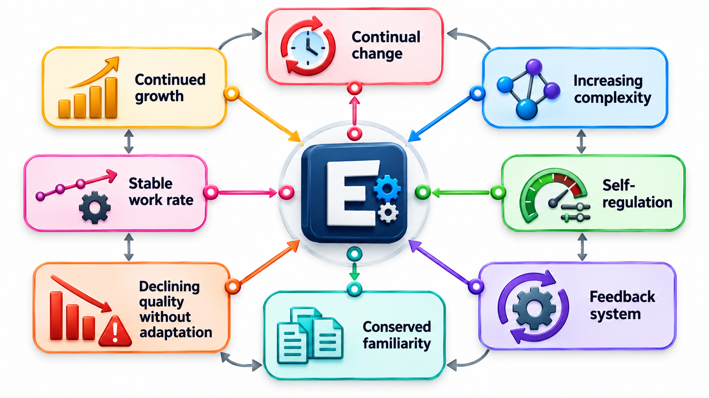
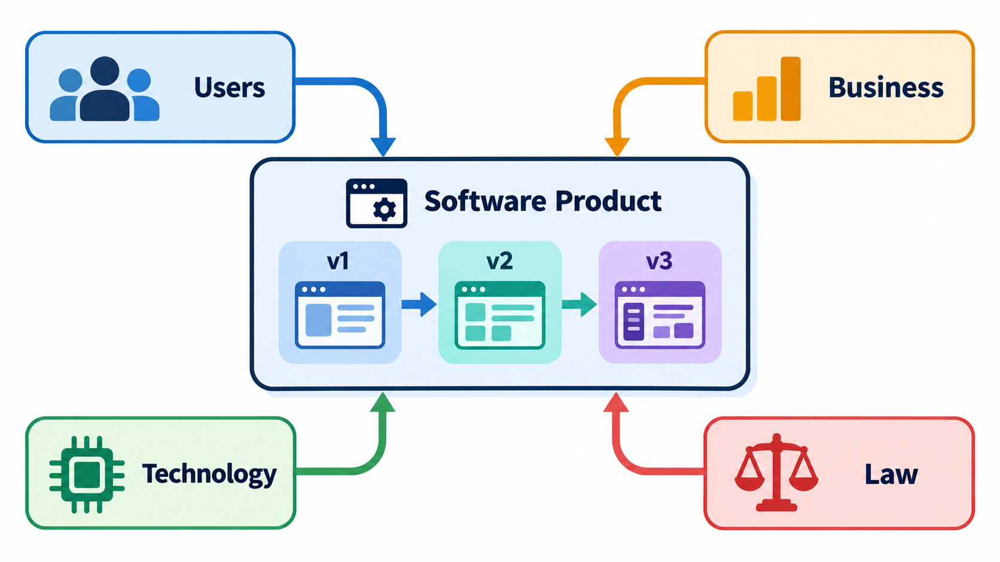
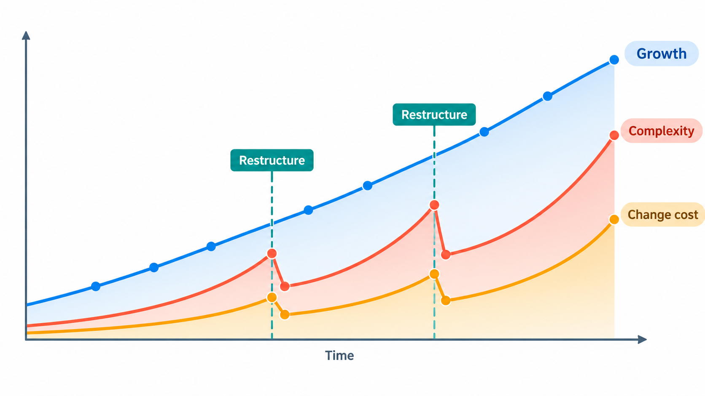
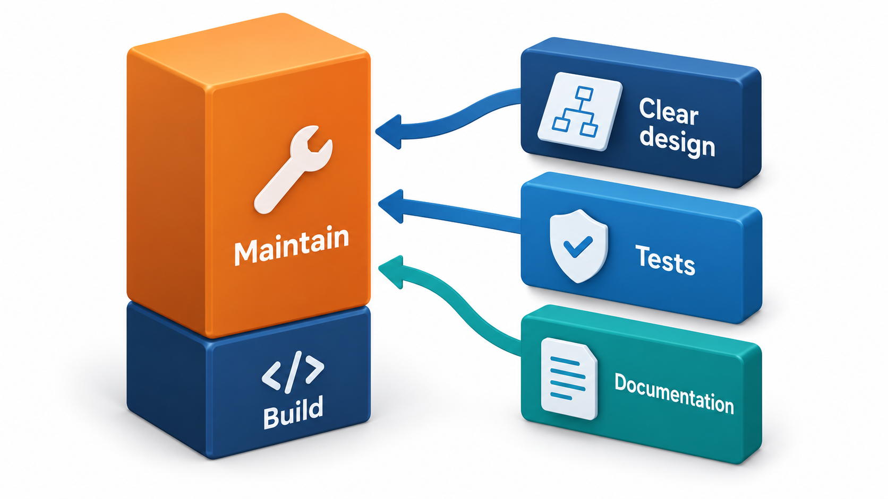
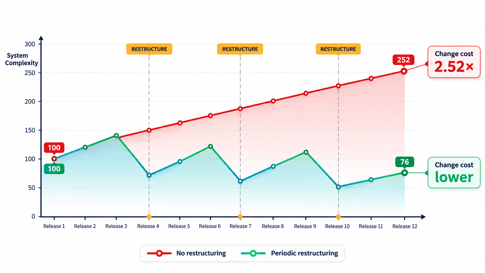

## Software Changes Follow Patterns

Large systems do not evolve randomly. When the researcher Meir Lehman and his colleagues studied the release history of IBM's large operating system OS/360 in the early 1970s, they noticed patterns that were not what managers expected. Growth from release to release followed a smooth curve, not the wild jumps of a project that everyone thought was out of control. Effort was spent in a steady way. And the number of modules that had to be changed in each release crept up as the system grew.

Over twenty years of further study, a series of statements called the **laws of software evolution** were set out. They are not laws of nature like those in physics. They are empirical regularities, observations about how large, real programs behave over time, backed by data. They have been debated and refined, and they remain a useful map of what to expect.

## The Central Idea: E-Type Systems

Lehman divided programs into kinds. One kind, which he called **E-type**, is a program that solves a problem in the real world and is embedded in it: a payroll system, a booking system, an operating system. Its requirements come from a world that is always changing, and it changes the world in turn, by being used. Such a program can never be finished. The other kinds, such as a program that computes a mathematical function, have a fixed specification and can be completed. The laws are about E-type systems, which means nearly all the software of business life.

| Kind | Specification | Can it be finished? | Example |
| --- | --- | --- | --- |
| **S-type** | Fixed and precise | Yes | A program that sorts numbers |
| **P-type** | A model of a problem, refined with experience | Mostly | A chess program |
| **E-type** | A reality that changes; the program changes it too | Never | A fee-management system |

## The Laws, in Plain Words

The laws were stated in the 1970s and early 1980s, with later additions. In summary:

| Law | What it says | What it means in practice |
| --- | --- | --- |
| **Continuing change** | A system in use must be continually adapted, or it becomes progressively less useful | Software that is not changed falls behind its environment |
| **Increasing complexity** | As a system changes, its complexity increases unless work is done to reduce it | Every change adds mess, so restructuring is needed |
| **Self-regulation** | Growth and other measures of a large system follow a regular, predictable pattern | Release sizes and effort are steadier than they feel |
| **Conservation of organisational stability** | The rate of work on a system tends to stay roughly constant over its life | Throwing more people at it does not speed it up much |
| **Conservation of familiarity** | The content of each release stays within what the team and users can absorb | Releases cannot grow without bound |
| **Continuing growth** | A system must keep growing in functionality to keep users satisfied | Users always want more |
| **Declining quality** | Quality appears to decline unless the system is actively adapted and maintained | Neglected software degrades |
| **Feedback system** | Evolution is a multi-level feedback process | Users, managers and developers all push back on the system |

Three of these matter most for a working engineer: *continuing change*, *increasing complexity* and *declining quality*. Together they say that software is not like a bridge, which, once built, just needs painting. It is more like a garden, which stays in order only while someone tends it.

<!-- Visual: software continuing to change as its environment changes. -->

## Seeing the Laws in a Small System

The laws can be recognised in the life of any system. Take a college fee portal over five years.

| Year | What happens | Which law |
| --- | --- | --- |
| 1 | Launch; used by one department | |
| 2 | Other departments ask for features; a new payment method arrives | Continuing change; continuing growth |
| 3 | Rules for scholarships pile up; changes take longer | Increasing complexity |
| 4 | A rewrite is proposed; meanwhile fewer features ship | Declining quality |
| 4 | Two more developers are added; output barely rises | Conservation of organisational stability |
| 5 | A very large release breaks several things and confuses users | Conservation of familiarity |

None of it is exceptional. It is the ordinary life of a system that people use.

## Complexity Needs Active Work

The second law has an important twist: complexity grows *unless work is done to reduce it*. Model the idea. A system gains 8 per cent complexity from each release of new features, starting at 100. A team that restructures removes 15 per cent of the complexity at a restructuring release. Over twelve releases:

| Approach | Complexity after 12 releases | A change then costs |
| --- | --- | --- |
| Never restructured | 252 | 2.52 times today's |
| Restructure every 6 releases | 182 | 1.82 times today's |
| Restructure every 3 releases | 131 | 1.31 times today's |

With no restructuring, complexity grows from 100 to 252, and a change costs 2.52 times what it does today, because the cost of a change follows complexity. The numbers are invented, but the pattern follows the second law: left alone, complexity rises, and restructuring is the work done to resist it. Teams that skip it find that every release is slower than the last. The model also shows a trade. A restructuring release adds no features. Its benefit is that all later work gets cheaper, which is why it is hard to justify and valuable to do.

## Why This Explains Why Maintenance Dominates

The laws explain the pattern seen in maintenance. A system is changed continually, since its world changes. Each change adds complexity. So the cost of change rises over time, unless effort goes into keeping the structure healthy. The lifetime cost of a system is therefore dominated by what happens after the first release, and the early design choices that make change cheap pay back the most.

The laws also give reasons for modesty about planning. Because effort and growth follow regular patterns, wild promises, like doubling the speed of delivery by doubling the team, run against the data. And because familiarity limits what users and teams can absorb, a very large release brings more problems than several smaller ones. This supports the case for small, frequent releases. The same warning appears in Fred Brooks's observation, known as Brooks's law, that adding people to a late software project makes it later, because the new people must be taught and the number of communication paths grows.

<!-- Visual: maintenance effort and cost over a long-lived system's life. -->

## Using the Laws

| Law | A practical response |
| --- | --- |
| Continuing change | Budget for change after release; do not treat the launch as the end |
| Increasing complexity | Schedule restructuring and refactoring regularly |
| Declining quality | Watch quality measures (defects, change time) as the system ages |
| Conservation of familiarity | Release in manageable pieces; prepare users for change |
| Conservation of stability | Do not plan on throwing people at a deadline |
| Continuing growth | Expect and plan for steady feature requests |
| Feedback system | Listen to users, monitoring and the team; do not rely on one source |

## Reading Your Own Project Through the Laws

A team can check the laws against its own data, with figures most version-control tools already hold.

| Measure | How to get it | What it tells you |
| --- | --- | --- |
| Size over time (lines or modules per release) | Count at each release | Whether growth is steady, slowing or accelerating |
| Changes per release | Count commits or tickets | Whether the pace of work is roughly constant |
| Time to make a typical change | Cycle time per ticket | Whether complexity is making work slower |
| Files changed together | Version history | Hidden coupling |
| Defects per release | Defect tracker | Whether quality is declining |

A flat line of work with a steadily rising time per change is the signature of the second and seventh laws at work. It is the signal to schedule restructuring, before the line becomes a wall.

## Do the Laws Still Hold?

Lehman's data came from large, proprietary systems of the time. Later researchers have tested the laws on open-source projects such as Linux and found support for some (continuing change, continuing growth) and mixed results for others (growth sometimes accelerates rather than slows). In the age of continuous delivery and cloud services, the pace of change is very different. But the underlying message has stood the test of time: software that is useful is software that keeps changing, and software that keeps changing needs deliberate care to stay healthy.

<!-- Visual: a line of system complexity over twelve releases rising steadily without restructuring and sawtoothing downward with periodic restructuring releases, with the cost of a change shown alongside. Save as images/127_complexity_with_and_without_restructuring.png. -->

## Five Misreadings of the Laws of Evolution

**"They are laws like gravity."** They are patterns observed in data, with exceptions. Treat them as strong expectations, not certainties.

**"A finished system is a stable one."** A system in use is never finished. If it stops changing, it is dying.

**"Complexity grows because developers are careless."** It grows because change adds structure. Good developers slow it, and restructuring reverses part of it.

**"Adding people will speed up evolution."** The law of stable work rates suggests otherwise, and Brooks's law agrees.

**"These apply only to old mainframes."** The studies were of such systems, but the patterns have been seen in modern open-source and web systems too.
