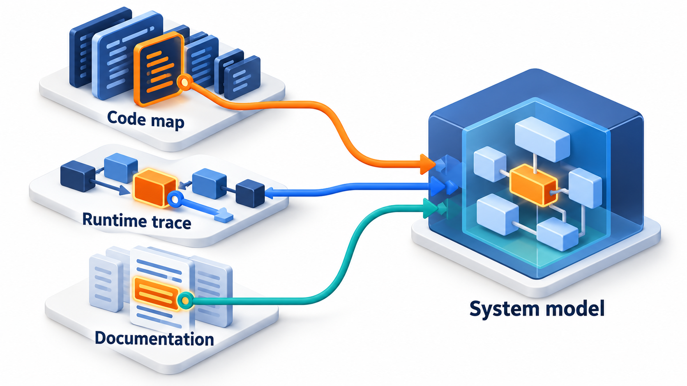
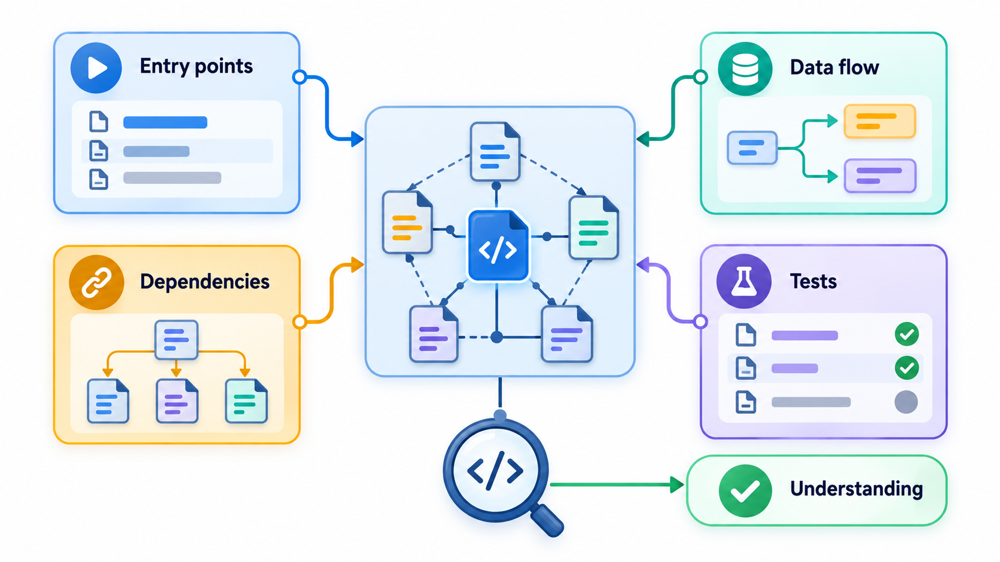
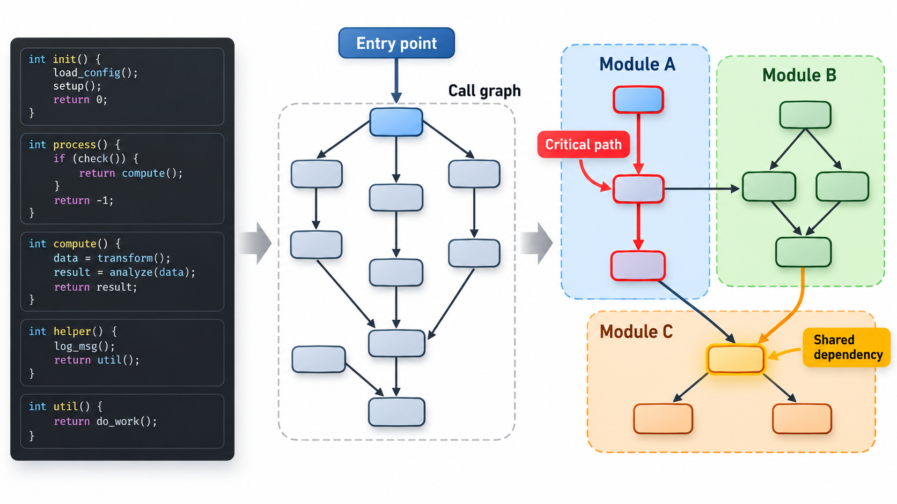
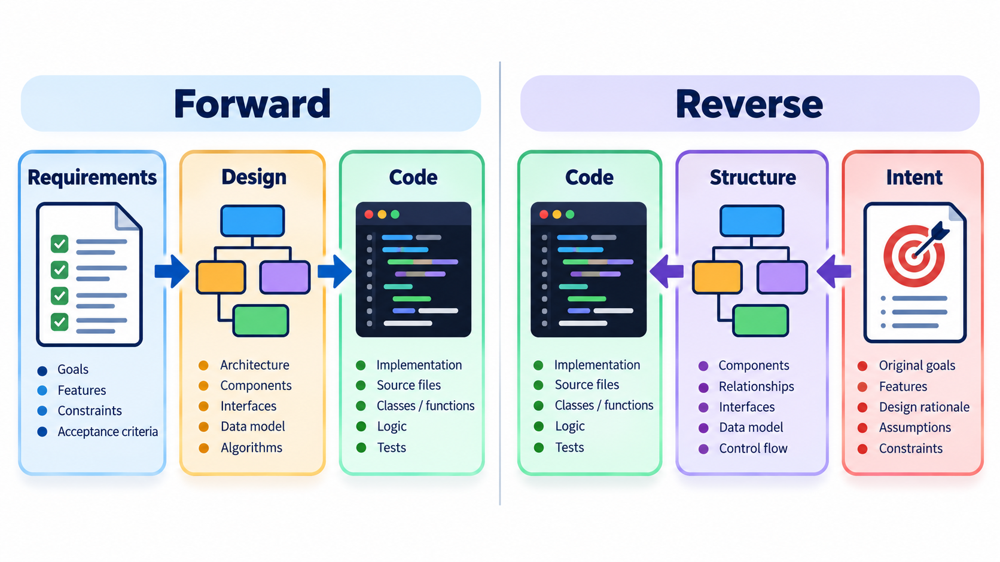
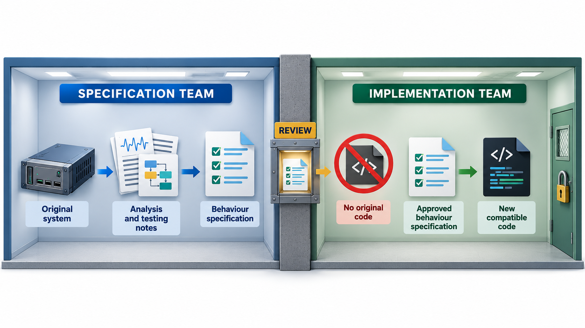

## Understanding Code You Did Not Write

Most of a developer's time is spent reading code, and much of it is code written by other people, long ago, with little explanation. **Program comprehension** is the process of understanding it: working out what it does and why, what depends on what, and where to start. **Reverse engineering** goes further: working out how a system works from the finished product, without its design documents, for instance to rebuild a compatible version, to recover lost knowledge or to find a security flaw.

One way of building a compatible product without copying is the "clean-room" method: one team studies the original and writes a precise specification of *what it does*, with none of its code, and a second team, who have never seen the original, builds new software from the specification alone. This topic covers both comprehension and reverse engineering.

## Understanding Is Most of the Work

Studies of how developers spend their time agree that a very large share, often more than half, goes into reading and understanding code, and only a small share into typing new code. When maintaining a system, the amount of reading is higher still. Comprehension is the bottleneck, and techniques that make it faster pay off directly.

Researchers have described how experienced developers go about it. They build a **mental model**: a picture of what the program is for, what its main parts are and how they fit. They use two strategies, often switching between them.

- **Top-down.** Start with a guess about what the program does (a billing system, so it must have customers, invoices and payments) and look for code that confirms it. This works when the domain is familiar.
- **Bottom-up.** Start with the code itself, read small pieces, work out what each does and group them into larger ideas. This works when the domain is unfamiliar.

Experts use clues, called *beacons*: a function called `sort`, a variable named `retry_count`, a familiar pattern. Good naming is therefore a gift to the next reader, since it supplies beacons.

| Strategy | Starts from | Works best when | Risk |
| --- | --- | --- | --- |
| **Top-down** | A hypothesis about the program's purpose | You know the domain | Confirmation bias: seeing only what you expect |
| **Bottom-up** | The code, line by line | The domain is unfamiliar | Getting lost in detail |
| **Opportunistic (mixed)** | Whatever clue is at hand | Real work, most of the time | Needs discipline to keep notes |

<!-- Visual: A developer's mental model of a program growing as they read. -->

## A Real Case: A Compatible Computer

In 1982 the company Compaq wanted to make a personal computer compatible with the IBM PC, whose built-in software (the BIOS) was protected by copyright. One team of engineers studied the original and wrote a precise specification of what it does, with none of its code, and a second team, who had never seen the original, built new software from the specification alone. This clean-room method produced a compatible machine without copying.

## Techniques for Reading Code

A set of practical techniques turns comprehension from wandering into a method.

- **Start from the outside.** Run the program, read the README, look at the tests and the folder layout.
- **Find an entry point** and follow the flow from there: the `main` function, the handler for a request, the code that responds to a button.
- **Read the tests.** They show how the code is used and what is expected of it.
- **Trace execution.** Run it in a debugger, or add prints, and watch what is called.
- **Draw it.** Sketch a call graph, a diagram of the main parts, or a table of the data. Drawing forces precision.
- **Take notes and rename.** Write down what you learn, and where it helps, improve names and add comments as you go.
- **Ask why.** Use the version history to find the reason behind odd code.
- **Make a small change** and see what happens. Experiments confirm understanding.

<!-- Visual: A process of program comprehension from first look to confident change. -->

## What Makes Code Hard to Understand

| Obstacle | Example | What helps |
| --- | --- | --- |
| Poor names | `x1`, `tmp`, `doIt` | Rename as you learn |
| Long functions | 400 lines doing many things | Extract pieces with names |
| Deep nesting | Five levels of `if` inside loops | Early returns; named conditions |
| Hidden state | Global variables changed from many places | Trace who writes them |
| Indirection | Callbacks, frameworks, reflection | Debugger and trace |
| Missing context | No record of why | Version history, people |
| Inconsistent style | Three ways to do the same thing | Note which is current |
| Dead code | Branches that never run | Coverage tools |

## Recovering Structure: A Call Graph

A **call graph** shows which functions call which. It is among the most useful pictures for understanding unfamiliar code, since it reveals the shape: where things begin, which functions are central and which are leaves. Tools generate it from the source. Take six short functions of a fee-calculation program with no explanation.

| Function | Calls |
| --- | --- |
| total due | base fee, late fine |
| base fee | nothing |
| late fine | fine per day, days late |
| fine per day | nothing |
| days late | nothing |
| report | total due |

Only the report is never called by another function, so it is the entry point. A reader now knows where to start reading, and the structure beneath it: report, then total due, then its two components. Searching for names is a rough method, since it can be fooled by comments or strings. Real tools parse the code properly, and draw the result as a diagram, but the idea is the same.

| Reading the graph | What it tells you |
| --- | --- |
| A function nothing calls | An entry point, or dead code |
| A function many call | A central helper; careful changes |
| A function that calls nothing | A leaf: easy to understand alone |
| A cycle | Mutual dependence; harder to understand either part alone |
| A long chain | Deep layering; a single operation crosses many functions |

## Reverse Engineering

Reverse engineering goes further than comprehension for one's own purposes. It aims to **recover the design** of a system from its implementation: its structure, its data, its behaviour. Uses include maintaining a system whose documentation is lost, understanding a file format or protocol, checking the security of a program, migrating a legacy system, and, as in the Compaq case, building a compatible replacement.

There are two broad directions of work.

- **Forward engineering** moves from requirements, through design, to code.
- **Reverse engineering** moves the other way: from code to design to requirements. It produces models at a higher level of abstraction: call graphs, class diagrams, data models, descriptions of business rules.

When the recovered design is used to restructure or rebuild the system, the combination is **re-engineering**.

<!-- Visual: forward engineering from requirements to code compared with reverse engineering from code back to design. -->

## Methods and Their Limits

Reverse engineering of code uses **static analysis**, which reads the code without running it, and **dynamic analysis**, which watches it run and records what happens. For software available only as a compiled program, tools called *disassemblers* and *decompilers* turn machine code back into something readable, though names and comments are lost, and the result is hard work to understand.

| Method | What it does | Strength | Weakness |
| --- | --- | --- | --- |
| **Static analysis** | Reads the code or binary without running it | Covers all paths | Misses what is decided at run time |
| **Dynamic analysis** | Runs the program and records behaviour | Shows real behaviour and data | Covers only the paths exercised |
| **Black-box observation** | Feeds inputs and records outputs | Needs no code | Hard to be complete |
| **Documentation and interviews** | Reads old documents; asks users and maintainers | Supplies the why | Memories fade; documents may be wrong |
| **Data analysis** | Examines files and database contents | Reveals real structure | Meaning is not always clear |

Two cautions apply. First, **the law**. Reverse engineering can touch copyright, licences and contracts. Some jurisdictions allow it for interoperability or security research, and many licences forbid it. Clean-room techniques exist for that reason. Take advice before reverse engineering software you do not own. Second, **the limits of recovery**. Code shows *what* the program does, and seldom *why*. Intent, business rules, and the reasons for decisions have to come from people and from history, which is why interviews and old documents are part of the job.

<!-- Visual: the clean-room method in two rooms: a specification team studying the original and writing a specification, a reviewer passing it through a wall, and an implementation team that never sees the original writing new code. Save as images/128_clean_room.png. -->

## Recovering Business Rules

In a legacy system, the most valuable thing to recover is often the set of business rules buried in code. A method is to read the code, state each rule in plain words, and have a business expert confirm it.

| Code seems to do | Rule in plain words | Confirmed by | Notes |
| --- | --- | --- | --- |
| Adds 5 per day after the 10th of the month, up to 100 | Late fine of Rs 5 a day, capped at Rs 100, starting after the due date | Accounts office | Cap found only in code |
| Skips students with code "S" | Scholarship students pay no late fine | Registrar | Not in any document |
| Rounds down to the nearest 10 | Fees are rounded down to Rs 10 | Nobody remembers why | Ask; may be a circular from years ago |

The third row is a warning. A rule that nobody can explain still has to be preserved until someone decides otherwise, because some customer may depend on it.

## Five Misreadings of Comprehension and Reverse Engineering

**"Good programmers understand code at a glance."** They have better strategies and a better mental library, and they still need time and tools.

**"Reverse engineering means hacking."** It is an ordinary maintenance activity, and the basis of interoperability. Legal limits apply.

**"The code tells you everything."** It tells you what the program does. The reasons live elsewhere.

**"Drawing diagrams is a waste when you can read the code."** A call graph shows the shape that line-by-line reading hides.

**"Comprehension is a one-off job."** The understanding fades. Notes, tests and clearer names keep what you have learned.
