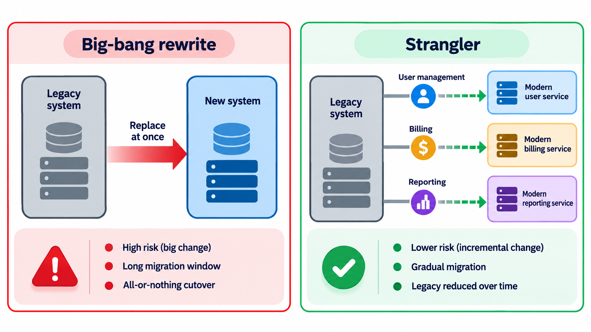
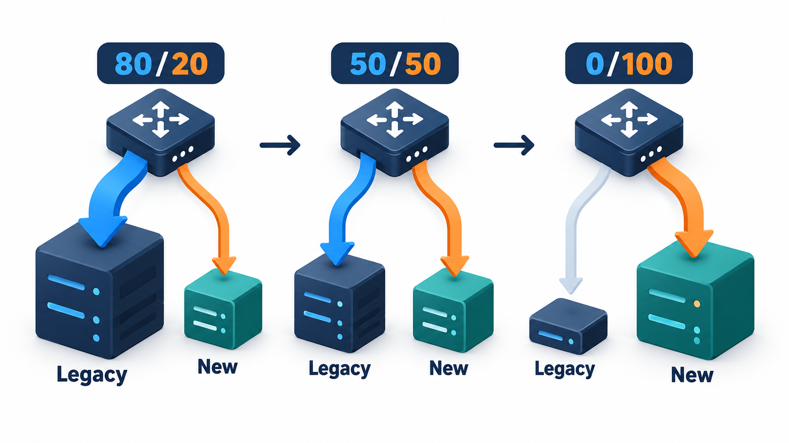
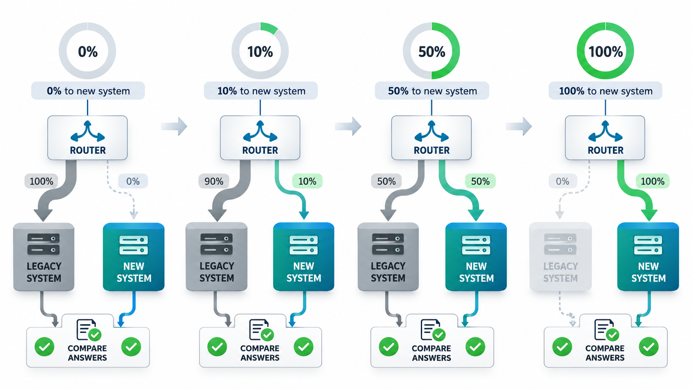
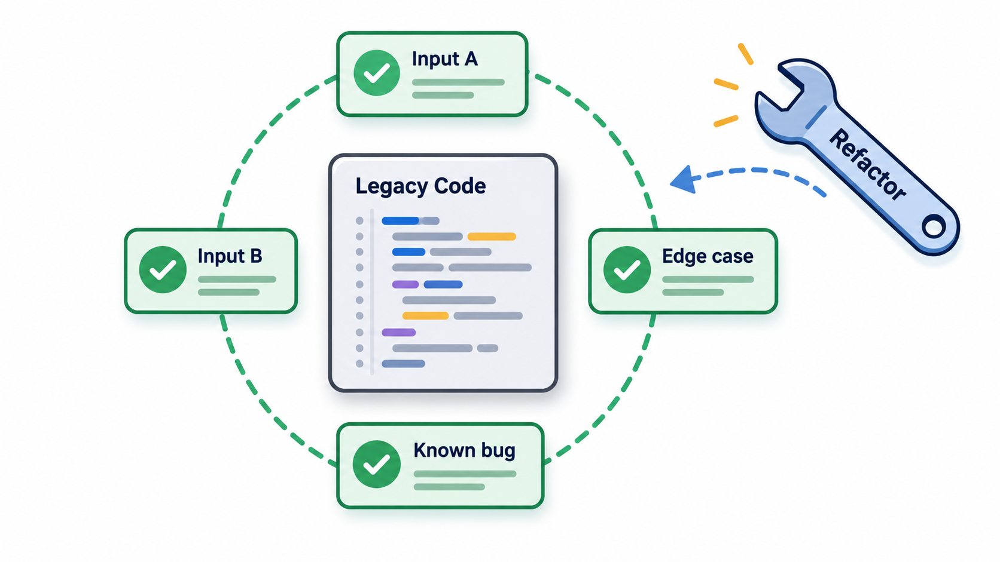
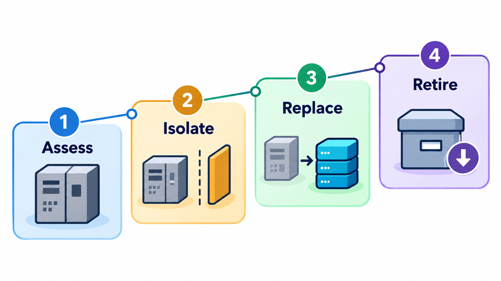

## Old, Essential and Hard to Change

Nearly every organisation of any age has **legacy systems**: software that is old, still essential, hard to change and often poorly understood. Replacing one is tempting and dangerous. A "big bang" replacement switches the old system off on a Friday and the new one on from the following Monday, and if the new system has not been properly tested for the load and conditions of real use, millions of people find out on Monday morning.

How to deal with legacy systems is one of the central decisions in software engineering. The choices run from leaving the system alone, to wrapping it, to re-engineering it piece by piece, to replacing it. This topic covers each, and the safer, gradual approach.

## What Makes a System Legacy

"Legacy" does not simply mean old. A legacy system is one that:

- is **critical**: the business cannot run without it;
- is **hard to change**: its structure has decayed, its tests are few and its knowledge is thin;
- uses **outdated technology**: languages, platforms or hardware that are no longer supported or fashionable;
- is **poorly documented**: the people who built it have gone.

The cost of such a system is the cost of everything it holds up: slow delivery of new features, rising maintenance costs, scarce skills and security risk. Yet it works, and it embodies years of business rules, many of which exist nowhere else. That is why the temptation to throw it away is strong and the danger of doing so is real.

## A Real Case: A Migration Over One Weekend

In April 2018 the British bank TSB moved the accounts of about five million customers from its old banking platform, which it had inherited from a former parent, to a new one. The bank had planned the migration for years and carried it out over a single weekend. When customers came back on the Monday, the new platform could not cope. Many could not log in to their online or mobile accounts at all. Others could see other customers' accounts or find their own balances wrong. Branch queues grew, the call centre was overwhelmed, and problems continued for weeks and, for some customers, for months. The chief executive left in the autumn, and the bank was later fined tens of millions of pounds by its regulators, who found that it had not managed the risks of the change properly.

The old system was not good, which is why it was being replaced. But its age was only part of the story. The migration was a single, large, one-way step, with a launch date fixed in advance. Testing had not shown how the new platform would behave under real load, the plan for going back was weak once customers' data had moved, and the cost of failure fell on the people least able to bear it.

| Choice TSB made | A common alternative |
| --- | --- |
| Move all customers in one weekend | Move small groups in stages and watch each |
| Replace the whole platform at once | Replace one function at a time, with the old system still running |
| Rely on pre-launch testing | Run the old and new systems side by side and compare their results |
| Fix the date and then manage the risk | Let the readiness of the system decide the date |

Legacy systems are a problem because they matter. Re-engineering them is a real engineering decision, with options between leaving them alone, wrapping them, moving them gradually and replacing them. The topic that follows sets out those options and the conditions under which each is sensible.

## Assessing a Legacy System

Before choosing an option, a team assesses the system on two axes: how valuable it is to the business, and how healthy it is technically.

| | Technically healthy | Technically poor |
| --- | --- | --- |
| **High business value** | Keep and maintain | Re-engineer, wrap or replace gradually: the hard case |
| **Low business value** | Leave alone | Retire: switch off or replace with something simple |

Signals of poor technical health include difficulty finding people who can work on it, long times to make small changes, frequent failures, unsupported platforms, and security fixes that cannot be applied. Signals of business value include revenue that depends on it, the number of users, and legal duties it fulfils.

## Four Options

An organisation facing a legacy system has choices. Each trades cost, risk and benefit differently.

| Option | What it means | Good when | Danger |
| --- | --- | --- | --- |
| **Keep and maintain** | Carry on, fixing and patching | The system is stable and changes are rare | Costs rise and skills disappear |
| **Refactor** | Improve the internal structure step by step, without changing behaviour | The core is sound but messy, and has or can get tests | Slow, and cannot fix a fundamentally wrong platform |
| **Wrap** | Leave the old system as it is and put a modern interface around it, such as an API | The logic is fine and access is the problem | The old system remains and keeps its costs |
| **Replace (rewrite)** | Build a new system and switch over | The old technology is a dead end and the business has changed | Huge cost and risk, loss of hidden rules |

Often the answer is a combination, applied to different parts of the system.

<!-- Visual: choosing between rewriting a legacy system and replacing it gradually. -->

## The Danger of the Big-Bang Rewrite

The most seductive option is the clean slate. The old code is a mess; surely a fresh start with modern tools will be quicker than fixing it. The record says otherwise. In 2000 the software writer Joel Spolsky wrote an essay called "Things You Should Never Do, Part I", about Netscape's decision to rewrite its browser from scratch. The rewrite took about three years, during which the company released no significant new version while Microsoft's browser caught up. Netscape lost its lead. His argument was that old code looks ugly because it has been tested and fixed: every odd line is a bug that was found and removed in use. A rewrite throws away that knowledge and starts finding the same bugs again.

Big-bang replacements fail for several reasons. They take longer than planned. The old system keeps changing in the meantime, so the target moves. The new system lacks hidden rules the old one had. All the risk is faced on one day. And there is no value delivered until the end.

| Why big-bang fails | What happens |
| --- | --- |
| **Underestimated scope** | The old system does more than anyone remembers |
| **Moving target** | Business changes continue during the rewrite |
| **No early value** | Years pass with nothing delivered |
| **All risk at once** | One cut-over day decides everything |
| **Lost knowledge** | Fixes made over the years are not reproduced |
| **Team fatigue** | A long project without wins loses people and funding |

## The Strangler Approach

Martin Fowler gave a name to a safer alternative, the **strangler fig** pattern, after a tree that grows around a host and gradually replaces it. Instead of replacing the old system at once, you build the new one *around* it. A routing layer sits in front. Initially all requests go to the old system. Then you replace one function or one slice, send the requests for that slice to the new code, and leave the rest. Slice by slice the new system takes over, and the old one shrinks until it can be switched off.

The advantages are large: value is delivered continuously, each step is small and can be reversed, and the old system stays as a fallback. A powerful companion technique is the **parallel run**: send the same request to both old and new, return the old answer, and compare the new one in the background. Disagreements expose bugs in the new code without any user being affected.

Take a legacy fee calculation and a rewrite that should give the same answers, but has a hidden bug for exactly 13 credits. Requests come in for 2, 4, 6, 8, 10, 13, 15 and 16 credits, and a growing share goes to the new code.

| Share of requests on the new code | Requests the new code serves | Mismatches against the old |
| --- | --- | --- |
| 0% | None | None |
| 25% | First two (2 and 4 credits) | None |
| 50% | First four (2, 4, 6, 8) | None |
| 100% | All eight, including 13 credits | The request for 13 credits |

At 100 per cent the request for 13 credits reaches the new code and the mismatch is reported. The comparison caught the bug before every customer met it. Had the cutover been a single weekend, 13 credits would have been wrong for everyone at once. The staging of the share is what makes the approach safe. Each increase is a small risk, with a check, and a quick return to the old code if something is wrong.

<!-- Visual: A strangler route gradually sending requests from the legacy system to the new one. -->

## A Migration Plan in Slices

A slice-by-slice plan for a fee portal might look like this.

| Slice | Order | Why this position | Safeguard |
| --- | --- | --- | --- |
| Read-only receipts page | 1 | Low risk; no data changes | Parallel run for a month |
| Student login | 2 | Self-contained; high use | Old login kept as fallback |
| Fee calculation | 3 | Core logic; many hidden rules | Characterisation tests; parallel run |
| Payments | 4 | Highest risk; needs the earlier slices | Start with 1% of traffic; kill switch |
| Reports | 5 | Depends on all data | Run beside the old for a full term |
| Retire the old system | 6 | Only when no traffic remains | Archive data first |

Easy and low-risk slices come first to build confidence and learn, and the riskiest slice comes when the team has the most experience.

<!-- Visual: a router in front of a legacy system and a new system, with a dial showing the share of traffic sent to the new one rising from 0 to 100 per cent over several steps, and a comparison box that checks both answers. Save as images/129_router_and_dial.png. -->

## Related Techniques

**Branch by abstraction.** Put an interface in front of the part you want to replace, make the old code implement it, write the new implementation behind the same interface, and switch between them with a flag. Both live in the codebase at once, and the main branch stays releasable.

**Characterisation tests.** Before touching legacy code, write tests that record what it *currently does*. They are a safety net for refactoring and a check against the rewrite. They encode behaviour, hidden rules included.

**Seams.** Find places in the code where behaviour can be changed without editing it, such as an interface or a function that can be replaced in a test. A seam is where you can get a grip on tangled code.

**Automated codemods.** For large mechanical changes, such as renaming an API used in thousands of files, write a script that makes the change across the whole codebase and review the results, instead of editing by hand.

<!-- Visual: characterisation tests recording what a legacy routine does now. -->

**Data migration in stages.** Move data gradually, keep both copies in step for a while, and verify before cutting over. The TSB migration moved everything in one weekend, and the weakness of that approach showed.

<!-- Visual: migrating a system in stages with checks between them. -->

