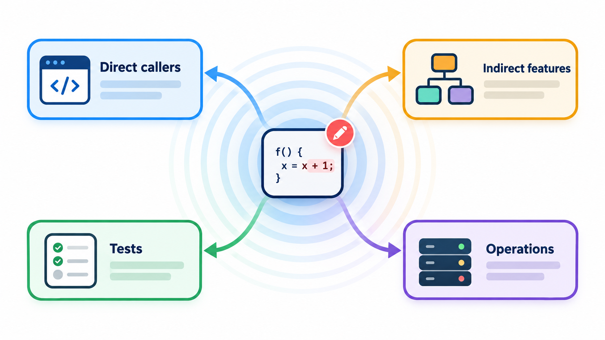
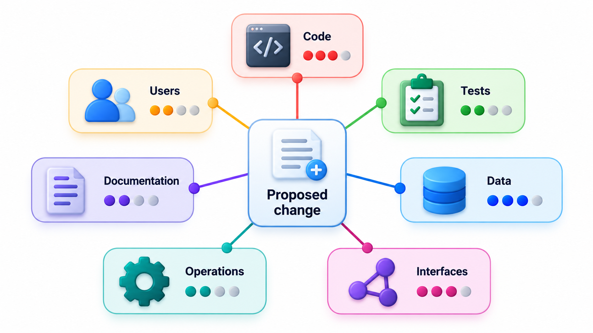
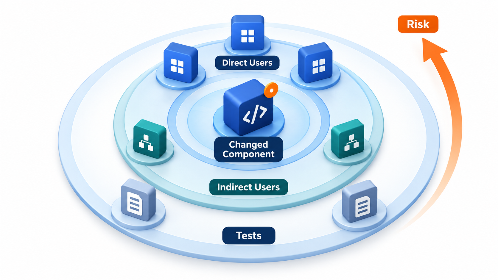
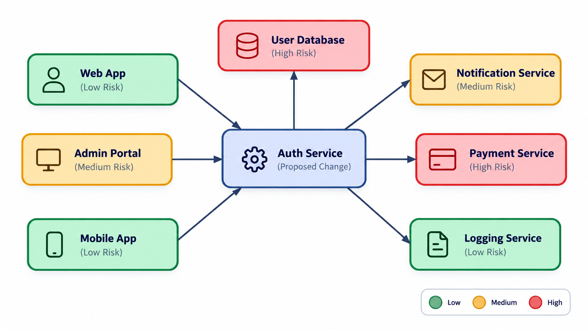
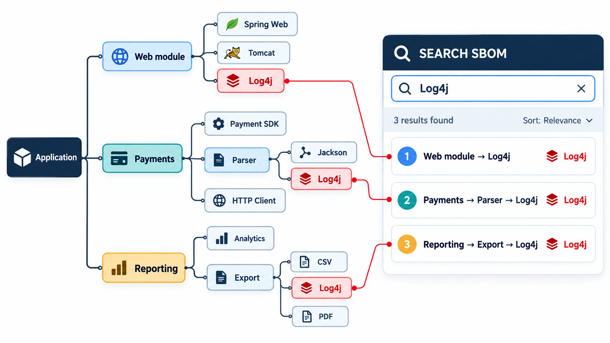

## Before You Change It, Find What Else It Touches

Every change raises the same question: what else will this affect? Sometimes the answer is easy, because a change to one screen touches only that screen. Sometimes it is very hard, because the thing being changed is buried inside other things: a library included inside other libraries, inside applications built by suppliers, inside products bought from vendors, many levels down. Fixing a flaw may be a version update; finding the places that needed the fix can take weeks.

**Change impact analysis** is working out, before or during a change, what else will be affected. This topic looks at how to answer it, in the small (a change to one function) and in the large (a flaw in a library at the bottom of the stack).

## The Question

Every change has a *planned* effect and a set of *consequences*. A new fee rule is meant to change the fee calculation, and it might also change the report totals, the receipts, an export that another team uses and a test that quietly depended on the old rule. Impact analysis tries to find those consequences in advance. It supports three decisions:

- **How big is the change?** An estimate of effort depends on how much is touched.
- **What must be tested?** The affected parts need re-testing, and the unaffected parts need not be.
- **How risky is it?** A change that reaches many central modules is riskier than one in a corner, and may call for more care, more review or a staged release.

<!-- Visual: ripples spreading outward from a change through the modules that depend on it. -->

## A Real Case: Where Do We Use It?

In December 2021 a serious flaw, nicknamed Log4Shell, was announced in Log4j, a logging library used inside an enormous number of Java programs. Organisations had to answer "where do we use it?", and the library was rarely a direct choice. Those with an inventory of their components answered in minutes; the rest searched for weeks.

## Following the Dependencies

The main technique is to follow dependencies in reverse. If module A uses module B, a change to B can affect A. So starting from the changed module, you look for everything that depends on it, then everything that depends on those, and so on, until no new modules appear. The distance from the change is a rough measure of how direct the effect is. Take a small system.

| Module | Uses | Tests covering it |
| --- | --- | --- |
| Screens | Fees, reports | 5 |
| Reports | Fees, database | 8 |
| Fees | Rates, database | 12 |
| Exports | Reports | 3 |
| Rates | Nothing | 4 |
| Database | Nothing | 6 |

| If this changes | Modules affected, by distance | Tests to re-run |
| --- | --- | --- |
| Rates | 5 modules: fees (1 step away), screens and reports (2), exports (3) | 32 |
| Exports | Only itself | 3 |

A change to a low-level shared module has a large blast radius, and a change to a leaf, which nothing else uses, has a small one. This is a reason to be careful with foundations, and to keep them small and well tested.

## Walking the Graph, Step by Step

The search for affected modules is a simple repeating process.

| Step | Modules known to be affected | Who uses any of them? |
| --- | --- | --- |
| Start | Rates | Fees uses Rates |
| 1 | Rates, Fees | Reports and Screens use Fees |
| 2 | Rates, Fees, Reports, Screens | Exports uses Reports; Screens also use Reports |
| 3 | Rates, Fees, Reports, Screens, Exports | Nobody else |
| Stop | Five modules | |

The tests to re-run are those for the five modules (4 + 12 + 8 + 5 + 3 = 32). The Database module is not affected, since Rates does not depend on it and a change to Rates does not alter it.

## Kinds of Impact

Dependency tracing finds the direct, code-level consequences. A thorough analysis looks wider.

| Kind of impact | Question | Example |
| --- | --- | --- |
| **Code** | Which modules call or use the changed code? | Everything that uses the fee rule |
| **Data** | Are formats or schemas changed? | A new column, a changed meaning of a field |
| **Interfaces** | Do other systems or teams rely on it? | The API that a partner calls |
| **Tests** | Which tests cover it, and which will need updating? | Tests with the old fee hard-coded |
| **Documentation and training** | What descriptions will become wrong? | The help page and the user guide |
| **Operations** | Does it change how it is deployed, monitored or backed up? | A new configuration setting |
| **People and process** | Who must be told? | The support team, the accounts office |

Not all of these can be found by a tool. Some need conversations with the people who own the neighbouring parts.

## Techniques and Tools

**Static dependency analysis.** Tools read the code and build a graph of who uses what, so "find all usages" is automatic. This is reliable for direct references and less so for indirect ones, such as code that calls a function by a name held in a string, or through configuration.

**Traceability links.** If requirements, design, code and tests are linked, a change to a requirement points to everything built from it.

**Test coverage maps.** Tools can record which tests run which code, so that a change to a function suggests exactly the tests to re-run.

**Dependency inventories.** For libraries, a *software bill of materials* (SBOM) lists every component in an application, including nested ones. With it, the question "where do we use Log4j?" becomes a search, not an investigation. After Log4Shell, many organisations began to keep such inventories.

**History.** Version control shows which files tend to change together. A file that is nearly always modified along with another has a hidden link that no import statement shows.

**Asking people.** The person who knows the system will often name a consequence the tools cannot see.

| Technique | Finds | Misses |
| --- | --- | --- |
| Static dependency analysis | Direct references in code | Dynamic calls, configuration |
| Coverage maps | Tests that exercise the code | Code with no tests |
| SBOM | Libraries and versions in use | How the library is used |
| Co-change history | Hidden coupling | New code with no history |
| Interviews | Business and social dependencies | Anything nobody remembers |

<!-- Visual: the cone of impact widening from a change to the parts that may need review. -->

## From Impact to Estimate and Risk

Once the impact set is known, it supports an estimate: effort for the change itself, plus the effort to update affected modules, tests and documents, plus the effort to retest. It also supports a risk judgement. A common way is to place changes on a map of *how much is affected* against *how well it is tested*. A change that reaches many modules in poorly tested code is the danger zone, where the best response is to write tests first, or to make the change in smaller pieces, or to release it behind a feature flag.

| | Well tested | Poorly tested |
| --- | --- | --- |
| **Few modules affected** | Low risk: go ahead | Moderate: add a test first |
| **Many modules affected** | Moderate: review and staged release | High: write tests, split the change, use a flag |

<!-- Visual: A map of change risk by how widely a change reaches and how well it is covered by tests. -->

## Limits

Impact analysis is never complete. Dynamic behaviour, such as reflection or plug-ins loaded at run time, hides dependencies. Data flows through databases and message queues without appearing as calls. Other teams use your interface in ways you do not know. So the analysis gives a starting estimate, to be backed up by testing, staged release and monitoring. The aim is to be wrong less often and to find out quickly when you are.

<!-- Visual: a software bill of materials as a tree with an application at the top and nested libraries below, with a searchable list on the side, and the library Log4j highlighted in three places at different depths. Save as images/130_sbom_tree.png. -->

## Five Misreadings of Change Impact Analysis

**"A tool will find everything affected."** Tools find direct, static links. Dynamic and human dependencies need judgement.

**"Small changes have small impacts."** A one-line change to a shared foundation can reach everything. Size and reach are different.

**"Impact analysis is only for big projects."** Asking "what else uses this?" before every change is the same habit at small scale.

**"If the tests pass, nothing else was affected."** Only if the tests cover what was affected. Weak tests hide impact.

**"We know our dependencies."** Log4Shell showed how many organisations did not. Keep an inventory.
