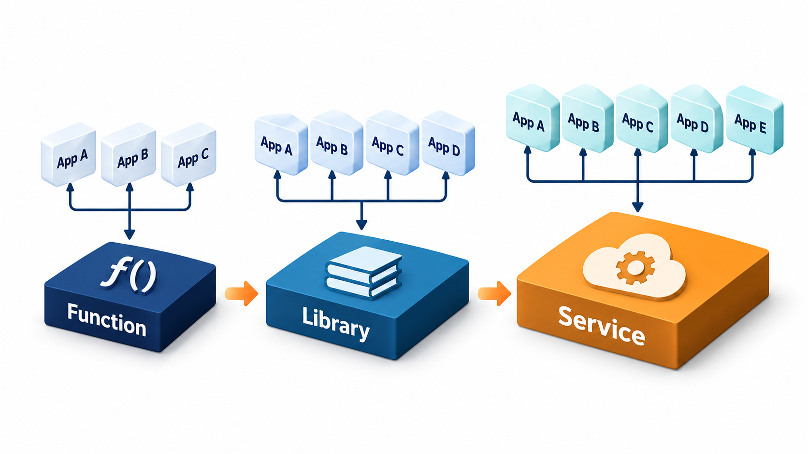
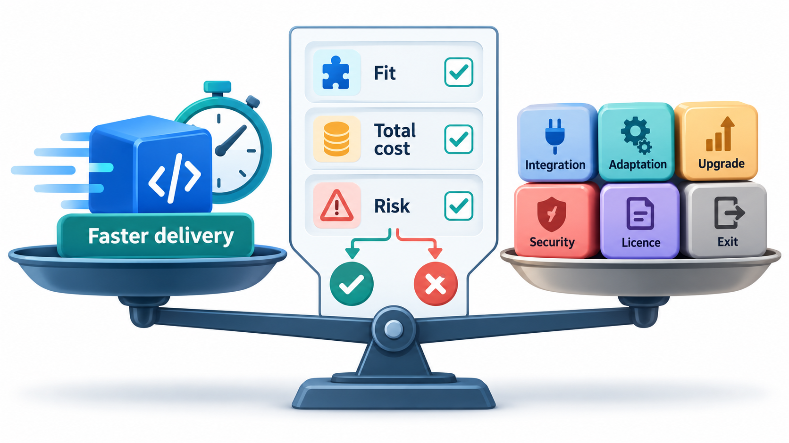
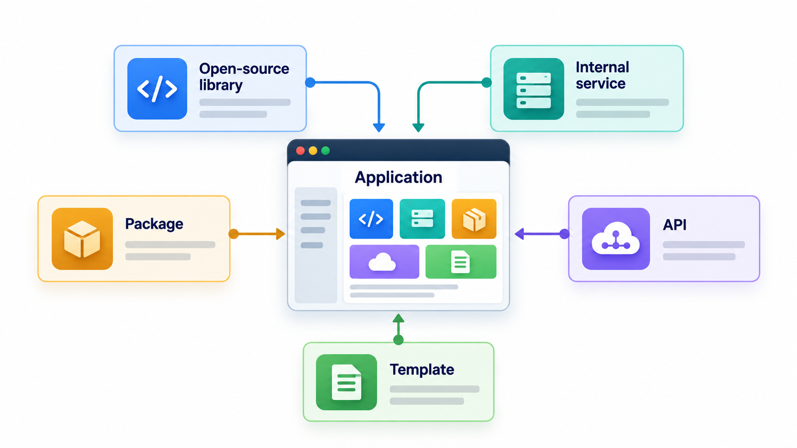
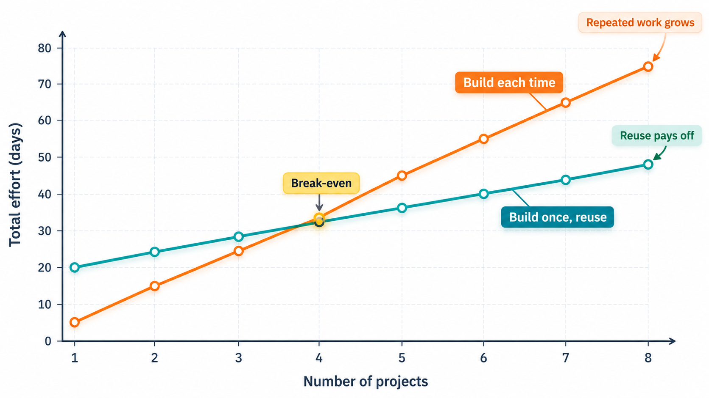
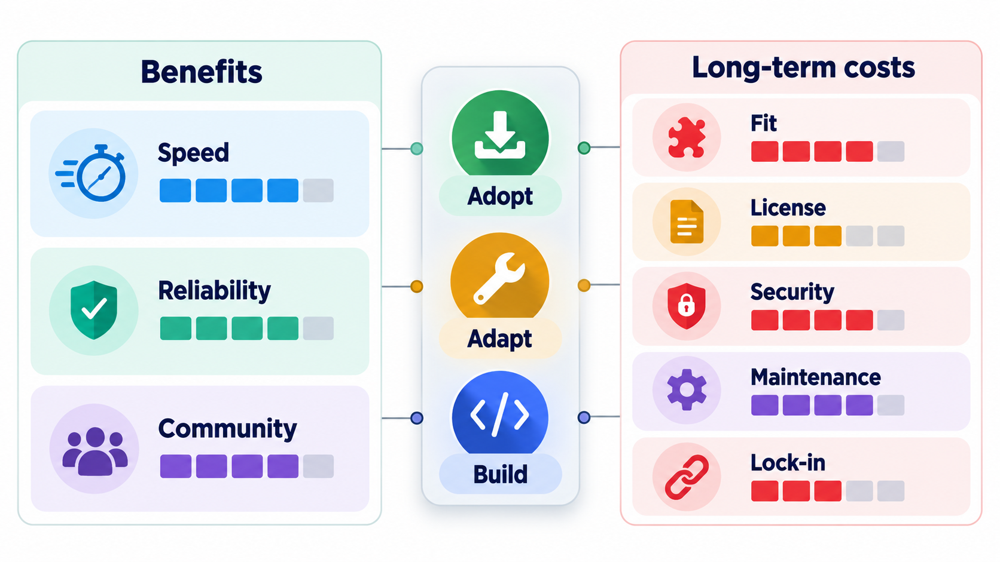

## Build It Once, Use It Many Times

Hardware engineers build computers from standard components, catalogued and ordered by number. For a long time software people kept writing the same routines over and over, each time slightly differently. The proposal that software, too, should be assembled from well-made standard parts has largely come true, though not as first imagined. The catalogues are package registries with millions of components, and a modern application is mostly assembled from other people's code.

**Software reuse** is using existing software, in whole or in part, instead of building new. It is the greatest productivity gain in the history of programming, and it is harder than it looks. This topic covers the forms of reuse, why it is hard, and when it pays.

The idea was put forward at a 1968 conference on software engineering by Douglas McIlroy of Bell Labs, who argued that the industry should have a catalogue of standard routines, as other engineering fields do. Half a century later, sites that host millions of packages are the realisation of that proposal, and the gain is real: most of the code in a typical new application was written by someone else.

## Levels of Reuse

Reuse happens at many scales.

| Level | What is reused | Example |
| --- | --- | --- |
| **Code snippets** | A few lines copied | A sort routine from a book |
| **Functions and libraries** | Tested code called by your program | A date library, an encryption library |
| **Components and services** | Larger pieces with an interface, running in or beside your program | A payment gateway, a mapping service |
| **Frameworks** | A skeleton that provides the structure and calls your code | A web framework |
| **Platforms and products** | Whole systems, configured and extended | An ERP or a content management system |
| **Designs and knowledge** | Architecture, patterns, requirements | Design patterns, a reference architecture |

The higher the level, the greater the saving when it works, and the greater the commitment: a framework shapes your whole program, while a function can be replaced in an afternoon. A copy-pasted snippet is the cheapest to take and the most expensive to keep, since fixes to the original never reach the copies.

<!-- Visual: levels of reuse from copied code to whole platforms. -->

## Benefits

The benefits are well known. Development is faster, since you do not build what already exists. Reused code, used by many, has had many bugs found and fixed. A good library embodies expertise that you may not have: encryption written by experts is safer than encryption written by you. Using standard components also makes systems more consistent and easier for newcomers to understand.

| Benefit | Example |
| --- | --- |
| **Speed** | A payment library saves months of building and certifying |
| **Quality** | A popular parsing library has had thousands of users find its bugs |
| **Expertise** | Security code written by specialists |
| **Focus** | The team builds what is unique to its product |
| **Standardisation** | New staff already know the framework |

## Why Reuse Is Harder Than It Looks

The costs are less obvious.

- **Finding.** You must know the component exists, and judge whether it fits.
- **Understanding.** You need to learn how it works, and its documentation may be poor.
- **Adapting.** It almost never fits exactly. You write glue code, and work around its assumptions.
- **Depending.** You inherit its bugs, its release schedule, its licence and the risk that it is abandoned. If it changes, you must follow.
- **Making something reusable.** Code written for one purpose is not automatically reusable. To be reused it must be general, documented, tested and stable, and that costs more, often two or three times as much as building for a single use.
- **The "not invented here" problem in reverse**, the habit of reusing anything without asking whether it fits.

The last point leads to a question of arithmetic. When is it worth paying to make something reusable? Compare building a component for each project with building it once in a reusable form. Building a one-off version takes 10 days. Building a reusable one takes 30, about three times more, for documentation, tests and a clean interface. Each later reuse costs 2 days to learn, adapt and integrate it.

| Projects using it | Build each time | Build once, reuse |
| --- | --- | --- |
| 1 | 10 days | 30 days |
| 2 | 20 days | 32 days |
| 3 | 30 days | 34 days |
| 4 | 40 days | 36 days |
| 5 | 50 days | 38 days |
| 8 | 80 days | 44 days |

For one project, the reusable version is a loss. At three projects it is still behind (30 days against 34), and at four it pulls ahead (40 against 36). By five projects the gap is clear: 50 days against 38. The break-even is at about four uses. The lesson is the one that experienced engineers repeat: do not generalise until you have at least two or three real uses. A component built for imagined reuse costs more and often fits none of the actual needs. The numbers are assumptions, and the pattern, a high up-front cost repaid over many uses, is typical.

## Frameworks, Components and Inner Source

**Frameworks** provide a reusable skeleton, and their characteristic is *inversion of control*: the framework calls your code, not the other way round. A web framework receives the request and calls your handler. They give a great deal of structure for free and demand that you follow their conventions.

**Components** are units with a defined interface that can be plugged in and replaced. The healthy form is a small interface hiding a lot of implementation.

**Inner source** applies open-source practices inside a company. Teams share code across the organisation, with visible repositories, contribution guides and review by the owning team, so that a team that needs a change can propose it instead of copying and diverging. It captures reuse benefits where the shared component belongs to the company.

**Open source** is the largest reuse mechanism of all. It brings licence questions: some licences allow free use, and some demand that your own code be opened if you use theirs. Reading and tracking the licences of what you reuse is part of the job.

| Form | Who owns it | Strength | Caution |
| --- | --- | --- | --- |
| Library | A project or vendor | Replaceable; you call it | Version and licence tracking |
| Framework | A project or vendor | Large saving | Shapes your whole design; hard to leave |
| Internal shared component | Your company | Fits your needs | Needs an owner and support |
| Inner source | Shared across teams | Avoids forks | Needs contribution rules |
| Open-source product | Community | Free to use | You may need to maintain your own patches |

<!-- Visual: an ecosystem of reusable components around a product. -->

## Making Code Reusable

If code is to be reused by others, certain qualities are needed.

| Quality | What it means |
| --- | --- |
| **Clear purpose** | It does one thing and says what |
| **Small, stable interface** | Callers do not depend on its insides |
| **Few dependencies** | It does not drag in a large tree |
| **Documentation with examples** | A newcomer can use it in minutes |
| **Tests** | Users trust changes |
| **Versioning and a changelog** | Users know what a release changes |
| **Someone responsible** | Questions and fixes have a home |

Without an owner, a shared component slowly rots, and the teams that use it start to copy it, which is the failure that reuse was meant to prevent.

## Deciding Whether to Reuse

A short list of questions helps.

<!-- Visual: a bar chart of total days against the number of projects for "build each time" rising steeply and "build once, reuse" starting high and rising slowly, crossing between three and four projects. Save as images/131_reuse_breakeven.png. -->

1. Does it do what we need, or only most of it?
2. How well maintained is it: recent releases, active maintainers, responsive to issues?
3. How big and complicated is it compared with what we use of it?
4. What is the licence, and is it compatible with our use?
5. How hard would it be to replace if it fails us? Is there an interface of our own around it?
6. What are the security record and the cost of keeping it up to date?
7. Could we build the part we need in a few days, with less dependency?

Wrapping a reused component behind a small interface of your own limits the damage if you ever need to change it.

<!-- Visual: A reuse decision weighing fit, cost and risk. -->

