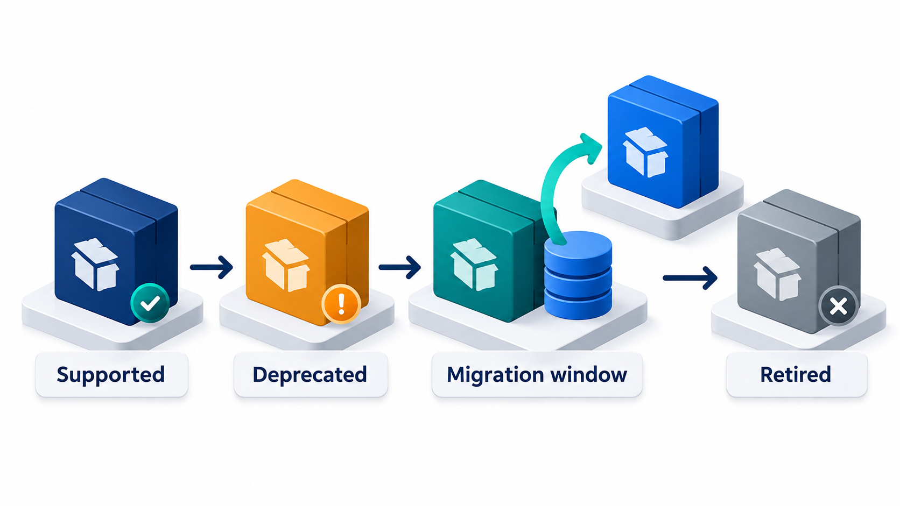
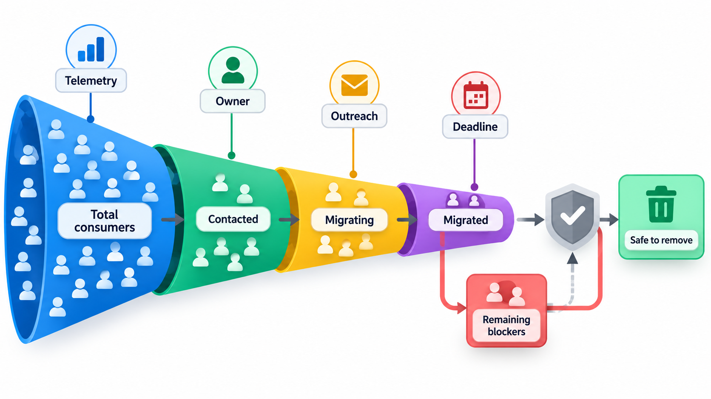
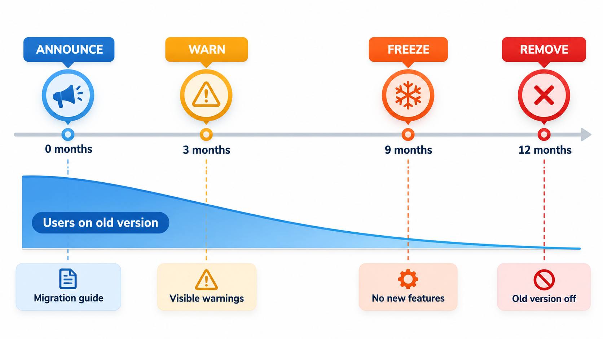
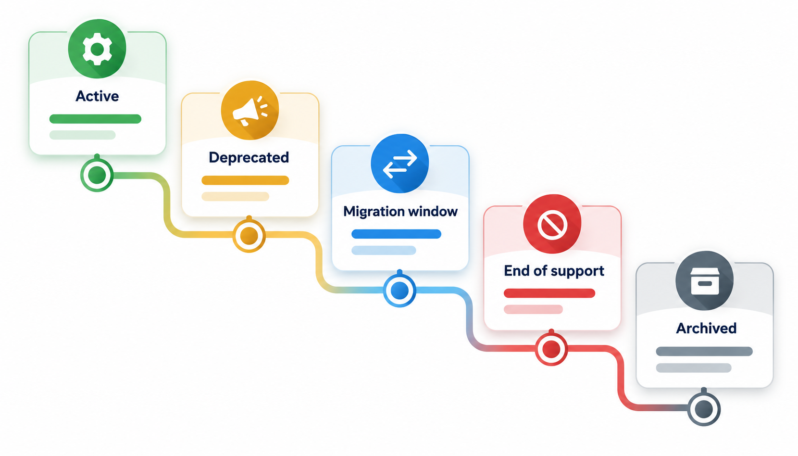
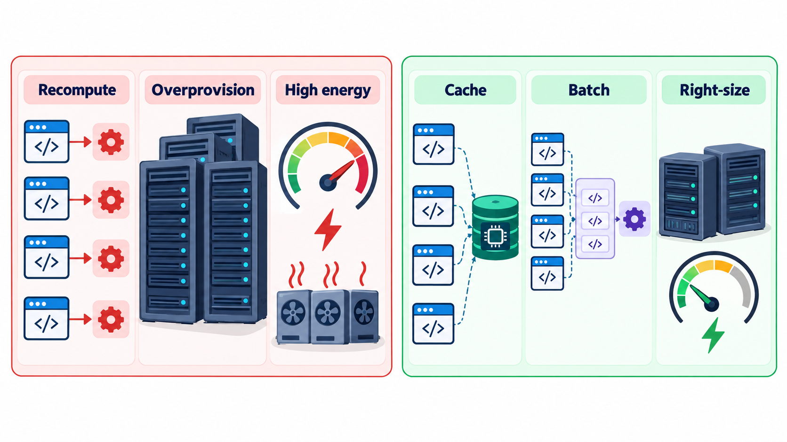

## The Hardest Part of Software Is Taking Things Away

Features, interfaces, versions and entire products need to be retired, and the people who depend on them did not choose to be disturbed. Sometimes a platform deliberately breaks compatibility to fix design mistakes that could not be repaired any other way; the old version is declared dead on a date, and some organisations are still running it years later. A retirement plan always takes longer than planned, because the cost of moving is borne by people who never asked for it.

**Software deprecation** is the practice of retiring something in a planned, communicated and humane way. This topic covers how to announce it, how to warn users, how long to wait, and how to write a policy.

## Why Things Must Be Retired

Keeping everything for ever sounds kind and is not sustainable.

| Reason | Example |
| --- | --- |
| **Security** | An old encryption method is found to be breakable |
| **Maintenance cost** | Supporting five generations of an interface slows every change |
| **Better replacement exists** | A new API fixes design mistakes |
| **Platform change** | A browser stops supporting a technology |
| **Low use** | A feature used by 0.1% of customers costs more than it earns |
| **Legal change** | A data-handling rule makes a feature unlawful |

## A Real Case: Python 2 to Python 3

When the designers of the Python programming language released version 3 in December 2008, they chose to break compatibility on purpose. Some early choices in version 2 had been mistakes that could not be repaired without changing the meaning of existing programs, such as how text and numbers were represented, and they judged that a clean break would serve the language better in the long run than endless patches. The price was that programs written for the old version would not run on the new one without changes.

The migration was slow. Large organisations had millions of lines of Python 2, and many of their dependencies had not yet moved. The old version was kept going with updates for years, and its planned end date was postponed from 2015 to 1 January 2020, when the maintainers finally declared it unsupported. Some organisations were still running it afterwards, with no security fixes from the people who had written it, and some paid companies to keep supporting it.

| Stage | What happened | General lesson |
| --- | --- | --- |
| Announcement | A new version, deliberately not compatible with the old | Say clearly what will break and why |
| Transition | Years of both versions side by side, with tools to help convert | Give users tools and time to move |
| Extension | The end date was moved once, to match real progress | A date that nobody can meet loses credibility |
| End of life | Declared on a fixed day | A stated date is what makes users act |
| After | Some users stayed, without support | Staying behind has a cost, and it falls on the user |

Deprecation is the planned retirement of a feature, an interface or a whole product. Done well, it respects the people who depend on the old thing. The topic that follows covers how to announce it, how long to wait, how to help users move and how to be honest about what it will cost them.

## Deprecation and Its Stages

To **deprecate** something is to mark it as obsolete and discourage its use, while it still works. It is a signal: this will go away, so plan to move. The life of a feature that is being retired normally has stages.

1. **Announce.** Say that the feature is deprecated, why, and what to use instead. Give a date.
2. **Warn.** Make the product itself say so: a warning when the old function is called, a notice in the documentation, an email to known users.
3. **Support the move.** Provide a migration guide, a tool to convert, and a replacement that is really ready.
4. **Freeze.** Stop adding to the old feature. Fix serious problems, but nothing more.
5. **Remove, or end of life.** On the stated date, switch it off. The consequences should by now be small, because users have had time.

<!-- Visual: the path of a feature from announcement through warning to removal. -->

## Knowing Who Still Uses It

Removing a feature safely depends on knowing who is affected. Good providers measure.

| Evidence | How to get it | Use |
| --- | --- | --- |
| **Usage counts** | Log calls to the old interface | See whether use is falling |
| **Who is calling** | Record the caller or key | Contact them directly |
| **Warnings seen** | Count deprecation warnings issued | Confirm that users are being told |
| **Migration progress** | Share of traffic on the new version | Decide when removal is safe |
| **Support contacts** | Questions about the change | Find obstacles in the migration guide |

A removal date should be tied to usage: a deprecated interface still carrying 30 per cent of traffic two weeks before the date is a signal to extend the deadline or reach out, not to proceed.

## A Warning in Code

Many languages have a built-in way to flag deprecated code. Take an old function that now forwards to a new one, and issues a warning that tells the caller what to do.

| What happens | Result |
| --- | --- |
| An old caller asks the old function for the fee for 4 credits | It still returns 4,000, because it calls the new function with no scholarship |
| The old function also issues a deprecation warning | The warning points at the caller's line |

The warning message says what is deprecated, when it will go, and what to use instead: the old function "is deprecated and will be removed in version 3.0; use the new function with a scholarship option". Nothing broke, and the caller has been told. A good deprecation message always contains the same three things: what is going, when, and what to do instead. A warning that says only "deprecated" gives the reader a problem and no solution.

| Poor message | Better message |
| --- | --- |
| "calculate_fee is deprecated" | "calculate_fee is deprecated and will be removed in 3.0 (January). Use compute_fee(credits, scholarship=None)." |
| "This API is old" | "v1 endpoints stop working on 30 June. Move to /v2; see the migration guide at the link." |

## Writing a Deprecation Policy

Users can plan only if they know the rules. A **deprecation policy**, a short written promise, answers these questions in advance.

- **How long** will a deprecated feature keep working? Six months, a year, two major versions?
- **How will you tell people?** Release notes, warnings, emails, a changelog, a status page.
- **When can breaking changes happen?** Typically only in a major version, under semantic versioning.
- **What help will you provide?** Guides, tools, a period when old and new run together.
- **What happens at the end?** Is there paid extended support for those who cannot move?

A consistent policy is also a competitive advantage. Customers trust a provider whose changes are predictable.

| Kind of provider | Reasonable notice period |
| --- | --- |
| Internal service used by a few teams | A few weeks to months |
| Public library | At least one major version cycle (often 6 to 12 months) |
| Public web API with paying customers | 12 months or more |
| Operating system or language | Several years, with long-term support versions |
| Regulated or safety-critical product | As long as contracts and regulations require |

## Long-Term Support and Sunset Plans

Two ideas apply to whole versions and products. **Long-term support (LTS)** releases are versions that a project promises to maintain, with fixes but no new features, for an extended time, often several years. They suit users who value stability over novelty: the Ubuntu Linux system and the Node.js platform offer LTS versions. A **sunset plan** is the planned ending of a product or service: a date, a notice period, a way for users to export their data and an honest explanation. When Google switched off its Reader service in 2013, it announced the date months ahead and allowed users to export their subscriptions, though many users still felt the notice was too short and the decision unwelcome.

Retiring a product also means looking after the data. Users must be able to take their information with them, in a usable format. Where laws govern data, the end of a service may need secure deletion and records of it.

<!-- Visual: a timeline with the stages announce, warn, freeze and remove placed along it, with example intervals of 0, 3, 9 and 12 months and the users still on the old version shown as a shrinking band. Save as images/132_deprecation_timeline.png. -->

| Sunset step | Purpose |
| --- | --- |
| Announce with a date | Give time to plan |
| Stop new sign-ups | Avoid acquiring users you will have to move |
| Offer export tools | Users keep their data |
| Suggest alternatives | Reduce the burden of finding one |
| Send reminders | Reach people who missed the first notice |
| Switch off | On the promised date |
| Delete data securely | After the agreed retention period |

<!-- Visual: the life cycle of a product from launch through maturity to retirement. -->

## The Other Side: Living with Deprecations

Deprecation affects users of libraries as well as providers. A developer should treat deprecation warnings as to-do items and not as noise. Many teams make warnings fail the build in their own code, or at least list them, so that old calls are replaced while it is easy. Ignoring warnings for years turns a small change into an emergency migration when the removal finally comes. Keeping dependencies updated, reading release notes and testing against the next version before it is final all help.

| Habit | Effect |
| --- | --- |
| Show deprecation warnings in the test run | Old calls are visible |
| Fix them in small steps as you pass | No big migration later |
| Track the planned removal dates of what you use | No surprises |
| Test against the next major version early | Find problems while they are cheap |
| Wrap third-party interfaces | Change in one place when a dependency changes |

## Sustainability

A last aspect is the idea of **sustainable software**. Keeping every old interface for ever has a cost: complexity, security exposure and a slower team. Removing too quickly has a cost to users. A sustainable approach plans the whole life of a product, including its end, and spends effort on retiring things deliberately as well as building them.

<!-- Visual: software kept sustainable by planning its retirement as well as its growth. -->

