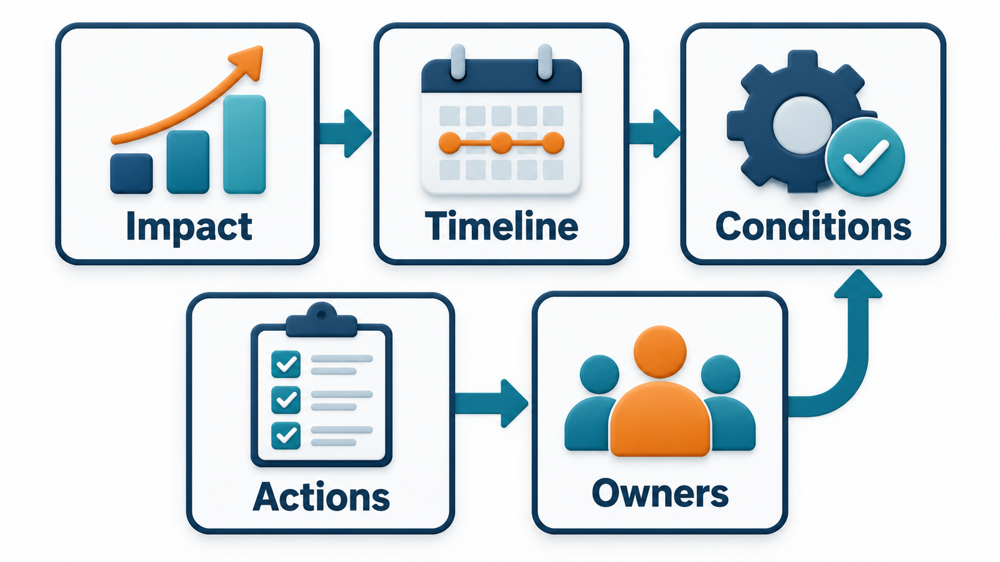
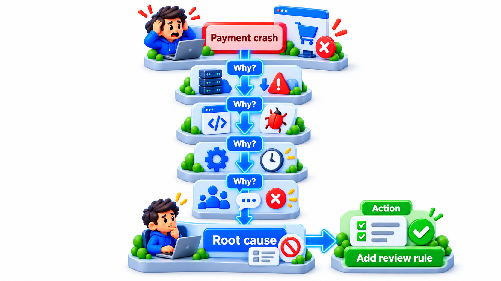
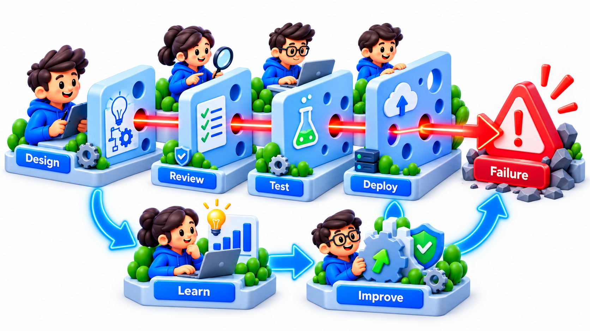
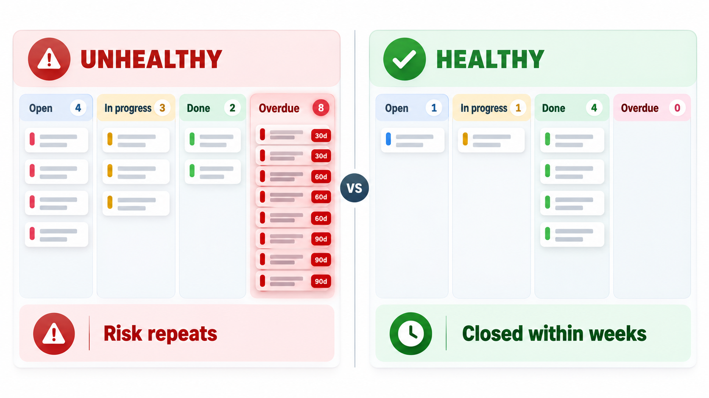
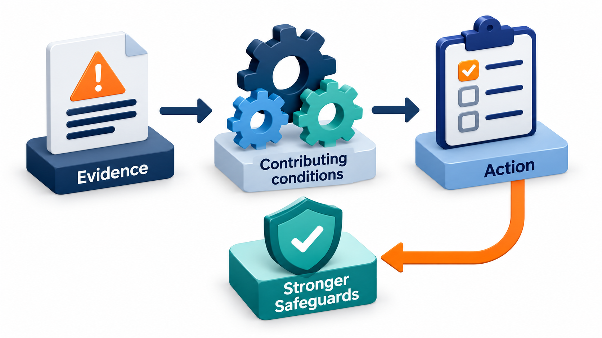

## Learn From the Failure Without Blaming the Person

The most valuable information about failure comes from the many events that did not end in disaster, and people will give it only if they are not afraid. A near miss at one organisation teaches a lesson that only that organisation ever learns, unless a system for confidential, blame-free reporting spreads the lesson to everyone.

**Post-incident analysis**, also called a postmortem or incident review, is the software version: looking back at a failure, soberly and without blame, to understand how it happened and what to change. This topic covers how to run one, how to avoid the common traps and how to make sure the lessons become action.

## The Purpose: Learn, Not Blame

When something goes wrong, the natural reaction is to ask who is responsible. It feels like accountability. In practice, blame closes the door on learning. People who fear punishment hide mistakes, avoid reporting near misses and shape their accounts to protect themselves, and the organisation learns less each time.

The **blameless postmortem**, popularised in software by companies such as Etsy and Google, starts from a different premise: people generally do their best with the information and tools they have. If an engineer made a mistake that brought the system down, the interesting question is not "why were they careless?" but "why was it possible for that mistake to have this effect, and why did the system not catch it?". A system that depends on no one ever making a mistake is a fragile system. Accountability is kept in the form of ownership of the follow-up actions, not punishment of the individual.

| Blame-focused question | Blameless question |
| --- | --- |
| Who ran the command? | What made the wrong command easy to run? |
| Why didn't they check first? | What checks should the tool have made? |
| Who approved this? | What did the reviewer see, and what was hidden from them? |
| Why were they so careless? | What was the engineer's workload and information at the time? |
| How do we stop this person repeating it? | How do we make the whole system tolerate this slip? |

<!-- Visual: A blameless postmortem focusing on how the system allowed the failure rather than on who made it. -->

## A Real Case: Aviation's Reporting Scheme

In December 1974 a passenger aircraft on a flight into Washington crashed into a mountain while descending in cloud. The crew had misread an instruction on the approach chart, which was ambiguous. What made the accident bitter was that, about six weeks earlier, another airline's crew had made almost the same mistake on the same approach and had escaped. The airline had circulated a warning among its own pilots, but the information never reached other airlines, and there was no mechanism to share it.

In response, the American aviation authorities and NASA set up a confidential reporting scheme in 1976. Pilots, controllers and others report mistakes and close calls. Reports made in good faith are protected from punishment, are stripped of names and are collected in a database that anyone in the industry can learn from. The scheme is still running, and tens of thousands of reports arrive each year. It is a main reason why flying has become so safe.

The point of the scheme is its design. People report their own errors only if doing so is safe, and the whole industry benefits only if the lessons are shared and not locked inside one company.

| Principle in the aviation scheme | The same principle in a software post-incident review |
| --- | --- |
| Reports are protected from blame | The review asks what let the mistake happen, not who made it |
| Names are removed | Findings describe roles and systems |
| Lessons are collected and shared | The write-up is open to other teams |
| The scheme tracks patterns, not single events | The team looks for causes that recur |

Post-incident analysis in software borrows these ideas. The topic that follows shows how to build a timeline, find the causes beneath the trigger and write actions that make the same mistake harder to repeat.

## What a Good Review Contains

A written report, produced soon after the incident (within a few days, while memories are fresh), usually has these parts.

| Section | What it holds |
| --- | --- |
| **Summary** | What happened, in a few sentences, and the impact: who, how many, how long |
| **Timeline** | A record of events with times: detection, actions, decisions, recovery |
| **Contributing factors** | The conditions that together allowed it, technical and organisational |
| **What went well** | Things that worked, such as a fast rollback, to keep doing |
| **What went poorly** | Delays, gaps, confusing tools, missing alerts |
| **Where we got lucky** | Things that could have made it worse but did not |
| **Action items** | Specific changes, each with an owner and a date |

The "got lucky" section is a valuable one. A near miss that was saved by chance shows a weakness as much as a failure does.

## Running the Review Meeting

The conversation is as important as the document.

| Step | Practice |
| --- | --- |
| 1. Prepare | The scribe's timeline is circulated beforehand; people add what they remember |
| 2. Set the tone | The facilitator states that the aim is learning and that no one is on trial |
| 3. Walk the timeline | Ask at each step: what did the person know, what did they see, what options did they have? |
| 4. Find the factors | Technical, process and human, including pressure and tools |
| 5. Ask what helped | Record the good decisions too |
| 6. Agree actions | Specific, small enough to finish, with owners |
| 7. Publish | Share beyond the team, with sensitive details removed |

A facilitator who did not take part in the incident is useful, since they can ask naive questions and keep the discussion off blame.

## Beyond a Single Cause

Complex failures rarely have one root cause. Several things lined up: a code change, a missing test, an alert that did not fire, a tired engineer, a confusing console. The word *root* suggests a single point, so many practitioners prefer **contributing factors**. A model often used is the *Swiss cheese* picture: each defence, a review, a test, an alert, a rollback, is a slice of cheese with holes, and a failure happens when the holes in several slices line up. The review looks for the holes, in every slice, not for one culprit.

A technique for digging is the **five whys**: ask why, then why again of each answer, until you reach something that you can change. Why did customers see wrong balances? Because the migration copied the wrong table. Why? Because the script used a name that matched two tables. Why was that possible? Because the test data had only one. Why? Because nobody owned the test environment. Why? And so on. The chain usually leaves the code and ends in process or ownership. Five is a guide, not a rule, and real incidents branch.

<!-- Visual: the five whys moving from the visible failure to changeable causes. -->

## Contributing Factors Grouped

Sorting the factors helps to see where fixes belong.

| Category | Example factor | Possible fix |
| --- | --- | --- |
| **Technical** | A script matched two tables by name | Use unique identifiers; add a dry-run mode |
| **Testing** | Test data had only one such table | Make test data resemble production |
| **Process** | No second person reviewed the migration plan | Require review for data migrations |
| **Tooling** | The console gave no warning before the destructive step | Add a confirmation showing what will change |
| **Monitoring** | No alert on the sudden change in row counts | Alert on unusual data changes |
| **Human factors** | The engineer was working late, alone | Rotate duties; avoid risky work when tired |
| **Organisational** | The test environment had no owner | Assign ownership |

## Near Misses

The aviation lesson applies directly. A problem that was caught before it hurt anyone, a bad deployment spotted by a lucky engineer, a backup restore that failed during a test, a dashboard that showed red for an hour before anyone noticed, is a free lesson. **Near-miss analysis** treats it as seriously as a real incident, at a fraction of the cost. Teams that encourage people to report near misses, with no blame, find weaknesses before customers do.

<!-- Visual: swiss cheese layers where holes in several defences line up to let a failure through. -->

## From Lessons to Change

A postmortem that ends in a document is a failure. The point is to change the system, and the most common reason that organisations repeat incidents is that action items were written and never done. Practices that help:

- **Make actions specific.** "Improve monitoring" is not an action. "Add an alert when disk use passes 80 per cent on the database servers" is.
- **Give each an owner and a date.**
- **Track them** in the same system as other work, and review progress.
- **Prioritise honestly.** Not every idea needs doing, and the ones chosen should be done.
- **Share the report widely.** Other teams may have the same weakness.
- **Look for patterns** across many incidents: the same factor appearing again and again points to a deeper problem.

A review only helps if the fixes actually happen. Track the action items from one review and report which are done, open or overdue, counting days from the review. Today is day 30.

<!-- Visual: a chart of action items from past reviews, grouped by status, with a rising pile of overdue items, beside a healthy version where items are closed within weeks. Save as images/133_action_item_status.png. -->

| Action | Owner | Due day | Status on day 30 |
| --- | --- | --- | --- |
| Add alert for disk above 80% | Asha | 7 | Done |
| Rehearse the rollback | Ravi | 14 | Done |
| Write the runbook for database failover | Meena | 21 | Overdue by 9 days |
| Remove manual step in deploy | Kiran | 45 | Open, due in 15 days |
| Review who has production access | Divya | 10 | Overdue by 20 days |

Only 2 of 5 actions are complete after a month, and two are overdue. That is the usual picture and the real finding: the review's value is draining away. A report like this, shown at a regular meeting, is what turns an intention into change. The most important line may be the overdue access review. A change that nobody has time for is often the one that would have prevented the incident.

<!-- Visual: A learning loop from incident to review to action and back to a safer system. -->

