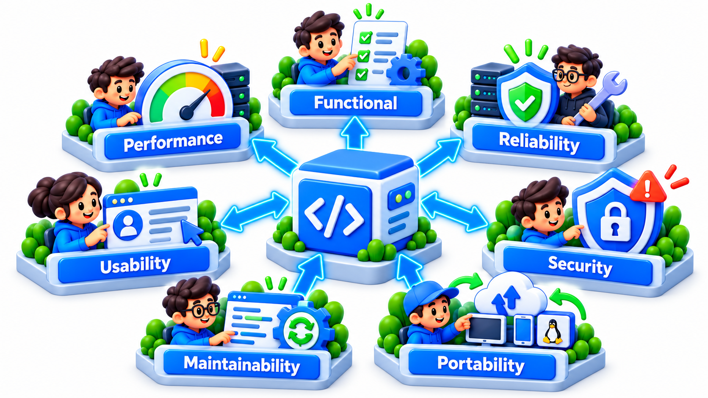
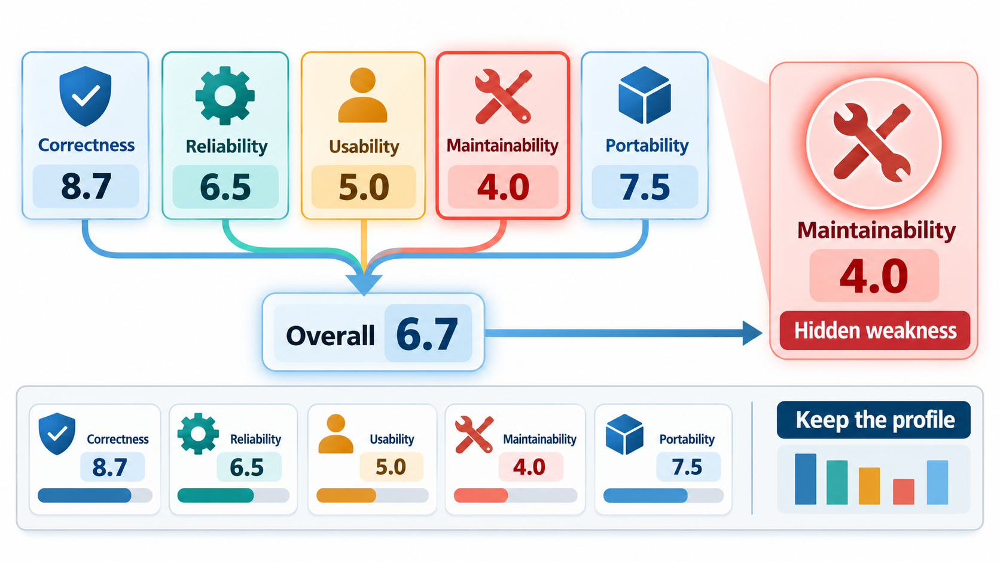
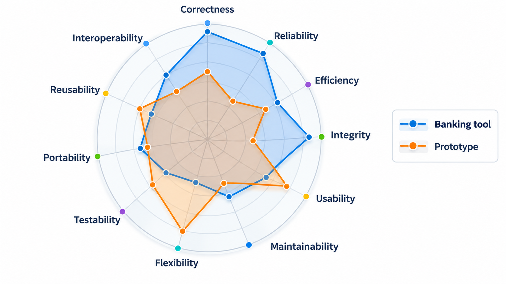
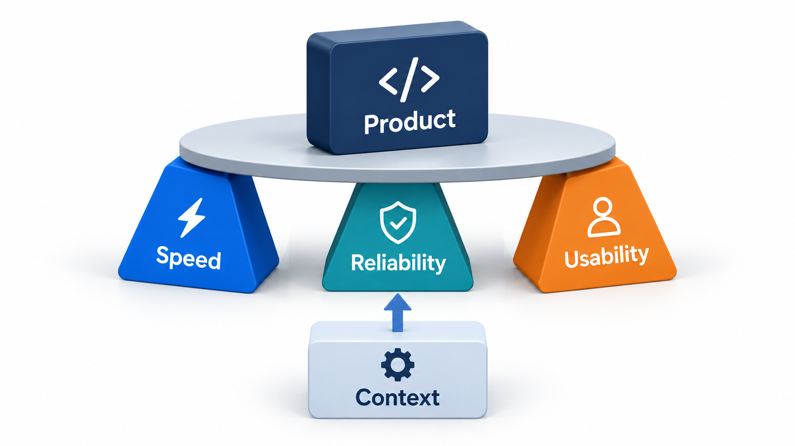

## Breaking "Quality" Into Parts You Can Assess

Every supplier says their product is of high quality, and the word means speed to one person, reliability to another and ease of change to a third. Without an agreed breakdown there is no way to check the claim or compare two products. **Quality models** supply the breakdown: they split quality into factors, split factors into criteria that can be rated, and give a way to combine the ratings.

The idea they introduced is still used: quality is not a single property. It is a set of properties, which can be broken down into things that can be assessed, and which have to be weighed against each other for a given purpose. This topic explains the three best-known models, an early one, a similar one, and the later international standard, and how to use them.

## Why a Model Is Needed

Consider two fee-management products. Product A is fast and has a clean, attractive interface but crashes once a week. Product B never crashes, looks dated and is hard to modify. Which is "higher quality"? The question has no answer until you say what matters. A model gives the vocabulary for the argument.

| Without a model | With a model |
| --- | --- |
| "A is better" / "B is better" | A scores high on efficiency and usability, low on reliability; B scores the reverse, and low on maintainability |
| Quality means whatever the speaker values | Quality is a list of named properties with agreed meanings |
| Contracts say "high quality" | Contracts say "reliability at least 99.9% availability; maintainability: each module under a set complexity" |
| Claims cannot be checked | Each factor has a way to be measured |

## McCall's Model: Factors, Criteria, Metrics

McCall's model, developed in the 1970s for the US Air Force, has three levels. At the top are eleven quality **factors**, the properties a user or customer cares about. Below each factor are **criteria**, more technical qualities that contribute to it. Below the criteria are **metrics**, actual measurements.

The eleven factors are grouped by the stage of the software's life they relate to.

| Group | Factors | The question |
| --- | --- | --- |
| **Product operation** (using it) | Correctness, reliability, efficiency, integrity, usability | Does it do the job, dependably, quickly and securely, and can people use it? |
| **Product revision** (changing it) | Maintainability, testability, flexibility | Can we fix it, check it and adapt it? |
| **Product transition** (moving it) | Portability, reusability, interoperability | Can it move to another platform, be reused and work with other systems? |

Criteria sit below. For example, *maintainability* depends on simplicity, conciseness, self-descriptiveness and modularity. A reviewer can rate each of those on a scale, and combine them to get a factor score. The point is the chain from vague wish to measurement.

| Layer | Example | Who cares |
| --- | --- | --- |
| **Factor** | Maintainability | The customer paying for upkeep |
| **Criterion** | Modularity | The designer |
| **Metric** | Average module coupling; average function length | The reviewer or tool |

<!-- Visual: A quality model arranging factors, criteria and metrics in layers. -->

## Boehm's Model and ISO 25010

Boehm's model has a similar shape but a different top. It starts from the *general utility* of the software, and splits this into *as-is utility* (is it useful now?), *maintainability* and *portability*. Each splits further into the characteristics that support them. It emphasises that quality has to be seen from the perspective of use and of future change.

The international standard **ISO/IEC 25010** is the modern descendant. Its product quality model lists characteristics such as functional suitability, performance efficiency, compatibility, usability, reliability, security, maintainability and portability, each with sub-characteristics. A second part of the standard, quality in use, covers how the software performs for real users in real situations: effectiveness, efficiency and satisfaction. Using the standard gives teams and contracts a shared vocabulary.

| ISO 25010 characteristic | A question it asks | Example sub-characteristic |
| --- | --- | --- |
| Functional suitability | Does it do what is needed? | Completeness, correctness |
| Performance efficiency | How fast, with what resources? | Time behaviour, capacity |
| Compatibility | Does it work with other systems? | Interoperability |
| Usability | Can people learn and use it? | Learnability, accessibility |
| Reliability | Does it keep working? | Availability, fault tolerance, recoverability |
| Security | Does it protect data and resist attack? | Confidentiality, integrity, authenticity |
| Maintainability | Can it be changed? | Modularity, testability, modifiability |
| Portability | Can it move? | Installability, replaceability |

The models agree on most of the content. They differ in grouping and in names. A team does not have to choose a winner. It should choose a list, and use it consistently.

## From Model to Score

A quality model becomes useful when it produces a number or a profile to compare. The steps are always the same. Rate the lowest-level criteria. Combine them into a score for each factor. Decide what matters for this product, which is a statement of **weights**. Combine the factor scores into an overall view, or, better, keep the profile and look at each factor. Take a project that rates the criteria behind five factors out of 10, and weights what it cares about.

| Factor | Ratings of its criteria | Factor score (average) | Weight |
| --- | --- | --- | --- |
| Correctness | 9, 8, 9 | 8.7 | 3 |
| Reliability | 7, 6 | 6.5 | 3 |
| Usability | 5, 6, 4 | 5.0 | 2 |
| Maintainability | 4, 5, 3 | 4.0 | 1 |
| Portability | 8, 7 | 7.5 | 1 |

The weighted overall figure is 6.7 out of 10. It hides the fact that maintainability, at 4.0, is the weakest, and that is the real information. This is why practitioners look at the profile. A single number invites arguments about the weights. The factor scores show where to put effort. The weights themselves record a decision: the team has said that portability matters little for this product, and anyone can challenge it. A banking tool and a prototype would have different weights.

## Quality Is Relative to a Purpose

No model says how much of each factor is enough. That depends on the purpose. A hospital monitor needs reliability above everything, a game needs performance and engagement, and a one-week prototype needs almost none of them. Quality is often defined as **fitness for use**, and the models help to make the question of fit concrete. The factors also pull against one another: raising security can cost usability, raising performance can cost maintainability. Part of the use of a model is to make these trade-offs visible and explicit.

<!-- Visual: a radar chart with eleven axes for the McCall factors and two outlines, one for a banking tool and one for a prototype, showing how the same factors are weighted differently. Save as images/134_factor_profiles.png. -->

| Product | Factors weighted most | Factors weighted least |
| --- | --- | --- |
| Hospital monitoring | Reliability, correctness, safety, usability | Portability, flexibility |
| Online game | Efficiency, usability, scalability | Maintainability (until it succeeds) |
| Banking application | Correctness, security, reliability, auditability | Reusability |
| Two-week prototype | Speed of building | Most of the others |
| Open-source library | Portability, maintainability, documentation | Efficiency, in many cases |

<!-- Visual: quality factors that trade against each other. -->

## Three Views of Quality

A useful distinction from the quality field is that the same product is judged from several viewpoints. The **user view** asks whether it meets their need. The **manufacturing view** asks whether it was built to its specification and process. The **product view** looks at its internal characteristics, such as structure and complexity. A product can pass one view and fail another: built exactly to a specification that the users did not want, or elegant inside and useless outside. Good assessment looks at all three.

<!-- Visual: three verdicts on quality: user, process and product. -->

## Limits of Quality Models

| Limit | Meaning |
| --- | --- |
| **Judgement remains** | Ratings of criteria are opinions unless backed by measurement |
| **Hard to measure** | Some factors, like usability, need studies with users |
| **Static view** | Models describe a product at a moment; quality changes as the product evolves |
| **Weights are contested** | Different stakeholders weigh factors differently |
| **Partial coverage** | No model lists everything: accessibility, ethics, fairness and sustainability are modern additions |

## Five Misreadings of Quality Models

**"A quality model gives you a quality score."** It gives a structure for assessment. The weights and ratings are judgements.

**"A single number summarises quality."** It hides the weak factors. Keep the profile.

**"The model with the most factors is the best."** A short list that a team uses is better than a long one it ignores.

**"The same weights fit every product."** They must be set for the purpose, and written down.

**"Quality models are only academic."** Contracts, audits and tools such as code analysers are built on them.
