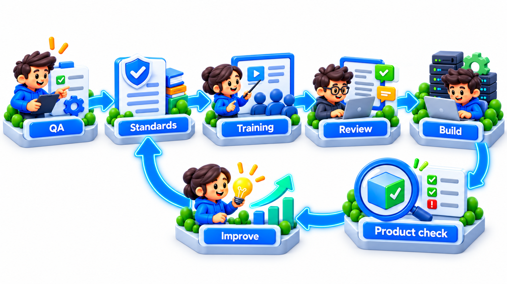
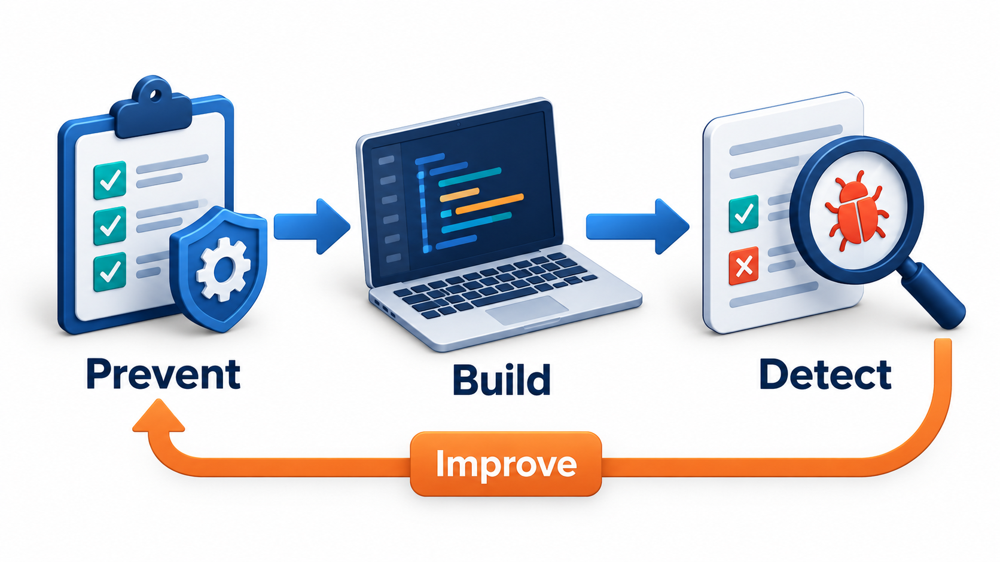
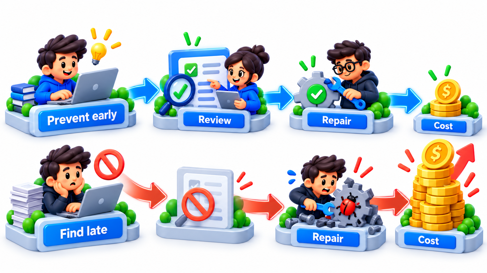
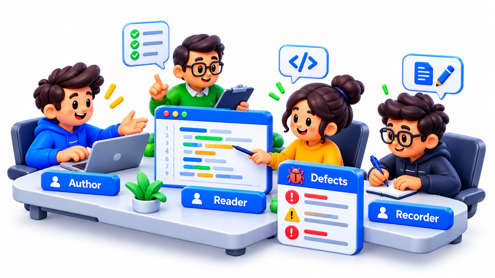
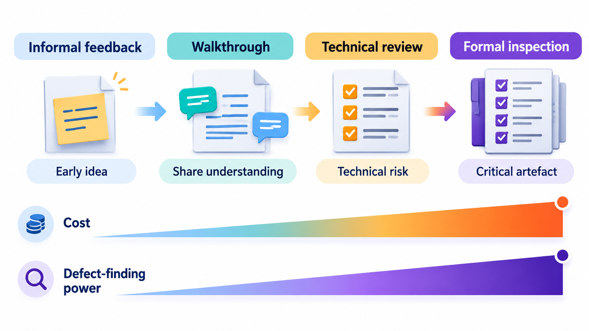
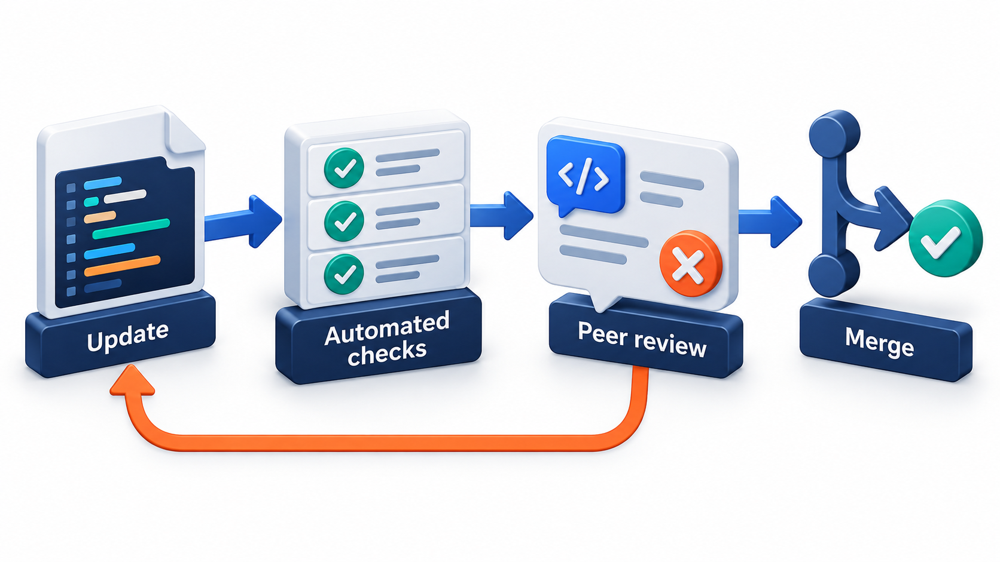

## Quality Is Built In, Not Inspected In

When a system is pushed beyond its design, such as a computer swamped with useless data at the most critical moment of a mission, whether it survives depends on choices made long before. A design that sorts tasks by priority, and when overloaded restarts and re-runs only the vital ones, keeps working. A design that has been reviewed many times and exercised in many simulations, including simulations of overload, has been shown to cope.

That is the aim of **software quality assurance** (SQA): a planned and systematic set of activities that gives confidence that software will meet its requirements, by building quality in and checking at every stage. This topic covers what SQA includes and how its main tools, reviews and audits, work.

## Assurance and Control

Two terms are close, and their difference matters.

**Quality control (QC)** is about the *product*. It inspects and tests the software to find defects: running tests, reviewing code. It is detective: it finds problems in what has been made.

**Quality assurance (QA)** is about the *process*. It looks at how the software is being made, and makes sure that the way of working is likely to produce good results: standards followed, reviews held, tests planned, records kept. It is preventive: it aims to stop defects from arising.

Testing is a QC activity. The decision to require peer review of every change, and the checking that it was done, is QA. A good system has both, and they feed each other: defects found by control reveal weaknesses in the process, which assurance then corrects.

| | Quality control | Quality assurance |
| --- | --- | --- |
| **Focus** | The product | The process |
| **Nature** | Detective: finds defects | Preventive: stops defects arising |
| **Examples** | Testing, code inspection, measuring defects | Standards, process audits, training, improvement of methods |
| **Question** | "Is this build good?" | "Are we working in a way that produces good builds?" |
| **When** | After something is made | Throughout the project |

<!-- Visual: quality assurance improving the process while quality control checks the product. -->

## A Real Case: The Alarms During a Moon Landing

During the descent of Apollo 11 to the Moon in 1969, the guidance computer was overloaded by unexpected data and raised alarms. Because its software gave priority to the vital tasks and, when overloaded, restarted and re-ran only those, the landing continued.

## The Cost of Prevention

Why spend on assurance when testing exists? Because the cost of a defect depends on when it is found. A flaw in a requirement found at a review costs a conversation. The same flaw found in production costs a release, an incident and a reputation. The quality field divides costs into *prevention* (training, standards, reviews), *appraisal* (testing, inspection) and *failure* (rework, support, lost customers, damages). The usual finding is that money spent on prevention and appraisal reduces failure cost by more than it costs.

| Category | Examples | Direction of change as quality effort rises |
| --- | --- | --- |
| **Prevention** | Training, standards, design reviews, tools | Rises |
| **Appraisal** | Testing, inspections, audits | Rises |
| **Internal failure** | Rework found before release | Falls |
| **External failure** | Production defects, support, refunds, reputation | Falls sharply |

<!-- Visual: feedback between process assurance and product control. -->

## Reviews, Walkthroughs and Inspections

The main assurance activities are human examinations of work products before they are used. They differ in how formal they are.

<!-- Visual: the cost of quality, with prevention spending reducing the cost of failure. -->

| Type | How it works | Led by | Best for |
| --- | --- | --- | --- |
| **Informal review** | A colleague reads and comments | The author asks | Quick feedback on small things |
| **Walkthrough** | The author leads the group through the work, step by step | The author | Sharing understanding, collecting ideas |
| **Technical review** | Experts examine the work against standards and needs | A trained moderator | Checking technical fitness |
| **Inspection** | A formal process with defined roles, a checklist, preparation, a logged list of defects and follow-up | A trained moderator, not the author | Finding defects in critical work |

Michael Fagan's inspection method, introduced at IBM in the 1970s, is the best known. Roles include a *moderator* who runs the meeting, a *reader* who paraphrases the work, a *recorder* who logs defects and the *author* who answers questions. The reviewers prepare in advance with a checklist. The meeting finds defects but does not fix them. The author reworks, and the moderator checks the rework.

A key lesson from inspections concerns pace. Reading too fast finds few defects. Check the data from four inspections against the common guideline of about 150 to 200 lines per hour.

| File | Lines | Hours | Defects found | Rate (lines per hour) | Defects per 100 lines | Verdict |
| --- | --- | --- | --- | --- | --- | --- |
| Fees | 400 | 1 | 2 | 400 | 0.5 | Too fast: likely missed defects, re-inspect |
| Receipts | 300 | 2 | 7 | 150 | 2.3 | Reasonable pace |
| Reports | 500 | 5 | 11 | 100 | 2.2 | Reasonable pace |
| Login | 250 | 2 | 9 | 125 | 3.6 | Reasonable pace |

The fees file was reviewed at 400 lines an hour and produced only half a defect per hundred lines. That is suspiciously fast and suspiciously quiet. The other three, inspected at 100 to 150 lines an hour, found four to seven times as many. A low defect count from a rushed inspection is not good news. It is a sign that looking was inadequate. A team that records its inspection data in this way can tune its practice: set a recommended pace, spot the sessions that did not meet it and compare the defects found with those that escape later.

<!-- Visual: roles in a formal inspection. -->

## What Inspections Catch

Inspections find a different mix of defects from testing, which is a reason to use both.

| Defect type | Found well by inspection? | Found well by testing? |
| --- | --- | --- |
| Missing or ambiguous requirement | Yes | Rarely |
| Design flaw | Yes | Late and expensively |
| Logic error in code | Yes | Yes |
| Unhandled edge case | Sometimes | Yes, with good cases |
| Performance problem | Rarely | Yes, under load |
| Inconsistent naming and style | Yes | No |
| Security design weakness | Yes, with a checklist | Sometimes |

## Audits

An **audit** is an independent check that the process was followed. An auditor, from outside the project (often from the quality department), examines records and work products and asks: did the team do the reviews its plan requires? Do the test records exist? Are the standards observed? Is the configuration management in order? An audit does not judge the product. It judges whether the process that should produce a good product was actually followed, and reports gaps for the project to fix. Audits are required in regulated industries and by many customers.

| Audit question | Evidence examined | Typical finding |
| --- | --- | --- |
| Were requirements reviewed? | Review records with dates and names | Two requirements documents have no record |
| Were tests planned and run? | Test plan, results | Regression tests were skipped before the last release |
| Are changes controlled? | Change requests and approvals | Three changes went live with no approval |
| Are defects tracked to closure? | Defect tracker | Many items closed with no verification |
| Are standards followed? | Sample of code against the coding standard | Consistent, with a few exceptions |

## Standards and Plans

SQA is organised around a **quality plan** for the project: which standards apply, which reviews and tests will be done, who is responsible, what records will be kept and what the criteria are for release. Standards such as ISO 9001 give the plan a base. The plan makes quality a visible, scheduled activity and not a hope.

<!-- Visual: a spectrum of review types from informal feedback to formal inspection with example of when to use each, and a cost and defect-finding power rising along it. Save as images/135_review_spectrum.png. -->

| Part of a quality plan | Example |
| --- | --- |
| **Standards** | Coding standard; review checklist |
| **Reviews** | Every requirement document reviewed; every change reviewed by one other developer |
| **Testing** | Unit, integration, system tests; exit criteria |
| **Measures** | Defects found per review; escaped defects per release |
| **Roles** | Who moderates inspections; who audits |
| **Records** | Where review and test records are kept |
| **Release criteria** | No open critical defects; all planned tests passed |

<!-- Visual: A review gate that a work product must pass before moving on. -->

## Five Misreadings of Quality Assurance

**"QA is the testing team."** Testing is quality control. Assurance is about making sure the whole process works.

**"Quality can be inspected in at the end."** By then defects are built in. Assurance acts throughout.

**"More reviews always find more defects."** Rushed ones do not. Pace and preparation matter.

**"An audit judges the product."** It judges whether the agreed process was followed.

**"Assurance slows teams down."** Done well it reduces rework, which costs far more time.
