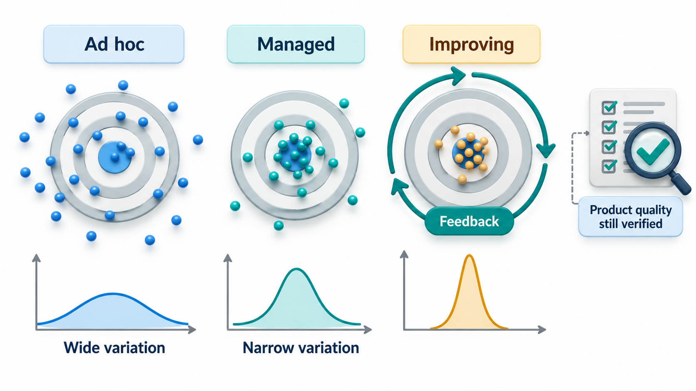
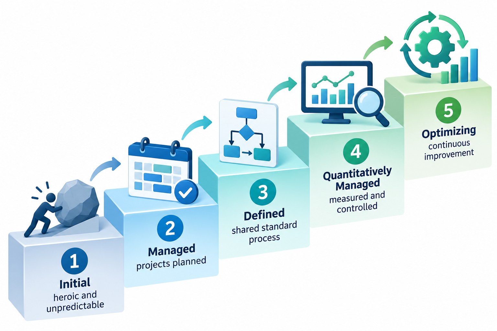
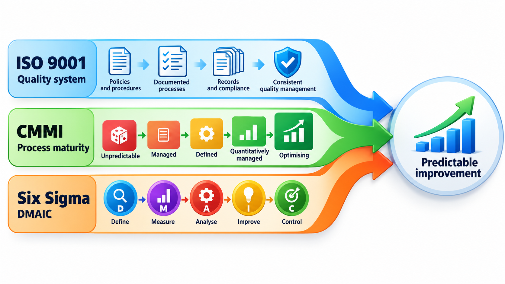
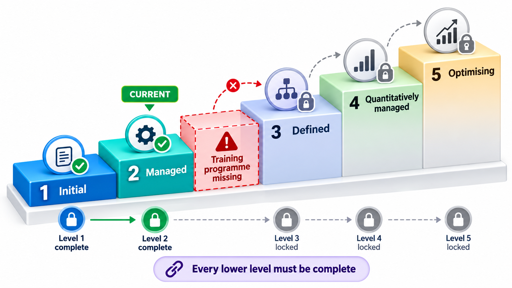
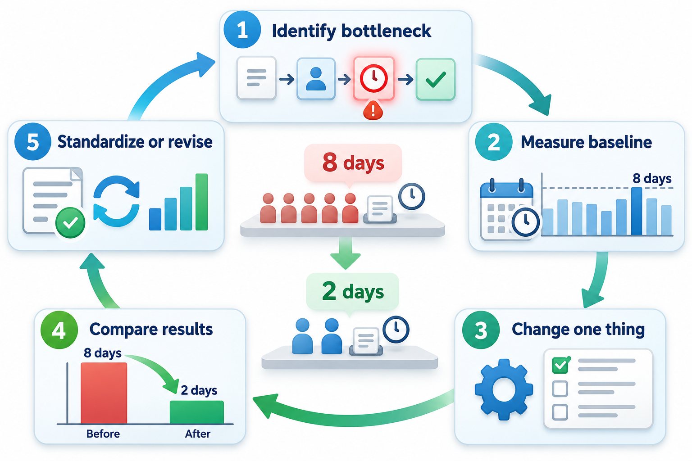

## Can You Predict Who Will Deliver?

A buyer who hires software contractors faces a problem: projects are too often late, over budget and unreliable, and nothing in advance tells which contractors are likely to deliver. One answer is to look not at the product but at the organisation. The predictability of a software organisation depends on the maturity of its processes: whether its way of working is written down, followed, measured and improved, or depends on heroic individuals.

That idea became a staircase of maturity levels, and later a family of standards and frameworks. It began in the 1980s when the US Department of Defense asked the Software Engineering Institute at Carnegie Mellon University to find a way of judging software contractors, which produced the original Capability Maturity Model (CMM). This topic covers the main frameworks in use: ISO 9001, the Capability Maturity Model Integration (CMMI) and Six Sigma. It also covers what they actually achieve, and the criticisms that are made of them.

## Why Process Matters

A mature process turns a project's success from luck into repeatability. The contrast is easy to see.

| | Immature organisation | Mature organisation |
| --- | --- | --- |
| **Planning** | Estimates are guesses, revised in a crisis | Estimates use past data |
| **Success depends on** | A few heroic individuals | The system of working |
| **When a key person leaves** | Knowledge is lost | Practices and records remain |
| **Quality** | Found at the end, by luck | Built in and checked throughout |
| **Improvement** | Rare and accidental | Planned, from measurements |
| **Predictability** | Low: outcomes vary widely | Higher: outcomes cluster around the plan |

## Process Maturity: CMMI

The CMM grew into the **Capability Maturity Model Integration** (CMMI), first released in 2002 and revised since, now maintained by the CMMI Institute. It describes best practices for organisations that develop products and services, and rates their maturity on five levels.

| Level | Name | What it looks like |
| --- | --- | --- |
| **1** | Initial | Work is ad hoc, success depends on individuals, results are unpredictable |
| **2** | Managed | Projects plan, track requirements and configuration, and can repeat past successes |
| **3** | Defined | The organisation has standard processes, tailored by projects, with training and peer review |
| **4** | Quantitatively managed | Processes are measured, and variation is controlled with statistics |
| **5** | Optimising | The organisation continually improves, analysing causes of defects and trying new methods |

Each level above the first is defined by **process areas**, groups of related practices, such as requirements management, project planning, configuration management, verification and measurement. To be at a level, an organisation must satisfy *all* the practices of that level and those below. An **appraisal** by a trained, independent assessor checks the evidence. Take an organisation that has six practices in place.

| Level | Practices required | In place? |
| --- | --- | --- |
| 2 (Managed) | Requirements management, project planning, configuration management | All three: level 2 reached |
| 3 (Defined) | An organisation-wide standard process, peer reviews, a training programme | Standard process and peer reviews, but no training programme: level 3 not reached |
| 4 (Quantitatively managed) | Quantitative process management, statistical control of quality | Quantitative process management is in place, but earns no credit |
| 5 (Optimising) | Causal analysis of defects, continuous process innovation | Not in place |

The appraised level is 2, "Managed". The organisation also has a level 4 practice, quantitative process management, but it earns no credit for it, because a level counts only when every level below is complete. That is the logic of a staircase: gaps lower down hold everything above back. A real appraisal examines evidence, such as plans, records and interviews, and not a list.

<!-- Visual: five levels of process maturity from reactive firefighting to continuous improvement. -->

## What Each Level Changes in Daily Work

| Level | A typical day for a developer |
| --- | --- |
| 1 | Told to "get it done"; requirements change by conversation; test when time allows |
| 2 | Work is tracked against a plan; requirements are written and changes are recorded; code is in version control |
| 3 | Follows the organisation's standard process, tailored; peer review is routine; trained in the methods |
| 4 | Measures such as review pace and defect rates are collected and used to steer the project; variation is investigated |
| 5 | Defect causes are analysed and fed back into the process; new methods are piloted and adopted when they work |

## ISO 9001 and Related Standards

**ISO 9001** is the international standard for quality management systems, first published in 1987 and revised several times. It is not specific to software. It applies to any organisation that wants to show it can consistently provide products and services that meet customer requirements. It asks for a documented system: a quality policy, defined processes, records, internal audits, corrective action when things go wrong and a commitment to improvement. An organisation can be *certified* by an independent body, which audits it regularly. A guide, ISO/IEC/IEEE 90003, explains how to apply ISO 9001 to software.

Other standards cover particular aspects: ISO/IEC 12207 for the software life cycle processes, ISO/IEC 25010 for quality characteristics, ISO/IEC/IEEE 29119 for testing, and ISO/IEC 27001 for information security management. In regulated industries there are sector standards, such as DO-178C for aircraft software and IEC 62304 for medical device software.

| Standard | Concerns | Typical user |
| --- | --- | --- |
| ISO 9001 | A general quality management system | Any organisation wanting certification |
| CMMI | Process maturity and capability | Software and systems suppliers |
| ISO/IEC 12207 | Life-cycle processes for software | Organisations defining their processes |
| ISO/IEC 27001 | Information security management | Anyone handling sensitive data |
| DO-178C | Safety of airborne software | Aerospace suppliers |
| IEC 62304 | Medical device software life cycle | Medical device makers |
| ISO 26262 | Functional safety of road vehicles | Automotive suppliers |

## Six Sigma

**Six Sigma** began at Motorola in the 1980s as a method for cutting defects in manufacturing. The name refers to a level of quality at which there are no more than about 3.4 defects per million opportunities. It uses data and statistics to find and remove the causes of variation. Its improvement cycle is known as **DMAIC**: Define the problem, Measure the current performance, Analyse the causes, Improve the process and Control it so that the gain lasts. In software, Six Sigma has been used to reduce defects and cycle time, particularly in services firms.

| DMAIC step | Applied to late deliveries |
| --- | --- |
| **Define** | 30% of releases miss their date; target is 10% |
| **Measure** | Record planned vs actual dates for the last 40 releases |
| **Analyse** | Most delay comes from late requirement changes and slow test environments |
| **Improve** | Freeze requirements two weeks before release; automate environment set-up |
| **Control** | Track the late-release rate monthly; alert if above 10% |

## How Services Firms Use Them

For companies that sell software development as a service, a certificate is a form of proof for a buyer who cannot inspect the work in advance. A client choosing between suppliers in different countries can compare their CMMI levels and ISO certification. The standards also give a supplier a systematic framework: processes for estimation, risk, change control and measurement, which can be taught to thousands of staff and applied consistently across many projects and sites.

## What the Evidence Says

Process frameworks have real benefits and real critics. Studies of organisations that adopted CMMI report improvements in schedule predictability, defect rates and cost. They also report that the improvement comes from doing the practices well, and that an organisation can achieve a high rating while its teams treat the practices as paperwork. Common criticisms are that the frameworks:

<!-- Visual: a staircase of five steps for the CMMI levels with a person at level 2 looking up at the missing training programme step, and a note "a level counts only when every lower level is complete". Save as images/136_maturity_staircase.png. -->

- were designed for large, plan-driven projects, and can seem heavy for small or agile teams;
- measure whether a process *exists* and is followed, not whether the software is any good;
- can be pursued for the certificate and not for the improvement;
- cost money and time in appraisals and documentation.

CMMI has responded with versions that fit agile work and with a focus on performance, and many organisations combine maturity frameworks with agile practices. A realistic view is that standards give a useful skeleton and a common language, and the benefit depends on the culture that uses them.

<!-- Visual: an improvement cycle that measures, analyses, changes and verifies a process. -->

## Five Misreadings of Standards and Maturity

**"A high maturity level means the software is good."** It means the process is defined and controlled. Quality of the product still depends on how well the practices are applied.

**"Certification is only a badge."** It can be, if pursued for show. It can also drive real discipline. The difference is in the intent.

**"Maturity frameworks are incompatible with agile."** Many organisations combine them. The frameworks name outcomes, and agile is one way to achieve them.

**"Level 5 is the goal for everyone."** A small team on a short project may be well served at a lower level. The cost of each level must be weighed against its benefit.

**"Standards are the same as documents."** They require evidence of practice. Documents that nobody uses fail an honest appraisal.
