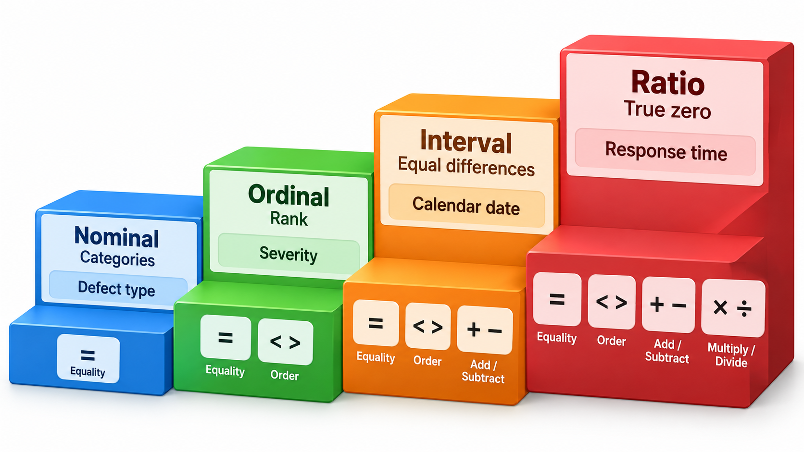
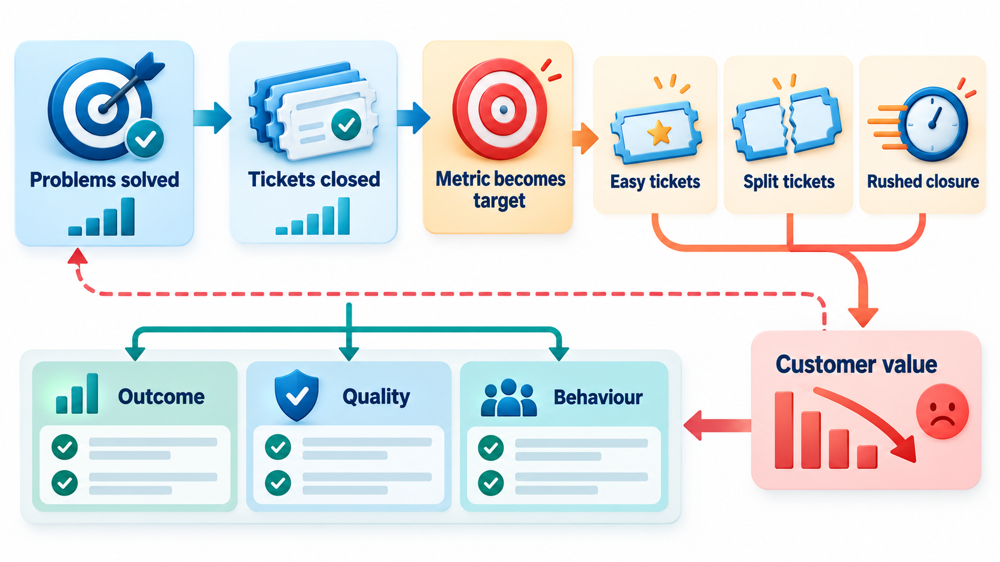
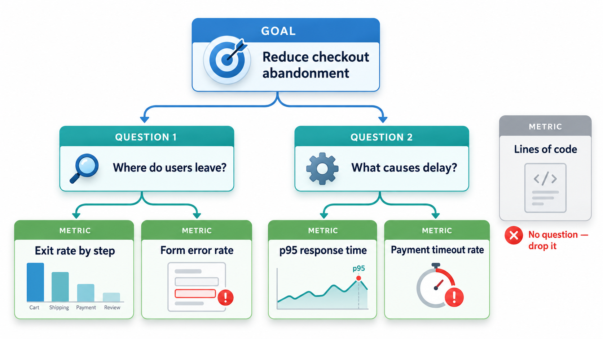

## When a Measure Becomes a Target

Numbers are persuasive, so they are easy to misuse. When an organisation sets a demanding target for a measure, ties it to pay and continued employment, and tracks the figure closely, people under pressure hit the number by any means. The measure becomes the goal, and the goal comes loose from the thing it was supposed to stand for.

The phenomenon is so common that it has a name, **Goodhart's law**: when a measure becomes a target, it ceases to be a good measure. Software teams meet it constantly. Measure lines of code, and code gets longer. Reward the number of bugs fixed, and bugs are split into many tickets. This topic is about measuring software well, and avoiding that trap.

## Why Measure

Without measurement, claims about quality, progress and productivity are opinions. With it, a team can see where it stands, spot trends, test whether a change helped and make its case to others. Software metrics fall into two broad families.

- **Product metrics** describe the software itself: size, complexity, defect density, test coverage, response time, availability.
- **Process metrics** describe how it is made: how long a change takes from idea to release, how many defects are found in review, how many escape to users, how often deployments fail.

A third group, **project metrics**, tracks the progress of a particular project: effort spent, schedule slip, budget used.

| Family | Example | Question it answers |
| --- | --- | --- |
| **Product** | Cyclomatic complexity of a module | How hard is this code to change? |
| **Product** | Availability over the month | Is the service up when needed? |
| **Process** | Lead time from commit to production | How quickly can we deliver a change? |
| **Process** | Share of defects found in review | How well does review work? |
| **Project** | Effort spent against plan | Are we on schedule and budget? |

<!-- Visual: A metric used in its context, with the limits of what it can tell. -->

## A Real Case: Accounts Nobody Asked For

In 2016 it emerged that employees of the American bank Wells Fargo had opened millions of bank and credit card accounts that customers had never asked for. The bank had set demanding sales targets, summed up in an internal slogan about selling eight products to every customer, and it measured each branch and each employee by how many accounts they opened. The figure was tracked every day. It was tied to pay and to continued employment. Employees who could not meet it faced pressure, and many met it by creating accounts in customers' names, moving money between them without permission, and in some cases creating fake email addresses. In 2016 the bank agreed to pay a settlement of 185 million dollars, and thousands of employees were dismissed. Total costs to the bank in later years were far higher.

The measure itself was precise and easy to count. What it measured was not what the bank wanted. The bank wanted satisfied customers who used its services, and it counted accounts opened. Once the number became the target, people optimised the number.

| The intended goal | The measure chosen | What the measure rewarded |
| --- | --- | --- |
| Customers who use more of the bank's services | Number of accounts opened per customer | Opening accounts by any means |
| A healthy relationship with customers | Daily sales figures | Short-term pressure |

This effect is often summarised as: when a measure becomes a target, it stops being a good measure. It applies equally to software teams. Lines of code, number of bugs closed, test counts and velocity all describe something real, and all can be gamed once they decide who is praised or blamed. This topic shows how to choose metrics that answer a real question, how to read them as signals and what to watch for when a number starts to drive behaviour.

## The Levels of Measurement

Not all numbers can be treated the same way. The scale on which something is measured decides what arithmetic is meaningful.

| Scale | What it means | Example | What you can do |
| --- | --- | --- | --- |
| **Nominal** | Labels with no order | Programming language used; defect type | Count how many in each class |
| **Ordinal** | An order, but unequal gaps | Severity: low, medium, high | Rank; do not average |
| **Interval** | Equal gaps, no true zero | Dates | Add and subtract differences |
| **Ratio** | Equal gaps and a true zero | Lines of code; hours; defects | All arithmetic, including ratios |

A common error is to average ordinal values, such as treating severity levels 1 to 4 as numbers and reporting "average severity 2.3". The gap between severity 1 and 2 is not the same as between 3 and 4, so the average has no clear meaning.

## Start with a Goal: Goal-Question-Metric

A common mistake is to measure what is easy and hope it is useful. The **Goal-Question-Metric (GQM)** method, devised by Victor Basili and David Weiss in the 1980s, reverses the order.

1. Begin with a **goal**: what does the organisation want? "Reduce the number of defects that reach users."
2. Derive **questions** that would tell you whether you are meeting it: "What share of defects escape to production? Is that share falling?"
3. Choose **metrics** that answer the questions: "Defects found after release divided by all defects found."

Every metric then has a reason to exist. If you cannot say which question a metric answers, drop it. Take the goal "reduce the defects that reach users". The question is "what share of defects escape?", and the metric is the **escape rate**: defects found after release divided by all defects found.

| Release | Found before release | Found after | Escape rate |
| --- | --- | --- | --- |
| R1 | 40 | 20 | 33.3% |
| R2 | 55 | 15 | 21.4% |
| R3 | 70 | 7 | 9.1% |

The trend is downward: more defects are being caught before users see them. That is an answer to the question, and so to the goal. A vanity metric would be the number of tests written. It always goes up, it is easy to report and it says nothing about whether defects escape. A team could write a thousand worthless tests and the escape rate would stay put. The difference between the two is the heart of good measurement: an **actionable** metric tells you what to do, and a vanity metric makes you feel good.

## A Second Goal Worked Through

| Part | Content |
| --- | --- |
| **Goal** | Make changes reach users faster without more failures |
| **Question 1** | How long does a change take from commit to production? |
| **Metric 1** | Lead time (median and 90th percentile) |
| **Question 2** | How often do releases cause a problem? |
| **Metric 2** | Change failure rate: releases needing a fix or rollback divided by all releases |
| **Question 3** | How quickly do we recover? |
| **Metric 3** | Time to restore service |
| **Paired reading** | Lead time falling while failure rate rises means speed is being bought at the expense of quality |

The pairing in the last row is deliberate: each metric guards against the gaming of the other.

## Properties of a Good Metric

A useful metric is:

- **Tied to a goal or decision**, with a clear reason for being collected.
- **Understandable** by those who use it.
- **Hard to game**, or paired with another metric that reveals gaming.
- **Cheap to collect**, ideally automatically.
- **Consistent** over time, so trends mean something.
- **Considered with context**: a number alone says little.

Metrics work better in pairs that pull against each other. Measure speed of delivery together with quality, such as lead time with the rate of failed changes, so that pushing one does not silently ruin the other.

## Vanity and Misleading Metrics

Some measures are popular and weak.

| Metric | Why it misleads |
| --- | --- |
| **Lines of code written** | Rewards bulk, punishes concise solutions |
| **Number of commits or tickets closed** | Easily inflated by splitting work |
| **Hours worked** | Measures presence and not value |
| **Test coverage as a target** | Invites tests that run code without checking it |
| **Number of defects found** (by testers) | Rewards finding trivial ones; discourages cooperation |
| **Velocity compared between teams** | Points are not comparable, and the comparison leads to inflation |

None of these is useless as information. They become harmful when used to rank people or as targets.

## How Metrics Get Gamed

Every target invites a response. Recognising the common ones helps in designing measures that resist them.

| Target | Typical gaming | Safer design |
| --- | --- | --- |
| Close more tickets | Split work into tiny tickets; close hard ones as "won't fix" | Measure time to resolve and customer outcomes |
| Reach 90% coverage | Write tests with no assertions | Add mutation score or review of test quality |
| Fewer bugs reported | Discourage reporting; reclassify bugs as requests | Track escaped defects found by users |
| Faster releases | Skip testing | Pair with change failure rate |
| Higher velocity | Inflate story points | Do not compare velocity; track delivered value |

## Measuring Responsibly

A few rules keep measurement honest.

<!-- Visual: a goal at the top branching to two questions, each branching to one or two metrics, with a stray metric on the side labelled "no question, drop it". Save as images/137_gqm_tree.png. -->

- **Measure the system, not the person.** Team and process measures drive improvement. Individual scorecards drive gaming and fear.
- **Use trends, not single readings.** Direction matters more than a snapshot.
- **Look at distributions.** The average hides the worst cases. Use percentiles.
- **Combine numbers with judgement.** A metric points, and a person decides.
- **Tell people why you are measuring**, and what you will not do with the numbers.
- **Review the metrics themselves.** Retire those that no longer answer a live question.

<!-- Visual: A decision about what to do after reading a metric, depending on context and trend. -->

