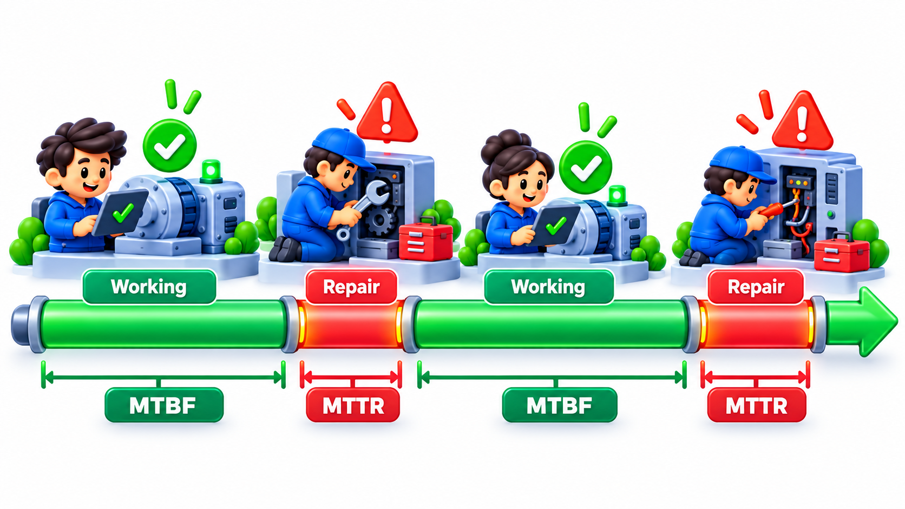
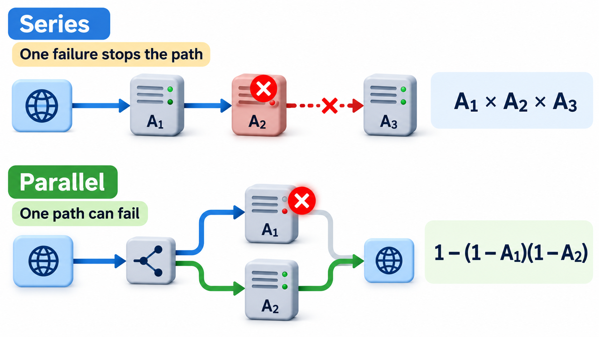
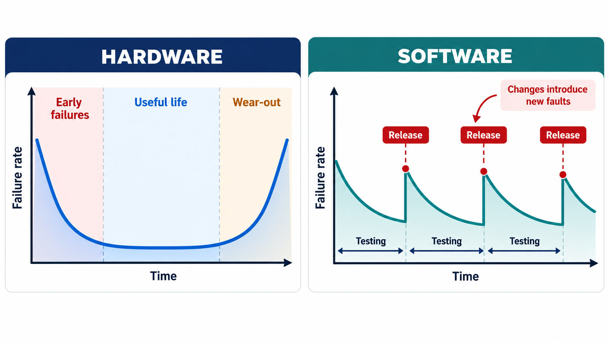
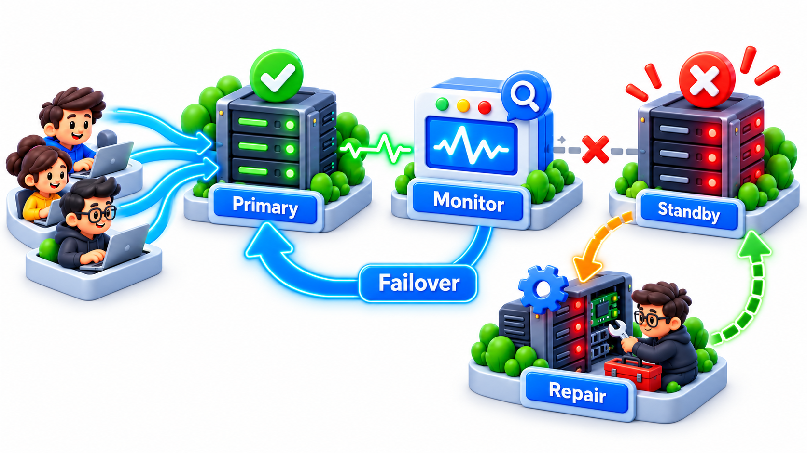
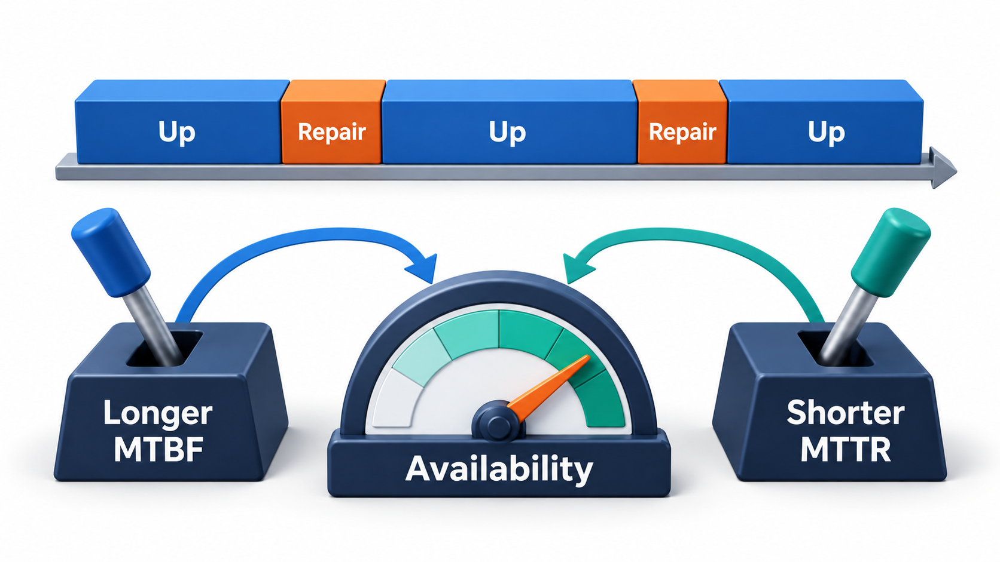

## Five Nines Is a Promise About Time

Some services must almost never be down. A telephone exchange is expected to give a dial tone at any hour, in an emergency, for tens of thousands of lines, and a failure of an hour would affect a whole town. One famous design target allowed the switch to be out of service for no more than two hours in forty years: a little over a minute a year. "Five nines", 99.999 per cent availability, became a rule of thumb for the telephone industry and a slogan for others.

Meeting such a number takes more than careful coding. It takes redundant hardware, software designed to recover from errors without losing calls, thorough testing, and a way of counting failures. The field that studies this is **software reliability engineering**. This topic defines the terms used to talk about it: reliability, availability, MTBF and MTTR, and shows how redundancy changes the arithmetic.

## What Each Nine Means

The number of nines translates directly into time.

| Availability | Downtime per year | Downtime per month | Typical use |
| --- | --- | --- | --- |
| 99% (two nines) | About 3.65 days | About 7.2 hours | Internal tools; non-critical |
| 99.9% (three nines) | About 8.8 hours | About 43 minutes | Many business services |
| 99.99% (four nines) | About 53 minutes | About 4.3 minutes | Payments, key platforms |
| 99.999% (five nines) | About 5.3 minutes | About 26 seconds | Telecom, emergency systems |

A target stated as a percentage sounds small. Stated as time, it shows what is demanded: five nines allows less than a coffee break of outage in a whole year.

## Reliability and Availability Are Not the Same

**Reliability** is the probability that a system will perform its function without failure for a stated period under stated conditions. It is about *how long between failures*. A system that runs for 1,000 hours without a failure is more reliable than one that fails every 100 hours.

**Availability** is the proportion of time a system is *working when needed*. It depends on how often it fails and also on how fast it recovers. A system that fails often but is fixed in seconds can be more available than one that fails rarely but takes a day to repair.

The distinction matters in practice. A user of a bank's app cares about availability: is it up when I want it? An engineer designing a spacecraft cares about reliability: a failure that cannot be repaired ends the mission.

## The Vocabulary

Four terms do most of the work.

| Term | Meaning | Unit |
| --- | --- | --- |
| **Failure intensity** (or failure rate) | How often failures occur, per unit time | Failures per hour |
| **MTBF** | Mean time between failures: the average operating time between one failure and the next | Hours |
| **MTTR** | Mean time to repair (or restore): the average time to get back to service after a failure | Hours or minutes |
| **Availability** | The share of time the system is up | A percentage |

For a repairable system, the relationship is simple:

**Availability = MTBF / (MTBF + MTTR)**

The system is up for one MTBF and down for one MTTR, and then the cycle repeats. The formula shows that there are two ways to improve availability: fail less often (raise MTBF) or recover faster (lower MTTR). Modern practice, with automation and rollbacks, often finds the second easier and cheaper.

<!-- Visual: availability depending on how long a system runs between failures and how fast it is repaired. -->

## Putting Numbers on the Choices

Availability equals MTBF divided by (MTBF plus MTTR), where MTBF is the mean time between failures and MTTR is the mean time to repair. Compare two designs of a service.

| Design | MTBF | MTTR | Availability | Downtime a year |
| --- | --- | --- | --- | --- |
| Rarely fails, slow to fix | 2,000 hours | 10 hours | 99.502% | 43.6 hours |
| Fails more, fixed fast | 500 hours | 0.5 hours | 99.9% | 8.8 hours |

The second design fails four times as often, yet has far less downtime. Fast recovery beat rare failure. Now add redundancy. With two independent servers, the service is down only if both are down at once. The chance that one is down is 1 minus its availability, so the chance that both are down is that figure squared.

| Setup | Availability |
| --- | --- |
| One server (the fast-repair design) | 99.9001% |
| Two independent servers | 99.9999%, a thousand times less downtime |

This is why redundancy is the standard tool for high availability. The word *independent* carries the weight. Two copies of the same software, on the same power supply, with the same bug, fail together, and the benefit disappears. Real designs separate copies by machine, by building and by region.

## Components in Series and in Parallel

Real systems combine parts, and the way they are combined decides the result.

| Arrangement | Rule | Example (each part 99.9%) |
| --- | --- | --- |
| **In series** (all must work) | Multiply availabilities | Web server, application server, database: 0.999 x 0.999 x 0.999 = 99.7% |
| **In parallel** (any one is enough) | Multiply unavailabilities, then subtract from 1 | Two database copies: 1 - (0.001 x 0.001) = 99.9999% |

Series arrangement lowers availability: every added dependency is a new way to fail. This is why long chains of services are fragile. Parallel arrangement raises it, which is why the weakest link, such as a single database, is the first to be duplicated.

## Software Fails Differently from Hardware

A light bulb wears out, so its failure rate rises with age. Software does not wear out: its code does not decay. But its failures behave in their own way. A typical software failure rate starts high when the system is new, because faults are being found, and falls as they are fixed, the period called **reliability growth**. Then it is disturbed by every new release, which brings new faults. Over a system's life, the failure rate has a sawtooth shape.

**Reliability growth models** use the times of failures observed during testing to estimate how many faults remain and how reliable the software will be. They are used to decide when testing can stop: when the failure intensity has fallen to the target. Another practice, the **operational profile**, tests the software in proportion to how it will really be used, so that the commonly used features get the most testing, since reliability is judged from the user's experience and not from the number of faults.

| Aspect | Hardware | Software |
| --- | --- | --- |
| Cause of failure | Wear, ageing, physical defects | Design and coding faults |
| Failure rate over time | Bathtub: high early, low, rising with wear | Falls during testing; jumps with each release |
| Repair | Replace the part | Fix the code; sometimes just restart |
| Redundancy of identical copies | Effective against random failure | Ineffective against a shared bug |
| Prediction | Statistical, from parts data | From test failure history and usage |

## Designing for Reliability

Reliability is built into a system by design, in several ways.

<!-- Visual: a bathtub-shaped hardware failure curve beside a sawtooth software failure curve that falls during testing and jumps with each release. Save as images/138_failure_rate_curves.png. -->

- **Fault avoidance.** Reviews, good design, testing and strong typing prevent faults from being created.
- **Fault detection.** Assertions, health checks and monitoring find faults quickly.
- **Fault tolerance.** The system keeps working in spite of faults: redundancy, retries, failover, graceful degradation.
- **Fast recovery.** Automatic restart, rollback and tested backups reduce MTTR.
- **Reducing single points of failure.** Every component whose failure alone stops the service is a risk to be removed or duplicated.

<!-- Visual: redundancy and failover keeping a service available when one component fails. -->

## The Cost of Each Nine

Each extra nine of availability costs more than the last. Going from 99 to 99.9 per cent might need better monitoring and a second server. Going to 99.99 per cent needs automatic failover and several regions. Going beyond usually needs expert operations, specialised hardware and a great deal of testing. The right target is the one the users and the business actually need, and not the highest one imaginable.

| Target | Typical measures needed |
| --- | --- |
| 99% | Basic monitoring; manual recovery |
| 99.9% | Redundant servers; automated restarts; tested backups |
| 99.99% | Automatic failover; several locations; careful releases |
| 99.999% | Redundancy at every level; no single point of failure; rigorous testing; specialised operations |

<!-- Visual: availability targets and the downtime each one allows in a year. -->

