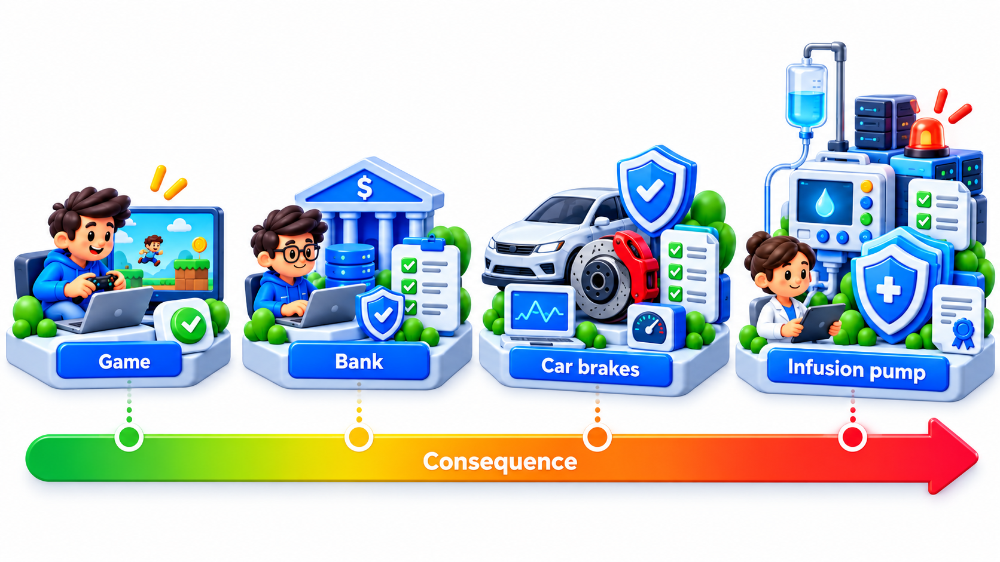
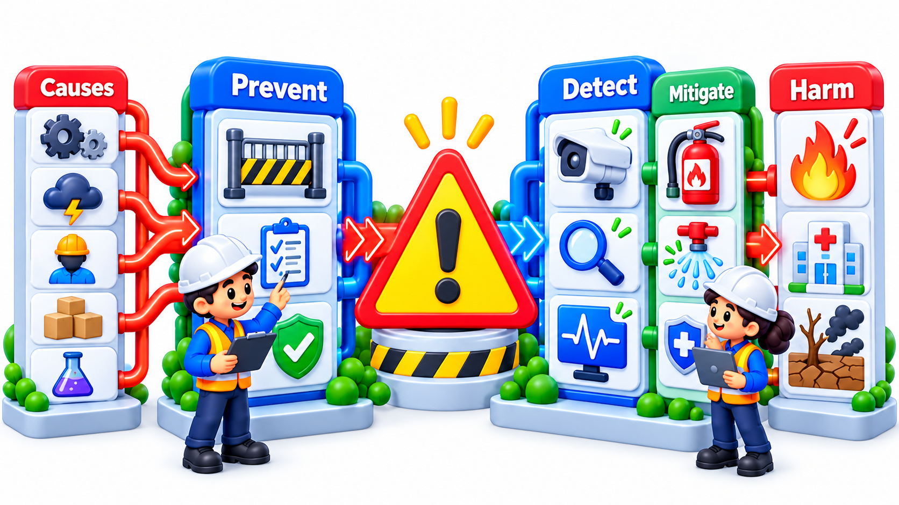
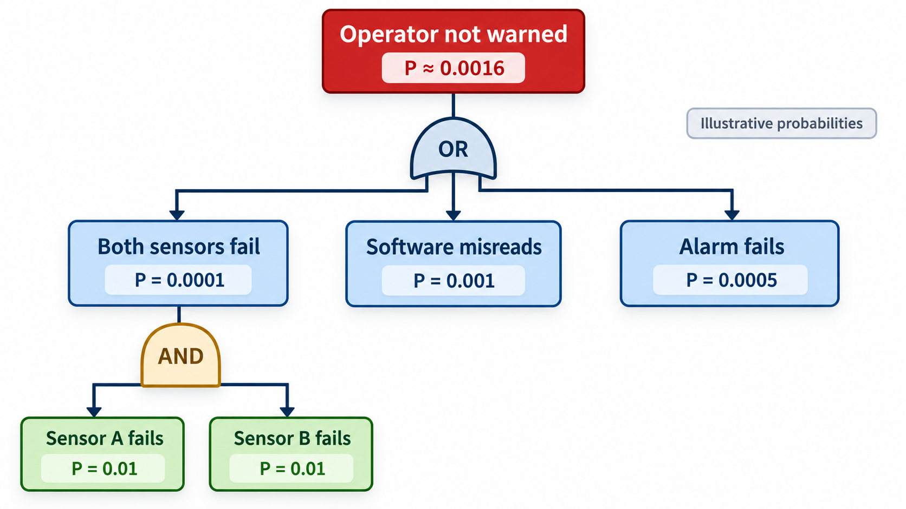
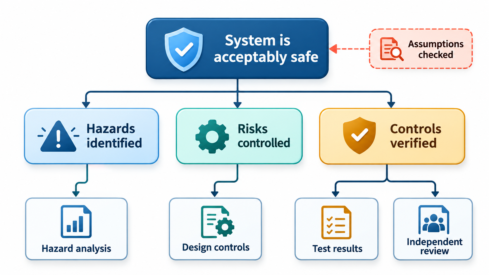
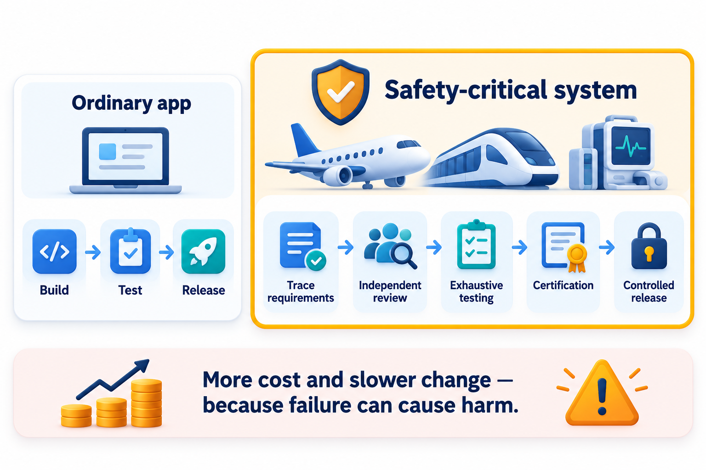

## Reason About Harm Before It Happens

Some software can kill. It runs aircraft, cars, trains, pacemakers, infusion pumps and power plants. In such systems you do not wait for failures to happen and then fix them. You reason in advance about how harm could come about, and you design the system so that it is very unlikely.

One tool for the reasoning starts from the unwanted event, say an accidental launch or a missed alarm, and works backwards: what combinations of failures, of equipment, of people and of software, would be needed to cause it? Draw the answer as a tree with logic gates. This is **fault tree analysis**, devised by H. A. Watson at Bell Telephone Laboratories in 1961 to study the safety of a missile launch system, and it is the mindset of **safety-critical software**: software whose failure could cause death, serious injury, or severe damage to property or the environment. This topic covers how such systems are analysed and built, and why they are held to rules that differ from those of ordinary software.

## Safety Is a Property of the Whole System

A key point is that safety is not a property of software alone. A program on its own harms no one. Harm arises from a *hazard*: a condition of the whole system, including hardware, software, people and the environment, that could lead to an accident. Software is one source of hazards among many. A drug pump delivers the wrong dose because of an error in its code, but also because of a mislabelled vial, a confusing screen or a worn part.

The terms are precise.

- A **hazard** is a potential source of harm: "the pump delivers too much".
- A **risk** combines how likely a hazard is to lead to harm with how severe the harm would be.
- A **safety requirement** is something the system must do (or never do) to control a hazard: "the pump shall stop if the dose exceeds the limit".

The work is to find the hazards, rate the risk of each, decide what controls reduce it to an acceptable level and prove that they do.

| Term | Example for an infusion pump |
| --- | --- |
| **Hazard** | The pump delivers a drug dose ten times too high |
| **Cause** | A units error between milligrams and micrograms in the entry screen |
| **Accident** | The patient is harmed |
| **Severity** | Catastrophic (possible death) |
| **Likelihood** | Must be extremely low before the device is approved |
| **Control** | A hard upper limit on dose in the pump firmware; a confirmation screen showing the dose with its unit |

## Hazard Analysis

The first activity is to look for hazards systematically, early in the design. Several methods are used.

**Preliminary hazard analysis.** Brainstorm what could go wrong, at a high level, from the early description of the system.

**HAZOP (hazard and operability study).** Take each part of the design and apply guide words such as "no", "more", "less", "early", "late", "reverse" to its functions, asking what would happen. "More dose", "no signal", "late reading".

**FMEA (failure modes and effects analysis).** List each component and each way it can fail, the effect of each failure on the whole, and how serious it is.

**Fault tree analysis.** Start from a hazard and work back to its causes, as Watson did.

The results are recorded in a **hazard log**, which tracks each hazard, its rating, the controls and the evidence that they work.

<!-- Visual: the criticality spectrum from minor inconvenience to loss of life. -->

## A Small FMEA

A table in the FMEA style, for a few parts of a pump:

| Component | Failure mode | Effect | Severity (1-10) | Control |
| --- | --- | --- | --- | --- |
| Dose entry screen | User enters wrong unit | Overdose | 10 | Show the unit large; require confirmation; upper limit |
| Motor driver | Stuck on | Continuous delivery | 10 | Independent hardware cut-off |
| Occlusion sensor | Fails to detect a blocked line | No drug delivered, no alarm | 8 | Redundant sensor; periodic self-test |
| Battery | Runs flat | Pump stops | 6 | Low-battery alarm well in advance |
| Display | Shows stale data | Operator misled | 7 | Time stamp; heartbeat check |

The rows with severity 10 get the strongest controls and the most testing. The table is also an ordered list of where review effort should go.

## Fault Trees With Numbers

A fault tree can be given probabilities. At an **AND** gate, all inputs must occur, so their probabilities multiply. At an **OR** gate, any input is enough, so the probability that at least one occurs is one minus the probability that none does. Work one through for the hazard "the operator is not warned of a dangerous condition". It happens if both sensors fail (AND), or the software misreads, or the alarm itself fails (OR).

| Basic event | Probability per demand |
| --- | --- |
| Main sensor fails | 0.01 (1 in 100) |
| Backup sensor fails | 0.01 (1 in 100) |
| Software misreads the sensor data | 0.001 (1 in 1,000) |
| Alarm itself fails | 0.02 (2 in 100) |

| Calculation | Result |
| --- | --- |
| Both sensors fail (AND): 0.01 x 0.01 | 0.0001 |
| Operator not warned (OR of all three paths) | about 0.02108, roughly 2% |
| Same, with an alarm ten times more reliable (0.002) | about 0.0031 |

Redundancy has made the sensor path very unlikely. The sum is dominated by the alarm's 0.02. A ten times more reliable alarm brings the total down to 0.0031. The sensors, for all their doubling, were never the problem. That is the value of the tree: it shows where to spend. An engineer might have added a third sensor, and it would have changed almost nothing.

## Standards and Regulated Domains

Safety-critical industries are governed by standards, and often by law, that say how software must be developed. The common features are a risk-based approach, with the more dangerous the failure, the more rigorous the process, and demands for evidence.

| Domain | Standard (examples) | Notes |
| --- | --- | --- |
| **Aviation** | DO-178C | Five levels of criticality, from catastrophic to no effect; the most rigorous levels require structural coverage and independent verification |
| **Automotive** | ISO 26262 | Automotive Safety Integrity Levels, A to D |
| **Medical devices** | IEC 62304 | Software classes by risk; links to risk management under ISO 14971 |
| **Railways** | EN 50128 | Safety integrity levels 0 to 4 |
| **General** | IEC 61508 | The parent standard for electrical and electronic safety systems |

At the highest levels, the expectations include documented requirements traceable to tests, independent review and testing, formal methods in some cases, restrictions on the language features allowed, thorough coverage measurement and a safety case.

<!-- Visual: hazard controls layered between a hazard and an accident. -->

## Rigour Scales With Risk

| Level of failure consequence | Typical effort |
| --- | --- |
| Inconvenience | Normal good practice |
| Minor injury or limited loss | Added reviews and test coverage |
| Serious injury | Hazard analysis, independent testing, traceability |
| Loss of life of one or a few | Full standard compliance, structural coverage, independent verification |
| Catastrophic, many lives | The highest rigour: formal methods, diverse redundancy, safety case reviewed by a regulator |

The higher levels cost many times more per line of code, which is why they are kept for the parts that need them.

## Design Principles for Safety

A few design ideas recur.

<!-- Visual: a small fault tree with the top event "operator not warned", an OR gate leading to "both sensors fail" (an AND gate over two sensor boxes), "software misreads" and "alarm fails", with the probability beside each box. Save as images/139_fault_tree.png. -->

- **Keep it simple.** Complexity breeds faults. Safety-critical code uses a restricted subset of the language and avoids dynamic memory and recursion.
- **Fail safe.** When something goes wrong, move to a safe state: a train stops, a valve closes.
- **Defence in depth.** Several independent layers of protection, so no single failure causes harm. Hardware interlocks that do not depend on software are the classic last line.
- **Redundancy with diversity.** Duplicate critical functions, preferably using different designs, so that one common bug does not defeat both.
- **Isolate the critical part.** Keep safety functions separate from the rest, so a fault in the entertainment system cannot affect the brakes.
- **Plan for human error.** Design interfaces so that mistakes are hard to make and easy to notice.

## The Safety Case

A **safety case** is a structured argument, backed by evidence, that a system is acceptably safe for its intended use. It states claims ("the pump will never deliver more than the limit"), the arguments for them (the control design, the tests, the analysis) and the evidence (test results, review records, proofs). A regulator or independent assessor examines it. The discipline is that safety must be *demonstrated*, not merely asserted.

| Part of a safety case | Example for the pump |
| --- | --- |
| **Claim** | The pump cannot deliver more than the programmed limit |
| **Argument** | Limit enforced in firmware and independently in hardware; software verified to the highest class |
| **Evidence** | Test reports, structural coverage results, independent review records, hazard log entries |
| **Assumptions** | Staff are trained; the vial label standard is followed |
| **Residual risk** | Remaining risks and why they are acceptable |

<!-- Visual: controls in safety-critical systems: traceability, independent review, exhaustive testing and certification as four stacked layers. -->

