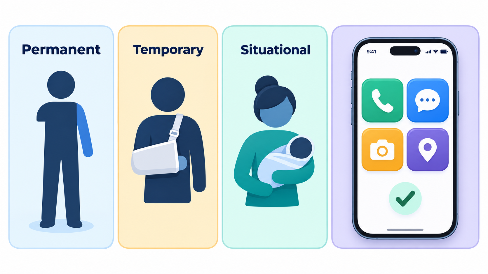
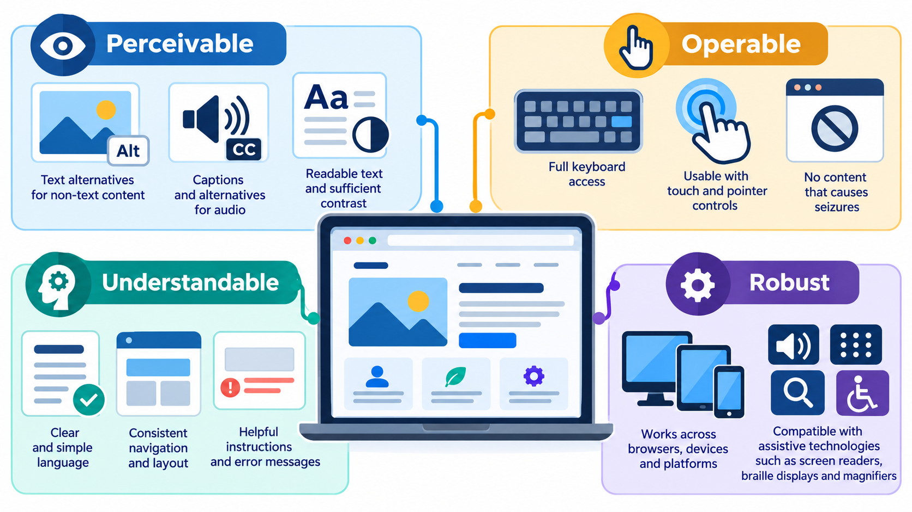
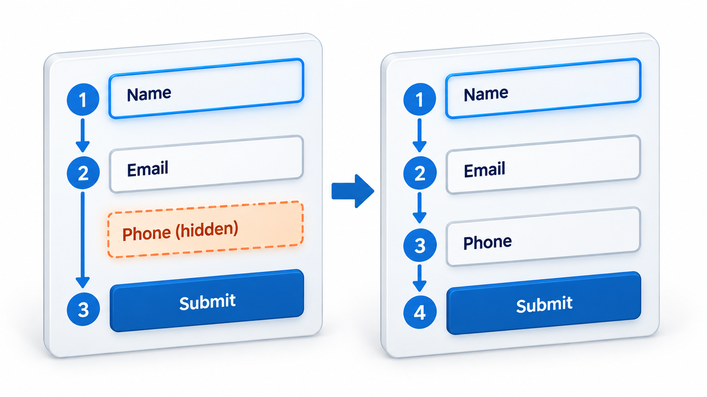
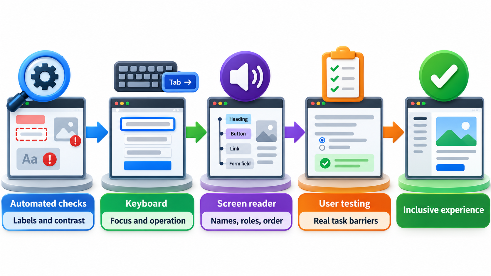
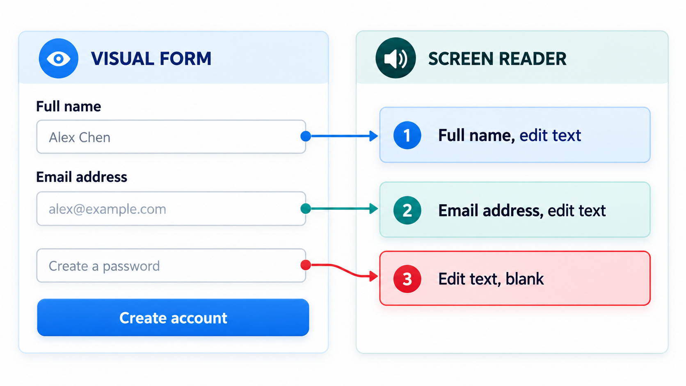

## Software That Works for Everyone Who Needs It

Some people use software with a screen reader because they cannot see the screen. Others cannot use a mouse, cannot distinguish certain colours, have low vision, are deaf, are in bright sunlight, or have one hand free. A button with no label that a screen reader can read, or a form that cannot be completed by keyboard, locks these people out. Courts and laws in many countries now treat that as a failure to provide a service, not a mere inconvenience.

Whether a person can use your software is a requirement, often a legal one, and not a courtesy. **Accessibility** is the practice of building software that people can use whatever their abilities and circumstances. This topic covers the main standard, the techniques that deliver it and how to test it.

## Who Is Affected

A common mistake is to think of accessibility as being about a small group. Disabilities include visual (blindness, low vision, colour blindness), hearing (deafness and hearing loss), motor (difficulty using a mouse or touch screen, tremor, paralysis) and cognitive (dyslexia, attention and memory differences). Together they affect hundreds of millions of people. Conditions can also be *temporary* (a broken arm) or *situational* (bright sunlight on a phone screen, a noisy train, one hand holding a baby). Features built for permanent needs help everyone: captions are used by people in noisy places, and keyboard shortcuts by anyone who prefers speed.

| Need | Permanent | Temporary | Situational |
| --- | --- | --- | --- |
| **Using one arm** | Amputation | Broken arm | Holding a baby |
| **Seeing the screen** | Blindness, low vision | Eye infection | Glare in sunlight |
| **Hearing** | Deafness | Ear infection | Noisy train, sound off in a meeting |
| **Understanding text** | Dyslexia, a language barrier | Tiredness | Reading in a second language, under stress |
| **Fine motor control** | Tremor | Injury | A bumpy bus ride |

<!-- Visual: one-handed interaction serving permanent, temporary and situational needs. -->

## WCAG: Four Principles

The most widely used standard is the **Web Content Accessibility Guidelines (WCAG)**, published by the World Wide Web Consortium. Version 2.1 and 2.2 are in common use. Its guidelines are organised under four principles, abbreviated POUR.

| Principle | Meaning | Examples |
| --- | --- | --- |
| **Perceivable** | Information can be presented in ways users can perceive | Text alternatives for images, captions for video, sufficient colour contrast |
| **Operable** | Users can operate the interface | Everything works by keyboard, enough time, no flashing that can cause seizures, clear focus |
| **Understandable** | Information and operation are understandable | Readable text, predictable behaviour, help with input errors |
| **Robust** | Content works with a wide variety of tools, including assistive technology | Valid, well-structured markup |

Each guideline has testable success criteria at three conformance levels: A (basic), AA (the usual target, and the level most laws refer to) and AAA (highest).

<!-- Visual: the perceivable, operable, understandable and robust principles of WCAG. -->

## Contrast You Can Compute

One of the most measurable criteria is colour contrast. Text must stand out from its background by a ratio of at least 4.5 to 1 for normal text at level AA. The ratio comes from a formula based on the relative brightness of each colour, in which green counts most because the eye is most sensitive to it. Applied to four colour pairs:

| Colour pair | Contrast ratio | Level AA (4.5 : 1) |
| --- | --- | --- |
| Black (#000000) on white | 21.0 : 1 | Passes |
| Light grey (#999999) on white | 2.85 : 1 | Fails |
| Dark grey (#595959) on white | 7.0 : 1 | Passes |
| White on a pale blue (#5DADE2) | 2.46 : 1 | Fails |

Black on white gives the maximum, 21 to 1. Light grey text on white, a fashionable choice, fails. White text on a pale blue button scores 2.46 and fails, though it looks acceptable to many designers. A slightly darker grey, #767676, is the lightest grey that just passes on white (4.54). The check is a number and not an opinion, so it can be built into design tools and automated tests. A designer with good eyesight cannot judge by looking: the failing pairs look readable on a good screen in a dark room, and are not for a person with low vision or on a phone in sunlight.

## Building It In

Most accessibility comes from doing ordinary web development properly.

- **Semantic markup.** Use the right element for the job: a `<button>` for a button, a heading tag for a heading, a `<label>` tied to each form field. Assistive technology relies on these meanings. A `
` styled to look like a button tells a screen reader nothing.
- **Text alternatives.** Every meaningful image has a short description in its `alt` attribute. Decorative images are marked to be skipped.
- **Keyboard operation.** Every function works without a mouse, in a logical order, with a visible indication of where the focus is.
- **Contrast and colour.** Meet the ratios, and never use colour as the only way to convey information (an error shown only in red).
- **Captions and transcripts** for audio and video.
- **Clear forms.** Labels, instructions, and error messages that say what went wrong and how to fix it.
- **Resizable text** and layouts that adapt to small screens and zoom.
- **ARIA attributes** to add meaning where plain markup falls short, used sparingly: the first rule of ARIA is to use a native element if one exists.

| Poor practice | What a user experiences | Better practice |
| --- | --- | --- |
| An image of a chart with no alt text | A screen reader says "image" and nothing more | Alt text stating the key finding, plus a data table |
| A styled box that acts as a button | Keyboard users cannot reach it; screen readers do not announce a button | A real button element |
| Error shown only by a red border | Colour-blind users miss it | An icon and a text message as well as colour |
| A form field with placeholder text only | The label vanishes when typing; screen readers may skip it | A visible label tied to the field |
| A video with no captions | Deaf users miss the content | Accurate captions and a transcript |
| Links that say "click here" | Out of context, meaningless to a screen reader list | Link text that says where it goes |

<!-- Visual: logical keyboard focus order making an interface operable without a mouse. -->

## Testing for Accessibility

No single test is enough. A good approach combines several.

- **Automated checks.** Tools such as axe, Lighthouse and WAVE scan pages for detectable problems: missing alt text, low contrast, missing labels. They catch perhaps a third to a half of issues, and they run in the build pipeline.
- **Keyboard testing.** Put the mouse aside and try to use the page. Can you reach and operate everything? Is the focus visible?
- **Screen reader testing.** Use NVDA or VoiceOver, or TalkBack on a phone, and listen to the page. Does it make sense?
- **Zoom and reflow.** Enlarge text to 200 per cent, and check that nothing breaks.
- **Testing with real users** who have disabilities. Nothing replaces their experience.

Accessibility, like security, is cheapest when it is part of the design from the start. Retrofitting means redoing structure.

| Method | Finds | Misses | Effort |
| --- | --- | --- | --- |
| Automated scan | Missing alt text, low contrast, missing labels | Whether alt text is meaningful; logical order | Minutes; run on every build |
| Keyboard-only pass | Unreachable controls, lost focus | Screen reader issues | Minutes per page |
| Screen reader pass | Poor announcements, bad structure | Some visual issues | Longer; needs practice |
| Zoom and small screens | Broken layouts | Others | Minutes |
| Users with disabilities | Real obstacles, in real tasks | Nothing a scan or pass could catch, but costs the most | Planned sessions |

<!-- Visual: a form with three fields, shown as a sighted user sees it and as a screen reader announces it, with a missing label causing the reader to say only "edit text, blank" for one field. Save as images/140_screen_reader_view.png. -->

## The Law and the Case for Doing It

Accessibility is increasingly a legal duty. Many countries have laws, such as the Americans with Disabilities Act in the United States (applied by courts to websites), the European Accessibility Act, and India's Rights of Persons with Disabilities Act, which require public services and, in many cases, commercial ones to be accessible. Most refer to WCAG at level AA. Beyond legal risk, accessible products reach more customers, work better on small screens and with voice control, rank better in search engines (because structure helps machines too), and are simply better built.
