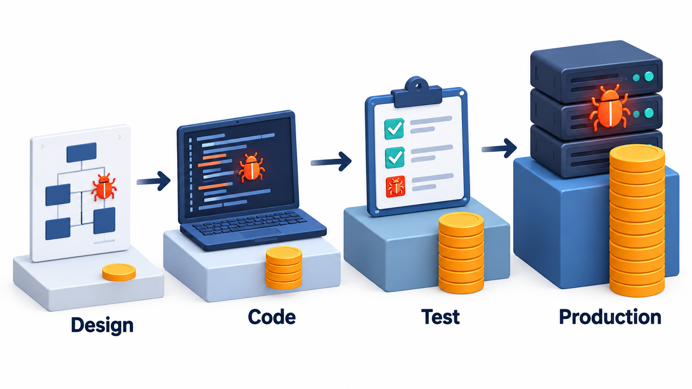
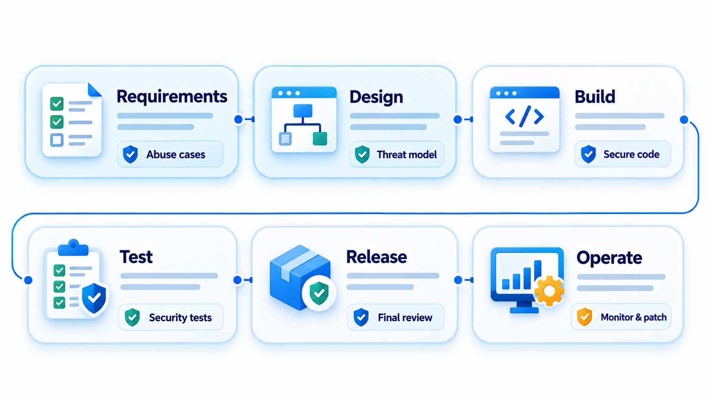
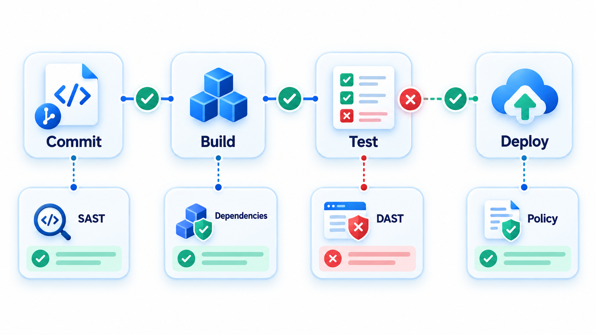
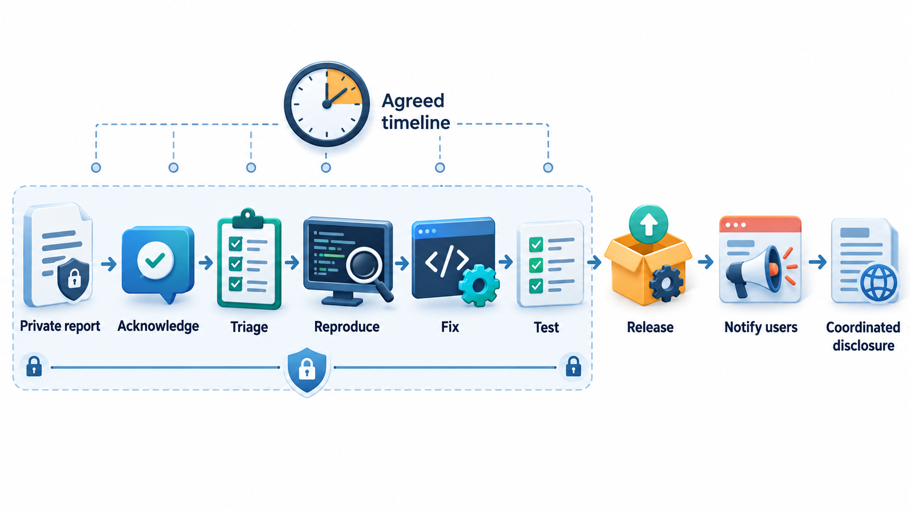
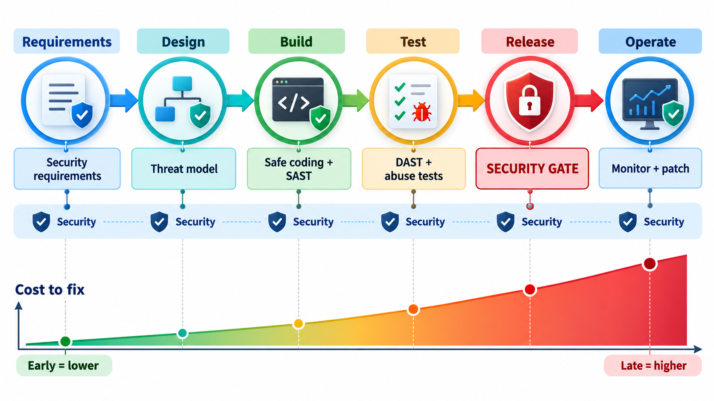

## Security Cannot Be a Final Inspection

Security cannot be a final inspection. The instinct, when attacks multiply, is to bolt on a security review just before release. It does not work, because flaws are created in requirements and design as well as in code, and by the end it is too late to change either. Organisations that improved did it by putting a security activity into every phase of development and training everyone who writes code.

That is the **secure development life cycle** (SDL): security requirements, threat modelling at design, secure coding rules, scanning and testing before release, and a plan for responding after. This topic lays out what that means in practice.

## Security Built in, Not Bolted On

Before the SDL, the common pattern was to build a product and then, near the end, hire a team of testers to attack it. Whatever they found was patched, if there was time. This approach has two problems. It finds only some flaws, since a design with a fundamental weakness, such as passwords stored in readable form, cannot be rescued by testing. And it finds them late, when fixing is expensive.

The alternative is called **shifting left**: moving security activities to the earlier stages of the life cycle, to the left on a timeline running from requirements to release. A flaw prevented in a design costs a conversation. The same flaw found after release costs an emergency patch, an investigation and perhaps a notification to customers.

| Stage where a flaw is found | Typical relative cost |
| --- | --- |
| Requirements or design review | 1 |
| Coding (static analysis, peer review) | 5 |
| Testing | 10 |
| After release | 30 to 100 |

The ratios are rough, and the direction is consistent: the later a security flaw is found, the more depends on it and the more it costs.

<!-- Visual: finding a security defect earlier sharply reduces its cost. -->

## A Real Case: The Company That Stopped to Fix Security

In 2001 and 2002 the Windows operating system and other widely used Microsoft products were hit by fast-spreading worms with names such as Code Red and Nimda. They exploited flaws that had often been fixed already but not applied, and some were flaws nobody had looked for. Customers, including governments and large businesses, began to lose confidence. In January 2002 the company's chairman, Bill Gates, wrote a memo to all staff, titled Trustworthy Computing, which said that security was to come before new features.

The company then did something unusual. It stopped feature work on major products for weeks, and thousands of engineers were trained in how attackers think and how to write safer code. Teams reviewed existing code for flaws. And over the next two years the company wrote down a process, which it called the Security Development Lifecycle, that put a security activity into every phase of development: requirements, design, implementation, verification and release, and response after release. Other companies adopted similar approaches.

The change was not one clever tool. It was a change of routine, applied to everyone.

| Phase | Typical security activity |
| --- | --- |
| Requirements | State the security needs and decide what must be protected |
| Design | Model the threats and design out the risks found |
| Implementation | Follow secure coding rules and use approved libraries |
| Verification | Review the code, run analysis tools and attack the system on purpose |
| Release | Final security review, and a plan for responding to reports |
| After release | Handle vulnerabilities and learn from each one |

A secure development life cycle is the shape that results from taking security seriously as a process rather than as a final check. This topic describes the activities and the reasoning behind them, and why fixing a flaw at the requirements stage is far cheaper than fixing it after release.

## Security Activities in Every Phase

| Phase | Security activities |
| --- | --- |
| **Training** | Developers learn secure design and coding, common vulnerabilities and how to respond to them |
| **Requirements** | Identify what must be protected and the rules that apply (laws, standards). Write **security requirements** as testable statements: "passwords are stored using a slow salted hash", "failed logins are limited to five per hour" |
| **Design** | Review the architecture for weaknesses; do **threat modelling** to find how it could be attacked; apply design principles such as least privilege, defence in depth and fail-safe defaults |
| **Implementation** | Follow secure coding standards; use approved libraries; run static analysis and secret scanning on every change; peer review with security in mind |
| **Verification** | Dynamic testing, fuzzing, dependency scanning, penetration testing |
| **Release** | Final security review; incident response plan ready; sign-off |
| **Operation and response** | Monitor, patch quickly, handle reports of vulnerabilities, learn from incidents |

The point of the table is the whole: security as a thread running through every phase, and not one activity in one place.

<!-- Visual: security activities integrated throughout the software development lifecycle. -->

## Writing Security Requirements

Vague wishes such as "the system must be secure" cannot be built or tested. Good security requirements are specific and verifiable.

| Vague | Testable |
| --- | --- |
| "Protect passwords" | "Passwords are stored only as salted hashes made with a slow algorithm; no plaintext appears in logs" |
| "Prevent unauthorised access" | "Every request to a student's record checks that the requester is that student or an authorised staff member" |
| "Be safe against attacks on login" | "After five failed attempts in ten minutes the account is locked for fifteen minutes and the owner notified" |
| "Protect personal data" | "Personal data is encrypted at rest and in transit; access is logged" |
| "Handle errors securely" | "Error messages shown to users contain no internal details such as file paths or query text" |

Each of these can be turned into a test, which is the sign of a usable requirement.

## Gates: Making It Hard to Skip

Good intentions fade under deadline pressure, so mature teams turn security activities into **gates**: conditions that must be met before work moves on. A release cannot go out until the threat model has been reviewed, the scans are clean and the tests have passed.

| Phase | Required security activity | Done? |
| --- | --- | --- |
| Requirements | Security requirements written | Yes |
| Design | Threat model reviewed | Yes |
| Code | Static analysis and secret scan clean | Yes |
| Test | Dependency scan and security tests passed | No |
| Release | Incident response plan ready | Yes |

Release is blocked until the test phase is complete. A gate like this works best when it is automated, not left to someone's memory: the pipeline checks the scan results and refuses to proceed if they are missing. The gate also settles an argument in advance. When the deadline arrives, nobody has to decide whether to skip the scan. The rule was agreed earlier, in calm conditions, and the pipeline applies it.

## DevSecOps: Security in the Pipeline

In teams that release often, security activities are woven into the continuous integration and delivery pipeline. This approach is called **DevSecOps**: development, security and operations as one flow. On every change the pipeline runs secret scanning, static analysis for insecure code patterns, a check of dependencies against lists of known vulnerabilities and, in later stages, dynamic tests and scans of container images. Findings appear in the developer's normal workflow, as comments on the pull request, and not as a report from a distant team weeks later. Fast feedback is what makes the practice effective.

| Check | Runs | Finds |
| --- | --- | --- |
| Secret scanning | On commit | Passwords and keys in code |
| Static analysis (SAST) | On every pull request | Insecure code patterns |
| Dependency scanning | On every build | Libraries with known vulnerabilities |
| Container image scanning | When an image is built | Vulnerable packages in images |
| Dynamic testing (DAST) | Against a test deployment | Flaws visible only when running |
| Infrastructure checks | On changes to infrastructure code | Open ports, public storage, weak settings |

<!-- Visual: automated security gates across a delivery pipeline. -->

## Secure Design Principles

A handful of design principles, set out by Saltzer and Schroeder in 1975, are still the basis of secure design.

- **Least privilege.** Every user and program gets only the access it needs, no more.
- **Defence in depth.** Several independent layers of protection, so one failure does not expose everything.
- **Fail-safe defaults.** Access is denied unless explicitly granted. When something fails, it fails closed.
- **Economy of mechanism.** Keep it simple. Simple code has fewer places for flaws to hide.
- **Complete mediation.** Check every access, every time. Do not cache a permission decision.
- **Open design.** Security should not depend on keeping the design secret. Keys are secret. Algorithms are public.
- **Separation of privilege.** Require more than one condition for sensitive actions.
- **Psychological acceptability.** If security is a nuisance, people will find ways round it.

## Handling Vulnerability Reports

After release, researchers and users will find flaws. A secure life cycle has a way to receive and act on their reports.

| Element | Purpose |
| --- | --- |
| **A security contact** (a published address) | Researchers know where to report |
| **A disclosure policy** | States how reports are handled, and promises not to pursue good-faith researchers |
| **Triage and severity rating** | Decide how urgent each is (a common scale is CVSS) |
| **A fix and a coordinated release** | Patch is ready before details are made public |
| **An advisory** | Tells users what is affected and what to do |
| **Recognition** | Credit, or a bug-bounty payment, encourages reports |

## People and Culture

A process works only if people use it. Training matters. So do **security champions**, developers in each team who take a particular interest and help colleagues. A blameless way of treating reported flaws makes people willing to speak. Rewards should favour finding and fixing problems, and not hiding them. And leadership has to mean it: the Microsoft change began with a chairman's willingness to delay features.

<!-- Visual: a timeline from requirements to operation with a security activity attached to each phase and a gate marker before release; below it a cost bar that is small on the left and large on the right. Save as images/141_security_in_every_phase.png. -->

