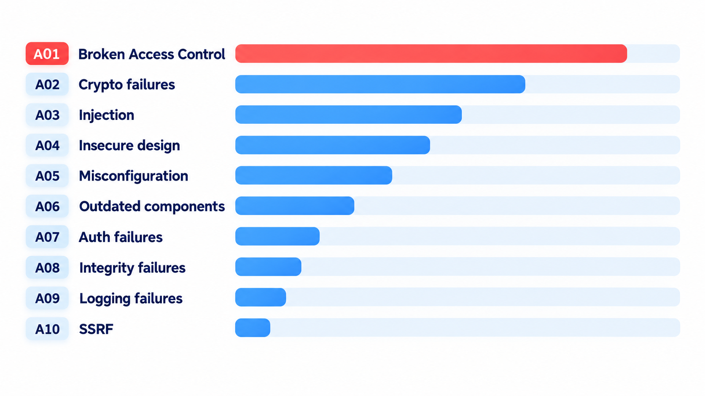
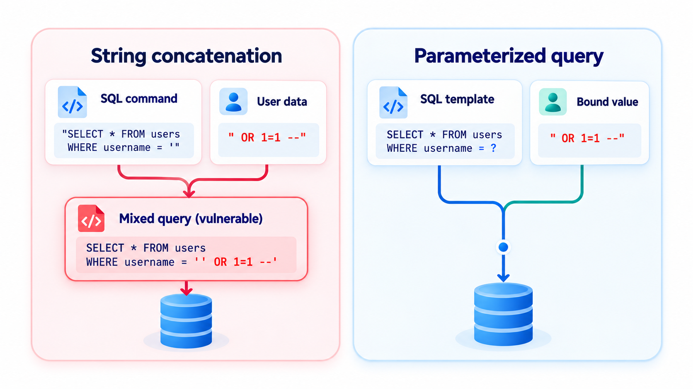
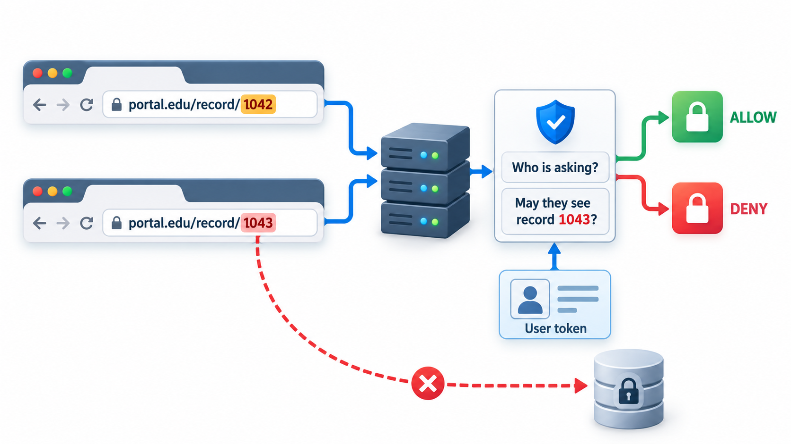
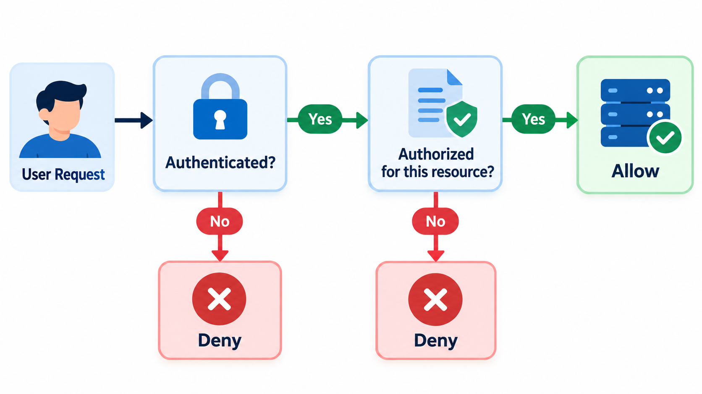
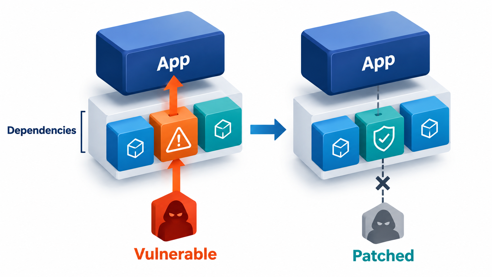

## A Short List of Familiar Mistakes

When a website is broken into and customers' details are taken, the technique is rarely exotic. It is far more often an old, documented and preventable weakness, sitting in software that nobody kept up to date or checked properly.

Most software vulnerabilities are a short list of familiar mistakes, repeated in thousands of programs. Knowing the list is the first defence, and that is why the security community maintains one. This topic covers the **OWASP Top 10**, the most widely used catalogue of web application risks, and a few of its main entries in detail, beginning with injection.

## The OWASP Top 10

The Open Worldwide Application Security Project (OWASP) is a non-profit community that publishes free material on application security. Its best-known document, the Top 10, is a ranked list of the most serious categories of web application risk, updated every few years from data contributed by security firms and from surveys. The 2021 edition placed these categories, in order:

| # | Category | In plain words |
| --- | --- | --- |
| 1 | **Broken access control** | Users can do or see things they should not |
| 2 | **Cryptographic failures** | Sensitive data is not protected, or weakly protected |
| 3 | **Injection** | Untrusted data is interpreted as commands (SQL, OS, scripts) |
| 4 | **Insecure design** | Flaws in the design itself, not the code |
| 5 | **Security misconfiguration** | Default passwords, open ports, verbose errors, unneeded features on |
| 6 | **Vulnerable and outdated components** | Using libraries with known flaws |
| 7 | **Identification and authentication failures** | Weak passwords, broken login, session problems |
| 8 | **Software and data integrity failures** | Trusting unverified updates, code or data |
| 9 | **Security logging and monitoring failures** | Attacks happen and nobody notices |
| 10 | **Server-side request forgery** | The server is tricked into making requests for an attacker |

The list is not a rule book. It is a prompt for awareness and a way of structuring review. Notice that the top entry, broken access control, was found in a large majority of the applications tested, and that injection, once first, has slipped as frameworks protect against it by default.

<!-- Visual: the OWASP Top 10 categories with broken access control highlighted. -->

## A Real Case: A Fix That Was Never Applied

In the 2017 breach of the credit-reporting company Equifax, which exposed the records of about 147 million people, the entry point was a known flaw in a widely used web framework. A fix had been published two months earlier and had not been applied to one forgotten system.

## Injection: Data Treated as Commands

Injection flaws happen when a program builds a command out of text that includes input from a user, and the user's input is interpreted as part of the command. The classic is SQL injection. A login query is built by gluing the user's name and password into a string. A user who types a specially crafted password changes the meaning of the query: a password written so that the condition "this is true" is added to the check, which is always satisfied. Take a table of two students and their passwords.

| Login attempt | Query built by gluing strings | Query with placeholders keeping data separate |
| --- | --- | --- |
| Honest: asha with the right password | Returns Asha, as it should | Returns Asha |
| Attacker: asha with a crafted password | Returns every row, both Asha and Ravi: the attacker is in without knowing a password | Returns nothing |

The glued query treats everything the user types as text to paste in, so the crafted password becomes part of the command. The safe version marks where the values go and passes the values separately, so the database treats them purely as data and never as part of the command. The fix is a habit, not a clever trick: never build commands by joining strings with user input. Use parameterised queries or a library that does. The same principle applies to operating system commands, directory lookups and others.

<!-- Visual: A parameterised query keeping the command separate from user data. -->

## How an Injection Plays Out

Following the attack step by step shows that nothing clever is needed.

| Step | What happens |
| --- | --- |
| 1 | The login page asks for a name and a password |
| 2 | The program builds one line of text: "find the student whose name is X and whose password is Y" |
| 3 | The attacker types a name of "asha" and, as the password, text that closes the quotation and adds "or 1 equals 1" |
| 4 | The finished line now reads: "find the student whose name is asha and whose password is nothing, or where 1 equals 1" |
| 5 | The second condition is always true, so every row matches |
| 6 | The program takes the first row returned and logs the attacker in |

The root cause is that the program could not tell where the author's command ended and the user's data began. Placeholders restore that boundary.

## Broken Access Control

This is the most common serious flaw. **Authentication** asks who you are. **Access control** (authorisation) asks what you are allowed to do. Flaws appear when the second check is missing or wrong. A student changes the number in the web address from student 1042 to student 1043 and sees someone else's fees. A normal user opens an admin page by typing its address. The server trusted the client and did not check that this user may see this record.

The defences are simple to state: check authorisation on the server, on every request, for every record; deny by default; do not rely on hiding links or on the client's choices. Testing should try to do things as the wrong user.

<!-- Visual: a web address with a student number highlighted and an arrow changing it to another number, then a server with a question mark "who is asking, and may they see record 1043?" and a padlock. Save as images/142_changing_the_number.png. -->

| Flaw | Example | Defence |
| --- | --- | --- |
| **Insecure direct object reference** | Changing the student number in the address from 1042 to 1043 shows another record | Check the user owns or may view the record |
| **Missing function-level check** | A normal user visits `/admin/users` | Authorise every sensitive function server-side |
| **Privilege escalation** | A user edits a hidden form field saying the role is admin | Never take roles from the client |
| **Forced browsing** | Guessing the address of an unlinked page | Deny by default; authorise each request |
| **Token tampering** | Editing a cookie or token to change the user | Sign and verify tokens on the server |

<!-- Visual: A request passing through authentication and then authorisation checks. -->

## Memory-Safety Bugs

A different family afflicts programs written in languages such as C and C++, which let programmers manage memory by hand. A **buffer overflow** writes more data into a block of memory than it can hold, overwriting what lies next to it, and an attacker may be able to use that to run their own code. Heartbleed, a 2014 flaw in a widely used encryption library, was a related fault: a read past the end of a buffer, which let attackers read secrets from servers' memory. A **use-after-free** uses memory after it has been released. Studies by Microsoft and Google have found that roughly 70 per cent of the serious security vulnerabilities in their large C and C++ code bases were memory-safety problems. That finding has led to a move towards memory-safe languages such as Rust, Go, Java and Python for new code, and to tools such as sanitizers and fuzzers for existing code.

## Other Important Entries

**Cross-site scripting (XSS)** lets an attacker put a script into a page that other users view. It belongs with injection, and is prevented by encoding output for the context where it is placed.

**Cryptographic failures** include storing passwords in readable form or with fast hashes, using outdated algorithms, sending data without encryption and mishandling keys.

**Vulnerable components.** The libraries in an application bring their flaws with them. Keep an inventory, and update.

**Insecure design.** A weakness in the plan cannot be fixed by careful coding: an account recovery flow that asks for easily found information, a system that trusts the client for prices. Threat modelling at design time is the defence.

**Logging and monitoring failures.** If an attack is not noticed for months, the damage multiplies. Log security events and watch them.

| Vulnerability | One-line defence |
| --- | --- |
| Injection | Parameterised queries; never join strings into commands |
| Broken access control | Server-side authorisation on every request; deny by default |
| Cross-site scripting | Encode output for its context; use a framework that does it by default |
| Weak password storage | Salted, slow hashes; never plaintext |
| Misconfiguration | Hardened defaults; no default passwords; automated checks |
| Outdated components | Inventory, scanning, regular updates |
| Memory-safety bugs | Memory-safe languages; sanitizers and fuzzing |
| Missing monitoring | Log security events; alert on patterns |

<!-- Visual: an outdated component opening an attack path into an application. -->

## Five Misreadings of Vulnerabilities

**"Attackers use sophisticated new techniques."** Most successful attacks use old, well-known flaws like injection and missing access checks.

**"A firewall protects the application."** A firewall does not understand your application's logic. Many of the flaws above pass straight through it.

**"If the interface hides it, it is protected."** Users can send any request. Check access on the server.

**"We use a framework, so we are safe."** Frameworks remove some risks by default. Misusing them, or disabling their protections, brings the risks back.

**"Memory-safety bugs are only for C programmers."** They are, in the sense that they arise in memory-unsafe languages. Those languages run operating systems, browsers and devices that everyone uses.
