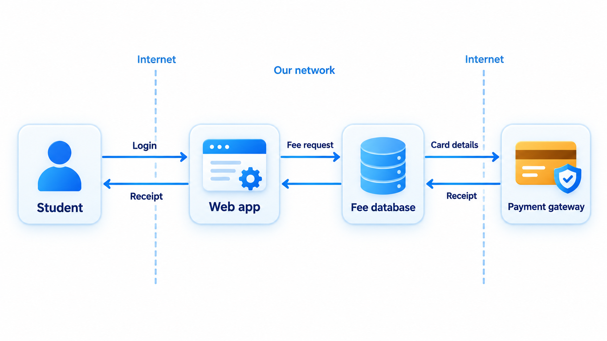
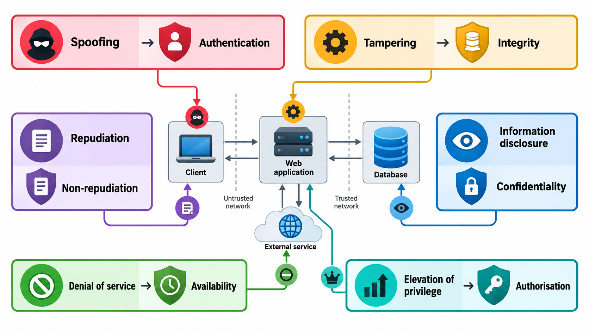
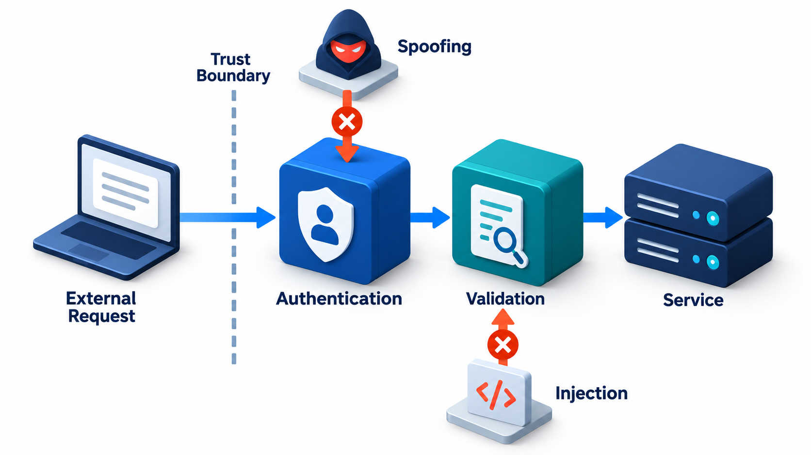
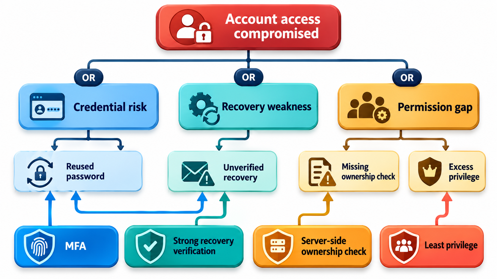
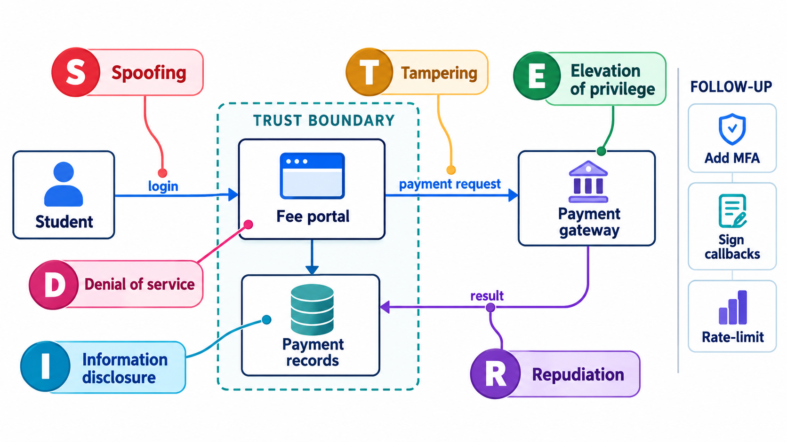

## Think Like an Attacker, but With a Checklist

"Think like an attacker" is good advice and hard to act on. What does it mean in practice for a team of ordinary developers building a feature next week? The answer is a simple checklist: a way of sorting all the ways a system can be attacked into six types of threat, remembered by the mnemonic **STRIDE** (spoofing, tampering, repudiation, information disclosure, denial of service, elevation of privilege).

**Threat modelling** is a structured way of thinking about how a system could be attacked, done at design time. It asks four questions: What are we working on? What can go wrong? What are we going to do about it? Did we do a good job? The answers produce a list of threats, each with a decision about how to handle it. This topic walks through a simple form of the process.

The method was developed at Microsoft in the late 1990s, as part of the effort that produced its secure development life cycle. Its great strength is that it can be done on a whiteboard by the people who understand the design, before a line of code exists.

## Step One: Draw What You Are Building

You cannot reason about threats to something you have not described. The standard tool is a **data-flow diagram (DFD)**, a simple picture with four kinds of element.

- **External entities**: people or systems outside your control (a student's browser, a payment gateway).
- **Processes**: your code that does something with data (the web application).
- **Data stores**: where data rests (the fees database).
- **Data flows**: the movement of data between them (the browser sending a payment request).

Then draw the **trust boundaries**: lines where the level of trust changes. The border between the internet and your servers is one. The border between the web tier and the database is another. Threats cluster at these lines, because data that crosses one cannot be assumed to be safe on the other side.

| Element | Fee portal example | Symbol convention |
| --- | --- | --- |
| External entity | Student's browser; payment gateway | Rectangle |
| Process | Web application; receipt generator | Circle |
| Data store | Fees database; audit log | Two parallel lines |
| Data flow | Payment request; receipt | Arrow |
| Trust boundary | Internet / server; server / database | Dashed line |

<!-- Visual: A data-flow diagram of system components with trust boundaries drawn between them. -->

## Step Two: Find the Threats with STRIDE

STRIDE names six categories, each a violation of a security property.

| Letter | Threat | Property violated | Example |
| --- | --- | --- | --- |
| **S** | Spoofing | Authentication | Pretending to be another student |
| **T** | Tampering | Integrity | Changing the fee amount in a request |
| **R** | Repudiation | Non-repudiation | Denying a payment was made, with no record to prove it |
| **I** | Information disclosure | Confidentiality | Reading another student's marks |
| **D** | Denial of service | Availability | Flooding the site on results day |
| **E** | Elevation of privilege | Authorisation | A student gaining administrator rights |

Not every threat applies to every element. A data store cannot be spoofed in the same way a person can; a person cannot be tampered with. A table of which threats apply to which element types keeps the work manageable. Walk over a four-element diagram and list the threats to consider for each.

| Element | Kind | Threats to review |
| --- | --- | --- |
| Student browser | Person or external system | Spoofing, repudiation |
| Web app | Process (our code) | All six: spoofing, tampering, repudiation, information disclosure, denial of service, elevation of privilege |
| Browser to web app | Data flow (network) | Tampering, information disclosure, denial of service |
| Fees database | Data store | Tampering, repudiation, information disclosure, denial of service |

That is 15 threats to think about for just four elements, a manageable list for a team meeting. Each entry is a prompt: how could someone tamper with the fees database? What would stop them? What would show us it had happened? A real diagram has many more elements, and the same method scales. The tables stop a team from having to invent categories, and from forgetting that data in transit, not only the server, is under attack.

## Example Threats for the Fee Portal

| Threat | Category | How it might happen |
| --- | --- | --- |
| An attacker logs in as a student using a guessed password | Spoofing | No limit on attempts |
| A student edits the amount in the payment request | Tampering | The server trusts the amount sent from the browser |
| A student claims never to have paid | Repudiation | No signed record of the payment |
| A user reads another student's receipt by changing the number in the address | Information disclosure | Missing access check |
| Thousands of requests on results day take the site down | Denial of service | No rate limiting; no capacity plan |
| A student calls an admin-only report page directly | Elevation of privilege | The page checks the menu, not the role |

Every row suggests a control. The second row, for example, is handled by never trusting the amount from the browser: the server looks up the fee itself.

## Step Three: Decide What to Do

For each threat, a team picks a response.

- **Mitigate.** Add a control that reduces it: authentication for spoofing, digital signatures or checksums for tampering, audit logs for repudiation, encryption for disclosure, rate limits for denial of service, authorisation checks for elevation.
- **Eliminate.** Remove the feature or data that creates the threat.
- **Transfer.** Let someone else carry it, as with insurance or a payment provider that handles card data.
- **Accept.** Decide, knowing the risk, to do nothing. This is a legitimate choice if recorded and agreed by the person who owns the risk.

Threats are usually ranked by risk, the likelihood and impact, so that effort goes to the serious ones first. Each mitigation becomes a requirement, a design change or a test.

| Threat | Likelihood | Impact | Rank | Decision |
| --- | --- | --- | --- | --- |
| Edited amount in payment request | High | High | 1 | Mitigate: server looks up the amount |
| Missing access check on receipts | High | Medium | 2 | Mitigate: authorise every request |
| Flood on results day | Medium | High | 3 | Mitigate: rate limits, capacity planning |
| Card details stored | Low (if not stored) | Very high | | Eliminate: use the payment provider's hosted form |
| Student claims non-payment | Low | Low | 5 | Mitigate cheaply: keep payment logs |
| Insider with database access | Low | High | 4 | Accept in part; audit logging and access review |

<!-- Visual: controls at a trust boundary that answer spoofing and tampering threats. -->

## Attack Trees

Another technique is the **attack tree**, popularised by Bruce Schneier in 1999. Like a fault tree, it starts with the attacker's goal at the top, such as "read another student's marks", and breaks it into ways of achieving it, joined by AND and OR. Each leaf can be given a cost, difficulty or probability, which shows the easiest path for an attacker and where a defender's effort is best spent. It is a good complement to STRIDE: STRIDE enumerates threats by system element, and the tree explores one goal in depth.

| Goal: read another student's marks | Path | Difficulty for attacker |
| --- | --- | --- |
| Log in as that student | Guess password | Medium (if no lockout) |
| | Steal password by phishing | Medium |
| | Reuse a password leaked elsewhere | Low |
| Exploit the application | Change the number in the address | Low (if no access check) |
| | Inject into the search box | Low to medium |
| Go around the application | Read the database backup | High (if protected) |
| | Bribe an administrator | High |

The tree shows that the cheapest paths for the attacker are weak passwords, password reuse and a missing access check. Those are where defence should start.

## Step Four: Check Your Work

A threat model is not finished when the meeting ends. It should be written down, kept with the design and reviewed when the design changes. The questions to ask: Did we cover every element and boundary? Is each threat addressed or accepted? Were the controls built and tested? Did new features add threats? A model that is made once and filed away goes stale.

## Making It Work in Practice

Threat modelling has a reputation for being heavy, and it does not need to be.

- **Keep it small.** A one-hour session around a whiteboard, with the people who know the design, finds most of the important issues.
- **Do it early,** when changing the design is cheap.
- **Include diverse people.** Developers, testers, operations and someone with a security mindset each notice different things.
- **Focus on the changes.** For a mature system, model the new feature and the boundaries it touches.
- **Turn results into work.** A threat model with no tickets is a document. One that feeds the backlog is a defence.
- **Think about people too.** Threats include abuse by authorised users and manipulation of staff, not only technical attacks.

<!-- Visual: a whiteboard sketch of a data-flow diagram of a fee portal with a dashed trust boundary, six coloured stickers marked S T R I D E placed on the elements where they apply, and a column of follow-up tasks on the side. Save as images/143_whiteboard_threat_model.png. -->

